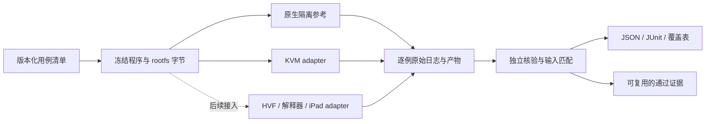

# 自动化 runtime 验收体系

## 目标与边界

同一 runtime 的修复应能回答四件事：原生 Linux 的行为是什么、各 Trames
执行后端是否一致、真实应用的具体流程是否可用、资源与性能是否退化。
构建成功、单元测试成功、程序能启动，都不能替代应用流程通过。

验收工具放在 `tests/acceptance/`，不进入 Cargo 生产依赖、应用启动或
syscall 热路径。ABI/布局/依赖边界仍在构建期检查；执行型验收在独立测试
进程完成。不向 runtime 增加协调器、服务线程、轮询总线或访问屏障。

原生测试使用可销毁 Linux VM。每例独立 rootfs 和 PID/mount/net/UTS/IPC
namespace，设备在私有 mount namespace 绑定，进程退出时释放。KVM 使用同一
不可变 rootfs 的逐例副本。真实应用可使用其原有线程；测试调度进程不属于
生产执行架构。

## 分层验收

| 层次 | 内容 | 现有基础与接入方式 | 通过含义 |
| --- | --- | --- | --- |
| 构建契约 | ABI、布局、依赖、平台选择、真实 pin | 现有边界脚本、C ABI oracle、严格构建 | 可构建且契约一致 |
| 子系统 | 单元、竞态、sanitizer、错误顺序、资源退役 | 复用当前各 crate 测试与专项脚本 | 指定实现不变量通过 |
| Linux 语义 | 原始 gVisor/syscall 用例、原生参考 | 保留 `tests/gvisor` 的 case/XML/归一化逻辑，后续增加 KVM adapter | 指定原生通过用例的行为一致 |
| 真实软件 | 完整文件/压缩/Git/Python/Node/编译流程 | 本批共享 manifest、native/KVM adapter | 这个版本/镜像/流程通过 |
| 生命周期与压力 | 多进程、阻塞、退出、FD/MM/内存/存储压力、重启恢复 | 接现有 performance/integration 脚本，新增长跑 profile | 限定压力与时长下通过 |
| 媒体与性能 | GPU/显示、音频/视频、CPU 时间、分布与资源上限 | 独立硬件能力和同机原生参考，不能由无硬件 job 代替 | 指定硬件与工作负载的验收 |

这些层次分别记账，不把单元测试数量加进软件兼容率，也不把 gVisor 的
原生失败/skip 加进通过分母。首批应用报告是“12 个流程 × 执行配置”，
不是“12 个软件的所有功能已支持”。



## 用例与运行矩阵

首批 `cli.json` 包含 12 个离线工作流：shell 管道、coreutils 文件生命周期、
文本过滤、tar/gzip/bzip2/xz 还原、SHA256/base64、Python 标准库/SQLite、
Python 子进程/socketpair/线程/fork、Git 本地提交/分支/克隆、curl 文件协议、
SSH 密钥公钥还原、Node worker/子进程、GCC/Make 编译与运行。

每例有稳定 ID、domain、tier、完整依赖、脚本、精确 stdout/stderr/退出码、
期限和确定性文件产物。未知 schema 字段会拒绝，不静默忽略新的约束。
随机密钥、PID、时间等不做普遍的字符串抹除；具体测试验证结构或关系，
只比较该用例声明的确定性产物。SSH key 流程不代表 SSH 登录，curl file
流程不代表 HTTP/TLS，Python SQLite 流程不代表数据库全部功能。

运行配置单独记录：原生/执行后端、程序架构、宿主架构/内核/CPU 特性、
实际页大小、libc、worker 数、KVM transport、构建配置和镜像摘要。通用
清单不包含 ARM 寄存器/syscall 号；当前 KVM 能否执行由产品 doctor 实测。
amd64 原生 job 只证明原生参考与工具可移植，不证明 amd64 KVM 后端已实现。

本批实际接入 native Linux 和 Linux KVM（SMCCC/MMIO，1/4 worker）。
HVF、解释器和物理 iPad 的 adapter 仍待接入；应复用现有独立 registry、
rootfs 导入、原始结果导出与 teardown API，不操作用户日常环境。解释器
在 Mac 上的结果不能算物理 iPad 通过。

glibc 与 musl、Debian/Ubuntu 与 Alpine 应使用不同镜像 profile。首批由
已安装的发行版程序构造冻结 bundle，记录所有复制字节、路径、模式、UID/GID、mtime、xattr（包括 capability/ACL）、
链接及宿主包版本。正式验收保存 bundle 本身并按 SHA256 取回（PAX、numeric owner、xattr/ACL 保留；
可信镜像恢复时使用 `sudo tar --same-owner --xattrs --xattrs-include='*' --acls -xf`）；不能假定
未来再次从同名 apt 包准备就能获得相同版本。执行阶段不下载或安装包。

## 结果、证据与门禁

每个配置保留 `plan.json`、`results.json`、逐例 `result.json`、原始二进制
stdout/stderr、声明的实际文件产物；KVM 另保留 doctor 输出与构建凭据。
`report.py` 再独立核对通过项的输入指纹、原始输出、退出码和文件摘要，
生成覆盖表、机器 JSON 与 JUnit。缺少 lane/日志/产物也使门禁失败。

| 状态 | 含义 | 计作通过 |
| --- | --- | --- |
| passed | 退出、输出、产物及原生对照全部匹配 | 是 |
| failed | 断言、进程退出或产物不同 | 否 |
| timed_out | 期限内未结束，终止原进程组 | 否 |
| blocked | 缺少指定程序/前提 | 否 |
| reference_failed | 没有同输入的有效原生通过证据 | 否 |
| infrastructure_error | 构建/隔离/硬件/证据本身失效 | 否 |
| not_run | 已计划但未运行，包括中断后留下的项目 | 否 |

筛选后的运行明确标为 subset，不能覆盖完整计划。原生错误先修夹具；
不能把原生失败解释为 Trames 成功。已知产品缺陷仍保持红色；不增加
默许通过的 xfail，不更改原始第三方断言。原有 gVisor 的严格 XML 判定与
skip/原生失败统计继续保留，不能由应用日志规则替代。

`build.py` 真实执行 argv 构建，比较构建前后的生产输入，记录 runtime/产品/
子模块内容、编译器与配置、实际二进制 SHA256。报告保留源码 commit 和
工作树是否 dirty；带未提交生产改动的记录不能作正式发布验收。不能仅凭
手填 commit 字符串认定二进制来源。

## 按输入复用

复用键包含具体用例内容、完整 rootfs 内容、实际执行程序/构建输入、验收器
语义、宿主能力、worker/transport。只有完整核验的通过结果可复用；失败、
超时、环境缺失、被取消和不完整记录都重跑。复用行保留来源并复制独立日志
与产物，避免上一轮目录删除后只剩一个无法审计的 passed 标签。

文档、报告或等待方式改变不使不相关的生产代码重新受测。用例内容改变
只失效该用例；镜像、runner 字节、解释器/规则或关联能力改变则失效相关
配置。当前以整个 rootfs 内容作为保守边界，镜像改变会重跑该镜像下的
用例，不凭猜测认定新增库不影响动态装载。

已有 `scripts/runtime-ci-reuse.py` 与 gVisor 的内容匹配机制继续有效；统一
目录是复用它们的证据规则，不是复制一套宽松 skip。后续将 domain/能力
映射接入现有变更范围脚本：未知依赖取完整相关层；最终合入/发布保留完整
门禁。长跑/竞态重复次数和性能采样必须作为计划输入，不能用一次旧通过
替代新稳定性/性能采样；本批时间字段明确不作性能验收。

## CI 与实施顺序

1. **本批交付**：共享应用清单、冻结 bundle、真实构建凭据、native/KVM
   adapter、严格证据核验、JSON/JUnit/覆盖表、失败续跑；native 在 Linux
   arm64/amd64 CI，验收器在 Mac/Linux CI。KVM 工作流显式要求真实硬件。
2. **下一批兼容修复**：依据首轮完整矩阵，先修跨软件的普通宿主文件读写
   和 Node 执行异常等共同问题，再按同一清单重跑失败项；保留不受影响证据。
3. **后端与语义接入**：为现有 gVisor 增加 KVM adapter，将已有 HVF/解释器
   证据转换为统一索引；逐步使同一应用清单走 HVF/解释器/iPad。
4. **服务/环境与压力**：本地 HTTP/TLS/SSH 对端、包管理、编译生态、独立
   环境生命周期、资源压力和重复运行。网络用测试私有对端，不依赖公网。
5. **性能/媒体发布门禁**：固定真实设备、热身与重复次数、同机原生基线，
   分别测启动、稳态吞吐/CPU 时间、p50/p95/p99、内存/FD/线程和退出回收；
   嵌套 VM 仅作诊断。GPU/音频/视频由对应真实硬件报告，缺少硬件保持未验收。

调度现状（2026-11-25）：共享验收器与 native 参考会自动跑 hosted CI；
KVM 已能由本地一个入口自动跑完整矩阵。Linux 仓库当前没有注册的 Actions
runner（API 核对为 0），所以新增的 labelled-KVM workflow 还需要接入真实
runner 才能在云端执行；本批没有安装常驻 runner/监听服务。定义 workflow
不算硬件通过。下一步将现有测试 VM 接入专用 runner 池，再配置生产改动
触发、并发与合入/发布状态门禁，保留当前软件缺陷的红色结果。

目标调度：日常 CI 运行受影响的快速层和指定软件 smoke；完整软件/语义矩阵在合入与
发布节点执行。长跑与夜间调度作为后续 CI 策略配置，本批不启动常驻监视
服务，也不自动创建日历/提醒或新的生产线程。

## 本地复现

从 Linux 产品工作树运行（先安装参考程序，使用可销毁测试 VM）：

```sh
python3 runtime/tests/acceptance/harness_test.py
python3 runtime/tests/acceptance/prepare.py --output target/acceptance-bundle
python3 runtime/tests/acceptance/build.py \
  --product . --runtime runtime --binary target/release/trames \
  --receipt target/acceptance-build.json -- cargo build --workspace --release --locked
python3 scripts/validate-applications.py \
  --bundle target/acceptance-bundle --runner target/release/trames \
  --receipt target/acceptance-build.json --output target/acceptance-matrix
```

`--reference DIR` 可使用同输入的原生结果；`--reuse OLD_MATRIX` 仅复用其
严格核验的通过项，其他项继续运行。输出目录必须全新。软件流程有失败时
入口非零退出，但仍汇总其他配置；不能把已生成报告当作验收通过。
