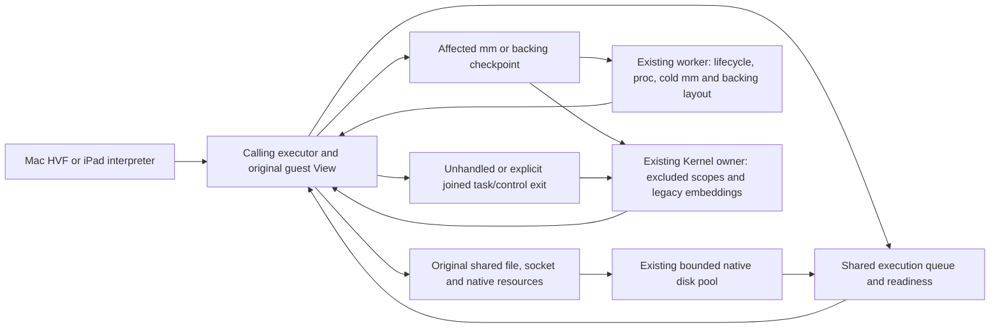

# Coordination and fallback boundaries

This is the consolidated implementation audit through stage 103, one-way source
session completion, reviewed on 2026-11-10. The prior shared runtime baseline is
`287fddcce660276c984b45f2d123562ddf1cccc5`. Mac HVF and the iPad interpreter share
this userspace Linux kernel. Historical stage paragraphs retain their prior
counts; the authoritative current category inventory is below.

## Current status at a glance — 2026-11-10

Stage 103 closes the production terminal lifecycle category. Normal completion,
explicit cancellation/deadline, budget exhaustion and source/backend failure use
one-way completion on existing executors. The host cannot receive an unfinished
guest-operation payload from this protocol. Task/mm/resource retirement and final
network teardown are source work; a busy GPU lease defers its own retirement to
actual resource notifications. Single-CPU product execution uses this same path.
The remaining category count is three. Legacy mutable embedding hooks and generic
execution handoff remain explicit debt, rather than a terminal completion route.
Architecture checks prevent adding new compatibility handoffs or guest dispatch
to terminal completion. See section 103.

Stage 102 unifies the complete original task/mm structural control pipeline:
worker admission, pinning preflight, scoped eligibility, clone/exec group work,
image replacement, mapping/layout admission, bounded native batching and proc
accounting consume one typed Linux ABI classification. Full syscall registers
remain intact for policy and guest visibility. Accepted structural calls cannot
fall between duplicated phase-specific number/command whitelists. io_uring's
whole existing registration control ABI normalizes its unsigned selectors once;
nonpinning controls retain their direct path and cold resource misses retain the
same original-resource scope, including filtered callers.

Stage 101 replaces the full unbound futex-ready stop mechanism. Original tickets
are delivered through the current weak executor binding; existing workers admit
exact cold waits using original nonblocking task/mm custody. Ordinary WAKE,
bitset wake, both requeues and clear_tid from ordinary, fatal and cold exits no
longer stop the cohort. Five production stop sites and their legacy latch are
removed. Source replacement, stopped owner handoff and custody retry retain the
same resource, not a copied task table or new service thread. WAKE_OP now shares
the original guest atomic-update and ordered bucket implementation with solo.
The broad category count remains four; final generic dispatch is still audited.

Stage 100 separates original per-task RSS/mapping observations from global
host/quota accounting as one resource subsystem. The typed proc demand now carries
HostMemory only for global meminfo/full observation; per-task status/stat/statm
and existing mapping reads use their real task/mm resources. A missing optional
Send+Sync host-memory callback no longer rejects those available resources or
forces their open/read/io_uring bodies through joined dispatch. Genuine absent
host-global accounting retains its explicit provider boundary.

Per-task observations no longer sample host-global memory, even when its callback
exists. A host-managed meminfo text observation reads its original host provider
without enumerating tasks, sampling every mm's native residency or constructing
unconsumed CPU/load/process projections. Quota-backed global memory still sums
unique original mm charges; sysinfo still observes its real task/load resources.
Lookup and alias-demand union preserve these dependencies without new byte hooks,
locks, service threads or a cached/stale memory-total publication.

Stage 99 handles the connected io_uring wait/context/lifetime graph as one
batch. Background maintenance, GETEVENTS and CQ poll/epoll use the same original
subscriptions. Accepted nested epoll graphs follow interest revisions; dynamic
socket branches also rebuild when their native set changes. Generic native
interests use stable original allocation identities, with weak identity leases
that cannot delay real endpoint close or UDP binding release. Hubless embeddings
retain fallible native read/write interests for their existing caller wait loop;
absence of HostEvents is no longer absence of a native event capability.

Compatibility capture retains original resolver/factory resources at capture,
not from a later CQ observer. The production worker builder supplies its existing
bindings directly and allocates no redundant compatibility resolver. Future
acceptance refreshes service/signal context; accepted work retains its original
one. Ordinary compatibility byte/file fast paths retain their prior staging
policy. Epoll SQEs can retain the original weak-watch graph without a ring return
ownership edge; directly retaining another ring remains excluded. Final scope
completion releases maintenance subscriptions immediately.

The two maintenance setters remain for actual unavailable typed graph providers
and original bodies that cannot run with their supplied provider. They are not
removed, renamed or converted into fabricated errno/ready results. Four broad
categories and the overall goal remain open. Stage 99 does not establish that
all custom embeddings have live PID/mm observations, or that final dispatch is
unreachable. See section 99 and the paired product validation record.

Stage 97 closes the implemented file-cache advice family, readahead and
fadvise64. Source and solo use one original-stat/type/range/flags body. The caller
queries live original Files once, preserving close/reuse and detached-membership
behavior rather than using a captured FD/type mask. The existing optional hint
policy remains: no speculative disk reads, eviction, data/position update or
resident charge is added. These short calls need no disk task, mapping checkpoint,
service thread or guest-memory access. Missing actual original metadata bindings
retain their before-effects capability boundary.

Stage 96 closes supported msync and its connected mapped-writeback resources.
Source/solo share range/flag import and capture actual original shared backings.
Existing mapped-file admission quiesces only their readers; native sync chains
through the existing disk pool and returns the CPU slot. Pending work retains
original identity through unmap/replacement and executor handoff, uses weak queue
ownership, and completes errors/unwind/shutdown without replaying guest pointers.
Anonymous/private/no-op providers need no job. Deduplication uses original inode
identity, not filesystem-local guest inode numbers. Generic custom providers
without original layout admission retain their actual capability boundary.

Stage 95 closes guest memfd_create on original Files/filesystem resources. The
owned name/flags ABI is shared with solo; native backing creation parks on the
existing disk pool instead of ending the execution cohort. One original FD
reservation and a real unpublished inode enforce live limits. Host allocation
runs outside the filesystem lock; failure/unwind releases both lifetimes. The
same original backing constructor also serves io_uring without keeping that
lock across native I/O. Empty/sparse files retain their existing physical-budget
policy. Neither missing-provider escalation site nor the broad categories is
relabelled as removed.

Stage 94 closes the file-lock execution subsystem: POSIX/OFD range controls,
blocking F_SETLKW/F_OFD_SETLKW, whole-file flock including directory/opaque OFDs,
original accepted ranges, inode notifications and common source/solo deadlock
detection. This corrects stage 93's broad wording about record-lock waits: only
the nonblocking range path was source-owned then; blocking requests and their
process-map deadlock scan still used joined dispatch. Waits now return CPU slots
and use their original inode readiness. The wait graph has weak original edges
and is touched only for contended POSIX waits, not ordinary lock operations.
No new coordinator/resource thread, polling bus or ordinary memory fence is added.

Stage 93 closes residual FD status authority, memfd seal operations and unknown
fcntl command completion on original source resources. F_SETFL checks live inode
ownership and current original fsuid/capabilities, then updates the accepted OFD;
it never re-resolves a reused numeric FD for its asynchronous subscription.
Source and solo share the short-control ABI. GET/ADD_SEALS use the same original
inode body; mapped WRITE-seal flushing uses existing FileWork/disk execution and
returns the CPU slot. Existing dup, lock and async-owner routes remain in place.
Actual absent resource/Files/lock/wait capabilities retain their boundaries;
neither io_uring maintenance escalation site nor the four broad categories is
declared removed.

Stage 92 closes recognized guest-fault delivery on source executors: caught CPU
memory/instruction/trap faults, rejected native entries, precise forced signal
information, frame construction/return and terminal frame failures use original
task signal resources and the existing caller View. Fault delivery and diagnostics
do not end the cohort. Host transport faults remain host failures, and embeddings
without source state retain their actual boundary. Final dispatch still has cold
syscall/native-resource cases; the four broad categories are not declared closed.

Stage 91 completes accepted io_uring bodies against their original sealed
resource context. Cold admission retains the original Files, credentials, fs and
namespace resources, device policy and the original global publication. It never
borrows the current task's Linux or donates a CQ observer's context. Opaque data
OFDs expose only their actual FileWork target, retaining native disk staging and
backing/layout waits. Genuine absent live PID/mm providers and capability-less
embeddings still defer before effects; both maintenance escalation sites remain.

Stage 90 removes legacy global proc/sys publication as an owner-only resource.
Existing set_runtime_info data has one original shared publication; private
resolvers retain that resource, and opened metadata files use common FileWork.
Reads, directory/metadata lookup, existing read-only namespace errors, registered
io_uring requests, links, completion and cancellation use the calling executor.
A later live provider is observed outside the publication lock. Numeric PID/mm
payloads and explicit unavailable providers keep their actual capability checks.
Both io_uring maintenance escalation sites and all four broad categories remain;
this closes a concrete provider dependency, not the full io_uring boundary.

Stage 89 closes the implemented time-observation family: clock_gettime,
clock_getres and gettimeofday use common source/solo ABI bodies on their calling
executor. Realtime vDSO gettimeofday still issues SVC, now completed by that
worker rather than ending the cohort. Wall time remains the original live host
SystemTime; the immutable monotonic calibration is not extrapolated into a stale
wall-clock copy. No clock updater, polling service, resource message or new lock
is added. Four broad categories remain.

Stage 88 closes the residual prctl family: original per-thread comm, parent-death
signal, subreaper, backend SME configuration and canonical unsupported-command
errors execute on the calling worker. Source/solo share the residual ABI; already
migrated credential and seccomp controls retain their existing original resources.
Comm is one bounded original name object, forked by value for every new task and
retained by source execution, proc and diagnostics. Namespace resource changes
preserve its identity; loaded-image publication supplies the actual new image's
name. No live rename requires an owner snapshot refresh. Four broad categories
remain; genuine absent parent/family capabilities and other final dispatch still
retain their explicit boundaries.

Stage 87 closes residual shared-descriptor ioctl discovery/control dispatch.
Ordinary unknown controls, namespace type, virtual render-node discovery and all
implemented network-interface controls use one source/solo ABI. The source keeps
one original shared OFD in its existing sealed resolver; close/reuse cannot
redirect the accepted operation, and unwinding restores its private alias. There
is no pathname/provider scan or guest-visible descriptor installation. PTY job
control and FIONBIO/FIOASYNC retain their existing original-resource execution.
Actual legacy OFDs and missing providers still defer before effects. Filtered
entries retain one accepted policy decision. Four broad categories remain.

Stage 86 admits original Futex/Sleep tasks even when no runnable actor selected
their mm. Their initial queue record has no byte/hardware View. Actual wake,
timeout, signal or control prepares only the original mm on an existing executor;
unrelated executing domains retain their Views. A shared-futex wake/requeue no
longer stops the whole cohort merely to adopt a preexisting cold waiter. Frozen
waiters retain their accepted wake until thaw. Cancellation preserves original
wait identity and can drain an untouched dormant task without preparing bytes.
The queue owns admitted deadlines; stale cold Process projections cannot force
host-control polling. Expiry publishes new preparation scopes before the same
executor claims source work. Capability-less/standalone scheduling, actual initial
admission and the other three broad categories remain. The count is still four.

Stage 85 removes actor-wide io_uring active/revision/legacy-required state.
Maintenance admission, readiness classification, completion, cancellation and
legacy escalation now name the original (mm, task) scope. One scope cannot idle
another or disable its source maintenance. Production Linux clones normally have
separate actors: this closes reuse/embedding and stale-publication dependencies,
not a measured common-workload global-actor bottleneck. The one-origin case uses
one retained scope without a registry lock; secondary origins release their
records after pending work and observers finish. Both real maintenance escalation
sites remain, scoped to their original submitter. Four broad categories remain.

Stage 84 binds accepted io_uring byte resources to the original submitting task,
including solo-imported signalfd requests before their first worker capture.
Foreign CQ observers cannot donate their reader; future context changes affect
only new requests. Original completion, cancellation and lease release remain
source-owned across close/reuse and live-cohort handoff. This closes an original
request-authority prerequisite inside the missing/excluded-resource category;
it does not remove either of its two maintenance setters or reduce the four
broad remaining categories. The overall goal stays active.

Stage 83 separates genuine absent native-event capabilities from original host
backend errors across readiness, TCP/socket/file waits, io_uring enter/CQ poll
and source background maintenance. Creation, descriptor, attach, subscription,
rearm and idle-wait failures retain their host cause. They no longer request an
owner replay or fabricate a guest EIO. The existing source executor stops/drains
its actual CPU actors and cancels accepted requests before returning HostIo.
One original-resource retry still lets a ready/cancelled stale interest finish
without needing a native subscription. Legacy missing capabilities and deferred
request bodies remain explicit; io_uring still has two genuine require_owner
sites for those cases. The overall goal is active.

Stage 82 deletes filesystem-kind-based source deferral. All implemented mount
kinds already retain original synchronized topology, filesystem and inode objects;
the whitelist only excluded mqueue. Its currently supported empty roots, metadata,
directory cursors and namespace operations now use the same original resolver,
including accepted io_uring dirfds. Actual node/provider exclusions remain. This
does not implement POSIX message-queue send/receive or remove the two genuine
io_uring maintenance-failure sites.

Stage 81 removes read-only memory observation from joined or mapping-checkpoint
execution. get_mempolicy, mincore and implemented non-discard madvise share one
source/solo ABI. Admitted Views observe original mapping extents, reservation
intervals and shared resident charges without loading pages or constructing byte
actors. Only actual discard/mapping changes keep their original mutation scope.

Stage 80 removes supported guest halt/poweroff from joined syscall execution.
Source and solo use one authority/magic/command/namespace policy. The original
root publication retains its actual thread-group control; later dispatch and
child/image admission cannot resolve a different numeric PID 1. Source requests
root/caller group exit through existing original lifecycle resources. Actual
CPU return, cancellation and backend/session teardown keep their necessary scope.

Stage 79 removes supported `sysinfo` execution and live system-accounting
refresh from joined control. Source/solo share one AArch64 ABI. The original
proc directory, unique mm residency reports, original host-memory callback and
shared load sample provide the data; no copied task-table provider is introduced.
Active CPU/task time is observable before its assignment returns. Load and idle
no longer depend on the drive loop refreshing a projection. Missing real
statistics/host capabilities retain their explicit legacy boundary.

Stage 78 removes live host pause/resume from joined execution. One original
cohort flag is shared by its domains and the existing dispatch queue. Original
execution leases interrupt running CPUs and reject late entry; no extra
per-instruction or ordinary memory check is added. Original jobs/Views, pending
I/O and translations remain retained. Existing workers can finish accepted
backing/lifecycle work, while scoped mapping batches cannot run guest
instructions. Resume preserves actual guest/group/mapping stop policy and starts
only required original CPU slots. Actual cancellation and final teardown remain.

Stage 77 closes native special-device pathname/OFD execution and Bridge
bytes/readiness through original shared resources. Original device availability,
namespace and credentials remain live; accepted bytes and waits retain their OFD
identity. The Bridge protocol retains its original broker mutex and limits,
notifies original readiness after unlocking, and exposes pure queue observation.
No new coordinator, resource thread, polling bus, global native-call lock or
ordinary guest-memory check/fence is introduced. io_uring's two genuine
maintenance-failure setters and the final dispatch fallback remain. The overall
coordinator-removal goal is active.

Stage 76 moves host imports/exports, conditional editor saves and timezone work
to the existing disk pool and original namespace/inode/backing resources. Actual
mapped dependants still quiesce; unrelated workers keep executing. Explicit pause
can drain accepted disk/backing work without resuming guest execution. Original
conditional replacement, metadata, quota, cancellation and old-OFD rules remain.

Stage 75 removes the Mac memory-pressure reclamation join. The existing host
adapter advances a finite original-Machine request in bounded batches while
vCPUs continue. Each step scans at most 64 mapping records and deactivates an
8 MiB batch rounded to original physical extents. Native host byte leases retain
their existing gate/readiness; pending pressure waits do not rescan them without
release. Normal pressure cancels the request. No worker/resource thread, polling
bus, global native-call lock or ordinary guest memory fence is added.

This is one-shot reclamation of live stage-two bindings, not a persistent RAM
quota or a claim about host RSS. Refaults retain the original bytes and may grow
the working set again. The optional explicit resident target keeps its own
existing policy and now observes the live shared mapping counter. The common
Linux/iPad Rust code is unchanged; this mechanism is isolated in the Mac backend.

Stage 74 removes systemd notification and graceful-stop supervision from joined
control on both products. The existing host adapter drains the original retained
nonblocking notification socket; PID 1 credentials still authenticate readiness
and its shutdown signal level. A host-authorized signal addresses the original
PID 1 task's policy and private inbox, without borrowing its executing CPU or
signalling unrelated jobs. Notifications and root-signal delivery no longer stop
the cohort. No new thread, polling bus or guest hot-path check is introduced.
Mac preserves its existing 100 ms host-control interval. Actual non-systemd
cancellation, pause, transfer/writeback and teardown remain explicit; the
then-current pressure boundary is closed by stage 75.

Stage 73 closes the diagnostic-tracing execution category. Linux.trace / Mac
--trace / interpreter --trace-syscalls no longer disable original resource
capture, source syscall handling, parked waits, lifecycle scopes, native entry or
continuous cohort admission. Snapshot::owner_syscalls and every logging-only
execution exclusion are deleted. Actual resource/capability and administration
boundaries remain; diagnostic logging cannot create another such boundary.

Accepted call metadata follows its original task through source/solo execution,
parking, interruption/restart, mapping scopes, fork/exec and joined handoff.
Queue wake/timeout producers only record results; they never format or write logs.
Existing execution threads emit complete lines from optional per-task reusable
scratch. There is no logging service, resource thread, memory fence or extra guest
permission policy. Disabled tracing allocates no diagnostic state or line buffer.
This is diagnostic logging, not new guest ptrace support.

Stage 72 deletes the separate Kernel terminal-ID-0 syscall body, line discipline,
signal scan, readiness projection and byte-triggered cohort stop. Embedding stdio,
/dev/tty and /dev/pts/0 now retain original PTY endpoints and the same direct ABI
as other guest terminals. A host adapter pumps original input/resize/signals while
the cohort stays live. Potentially blocking native output uses the original bounded
file/image I/O pool; no new pool, coordinator or resource thread is created.

Partial output retains its original accepted bytes through guest flush and Runtime
handoff. Host input EOF is a half-close. Original signal authority rebinds on a
resumed host session; ordinary byte I/O does not inspect that binding. Actual
platform administration, excluded resources and generic dispatch remain.
The overall coordinator-removal goal is active. Earlier stage descriptions below
record their then-current remaining boundaries; the inventory is authoritative.

Stage 71 closes the cold process observation/ownership dependency across
lookup, mutable lookup, checkout, iteration, value enumeration, retention and
removal. Original membership is validated after body custody, so an old PID
snapshot cannot expose a rekeyed, replaced or consumed body as current. The
original directory is never held while waiting for body custody. Already accepted
source Handles retain their identity/lifetime and ordinary source syscalls gain
no extra lookup, check or fence.

Owner admission now reads queue membership before original liveness. A source
CPU publishes exit before withdrawing its queue member; that existing queue
mutex orders the later exit read. The previous order could observe live=true,
then no queue member, and stop the cohort for a cold Ready projection awaiting
cleanup. This requires no new synchronization primitive or ordinary memory fence.
Actual host administration and generic excluded/legacy dispatch remain;
the overall coordinator-removal goal is still active.

Stage 70 removes host process admission/group control and native terminal
open/close/input/resize/hangup from joined execution. Accepted launches live on
original session resources, survive cohort replacement and load images/PATH on
the existing disk pool without retaining parent task/mm custody or a CPU slot.
Existing execution workers construct and admit original tasks/Views. PID
publication and disconnect share one atomic lifetime; publication also publishes
the original group-control callback. Signals address the original group directly.

Both products pump native terminal changes through original PTY resources.
Pending route-install events and final master close are rechecked and notified
once; pre-acquisition input/size events cannot target a future job. Source-born
admission and deferred cold retirement retain source ownership. Read-only tty
probes on non-terminal OFDs finish with the existing ENOTTY/EBADF before touching
an unused pointer. Legacy terminal ID 0, solo execution, one-time product setup,
actual administration, excluded providers remain explicit. The
overall coordinator-removal goal is active.

Stage 69 removes admitted NativeCall mapping/entry checkpoints from joined
fallback. An original-task HLT that defers before effects enters the existing
source lifecycle executor with only its affected mm/backing closure quiesced.
Vulkan host-allocation import, live/private native memory and cold entry
revalidation use the original Memory and the same native/device implementations.
Normal native bodies, permission checks, backing hooks and object synchronization
are unchanged. There is no new service thread, copied owner request or global lock.

Original task/mm contention parks on its existing readiness and releases the CPU
slot. GPU context/compile/fence waits retain the original Pending operation after
the scope releases its memory permits; accepted HLTs retire once. A reservation
that has not entered a body is returned on contention, cancellation or fault.
Unstable entries use the existing bounded pre-effects retry/fault rule. A checkpoint
is classified by its actual SVC/HLT outcome, never a stale x8 from an earlier call.
Tracing, absent original task capabilities and actual host/solo invocation remain
explicit. The overall coordinator-removal goal is still active.

Stage 68 closes the supported guest PTY/session/job-control execution category.
PGID/SID are one original process resource; CLONE_THREAD shares it and controlling
TTY state. setpgid/setsid, family wait selection, proc and signal target indexes
commit against original membership. Neither a frozen CPU snapshot nor an observer
refresh can overwrite a source membership change. Fork commits current job/TTY
inheritance in the existing family transaction; exec and last-thread exit retain
and retire the same original authority.

Both real and compatibility devpts, automatic slave opens, /dev/tty, supported
termios/foreground/session/winsize controls, input signals, detach/steal and final
master hangup use original resources. Background read/write/ioctl stops retain the
accepted SVC/OFD even with O_NONBLOCK, FD close/reuse, filters and cohort handoff.
Actual job stops lazily subscribe to original group CONT/termination readiness;
solo execution does not poll or depend on a worker-only wake. Read-only controls
use a shared direct ABI, not an async envelope or unrelated task-policy query.
No service thread, copied signal owner, ordinary memory fence or global byte lock
is added. Those then-current terminal/diagnostic boundaries are closed by stages 72–73;
unsupported tty/io_uring APIs are not added.

Stage 67 deletes io_uring's owner layout-work transport, its public take/restore
API and its owner signal-message queue. Neither queue had a current consumer.
Accepted file completions now own an original backing ticket when an embedding
has no FileLayouts driver; resource readiness retries that exact work, cancellation
releases its ticket and native work uses the existing file pool. Real production
FileLayouts publication retains its original scoped execution mechanism. Missing
a driver no longer requests owner escalation or silently abandons accepted work.

Production completions retain their original TaskSignal mailbox. A legacy source
without one publishes SIGXFSZ to its original task actor's atomic level flag;
ordinary solo signal collection consumes it without PID lookup or an owner message.
Forked tasks start with a separate actor. Standard signals coalesce normally.
Only actual pending dependencies allocate their private boxed state; common file
requests no longer embed the large FileWork object. This keeps the ownership change
off ordinary guest memory accesses and creates no resource thread or polling bus.

Stage 66 removed original-Files import/registration refusals, supplied the same
accepted context on solo/source execution, and closed foreign CQ recovery, corrupt
CQ-index and stale native-subscription handoffs. `owner_required` now has only the
two source-maintenance escalation sites: a genuinely unpumpable original body or
unavailable wait capability. Missing layout/signal capabilities are no longer its
triggers. Missing typed providers, excluded resources/pins, host
lifecycle remain explicit; the coordinator-removal goal is not complete.

Stage 65 removed the Unix ancillary owner ledger, reaping join, mixed-rights
exclusion and separate accepted-message owner executor. The original ownership
cycle graph and source-thread final release remain.

Stage 64 deletes the FD/network compatibility
RPC as an execution category: there is no Service event, caller-View loan,
request/reply transport, service admission classifier, owner service handler or
in-flight service state. Original console resources, complete epoll controls and
FD observations execute from the source; native host bytes use the existing
bounded I/O pool. EPIPE/SIGPIPE for source byte operations completes locally.
The former service's blocking/error cases are not redirected to whole-cohort
fallback. Its then-current remaining dependencies are updated by later stages and the
inventory below.

Stage 63 moves getrandom into one shared source/solo
ABI over the executor's original memory interface and host CSPRNG. Random-device
control requests return their existing unsupported errors on the original OFD;
FIONBIO/FIOASYNC retain their shared flag/subscription implementation. Existing
random-device scalar/vector/positioned reads/writes, poll and random UUID paths
are validated together. No guest entropy pool, worker service or fence is added.

Stage 62 moves the supported membarrier subsystem
to original execution leases: query/registration and errors complete locally;
private barriers visit the original mm, global barriers visit this Linux instance's
current execution domains. Requested actors acknowledge hardware fences before the
caller completes. Busy requests return the CPU slot; no View export, mm pause or
page-table publication is introduced. Native bodies and scoped mapping execution
participate in the same lease protocol. Fork/CLONE_VM/exec retain their original
registration semantics.

Stage 61 generates entry recognition from the actual
Linux and session dispatch arms. Truly unimplemented syscall numbers now complete
with the original ENOSYS diagnostic on the calling worker, after one seccomp
decision. Known handlers, legacy diagnostic-less embeddings
retain their actual routes. Ordinary already-handled calls do not execute this
cold classifier; AIO's pre-dispatch entry uses the same original AIO predicate.

Stage 60 moves supported BPF program load, identity,
ID reopening, device attach/replace/detach/query and their target-path dependencies
to the calling worker. The same original registry, Files table, immutable programs
and cgroup device graph feed source and solo execution. Verifier work runs outside
the short registry transaction; no resource thread or cohort pause is introduced.

Stage 59 moves the complete supported seccomp
policy subsystem to original task/group resources: strict/filter installation,
TSYNC, prctl queries, all supported entry decisions, SIGSYS and termination effects,
proc visibility, birth/exec inheritance and accepted-call cancellation. Policy
publication never pauses the cohort. Only actual policy installation and birth/
exec credential publication synchronize on the original group; ordinary entry
reads one immutable version without a lock or allocation.

Stage 58's scoped memory and stage 57's task/image lifecycle remain source-owned.
Actual unhandled/control work can still end the current execution cohort. The
table records supported source execution and explicit remaining boundaries; this
is not a claim that all coordinator work is removed.

| Area | Normal scope now | Remaining owner dependency / actual escalation |
| --- | --- | --- |
| Admitted file/path/FD, Unix/TCP I/O, transfers, AIO and io_uring operations | Calling worker and original shared resources; resource waits return the execution slot | Excluded descriptor/path/SQE kinds, owner controls, missing pumps/subscriptions retain explicit boundaries; production mapped-layout effects now use original backing admission |
| Futexes, clocks/timers, admitted poll/epoll/signalfd/child waits and caught signals | Calling workers and original readiness/mailboxes; preexisting Futex/Sleep actors are admitted without byte Views and prepare their original mm only on an actual event | Normal Kernel nonmember Futex/Sleep adoption no longer joins. Excluded wait resources and capability-less/standalone lifecycle embeddings retain their boundaries |
| Guest terminals, sessions and job control | Original process/TTY/Files/namespace resources on the caller; source and solo share the ABI; only actual stops allocate readiness | Embedding terminal ID 0 uses original PTY resources and the shared ABI. Capability-less embeddings and unsupported tty controls/io_uring remain explicit |
| Scheduling attributes and CPU affinity | Calling worker and original task atomics/authority; migration waits for only the original target's running lease and releases the caller's execution slot | Capability-less embeddings keep their boundary. Existing unsupported scheduling features return their original errno locally; no compatibility owner service is needed |
| Individual/group/default-fatal exit, STOP/CONT, parent notification and vfork release | Original source task/group resources | Returned CPU/statistics and cold task cleanup use existing source workers; only the original live mm pauses when necessary. Outside-cohort/solo and capability-less embeddings retain their boundary |
| fork/clone/vfork and execve/execveat | Existing workers handle pure and mixed mapping scopes, nonleader replacement and original old-mm retirement; existing disk pool prepares native images without a CPU slot | Affected actors still quiesce. Capability-less embeddings, solo and host invocation remain separate |
| Structural VM edits, pins and mapped-file layout changes | Supported mapping/buffer-registration checkpoints publish on existing workers with original task/mm custody; additive anonymous mmap runs directly while peers continue | Proc/cold-mm checkpoints and supported mapped-file transactions now run on existing workers. Unsupported backing/lifetime/policy and capability-less embeddings retain explicit boundaries |
| Descriptor ioctl discovery and control | Shared namespace type, virtual render discovery, implemented interface queries/link control and ordinary unsupported commands execute on the caller with one retained original OFD and the common solo ABI | Existing PTY/flag/async routes stay source-owned. Actual legacy OFDs or absent providers retain before-effects fallback; unsupported commands preserve their existing errno |
| FD status, descriptor flags and memfd seals | Live NOATIME authority, original OFD status/async subscription, descriptor-local CLOEXEC, canonical unknown-command errors and original inode seals run on source; native seal flushes park on existing FileWork | Existing duplication, record locks and async-owner operations retain their source routes and actual resource requirements. A genuinely absent source capability still defers before effects; no unsupported fcntl feature is advertised |
| Mapped-memory writeback | msync imports the original shared backing graph on its calling worker; existing FileLayouts admission and disk pool perform native sync without holding a CPU slot. Original range/key/error behavior is common with solo | Actual affected backing readers still quiesce. Anonymous/private/no-op mappings finish inline. Custom providers missing real original layout admission defer before effects; no msync-only supported-file join remains |
| File-cache advice | readahead/fadvise64 use live original Files/stat metadata and common type/argument validation on the calling worker | No advice-only join or mapping checkpoint remains. Optional hints retain their existing policy without forced prefetch/eviction. Missing actual metadata bindings defer before effects |
| Anonymous memory files | Validated owned memfd name/flags, original Files publication/inode allocation, native backing, sparse data, mapping, seals and aliases use original resources. Native creation returns the CPU slot; no pathname or mount-administration probe is required | No supported memfd_create-only join remains. Actual missing path/executor bindings keep their boundary; mapped writes/unmap retain necessary original-mm/backing scopes |
| POSIX/OFD range locks and whole-file flock | Original shared OFD/inode arbitration and common source/solo ABI; contended range/flock requests park and subscribe before retry. Deadlocks use original shared wait relations; directory flock uses the actual full OFD | No supported blocking-lock-only join or process-map retry/scan remains. Genuine missing original lock/Files capabilities retain a before-effects boundary; solo dispatch runs on its existing caller |
| Native libc/GPU/video/audio bodies, waits and before-effects mapping/entry checkpoints | Calling/shared-resource execution; exceptional access uses original task/mm custody on an existing executor, then retains resource waits | Capability-less embeddings and actual platform/host lifecycle retain their boundary. Single-CPU/solo calls use their existing caller. Local libc/DirectFile/HVF fallback alone is not an owner transition |
| Read-only VM observations and implemented non-discard advice | Calling executor, original admitted mappings/reservations and per-page resident metadata; common source/solo ABI | No observation-only join or mm checkpoint. Genuine absent custom observation capabilities retain explicit before-effects fallback; actual discard/mapping mutation remains scoped |
| Guest halt/poweroff | Calling executor and original root/caller group exit controls; common policy for source/solo | No supported power-control-only join. Missing original shutdown/exit capabilities keep explicit legacy execution. Unsupported restart/kexec and nested PID namespace power behavior retain their existing errno |
| System statistics and live CPU accounting | sysinfo and proc consume original task/mm/host resources; original execution assignments publish live time | No supported-statistics-only join remains. Genuine absent statistics/host capabilities retain legacy execution; load remains a five-second observer-sampled approximation |
| Dynamic proc/sys views and proc pathname/FD consumers | Original PID/mm/Files/fs/namespace resources on the calling worker; owner/solo queries use the same provider | First cross-mm byte export and invalidation now activate on an existing worker using only original task/mm custody. Published global metadata retains its original publication; numeric PID/mm paths without their actual provider and actual policy remain separate |
| Mount topology administration | Calling worker and original namespace/fs_struct resources, with existing disk workers only for host-backed path work | Busy transactions park the caller on original readiness. Genuinely excluded path controls keep separate boundaries |
| Task namespace membership and Files/fs detachment | Calling worker; supported unshare/setns and close_range update original per-task bindings and all future-call consumers; busy namespace transactions return the execution slot | Capability-less embeddings remain. Clone namespace creation retains creator-mm custody; unsupported user/time namespace semantics remain separate |
| prctl task controls and per-thread comm | Source/solo share residual parent-death/subreaper/name/SME/error handling; existing credential/seccomp routes remain original-resource work. Proc and diagnostics observe the same original name | No production prctl-only join remains. Genuine missing parent/family providers keep before-effects fallback; absent backend SME support keeps its original EINVAL. Name publication/fork/exec retain actual task/image identity |
| Credentials and capabilities | Supported UID/GID/fs-ID/groups, capget/capset and credential prctl run on the caller; original task credentials feed target permissions and observations | Capability-less embeddings retain their boundary; unsupported user namespaces and file capabilities are unchanged |
| Memory barriers | Supported membarrier query/register/private/global/get-registrations run on source workers; original active execution leases acknowledge requested fences | Capability-less/solo embeddings keep their joined path. Unsupported sync-core/rseq/global-expedited commands remain unsupported. Ordinary memory accesses acquire no new synchronization |
| Entropy and random devices | getrandom, original random/urandom OFDs and UUID resources run on the caller; unsupported random-device controls return locally on the accepted OFD | Absent descriptor capabilities retain their own route. Supported getrandom flags remain 0..3 and the existing transfer bound/fault behavior is retained; guest entropy credit/reseed controls remain unsupported |
| BPF and cgroup device policy | Supported program load/identity/reopen and attachment controls use original registry/Files/hierarchy resources on the caller; cgroup target directories and control files resolve/open on workers | Existing unsupported BPF commands/types remain explicit errors; capability-less embeddings keep their boundaries. Device opens/mknod/PTY peer and proc reopening consume the same live rules |
| Seccomp policy | Supported seccomp/prctl installation, TSYNC and entry results use original source task/group resources; busy installation releases the slot; proc and future entries observe live policy | Capability-less embeddings retain signal/exit handling; unsupported listener/logging/notification features remain unsupported. An allowed syscall may still encounter its own excluded resource or generic fallback |
| Cold process observation and source ownership | Original body custody and current original PID identity; queue publication orders the exit observation | Cold snapshots are lookup hints, not accepted source capabilities. Source Handles and genuinely excluded actors retain their original routes |
| Host process and native terminal lifecycle | Original process/group/PTY resources and existing execution/disk workers | Accepted launches survive cohort replacement; loading and custody waits release the CPU slot. One-time adapter setup and genuine missing/excluded providers remain explicit; terminal ID 0 transport no longer stops execution |
| Init notification and graceful-stop supervision | Existing host adapter and original notification endpoint; original PID 1 policy/private inbox | No notification/handshake/root-signal join remains; initial VFS preparation and actual final teardown retain their own lifetime |
| Mac host memory-pressure reclamation | Original physical registry/gates and retained byte-lease readiness, progressed by the existing host adapter | No pressure-only join remains. Refaults and physical granularity are backend work; actual cancellation/teardown retains its own lifetime |
| Live host pause/resume | Original cohort flag, execution leases and queue; accepted backing/lifecycle completion uses existing workers | No live pause-only join remains. Initial/solo execution and legacy stopped hooks keep their separate route; guest STOP/CONT, freezer and mapping pause remain independent |
| Host filesystem commands | Original namespace/inode/backing resources and the existing disk pool | Streaming import/export, conditional FileProvider saves and timezone updates no longer join. Only genuinely absent host-I/O bindings retain the legacy stopped command route; apply-on-return is the chosen admission policy |
| Actual host/embedding administration | Explicit cancellation, admin/deadline and final shutdown handling | These actual events retain their boundary. Normal host terminal transport, accepted filesystem commands and live pause/resume are source/resource work |
| Last-resort SVC/HLT/fault dispatch | Truly unimplemented numbers complete locally using generated conservative recognition and the original diagnostic log | Known handlers whose actual resource/subcommand is excluded, legacy embeddings and unhandled HLT/fault exits still retain joined fallback. An implemented number returning an errno is not classified as globally unimplemented |
| Single-CPU/solo execution | Existing coordinated caller path | The owner may itself be the guest executor; this is not evidence of an extra cross-thread syscall RPC |

Initial guest admission and exceptional legacy/control rescheduling still involve
owner orchestration. Existing epoch members migrate, park and wake through the
shared execution queue. That queue can now activate an original CPU-pool slot
directly when live affinity requires it; this does not request an owner service
or prestart every configured CPU. Scheduler, resource processing,
communication and full-stop costs must be measured separately. UI-thread affinity
and the native disk/device pools are not additional Linux coordinators.

Stage 55 removes supported task namespace membership changes from joined
dispatch, including Files/fs detachment and every captured resource consumer.
The multi-CPU namespace compatibility fixture requests no owner service and has
no unshare/setns/close_range cohort returns; its final console ioctl still returns.
These are fixture-specific results, not prevalence in Firefox or all containers.

Actual excluded control bodies, missing policy capabilities, exceptional native imports,
host administration and generic unhandled dispatch remain separate boundaries. Source-owned control lifetime does not imply that
every control operation itself has moved to a worker.

## Execution model

The `Join` edge requires the current cohort to return its Views. `Scope`
quiesces its actual mm/backing dependencies. There is no compatibility RPC edge.

The Kernel owner admits and collects execution cohorts and handles the remaining
joined scopes. Original task membership and supported structural publication are
shared with existing executors. An admitted short operation runs on its calling
worker. A blocked resource operation can return its execution slot and resume
from original readiness without a syscall RPC to that owner. Native disk jobs own
copied inputs and original resources, and publish results directly to the source.

The relevant scopes are:

- **Resource wait:** only the caller parks; other CPUs continue.
- **Affected-domain checkpoint:** only the required mm/backing users quiesce;
  the owner publishes their structural change.
- **Joined owner path:** the current cohort ends, its Views return, then the owner
  runs task/control or compatibility work. This is broader than one-resource wait.
- **Local execution fallback:** a different implementation runs on the same worker;
  the word `fallback` alone does not identify a coordinator transition.

## Remaining owner dependencies

### Docker I/O additions

| Interface | Normal execution | Current limits |
| --- | --- | --- |
| FIOASYNC / O_ASYNC, F_SETOWN/EX and F_SETSIG | OFD-owned subscriptions on pipe, Unix-socket and PTY readiness enqueue into shared task/process signal mailboxes. The target worker enters the existing ARM64 signal frame and restores it with local sigreturn. PID namespaces, group/TID ownership, credentials, standard coalescing and realtime queues use original identities. Only status/list changes synchronize per OFD; byte I/O and GETFL keep atomic flag reads. | Native TCP and other unsupported FASYNC descriptor kinds return EOPNOTSUPP. Reader-scoped signalfd reads and admitted waits execute on the source worker. STOP/CONT uses shared group control; default termination and actual lifecycle/owner resources retain their boundary. |
| io_setup/destroy/submit/cancel/getevents | One demand-zero, read-only context-header page is reserved during ELF load. Setup changes only the shared per-mm context registry. Buffered scalar/vector reads/writes and fsync/fdatasync use the existing disk pool, park the source task, copy results on its worker and publish CQ then eventfd. Accepted waits retain their original context across destruction, handle reuse and cohort handoff. | Buffered io_submit can return a submitted prefix and wait for its batch, as Linux permits; accepted payload staging uses the existing MAX_WRITE byte bound, with at most one additional preparation buffer and 64 request records; this is not an O_DIRECT DMA/pinned-buffer implementation. Context metadata is bounded to 128 contexts and 65,536 requested credits per context. Zero ring magic selects the library syscall fallback; userspace ring reaping is not advertised. Unsupported opcodes, I/O priority/RWF flags, temporary pgetevents masks and live mapped-file layout work return explicit errors instead of requesting a new owner service. In-flight buffered cancellation returns EAGAIN; already-completed requests return EINVAL. |
| EPOLLEXCLUSIVE | Shared readiness wakes ordinary subscribers and selects an eligible exclusive waiter per original OFD. Native one-shot registrations are driven by an existing idle executor and rearmed as interests retire. No polling bus or reactor thread is added. | ADD-only, no ONESHOT or nested-epoll target; MOD of an exclusive registration returns EINVAL. Existing owner-only descriptors retain their prior boundaries. Admitted masked epoll waits use the source worker. |

The signal-frame implementation is shared by owner delivery, source-worker I/O
delivery and sigreturn. The normal caught-SIGIO worker test asserts zero service
requests and a worker-retired sigreturn. The C fixture `tests/fixtures/async-io.c`
in trames-ipad compares the same AIO, SIGIO and epoll cases against native Linux
on one and four CPUs. Mac acceptance additionally runs the unmodified Debian
Docker/containerd/runc packages and the default four-worker nginx container.

### Shared signals and remaining lifecycle dependency

Signal delivery no longer selects between owner-private and resource queues.
The original task owns one private inbox and one process-shared inbox. Reader
capabilities belong to the syscall caller, so inherited/passed signalfds and
shared epoll interests never retain their creator's task as reader authority.
Accepted blocking reads and signal waits keep their imported operands, original
OFD, mask and deadline across parking, close/reuse and cohort handoff. They
subscribe to original queue/mask readiness and return their execution slot.
io_uring READ/READV/READ_FIXED/POLL use the same submitter-scoped capability,
including fixed files and buffers retained across unmap/unregistration.

Sighand changes serialize with guest enqueue/discard only on the actual table
and queues. Enqueue notification runs after those locks are released; removing
pending records changes the poll epoch without creating a readiness wake.
Owner/source context copies occur only at custody handoff. The short owner mask
ABI uses the same decoder without an unnecessary context mutex roundtrip.

STOP/CONT now uses the original shared thread-group control and parent wait
objects described below. It no longer requires the entire cohort to return.
Ordinary exit, group/default-fatal termination, clear_tid, accepted-operation
cancellation, namespace-init victim termination and original family completion
now use source resources. Returned CPUs, metrics and cold task cleanup are
completed on existing workers while other CPUs continue. Original task/mm permits
protect private projections. A cold group member sharing an executing mm
uses a byte checkpoint of that mm alone. It does not stop unrelated mm/backing
users or rebuild its mappings. External guarded mm borrows retain physical custody
independently of guest parent notification, keyed by the original mm identity.
Task creation now uses the creator mm checkpoint and dynamically admits children
into the same execution queue. Exec now replaces its image at the creator-mm
checkpoint, collecting original group peers and retaining borrowed old memory.
Actual excluded policy effects and missing capabilities retain explicit boundaries. Robust-futex owner-death support is not added by this work.

### Current remaining categories

The count is **three broad categories**. Stage 103 removes production terminal
session lifecycle as a coordinator category: physical CPU interruption and object
retirement confer no guest-execution authority on the waiting host. Initial/custom
legacy embedding contracts remain explicitly tracked, and final generic fallback
is not proven unreachable.

| Remaining category | Actual trigger | Current scope / authoritative implementation |
| --- | --- | --- |
| Missing capabilities and excluded resources | A genuinely absent source provider, an excluded original FD/node graph, a genuinely absent native event capability or unsupported source request body | There is no filesystem-kind exclusion after stage 82. Published global proc/sys metadata no longer lacks a source provider merely because it uses set_runtime_info. Other node/provider admission still applies. io_uring has exactly two submitter-scoped `require_owner()` maintenance call sites: an actually unavailable typed wait graph provider and deferred original body progress. An absent HostEvents hub no longer triggers this boundary: actual native interests are retained with their read/write directions. Compatibility capture carries its own original execution resources; per-task memory observations do not require a host-global statistics callback. Actual missing global providers and host backend errors retain their own boundary/cause. They remain connected to actual accepted request lifetime, subscriptions and cancellation. See [path authority](../../crates/trames-vfs/src/path_queries.rs), [maintenance](../../crates/trames-linux/src/direct/uring/background.rs), [wait sources](../../crates/trames-linux/src/direct/uring/wait.rs) and [actor](../../crates/trames-linux/src/direct/uring/actor.rs). |
| Final execution dispatch fallback | A returned SVC or cold HLT/resource operation not completed, parked or accepted by a source scope; host faults and capability-less embeddings retain their own explicit boundaries | The catch-all stops the current cohort for joined dispatch. Ordinary shared-FD ioctl discovery, residual prctl controls/errors, implemented time observations, FD status/NOATIME, inode seals, anonymous memory-file creation, mapped-memory msync/writeback, file-cache advice, canonical FD/error admission, the complete original epoll/poll/select graph and generic socket event sources, current-offset vector transports, blocking POSIX/OFD locks, directory flock and canonical unknown fcntl commands no longer use it. It remains an audit target even though admitted native calls, ordinary guest faults, generated ENOSYS and migrated syscalls have source completion. Recognized guest faults, caught handlers and signal-frame failures now complete/terminate on source. A backend error is not a software or full-Linux-VM fallback. See [worker dispatch](../../crates/trames-session/src/workers.rs) and [classification](../../crates/trames-session/src/worker_syscalls.rs). |
| Initial and legacy orchestration | Initial admission, standalone/capability-less nonmember scheduling and other excluded embedding routes | Ordinary live members and preexisting Kernel Futex/Sleep actors migrate, park and wake on the original queue. Cold waiters have metadata only until an event prepares their original mm; child/exec admission and lazy CPU slots no longer require a joined owner. Unbound futex delivery now admits exact original cold waiters on existing executors; only standalone caller-side ready draining remains. Product single-CPU sessions use source executors and one-way completion. Backends without worker execution support and mutable legacy embedding hooks still use their explicit caller contract. See [admission](../../crates/trames-session/src/process.rs), [legacy wakes](../../crates/trames-session/src/futex.rs) and [queue](../../crates/trames-session/src/run_queue.rs). |

Supported process/family lifecycle, signals and security policy, mount and task
namespace administration, proc views, transfers, timers, event waits, terminals,
native devices/Bridge, diagnostics, system statistics, guest power control and
read-only memory observations are source-owned. An excluded underlying resource
can still take the second category; this is not a claim that every custom
embedding or unsupported API has acquired an implementation.

Actual mapping edits, discard, backing/layout changes and external byte leases
still synchronize their affected original mm/backing closure. Existing workers
perform that scoped work; it is not equivalent to stopping every unrelated job
and handing its syscall to a coordinator. Ordinary native memory shares the
interpreter's permission, ownership and hardware memory model.

## Fallbacks that do not identify an owner transition

- The native libc registry can return `fallback=true` for a size/operation it does
  not accelerate. The guest implementation continues on the same executor. Its
  `checkpoint_retries` counter represents a different event: an owner boundary.
- A DirectFile fast-path miss (contention, seals, finite limit, mapped or disk
  representation) can enter the common full FileWork path. An ordinary full
  result or native disk wait does not require a coordinator syscall service.
- HVF's mapping diagnostic `Fallback` means delta-range history was unavailable;
  it compares persistent coarse mapping stamps and changed chunks. It does not
  switch to an interpreter or a Linux-kernel VM.
- Single-CPU/solo execution or failed parallel View admission can choose the
  existing coordinated caller path. Mac still executes instructions through HVF;
  iPad still uses its interpreter. A recorded backend failure is surfaced.
- Unsupported syscall/driver functionality can return its existing errno or API
  result. This is not evidence of a successful compatibility fallback.
- AppKit/UIKit presentation has its own UI-thread affinity. Ordinary window input,
  Wayland bytes and frame presentation are not the Kernel's owner syscall RPC.
  HiDPI events use the existing Wayland queue. iPad PiP retains the selected
  session's normal background lifecycle control; GPU suspension waits on actual
  context locks/readiness rather than creating a coordinator or service thread.
  See [display lifecycle](display-lifecycle.md) for the background GPU limitation.

## Remaining cost and interpretation of evidence

The per-filesystem namespace transaction, original inode metadata/byte/position
locks, GPU context/device locks, native disk-pool capacity, manifest durability,
View generations/dirty commit and HVF mapping synchronization still cost time.
They must be measured as actual resource work or publication, rather than counted
as coordinator messages. In particular, private namespace mutations retain their
original durable manifest checkpoint; native filesystem lifecycle references do
not make the same per-operation persistence promise.

`service_requests=0` is insufficient to prove owner independence. A direct
checkpoint, unsupported SVC/HLT, signal/control action or legacy scheduling wake
can end a cohort without incrementing the historical service counters. The
production Service transport was deleted in stage 64. Inspect together:

1. source worker/direct/file/socket/uring completions and retained identities;
2. actual resource wait and original executor completion (historical service fields remain zero);
3. cohort rounds and stop/dispatch time;
4. affected-mm VM checkpoint groups, wait/commit/resume timing;
5. native entry retries, mapping delta/coarse comparisons, resource and disk time;
6. the actual before-effects defer, terminal errno, or source-copyout boundary.

The source audit lists reachable current implementation boundaries. The namespace
acceptance verifies its admitted workflows, not the frequency of every remaining
boundary in Firefox or a complete server workload. No whole-application trace or
claim that all these owner paths were exercised is made here. The 2026-11-04 transfer, event-wait, timer and signal migrations update this inventory; the remaining owner
boundaries are still reachable.

### Shared child waits and lifecycle publication (2026-11-05)

The parent process now owns an original shared `Children` object. CLONE_THREAD
shares it; a fork starts a new family. Each child group owns one original
wait-event object, also shared by its threads. Birth, credentials, process-group
changes, reparenting and completed group exit publish structural metadata at
actual custody boundaries. Ordinary owner waits do not rebuild the process
directory after every query, and worker waits never access that directory.

Supported wait4/waitid selection, WNOHANG, WNOWAIT, stopped/continued events,
namespace PID translation and result formatting use this same object from the
owner and source workers. A blocked accepted wait subscribes to both its parent
family and original task/process signal queues before checking readiness. It
returns the execution slot, resumes on existing executors and preserves caught
signal EINTR/SA_RESTART behavior without a service request. Sibling waiters
consume an event once under the parent's object lock. Guest copyout and wake
callbacks run after releasing resource locks.

A consumed exit retires shared PID presence immediately, so kill(0), prlimit and
proc observations cannot expose a reaped child while its owner projection is
awaiting collection. Task visibility handles and original child objects prevent retained
completion handles from keeping a PID visible or retargeting its replacement.
Native ARM Linux oracle checks also corrected pre-existing ABI differences:
WNOHANG without a result does not preflight output pointers; a copyout EFAULT
after consumption does not restore the event; waitid copies rusage before
siginfo while wait4 copies status first. WNOWAIT still preserves the event.

**The remaining lifecycle migration is still open.** Default termination,
live task exit/group-exit cleanup, clear_tid,
parent-death/reparenting policy, namespace-init teardown and CPU/Memory/VFS
projection collection still run at their existing lifecycle boundaries.
`Epoch::finish` still stops its cohort. Exit events become waitable only after
the current cleanup has finished and all group members have exited. None of
these remaining dependencies is relabelled as a worker fast path or hidden RPC.

Cross-cohort adoption keeps child waits disjoint from generic I/O retry
transport. A previously blocked wait4/waitid owns its accepted `ChildWait`
request; importing a second `IoCall` for the same syscall would replay it as
unsupported I/O after the child event completed. The real Kernel adoption test
covers both APIs. Existing owner-event resource envelopes remain an explicit
compatibility boundary; they are not erased by this lifecycle change.

Completed owner projections are collected after worker Views return and before
processing the next returned owner syscall. This makes an immediate getpgid (and
other owner PID queries) observe the same reaping as signal/limit directories;
collection is not deferred to the next cohort's admission. The adoption test
follows each successful source wait with an owner getpgid and requires ESRCH.

### Original thread-group stop/continue control (2026-11-05)

Each original `IoTask` belongs to one shared `task_control::Group`; CLONE_THREAD
adopts the same object and a fork starts a new one. This is an overlay over the
original ready/futex/sleep/signal/child/I/O/GPU state, replacing the owner-private
`State::Stopped` and saved-state wrapper. It does not copy waits or repeat an
accepted syscall. Guest kill/tkill/tgkill, timer targets, FASYNC, resource signals
and parent-death producers use the same generation path. Opposing STOP/CONT
queues are cleared under this group's control lock; notifications run afterward.
SIGCONT resumes the group even when its disposition is ignored or masked.
The same-session permission exception applies to all three guest send APIs.

A running assignment holds a group execution lease. Actual CPU backends can
bind their neutral `ExecutionInterrupt`; STOP requests exits only for this
group's active members. The control lock does not cover guest execution or
native work. The relaxed stop flag is scheduling state, not a guest-memory
barrier. WUNTRACED/SIGCHLD is published only after every live member returns its
CPU and finishes accepted uninterruptible kernel work. Pending KILL suppresses
a late stop acknowledgement. An existing owner VM batch also holds this lease
and skips further guest execution after a stop request.

STOP preserves original subscriptions, operands, OFDs, deadlines and results.
Interruptible user waits stay parked; accepted disk/GPU work, hardware readiness
and ring background work can finish on their existing executors. Expired user
poll/socket/signal deadlines do not spin while stopped. The run queue rearms the
original task wake under its mutex before checking level state and parking.
This closes the real STOP -> CONT notification-coalescing race without a new
transport, polling loop or service thread. A one-slot/four-slot regression runs
four consecutive group stop/wait/continue/wait cycles without an owner request.

Birth, process-group/session changes, namespace changes and reparenting still
publish structural relationships at their existing boundaries. Orphaned groups
ignore default TSTP/TTIN/TTOU; SIGSTOP keeps its unconditional disposition.
Tracing and an actual excluded owner resource retain their existing boundary.
In particular, vfork and accepted mapped-file/legacy-owner work cannot be
acknowledged away: those original dependencies still finish before the group
reports stopped. No all-resource or all-lifecycle owner-independence claim is made.
`Epoch::finish`, exit/group-exit, clear_tid and final resource teardown remain.

The Linux signal-generation and group-stop behavior was checked against
[Linux v6.18 signal.c](https://github.com/torvalds/linux/blob/v6.18/kernel/signal.c).
The paired product evidence includes native ARM Linux, the Mac HVF backend,
the production interpreter and an iPad device-target compile. It does not claim
physical-iPad execution or a whole-browser speedup.

### Shared cgroup hierarchy, freezer and control events (2026-11-05)

The original cgroup v2 hierarchy, TID incarnations, pids counters and device
attachments are now shared resource state. Actual cgroup mounts participate in
the ordinary source pathname/namespace algorithms. Their control OFDs retain
the original inode and hierarchy, rather than an owner VFS or a copied file
body. Read/write, vector and positioned I/O, seek, directory operations and
poll/epoll use these resources from the owner and source workers. The caller's
PID namespace and credentials bind each operation; passing an OFD does not
pass its creator's administrative authority.

Each IoTask retains its original membership capability. Moves update that
member, so a previously retained device factory observes the current cgroup's
policy. Member retirement validates original identity; a late handle cannot
remove a replacement that reused its numeric TID. Hierarchical population and
frozen counts update at birth, move, acknowledgement and retirement, instead
of scanning every task for each pids.current/cgroup.events read. Hierarchy
transactions use the actual resource lock. Ordinary executor freeze tests
read the member's relaxed atomic flag without acquiring that hierarchy lock.

Freeze interrupts only affected active CPUs using the existing group execution
lease and backend interrupt. The normal owner CPU quantum also holds this
lease, as does the existing VM batch. A request is distinct from completion:
`cgroup.events:frozen=1` waits for execution and accepted uninterruptible work
to relinquish each member. Ancestor freeze, nested local freeze, live migration,
SIGKILL and thaw preserve original waits and their execution-slot ownership.
No message bus, service thread, guest-memory barrier or shadow task registry
is introduced. A non-leader exec can rekey a running lease; completion finds
that same original member after the key changes.

The actual control inode owns its event generation and readiness. Population,
completed freeze and pids limit events notify existing epoll/inotify channels
after resource locks are released. Poll does not acknowledge a change; reading
the original OFD does. Initial and removed control files expose Linux kernfs
ERR/PRI behavior. Deletion/recreation and controller removal keep old FD
identity, wake its waiters and return ENODEV rather than redirecting a retained
operation to a replacement control file. The implementation was compared with
[Linux kernfs](https://github.com/torvalds/linux/blob/v6.18/fs/kernfs/file.c),
[the freezer](https://github.com/torvalds/linux/blob/v6.18/kernel/cgroup/freezer.c)
and the [cgroup v2 interface](https://www.kernel.org/doc/html/latest/admin-guide/cgroup-v2.html).

Task birth now checks current limits and publishes membership in one original
cgroup graph transaction. Notifications run after the family publication lock
is released. An accepted cgroup.kill marks actual member identities before
signal delivery, closing the newborn-binding window without retargeting reused
PIDs. Production tasks bind their original IoTask; standalone VFS users retain
the legacy unbound kill-ID collection API. Source exit retires the same original
membership. BPF installation and cgroup namespace/mount topology retain their
joined boundaries; owner-local cold projection cleanup remains asynchronous.

### Original task addresses and resource retirement (2026-11-05)

Each original task now owns one `ThreadAddresses` object. Worker snapshots,
the Linux ABI and successful exec retain that same object; fork creates a new
one and exec clears the original registration. `set_tid_address` runs on the
calling worker, including existing ALLOW/ERRNO filter decisions, without joining
peer CPUs. Registration stores an address; it does not touch or preflight user
memory. Actual exit later attempts the write and ignores its fault, matching
[Linux fork.c](https://github.com/torvalds/linux/blob/v6.18/kernel/fork.c).
The real multithread acceptance registers a read-only address, makes it writable
later and observes clear_tid/futex completion. A denied registration leaves the
original CLONE_CHILD_CLEARTID address intact.

`FileTableOwner` represents one real task reference to the original Files
membership. Cloning a capability retains that reference; CLONE_FILES creates a
new task reference. Final retirement atomically wins once, removes real numeric
membership under its existing object mutex, then releases POSIX locks and drops
complete original OFDs outside that mutex. Accepted operations keep their own
OFD leases. Old factories, late reserved publications and late owner projections
cannot resurrect a closed table. No Rc strong count decides shared resource
lifetime. The existing owner exit path now uses this algorithm too.

Complete descriptions share lifetime even when their bytes require another
entry: stdio, terminal, volatile proc nodes, bridge/log and native image resources
are not excluded merely by kind. Actual owner epoll watch graphs, non-shared
namespace projections, OOM/network proc controls and mount-watch objects remain
explicit owner destructors. Retirement reports their count. Dynamic content,
path authority and task policy keep their actual admission; shared lifetime does
not manufacture worker byte authority. A fixed io_uring proc file retains its
original identity after close/reuse, while its body still defers before effects.

`ProcessRecordLocks` exposes the original process registry/owner pair for
resource-local retirement. `UringActor::cancel_task` cancels only the original
mm/submitter's requests, even after ring close and numeric FD reuse. Owner exit
and source cancellation use the same algorithm. CQ publication and retired lease
callbacks follow the original ring lock; accepted native jobs retain staging.
Legacy owner-ledger reaping remains explicit. These capabilities add no resource
thread, bus, polling loop, global algorithm lock or guest memory barrier.

Sharing complete descriptions also required removing a temporary-position
assumption: volatile file bytes and cgroup read/write/seek now use their original
OFD position, including owner/source and dup interleaving. Positioned writes
keep their no-f_pos-update behavior. The regression checks EOF, seek and mixed
owner/source writes on the same control OFD.

**Actual exit is still a joined lifecycle entry.** The new retirement APIs remove
resource dependencies; they do not by themselves migrate `exit_one`, group exit,
parent-death/reparenting, namespace-init teardown, robust-futex handling, final
mm/native maps or CPU/VFS projection collection. `Epoch::finish` still stops its
cohort. The next dependency migration must address those actual graphs, not
label an owner cleanup request as a source exit. Tracing, vfork and accepted
mapped-file/owner work keep their existing custody boundaries.

### Source individual thread exit and original parent-thread links (2026-11-05)

The original group arbitrates individual exit under its existing control lock.
It keeps one actual last member for final process cleanup; sixteen simultaneous
exitters leave exactly one live member. An allowed exit(93), with another live
member, cancels the submitter's ring requests, retires
cgroup membership, clears its original clear_tid address, wakes one original
futex waiter and retires Files on the calling worker. Non-leader PID visibility
is retired immediately. A leader's waitable process identity remains, and
ordinary process signals still reach its live group after that leader exits.

`Parents` owns the actual parent-thread graph; each task has one original
`Parentage` with relaxed scalar registration. Source and owner paths share this
graph. PR_SET/GET_PDEATHSIG run on the calling worker under existing filter
semantics. Death updates only that parent's original children, selects a live
survivor within the relationship transaction and notifies after unlocking.
A retained task cannot target a new task that reused its TID. Non-leader exec
retains the actual surviving thread through future-TID publication. Normal
cohort capture does not lock/rebuild this graph. Childless retirement does not
search a process table, select a survivor or acquire another group lock.

Already accepted source exit returns its CPU/View to the existing queue without
stopping unrelated jobs or sending an owner service. Remaining owner projections
are collected from an event on their existing owner after the exiting View
returns, without joining the other CPUs. CPU metrics remain with the returned
CPU until cohort drain; final group exit still joins before completing. Their collection is not presented as
already performed on the source. Clear_tid joins can proceed before that cold
collection, as ordinary exit already permits before all teardown completes.
Actual legacy futex-wait adoption keeps its existing scheduling boundary.

Removing the unconditional stop exposed a missing mm completion notification.
If another task had requested a mapping checkpoint, an exiting peer could return
the final active View without publishing VmReady. The owner then waited while
the requester remained held, although its futex ticket was already woken.
`Epoch::finish` now notifies original domain quiescence. A deterministic test
fails without this notification and passes with it; it asserts that the cohort
continues. No all-CPU stop, timer retry, polling loop or service thread substitutes
for the missing notification. Temporary diagnostic code was removed.

Owner group exit and exec also mark every removed original task dead; group exit
uses the same original parent-death and ring-cancellation resources instead of
silently dropping those threads. The Linux reference is
[exit.c](https://github.com/torvalds/linux/blob/v6.18/kernel/exit.c).

**The full lifecycle migration remains open.** The last member, exit_group,
default fatal termination, full process reparenting/subreaper and namespace-init
teardown, robust-futex support/cleanup and final mm/native ownership still need
their actual dependency migration. Operations on owner epoll/namespace/proc/mount
controls keep their explicit before-effects boundary; their presence no longer
refuses an otherwise admitted non-last exit. Tracing, legacy ancillary reaping
and accepted owner/mapped-file operations retain their documented custody.
Vfork creation and successful exec still use their structural owner entry; its
original release event and admitted parent wait now have source paths.
The ordinary syscall/native hot paths gain no new policy or guest-memory fence.

### Original process families and completion notifications (2026-11-05)

`Family` is the process group's actual shared parent/subreaper state. Threads
share it; a fork gets a fresh subreaper flag. Source getppid and
PR_SET/GET_CHILD_SUBREAPER read/write those original scalars, including the
existing ALLOW/ERRNO filter decision and checked guest copyout. They do not copy
parentage into a worker-only policy table or broadcast a change across Process
projections. Scalar accesses remain relaxed atomics.

`Families` owns the original parent/children graph. Structural registration,
adoption, final-status publication and PID-namespace victim selection transact
there; callbacks follow its lock. Parent wait membership and the parent signal
group are one Child relationship, so later STOP/CONT notifications reach the
same original parent as waits. Adoption updates the shared process parent and
all original live parent-thread links. Subreaper search stays within the active
PID namespace. A zombie adopted by an ignoring/NOCLDWAIT parent retires its
original wait/PID presence directly. Disposition comes from an actual live
parent member even if its leader thread has already exited.

Nonleader exec keeps the original Family, Child and descendants while replacing
the original task-presence binding. Registration must refresh that identity even
when numeric PID, process group and UID do not change. Pruning retains a live
family through this handover. The deterministic regression loses the original
children/wait result without these changes, and passes with them. This fixes the
full namespace program's blocked parent without a timeout, retry or polling fix.

This is dependency migration, **not final source process exit**. The existing
lifecycle owner still determines the last-member boundary and holds CPU/VFS/mm
and native-context teardown. It calls the same Family retirement/completion API;
namespace victims are original identities, then their remaining CPU projections
are collected by their existing custodian. Last-member exit, exit_group/default
fatal exit, robust-futex support and final mm/native ownership remain open, as do
actual owner epoll/namespace/proc/mount destructors, tracing/vfork and accepted
owner/mapped-file work. No resource thread, message bus, ordinary guest-memory
barrier or extra native permission model is added.

Namespace shutdown passes each original victim group to the existing full-group
cleanup, retaining its waitable leader until its peers retire. Removing the
leader projection first used to skip original group completion, including when
that leader was already a zombie. The regression covers both live and previously
exited leaders and fails against the old per-thread collection loop. This fixes
resource retirement; the final cleanup itself is still owned, not a source exit.

### Original native address-space lifetime and completion retirement (2026-11-05)

Native GPU, video and audio contexts belong to one actual mm resource, not the
Kernel's maps keyed by a projected vm_id. A real CLONE_VM task acquires one mm
reference. Capturing or cloning a worker capability retains that same task
reference; it cannot postpone logical retirement. Fork gets a separate native
space. Successful exec retires the old task's reference and creates a fresh
space; other real CLONE_VM users retain their original devices. Failed exec does
not change ownership. Source individual exit and owner lifecycle cleanup retire
the same original reference, idempotently.

The final reference takes original resources under their membership mutex and
releases them after unlocking. Device/context leases accepted earlier keep their
actual native dependencies. Weak caches do not own contexts: initialized ordinary
lookups bypass mm membership locking, and source native calls keep their existing
captured context/stream leases. No device is created for an ordinary headless mm.
The private Rc Vulkan graph remains behind its existing exclusive context lease;
this batch adds no unsafe Send/Sync declaration or guest-memory access policy.

Canceled native compilation and final GPU retirement use original completion
and availability subscriptions. A temporary keepalive retains the original graph
until its native work finishes, then breaks outside both object locks. Driver
callbacks try the context once and return when busy; an actual unlock retries the
pending event. A notification state machine closes completion/unlock races and
coalesces reentrant notifications. Its loop drains actual events, never polls a
busy mutex. Signals are rearmed for later completions, and reaper unlock also
notifies displaced normal native callers. An unlock also collects a completion
already observed by another native caller. The reaper excludes its own listener
when publishing its unlock, so it cannot create self-triggered polling. Only
actual retirement work registers these callbacks. Normal context leases gain no new retirement check.

Kernel-owned GPU/video/audio lifetime maps, ProcessMap native-liveness scans and
the owner drive-loop abandoned-GPU poll are removed. Group exit/exec also abandon
the removed original threads' accepted GPU jobs. Tests prove that unrelated
headless execution continues while another native context is occupied, and that
last-mm release returns before two gated native compilation jobs complete.
Reintroducing the old owner poll or removing completion-owned retirement makes
those guarded regressions fail. They release their gates before failing; a test
failure cannot strand a compiler or Kernel test thread.

The existing native final idle/destruction algorithms are retained. MoltenVK
observed fences provide asynchronous pending-submission retirement on Mac/iPad.
A backend without native fence notifications retains its actual native idle call;
this is not advertised as a new asynchronous fence implementation for that
backend. Native audio/decoder stop APIs retain their existing behavior. Last/group
and default-fatal task entry, final CPU/Memory projection custody, robust futex and
actual owner controls still need their connected migration. This batch removes
the native ownership/polling dependency, not the remaining full process boundary.

## Original thread-group exit completion — 2026-11-05

The original Group now separates execution retirement from cleanup completion.
Begin-exit marks the original IoTask dead under the group lock, decrements its
live membership, and retains its member until cleanup finishes. Source non-last
exits finish membership after Job::finish drops their retained guest View and
the existing owner collects the returned Memory/private-control projections.
Owner exits finish after original resources and local projections have returned.
The last begin-exit fixes an ordinary final status; an earlier explicit group
termination fixes it once. Cleanup finish order cannot change this status.

The same original group supplies last-member and final completion decisions to
process locks, family publication and host completion. These decisions no longer
scan ProcessMap or infer death from a temporarily absent owner-held caller. Live
membership is maintained under the existing group mutex; no ordinary guest
access gains a fence or a new global/resource lock. Member identity still uses
the original IoTask, including nonleader exec rekeying. A late stop/hold
projection cannot register a retired task as a new member.

Returning source-exit CPUs collect only owner-local Memory/VFS and scheduling
projections. They do not repeat io_uring cancellation, parent-death delivery,
clear_tid, descriptor/native retirement or native-job abandonment. A guarded
regression holds the original native context occupied while this collection
finishes; injecting legacy native cleanup makes it fail without hanging.
Original owner-local ancillary-rights and detached-mount projection collection
still runs after source descriptor retirement; original OFDs are not retired
again. Ordinary owner exits use that same collector once.

The completion phases are a prerequisite for, not completion of, source last-
member/group/default-fatal exit. Their entry still joins the cohort. Final
CPU/Memory custody, source namespace-init termination of actual victims, robust
futex support and operations on actual owner controls remain connected work.
Original vfork release and namespace completion dependencies are implemented below. No new service thread, polling bus, owner RPC or admission gate
is introduced in this batch.

## Original vfork release and cold projection completion — 2026-11-05

A vfork parent and its actual child share one release object. Creation still
uses the structural clone owner entry. The admitted parent parks on original
readiness in the existing execution queue and returns its slot. A source exit
publishes release after dropping the dying CPU's View; it does not wait for the
old owner to destroy private controls or drain unrelated CPUs. Owner exit and
successful exec finish the same object once. No numeric-PID ProcessMap scan,
new service thread, periodic retry or message bus is used. Linux's
[mm_release](https://github.com/torvalds/linux/blob/v6.18/kernel/fork.c) completes
vfork before full process/FD destruction, even when other child threads remain.
Release/acquire is confined to this actual parent/child completion event.
Pending vfork preserves uninterruptible stop custody; a finished release permits
STOP acknowledgement without running guest instructions. Background io_uring
CQ progress cannot retire that lifecycle wait or replace its clone return value.

Non-last source exit no longer rejects a Files table containing opaque owner
controls. Original logical descriptor retirement happens on its caller; the
private Rc controls remain on their actual owner. A coalesced event on the
existing completion channel collects those controls and the exited Memory
wrapper while other CPU Views continue. Group cleanup membership finishes after
that cold collection. CPU/metrics adoption still occurs once at cohort drain.
The event is asynchronous cleanup, not a source syscall RPC or a new owner poll.

Weak, owner-local references, captured only when a source exit actually returns
its wrapper, preserve final backing publication if the dispatched wrapper retired but an undispatched
CLONE_VM task retains the actual graph. They add no real mm owner, keep no RAM
alive and do not change private-view admission. A guarded mapped-file test drops
the wrapper before commit and verifies both the retained peer and real backing.
A full queue regression also leaves the only other mm owner undispatched and
checks the real backing, not merely a still-cached guest view. Disabling the
retired-root commit makes it fail. Ordinary capture allocates no weak-root
registry; unchanged live wrappers use the prior commit deduplication.

A sole runnable original vfork child can now admit its actual waiting parent by
release-object identity. It no longer needs an unrelated runnable task to enter
the source queue. Removing this admission fails the same full-queue regression
before dispatch. Structural clone/exec authority remains on its existing owner.

Original Families now store final status, optional host completion and pending
namespace dependencies in their existing relationship graph. Retiring nested
init records original victim families even if an ancestor already marked that
namespace dead. Each actual completion releases its dependents; init status and
parent/host notification are published once after its victims complete. This
removes cleanup-order assumptions, not the current joined execution of namespace
shutdown. Victim control references are original Groups for the next connected
source-termination migration.

Validation covers an occupied owner while a vfork parent resumes and another
CPU spins, an actual unique legacy epoll control, release while STOP is pending,
background ring CQ progress, cold private-control destruction while source
captures remain live, backing publication and nested namespace completion. Two
negative controls disable direct source release and ancestor-dead namespace
tracking separately; both fail their corresponding behavioral guard. The same
static C vfork fixture runs under native ARM Linux, Mac HVF and the iPad-shared
interpreter. Product evidence lives in trames-ipad's
`docs/validation/source-completion-20261105.json`.

Last-member exit(93), exit_group(94), default-fatal cleanup, final mm/CPU custody,
source namespace victim termination and excluded control operations remain open.
The current source path keeps one live group member for that joined completion;
this batch does not add another admission gate or claim full owner independence.

## Source process exit and CPU/mm return — 2026-11-05

This supersedes the historical last/group-exit and final-CPU restrictions above.
An original Group records one terminal request and kicks its existing execution
interrupts. Running, parked, stopped/frozen and traced peers observe that request
before executing more guest code. Normal traced syscalls and seccomp actions with lifecycle or signal effects
keep their explicit policy boundary. The caller retires original parents,
cgroup membership, clear_tid/futex wake, Files, process locks, timers, ring work
and native-space references once. Namespace-init retirement returns original
victim groups, including nested dependencies whose ancestor is already dead.

The existing completion queue hands the full Done CPU, metrics and actual exit
resources to its owner immediately, rather than saving a PID-only projection
until cohort drain. The owner destroys its local Rc controls, publishes necessary
backing writes and finishes original group/family cleanup. Parent waits may then
resume in the same execution cohort while unrelated CPUs are still busy. No new
service thread, syscall RPC, polling bus, ordinary guest barrier or unsafe block
is introduced.

Cold members outside the cohort retire through the same original resources.
If another live process shares their mm, a byte-only mm checkpoint returns its
private execution actors and clears their exclusive reservations. Cleanup borrows
the unchanged snapshot and restores those CPUs without a mapping rebuild or
backing-domain closure. A concurrent structural request upgrades that checkpoint
before it resumes. Original task identity guards cold work; original mm identity
guards detached physical memory, so PID reuse cannot redirect either completion.

Guarded external borrowers may outlive a task. Retired publication keeps the mm's
dirty-word journal until those generations return, including a borrower marking a
second frame while the provider publishes the first. Lazy original readiness
notifies the existing owner when the last View returns. Logical group/parent
completion does not wait for that external reference. Private execution is never
concurrent with coordinator byte publication; actual object locks and existing
private-view admission retain the same memory contract on Mac and iPad.

Validation includes parent resumption before unrelated CPUs finish for individual,
group, default signal and synchronous fatal exits; running, sleeping, traced and
cold group members; clear_tid visible to a surviving CLONE_VM process; an external
mm borrow held across wait/reap/PID reuse; and a deterministic late dirty-bit
publication race. Linux semantics are checked against original
[exit_mm and exit task work](https://github.com/torvalds/linux/blob/v6.18/kernel/exit.c).
Remaining boundaries include actual mapping/backing publication, tracing,
policy actions with lifecycle effects, excluded owner resources and original
legacy waiter adoption. Clone and exec construction now use scoped original-owner
custody instead of returning every address space.

## Task creation: creator-mm custody and live admission — 2026-11-05

All currently accepted fork/clone/vfork flag combinations use the existing
creator-mm custody mechanism. Only actual actors of that mm return their Views;
other mms continue on existing executors. Construction still runs on the
original owner of the Rc task/VFS graph. This is scoped owner work, not a claim
that task construction itself is source-thread independent. Initial and newborn
jobs use the same resource-capture helper, policy and original authorities.

The queue registers actual returned child IDs and mm identities before making
newborns runnable, grows participation only on existing CPU workers, and removes
retired membership/domain rows. Parent waits and vfork release retain original
notification objects. Woken continuations prefer an idle original executor,
never wait for a busy one, and leave capacity for new tasks. Initially parked
tasks have no stale CPU reservation. No polling bus or new service thread exists.

Birth and PID-namespace shutdown serialize at the original family relationship
lock; cgroup admission checks and commits at its original hierarchy lock. No
backing I/O or guest byte access runs under the family lock. Accepted fatal-group
state closes publication. Linux TID copyout faults do not cancel an already born
task. Record-lock PID translation reads the original live namespace, including
newborn/reaped mappings, without recapturing unrelated task contexts. Compare
[Linux task publication and TID stores](https://github.com/torvalds/linux/blob/v6.18/kernel/fork.c)
and [cgroup fork/kill ordering](https://github.com/torvalds/linux/blob/v6.18/kernel/cgroup/cgroup.c).

A creation-only checkpoint can retain external guarded borrows. Fork isolates
the child instead of invalidating unchanged parent storage, and preserves its
mapping snapshot and dirty journal until the last borrower returns. Writable
COW preparation freezes new children first, placing the new physical copy in
the child and preserving existing parent hardware mappings. No extra byte
barrier or unsafe admission is added.

Tracing and seccomp effects requiring full task handling still return to their
joined boundary before effects, without replaying the policy decision. Pure
custody-entry policy errors now complete on the worker before mm quiescence. Genuine mapping
changes mixed with creation retain their affected backing closure and external
borrow boundary. Exec now uses the scoped replacement described below;
namespace administration, excluded backings and native lifecycle boundaries
remain explicit. One-CPU/solo caller execution is unchanged.

## Exec image replacement without a whole-cohort return — 2026-11-05

The same creator-mm custody path now handles execve and execveat. Normal accepted
entries replace images without stopping unrelated address spaces. The original
Rc owner still reads argv/environment, resolves the original executable and
interpreter, constructs the new Runtime, and commits replacement. No Rc graph is
transferred to another thread. This removes the whole-cohort dependency, not the
remaining scoped construction/communication cost.

Preparation precedes destructive effects. A failed image preserves the old CPU,
Files, background-ring custody and task group. Successful replacement collects
actual peer CPUs/statistics before the shared de-thread cleanup; unrelated
CLONE_VM processes keep their original jobs. Live queue membership removes old
PIDs/mm entries and admits the replacement before any new image can run. An
owned empty mm entry survives only until its checkpoint is restored. Source
returns already queued before exec are adopted before peers can be removed.

Nonleader exec rekeys the surviving original task to the process ID. Old process
visibility remains alive until replacement publication; the child wait object,
resource directory, cgroup identity and parent links follow the survivor. Process
age and returned peer CPU accounting are preserved without counting global CPU
time twice. Old pending-open/AIO/retry state, deadlines and temporary wait-mask
restoration are cleared; the current signal mask remains. CLOEXEC still unshares
the caller's table first. Compare the ordering and identity requirements in
[Linux de_thread and exec_mmap](https://github.com/torvalds/linux/blob/v6.18/fs/exec.c).

Detached old memory uses its actual mm identity and the existing last-borrow
notification. Known writes publish before retirement; the dirty journal and
physical custody remain until late guarded borrowers return. It does not retain
a guest PID or delay the new image. Shared old mms continue under their surviving
owners. Post-commit backing failures remain host execution errors, rather than a
guest errno implying the old image survived.

Untraced continuous-worker custody entries evaluate seccomp once before effects.
Pure ERRNO/unsupported TRACE/USER_NOTIF results finish there without pausing an mm.
Allowed/deferred entry tokens reach the owner unchanged. Tracing and actual
signal/termination policy effects retain their explicit task-policy boundary.

An accepted cgroup.kill targets the original process inbox/group, even if its
captured leader has retired during exec. It cannot escape through de-threading or
follow a reused TID into another process. Ordinary resource-directed signals keep
their existing retired-target behavior. This uses original group/mailbox locks,
readiness and workers, with no new service thread, polling bus, unsafe block or
ordinary guest-memory barrier.

Remaining costs include scoped original-owner image construction, dynamic proc
path refresh (including openat of /proc/self/exe), namespace administration and
actual excluded mapping/backing/native controls. Single-CPU/solo execution stays
on its coordinated caller path. This change is shared by Mac and iPad; native
Mach-O and ARM Linux reference programs are controls, not claims of identical OS
semantics or a general CPU/Firefox speedup.

## Original task scheduling and on-demand execution slots — 2026-11-06

Stage 52 migrates the implemented scheduling subsystem as one ownership change:
`sched_setparam`, `sched_setscheduler`, `sched_getscheduler`, `sched_getparam`,
`sched_setaffinity`, `sched_getaffinity`, priority ranges, and process/group/user
`setpriority` / `getpriority`. Ordinary `sched_yield` already stays on the source.
The currently unimplemented RR-interval and sched-attribute interfaces preserve
their existing ENOSYS results on that source; realtime/deadline support is not
newly advertised. SCHED_OTHER/BATCH/IDLE and existing errors remain unchanged.

The original IoTask owns relaxed atomic affinity/nice/policy fields and one
coherent credential authority tuple. Normal Process/CPU execution no longer consults copied scheduling snapshots. A self query uses the original task directly; cross-task,
group and UID operations retain the actual original tasks from the existing
PID directory, respecting caller PID namespaces, credentials/capabilities, exit
and nonleader-exec identity changes. Partial priority-set effects preserve the
existing ABI. Fork copies attributes into a new task; exec retains its original
task attributes. No host thread priority or host affinity is changed. Initial task birth, actual
process-group/session changes, credential writes and exec publish their original
authority at that boundary; an ordinary owner query does not rebuild all task
projections before calling the same ABI.

A mask update shares the original group-control lock with execution entry.
If the accepted original task has a running lease, the caller retains its
completion event until that lease leaves. Backend interruption is task-scoped;
the caller parks on existing readiness and returns its CPU slot. Normal lease
return, retirement and rekey complete original waiters after releasing resource
locks. Accepted calls are not replayed after a cohort handoff or redirected by
numeric PID reuse. The existing vfork completion resource and retained wait
machinery are generalized for this event; no second wait/service mechanism is
introduced.

Real twelve-CPU acceptance exposed a dependency beyond syscall dispatch: a
thread pinned to a cold high-numbered CPU could otherwise remain ready forever,
because only the owner's VM-admission branch started additional slots. The
original CPU pool now exposes a shared starter with a per-slot startup/control
lock. The queue starts the required original executor directly; normal jobs and
guest execution do not hold those locks. Only the required slot starts, with
the same persistent CPU/native caches and command channel. No polling bus,
resource thread, full-cohort stop or eager all-CPU allocation is added. Actual
startup failures stop the session explicitly; dynamically started slots also
participate in original cancellation, completion collection and pool teardown.

Compared alternatives are: the old owner task graph (joining peers for control),
a new scheduling request queue (retaining per-call communication), and the
implemented original shared attributes plus task-scoped completion and direct
queue dispatch. Only cold CPU startup uses the existing executor command channel;
normal scheduling calls perform their actual resource work on the caller.

Untraced continuous workers retire ALLOW and pure error seccomp decisions once.
Tracing and real policy signal/termination effects preserve their original
boundary. Dynamic proc rendering still has its broader owner dependency even
though it reads the same live scheduling attributes. Initial guest admission,
legacy nonmember scheduling, namespace/credential administration, structural
memory publication and generic unhandled dispatch are not declared removed.

Concentrated validation covers 324 process/queue/worker cases (three existing
manual cases ignored), 65 kernel cases on Apple and native ARM Linux, strict
checks, both iPad compile targets, and 56 actual HVF/interpreter fixture cases.
The fixture includes cross-thread controls, self/cross-CPU migration, cold slots,
fork/exec, raw Linux ABI and ALLOW-filtered runs. Physical iPad testing remains
skipped. Signed Mac acceptance covers 47 HVF cases plus one pressure case; prior
unchanged memory/VFS/graphics checks are reused. Full filtered evidence and
remaining limits are recorded by the product's
[stage 52 validation](https://github.com/kb5000/trames-ipad/blob/main/docs/validation/worker-scheduling-20261106.json).

## Original proc/sys resources and complete namespace descriptors — 2026-11-06

A live ProcSource uses the original IoDirectory, weak PID incarnation binding,
ProcessView counters, Files membership, fs_struct paths and memory report. Point
queries do not scan unrelated tasks. Lookup demand excludes expensive payloads;
file bodies render through the existing algorithms on a private control island.
The common resolver accepts original inodes/OFDs for cwd/root/exe/fd links and
retained directory-relative traversal. Nonleader exec transfers the original PID
binding; descriptor reuse cannot redirect an accepted operation. Proc metadata
has weak resource ownership rather than a Files-to-task-to-Files cycle. The inode
cache sweeps dead entries under insertion pressure without an arbitrary live
entry quota. Real mount uses distinguish opens/cwd/mappings from metadata leases.

Maps retain their open mm, auxv retains saved bytes, cmdline follows the original
PID's current mm, and environ retains its open mm. Command/environment bytes are
read from original guest memory, including setproctitle; the loaded argument list
is not used as mutable byte authority. Same-mm reads use the caller's CpuMemory.
Remote reads collect page dependencies, activate bounded original physical read
leases at the existing target-mm quiescent boundary, and finish on the calling
worker. Mapping changes revoke only overlapping virtual readers; backing changes
revalidate through the original provider, and logical last-mm retirement releases
pins even if a physical execution View remains borrowed. No ordinary CPU load or
store barrier/check is added. No observer retains an execution View indefinitely.

First remote admission still uses the existing scoped memory owner: this removes
proc byte work and whole-cohort stopping, not the structural mapping publication
boundary. An external retained View parks that scope on original idle readiness;
unrelated mms continue. Clone/exec at that boundary requeues the original read
scope after lifecycle completion. FileWork and io_uring retain each operation's
actual dependencies, including fixed descriptors/buffers, vectors and new pages
discovered by setproctitle. Subscriptions advance when the dependencies change;
there is no new service thread, polling loop or resource bus.

MountNamespace now owns the actual synchronized Table and Arc Mount graph.
Read-only projections keep weak original namespace authority and do not retain
overlay layers. An nsfs descriptor, SCM_RIGHTS transfer, bind alias or setns target
retains the complete original Table, including later mounts. Namespace-FD export
normalizes to that original Table, never a read-only snapshot. Linux's ordered
mount-namespace bind rule rejects self/older bindings; unshare omits namespace
bind subtrees. This prevents namespace reference cycles without a collector.
Actual mount/unshare/setns administration retains its existing owner boundary.

The serial/traced owner queries use the same provider. They no longer perform a
second discovery walk and full process snapshot before an admitted lookup. Mac
host-managed memory queries use a Send callback to the actual host statistics;
bounded iPad sessions keep their budget reporting. Synthetic/legacy embeddings
without these capabilities keep their explicit old admission path.

Control-file opens preserve ordinary semantics: O_TRUNC on supported sysctls,
OOM controls and cgroup files does not become a regular-file truncate request.
Actual truncate syscalls still apply their original checks. Real Docker/runc
acceptance exposed this dependency after the control OFDs became worker-owned.

This batch does not add a Linux dentry history model: deleted cwd/root names and
anonymous endpoint O_PATH/pipe reopen details retain existing compatibility
limits. It does not claim all namespace administration, owner-only epoll graphs,
tracing/security or generic dispatch fallbacks are removed. Product fixture and
counterbalanced timing evidence is recorded in
[stage 53 validation](https://github.com/kb5000/trames-ipad/blob/main/docs/validation/worker-proc-20261106.json).

## Original mount transactions and root replacement — 2026-11-06

The supported mount topology subsystem (mount, remount, bind/recursive bind,
move, private/slave flags, umount/lazy detach and pivot_root) uses the original
namespace Table, Mount graph and lookup/retirement registries from source workers.
A pathname executor no longer freezes a topology snapshot or retains every mount
through an auxiliary strong registry. Each private resolver caches an immutable
weak lookup index; only actual registry edits publish a new revision. Cache hits
do not take the shared index lock, and cached entries cannot retain a detached
mount or its overlay layers. A serial writer reuses its index allocation when
there are no other readers. Ordinary path/FD consumers observe changes
without returning their CPUs or rebuilding a coordinator snapshot. Metadata-only
proc snapshots remain read-only projections and do not become mutation authority.

One transaction mutex per original namespace protects structural invariants.
An uncontended in-memory call executes on its source worker. Native filesystem
work retains owned operands in the existing disk pool. A contending FileWork
subscribes to that namespace's original readiness and releases its execution
slot; retries and cancellation retain the accepted operation. The real unlock
uses the existing atomic readiness protocol because a failed try_lock does not
acquire the mutex. No ordinary guest-memory barrier, polling bus, coordinator
request or new service thread is added. Mutation error ordering and permissions
remain in the common VFS algorithms, shared by owner and source entries.

Pivot_root replaces exact old mount/inode root and cwd references directly in
original fs_structs, including independent contexts. Open directory FDs and cwd
below the old root retain their original paths. A weak context registry serializes
only context creation and this reference replacement, preventing a concurrent
fork from publishing a missed old-root copy. Weak-entry pruning is amortized;
ordinary chdir/open/read operations do not acquire that registry lock. This follows
Linux [chroot_fs_refs](https://github.com/torvalds/linux/blob/master/fs/fs_struct.c).
A detached or foreign mount can remain readable through its directory FD, but
cannot become the caller's namespace root; this preserves the namespace membership
check in Linux [path_pivot_root](https://github.com/torvalds/linux/blob/master/fs/namespace.c).

This batch does not claim worker-side task namespace membership changes.
Unshare/setns and CLONE_NEW* still update captured task resources at their existing
lifecycle/owner boundary; unshare copies the original table under its transaction.
Credentials, unsupported newer mount APIs/propagation modes, tracing/security,
excluded pathname controls and generic unhandled dispatch remain explicit limits.
The native Linux, interpreter/HVF, timing and local regression evidence is in
[stage 54 validation](https://github.com/kb5000/trames-ipad/blob/main/docs/validation/worker-mount-20261106.json).

## Original task namespace membership and complete Files/fs lifetime — 2026-11-06

Stage 55 moves supported unshare/setns and close_range as one subsystem. Calling
workers retain a private resolver over original Files, fs_struct, UTS, mount,
network, IPC, cgroup and pid-for-children resources. A real membership change
prepares a candidate, commits once, then publishes only the original per-task
bindings. Failed preparation discards the candidate without detaching the old
Files/fs membership. The task's owner imports committed bindings before service,
scoped clone/exec/VM custody, CPU collection or retirement; it never replays the
namespace operation. Serial execution consumes one candidate directly. Non-mount
setns replaces a validated task-local handle, and private/no-unshare close_range
uses the actual Files table without a candidate or publication.

The source refreshes future DirectSyscalls, paths, descriptor factories, UTS/umask,
network, native image/event/audio resources, exit ownership and dynamic proc
observers together. Existing native wake targets and service roots are retained.
Accepted AIO/io_uring operations keep their original descriptors, paths and
execution context; only future SQE acceptance gets the new context. Ring actor
roots and task cancellation authority survive the switch. There is no ordinary
syscall version check, extra guest-memory barrier, new service thread or polling
message bus.

Files membership now retains each complete OFD, including excluded cold control
objects. Their former Rc control wrapper becomes Arc with object-local RwLock;
the full contained graph is Send+Sync, asserted at compile time. Ordinary Shared
OFD I/O is unchanged and acquires no new control lock. Private descriptor caches
are observations rather than owners. A copied table duplicates CLOEXEC and current
open slots, shares existing OFDs and the current limit, and omits unpublished
numeric reservations. Last-close and native callbacks run outside membership's
mutex. The unsafe Send resolver proof remains a private Rc island: exported
capabilities contain only owned original resources, never references to its VFS.

FsOwner counts actual task membership independently of path observers. Exit,
exec and detachment retire it idempotently, even before cold owner projections
are collected. Retained path contexts still keep their accepted roots. Mount
setns checks actual task sharing plus SYS_ADMIN/SYS_CHROOT, following Linux
[mntns_install](https://github.com/torvalds/linux/blob/master/fs/namespace.c).
Detachment avoids copying an already-private Files/fs domain, consistent with
[ksys_unshare](https://github.com/torvalds/linux/blob/master/kernel/fork.c).

A busy original mount transaction retains the accepted target namespace even if
its FD closes or is reused. Original readiness parks the caller; another existing
worker can resume it. Caught signals/STOP do not discard accepted uninterruptible
work; fatal retirement uses current task owners. Seccomp entry decisions travel
once, including ERRNO refusals and close_range variants. No global task scan is
needed to test fs sharing.

Concentrated validation covers source/serial commit and rollback, target retention,
waiting/cancellation, repeated publication/collection, actual fs ownership, native
notification reuse, accepted async SQE resources, filtered denials, and the common
Linux ABI. Native ARM Linux, HVF and interpreter fixtures cover 1/2/4/12 CPUs with
and without an ALLOW filter. An isolated Docker/runc lifecycle checks real container
namespace setup. Both iPad targets compile; no physical iPad performance claim is
made. The [stage 55 record](https://github.com/kb5000/trames-ipad/blob/main/docs/validation/worker-task-namespace-20261106.json)
contains hashes, all timing pairs and product validation.

Five alternating unprofiled pairs (64 checked namespace rounds per worker) show
2.70x/3.41x/6.94x at 2/4/12 CPUs. One CPU remains about 6% slower (5.955 to 6.314 ms
per 64 rounds), after eliminating unnecessary view copies and refreshes. The
unchanged proc control spans 0.99x–1.01x and does not establish a general speedup.
These figures are namespace-microbenchmark results, not Firefox or Geekbench.

Unsupported user/time namespaces, credentials/capabilities, clone's task graph
construction, tracing/security effects, excluded control bodies and generic
unhandled dispatch remain explicit. This completes the supported task namespace
membership batch, not global coordinator removal.

## Original credentials and complete permission consumers — 2026-11-06

Stage 56 moves the supported credential subsystem together: UID/GID/res-ID/fs-ID
and supplementary groups, capget/capset, keepcaps, bounding/ambient capabilities,
securebits, no_new_privs and dumpability. The source worker and serial executor
use one Linux ABI implementation. A prepared mutation commits only after all
input and permission checks succeed. Queries do not clone the groups vector;
ordinary worker getuid/geteuid/getgid/getegid retain their direct identity reads.

Each original IoTask owns one coherent CredentialState, shared by scheduling,
signal-target permission checks, remote prlimit/capget, proc observations and
family/SIGCHLD/waitid identity. A credential change does not republish the PID or
family graph. One task-local publication updates its cold VFS at collection or
before owner service/clone/exec custody. The source refreshes future path, file,
network, descriptor factory, UTS, kernel-log, Unix sender, limit and native/async
contexts together. Accepted io_uring/AIO work keeps the credentials and resources
accepted with the operation; later SQEs use the new authority. No extra ordinary
file-access lock, syscall version check, service thread or polling bus is added.

Dumpability is an original mm atomic shared by CLONE_VM and live proc resources;
fork and exec create the corresponding independent state. Sensitive credential
commits clear it and parent-death signaling before publishing objective credentials.
Proc reads the credential record before mm dumpability through the existing
credential lock publication. This follows the ordering purpose of Linux
[commit_creds](https://github.com/torvalds/linux/blob/master/kernel/cred.c), without
adding a guest-memory fence. Raw Linux set-ID remains per-task; libc is responsible
for its own thread-wide setxid protocol.

The shared ABI also fixes invalid setfsuid/setfsgid queries, setre-ID permissions
and saved-ID rules, setres-ID no-op behavior, transactional sorted group imports,
getgroups/setgroups count and privilege ordering, and remote capget error ordering.
Native ARM Linux fixtures cover those cases, per-thread authority, live remote
permissions, parent-death clearing and waitid identity. Source conformance tests
check original observers before owner collection, future permission refresh,
accepted SQE authority, and exactly one filter decision. The detailed
[stage 56 evidence](https://github.com/kb5000/trames-ipad/blob/main/docs/validation/worker-credentials-20261106.json)
records the final product checks and all observed failures or retries.

This completes supported credentials and their consumers, not coordinator removal.
Original-owner task/image construction, structural mapping publication, tracing
and security lifecycle, excluded control bodies and generic unhandled dispatch
remain. Unsupported user/time namespaces and executable file capabilities are not
introduced by this change.

Five counterbalanced unprofiled pairs use 256 checked credential rounds per
worker (fs-ID changes, capability drops/restores/queries, denied setgid and identity
queries). Timing is the longest worker loop, excluding creation and final joins.

| CPUs | Previous median | Current median | Speedup |
| --- | ---: | ---: | ---: |
| 1 | 4.443 ms | 3.552 ms | 1.25x |
| 2 | 137.874 ms | 19.107 ms | 7.22x |
| 4 | 323.613 ms | 37.179 ms | 8.70x |
| 12 | 1977.995 ms | 92.936 ms | 21.28x |

These are credential-administration measurements, not Firefox, Geekbench or
whole-container performance. The first Docker acceptance had an isolated round-6
cleanup timeout; subsequent baseline/candidate runs passed. Its root cause is
unattributed and remains tracked separately from the source-credential guarantees.

## 57. Original task/image lifecycle and mapping dependencies — 2026-11-06

The supported fork/clone/vfork/exec subsystem now constructs, admits and replaces
original tasks on existing workers, including mixed mapping scopes and disk-backed
image preparation. Its memory, VFS, PID/family, membership, queue and retirement
dependencies move with it. No global Kernel lock or new coordinator thread is used.

The following paragraphs retain intermediate implementation and validation history.
Statements about pending work or unchanged pins inside those milestones describe
that milestone, not the current status. The final acceptance below supersedes them;
remaining proc/cold-mm, mapped-file layout and actual policy/host boundaries stay
explicit in the current inventory.

The ownership prerequisite now covers the complete original Memory graph. Its
outer fork-byte Arc is separate from the inner physical SharedPage retained by
execution Views, so migration cannot inflate COW counts. Memory is automatically
Send through its fields; no whole-Kernel/Memory unsafe Send assertion is used.
CLONE_VM structural roots use one object-local reentrant mutex plus the existing
RefCell borrow rules. Interpreter slices borrow once; worker View accesses keep
their original byte path. The movable root is not yet admitted to lifecycle
workers: actual mm quiescence and executor-slot release remain admission work.

PageBacking is Send + Sync and uses Arc handles. File mappings retain the original
shared OFD, inode, mount identity, writable lease and cold page source, including
private COW mappings after descriptor close. Their local RefCell byte cache and
unpublished-borrow state are removed. Concurrent first mappings converge on one
physical cache page. A per-page writeback lock orders persistence snapshots;
dirty state is cleared before copying, preserved for later writes, and restored
on I/O error. Ordinary guest bytes retain their existing access protocol.

Guest fork uses fallible child accounting. Another mm's allocation can defeat an
earlier quota query, so a failed fork rolls back tentative charges and leaves the
parent's translation/epoch state unchanged. Fresh child charges skip the shared
first-touch state machine. Reached but unwritten sparse zeros remain uncharged,
including through retained Views. These changes resolve concrete dependencies;
they do not remove original-owner task/image construction.

Original task-number allocation now uses a session-owned atomic resource, shared
by guest clone and host-spawn entry points. It preserves monotonic IDs and the
existing overflow/error accounting; it is not a new task-capacity policy. Nested
PID translations use retained identity objects owned by actual tasks, TGID/PGID/
SID references and pending signal senders. Final release removes only that
identity's own ancestor entries. The clone-time global Process/signal-sender scan
and namespace-wide retain_ids sweep are removed. Root namespace translation and
reference acquisition still avoid map/registry locks.

Signal dequeue retains the sender through ABI translation, including signalfd,
sigtimedwait and source-thread handler frames. Standard-signal coalescing keeps
only the first sender; discards and rejected queue admission release their own
references. A process inbox remains lazy so binding policy cannot prevent a new
thread from adopting the original shared queue. Source handler delivery also now
converts si_pid through the receiver's namespace, as the owner delivery path did.
Nonleader exec retains the original leader identity while a pending signal can
independently retain its retired TID. These objects retain translations, not the
sender's task, Files, memory or execution slot.

Task capacity now belongs to one original atomic admission resource. Both guest
clone and host launch reserve before construction; a dropped reservation refunds
failure automatically. Published slots move into the task's original Presence.
Unreaped zombies retain their slot, while source wait/automatic reaping releases
it exactly once even if an owner projection or directory still retains visibility.
Task-table length and owner collection no longer decide capacity. Reaping uses a
relaxed atomic exchange and counter decrement; ordinary visibility reads remain
relaxed loads, with no new CPU-byte or native-function synchronization.

Both creation paths use the same family/PID/cgroup publication transaction.
Cgroup custody precedes ancestor PID maps, matching cgroup PID queries; all
validation precedes committing membership and namespace init. A rejected first
child leaves PID 1 available. Notifications and cgroup binding follow the family
guard. Host launch prepares its executable before committing namespace identity,
and updates the shared terminal session/foreground group only after admission.
Failed image loading therefore changes neither that terminal nor task capacity.
Host launch no longer republishes every unrelated task after insertion.
The common builder now accepts only the original task and retained session resources:
capacity, task/resource IDs, Families, limits and proc publication. It no longer
requires a Kernel reference or task-table access. Production clone calls this same
entry, then installs the child in the existing owner table; host admission uses
the same original birth transaction. Resource IDs and the transitional family
refresh marker are relaxed atomics. Per-task proc metadata construction no longer
requires Kernel, while live mapping/payload observations keep their actual memory
custody. This removes construction's dependency on the complete Kernel type; it
does not yet remove owner admission or dispatch.

Complete Vfs, Linux and Process now derive Send through their actual fields. No
unsafe Send is asserted for these types, and PathQueries no longer needs its old
manual Send assertion. Files membership and OFDs remain original shared resources.
Descriptor memoization is private to each task; only immutable identity markers
and immutable capability arrays use Arc. CLONE_FILES retains the same membership,
not a copied table or a cache mutex. Fork captures the membership revision under
its existing lock and retains cached results only if they match that exact copied
revision, avoiding a cache-versus-fork race with a concurrent shared-Files writer.
Original pseudo-filesystem metadata and the legacy ancillary ledger have their
own object guards; namespace projections are immutable Arc values. Heap cursors,
embedding-terminal state and shared membarrier registration use relaxed atomics.
Heap topology edits still require mm custody; scalar atomics do not replace it.

Legacy ancillary reaping never holds the ledger while checking channel liveness,
because send/receive acquire the channel first. Weak channel identities survive
until removal to prevent address reuse, and recursive OFD destruction follows the
ledger guard. An original pending-control count lets empty ordinary socket views
skip both ledger locks. Only actual legacy-control insert/remove operations edit
that scalar; byte I/O acquires no new lock or fence.

New regressions move the complete VFS after the parent drops, retain queued epoll
rights and namespace FDs, race CLONE_FILES edits against forked caches, and move
a complete Process with private COW memory and original pipe ownership. Two
independent builders create and publish 32 children after the Kernel is dropped,
with immediate original proc/family observations. A remote vfork case checks the
actual shared bytes, TLS/stack, parent release and failed birth after group
termination. These are construction/custody tests, not proof that a production
SVC already stays on a worker.

The new birth fixture exposed a native-oracle version difference: the local
Linux 7.0.0-38-generic returns EAGAIN on the first cgroup-rejected init attempt and
ENOMEM thereafter. The upstream [sub-init retry change, merged in April 2026](https://kernel.googlesource.com/pub/scm/linux/kernel/git/hid/hid/+/440d6635b20037bc9ad46b20817d7b61cef0fc1b)
removes that historical limitation. Trames deliberately keeps the retryable
behavior; the new guest fixture requires it and also verifies that an init which
actually ran and exited still makes later creation fail with ENOMEM. Its explicit
old-kernel oracle mode reports `legacy-init-disabled` and exits 77, never a pass.
The current upstream behavior was source-checked, not executed on a newer native
kernel. Failed native diagnostic runs and their empty temporary cgroups were
recorded and cleaned up.

The previous admission milestone included 189 unchanged memory checks on macOS and ARM64 Linux
(one ignored each). This admission change passes 522 macOS VFS checks plus 73
kernel checks; 13 VFS local-network/clock tests initially hit sandbox permissions
and pass on the permitted retry. The 30 hostfs-only cases from the prior milestone
are unchanged and reused. ARM64 Linux passes 551 all-feature VFS checks (one
ignored) and 73 kernel checks. Final process validation passes 225 cases (two
ignored); the unchanged worker/queue/session remainder contributes 122 passes
(one ignored). Both iPad compile targets and strict affected-crate checks pass.
Sixty-six checked guest runs across HVF/interpreter at 1/4/12 CPUs cover exec
variants, vfork, PID identities/namespaces, birth rejection/retry, cgroup lifecycle,
quota competition, freezer and subtree termination. The earlier PID-identity
fixture passed native ARM64 Linux; the new first-init fixture's old-kernel result
is the explicit difference above, not an oracle pass. Fixtures are wired into
namespace/cgroup CI. Installed Dev/stable and product pins are unchanged; the
whole lifecycle batch is still unintegrated.

After the complete-task and builder change, macOS passes 554 all-feature VFS
checks (one ignored), ARM64 Linux passes 553 (one ignored), and both hosts pass
350 process checks (three ignored). The 243 Linux ABI checks pass on ARM64 Linux;
unchanged memory/kernel checks above are reused. Both iPad compile targets, strict
VFS/Linux/session checks, isolated Mac/interpreter release builds and another 66
lifecycle guest cases at 1/4/12 CPUs pass. No installed Dev/stable application or
published product pin changed.

Nine alternating before/after pairs compare VFS ownership against the previous
birth milestone, using reconstructed source verified against its saved hashes.
Medians in ns/op: warm descriptor masks/flags 18.17 -> 14.75, private VFS fork/drop
683.29 -> 638.80, shared-Files clone/drop 131.51 -> 130.67, Unix byte round trip
177.67 -> 149.84, pipe round trip 80.60 -> 76.40, and legacy epoll-right transfer
409.73 -> 401.89. The initial movable-ledger implementation regressed Unix byte
I/O by about 8%; skipping empty control ledgers removed that cost. These local
measurements include VFS entry/projection overhead and do not establish Firefox
or whole-application speedup.

Nine counterbalanced ownership microbenchmark pairs compare the candidate with
the published baseline. Hot CPU, worker bytes, shared CPU slices, software stores,
native fills and fork operations remain within approximately 3% of baseline.
Unbatched scalar read/write through a shared wrapper costs 6.30 -> 11.05 ns per
pair; the structural lock is not free. CPU-slice borrowing amortizes it, and
source syscall integration should likewise retain scoped custody instead of
reacquiring it for each scalar. This is an ownership measurement, not an
application speedup. Raw logs, binaries and source hashes are in the product's
ignored `target/task-lifecycle` checkpoint until whole-batch integration. No
application-level performance improvement is claimed for the PID change yet.

The original complete task now has one retained handle through Work, Job,
ready/parked queues, VM checkpoints, and Done. The owner table stores that same
handle; removing/reinserting a table entry neither copies Process nor adds a
Memory or Files owner. CPU/View execution takes no task-body guard. CPU return,
including fatal diagnostics and group-exit detection, uses the retained original
task rather than resolving an old PID projection. Checkpoint accounting retains
the same handle while a failed exec can continue its original job.

Task-body custody uses an object-local reentrant mutex and RefCell. Owned guards
retain the stable Arc allocation; the private Ref/RefMut drops before the lock,
and extraction releases the borrow before returning the Arc. The lifetime
extension is limited to that owned allocation, guards remain non-Send, and no
unsafe Send assertion is needed. Reentrant conflicting access still fails at the
borrow boundary. Observer scans now release task custody before family
publication or reacquiring a leader, instead of relying on a reference's implicit
last use. This first custody milestone retained blocking access; the later
nonblocking admission below supersedes that limitation for checkpoint entry.

Dispatch preparation also accepts retained original session resources and one
original task, without Kernel or a task-table reference. Initial production
dispatch calls this same builder. Native contexts are owned by the task's original
address space; there is no duplicate device/resource registry. New tests remove
the owner projection before CPU completion, hold task custody while a real worker
executes, and retain original Memory/FD identities through cancellation and a VM
checkpoint. Another test drops Kernel and its whole table, builds a child on a
separate executor, prepares its job, and runs it on the original CPU pool. These
verify the construction-to-queue components; production clone/exec SVC admission
still uses owner custody.

After original-task custody and dispatch extraction, macOS and ARM64 Linux each
pass 353 process/worker/queue checks (three ignored). Both iPad compile targets,
strict session/conformance checks, isolated Mac/interpreter release builds and
66 lifecycle guest cases at 1/4/12 CPUs pass. Unchanged VFS, Linux ABI and memory
checks above are reused. Installed Dev/stable binaries still match the previous
hashes; nothing in this in-progress batch has been deployed or integrated.

Five alternating before/after pairs compare against the preceding builder
milestone, with both retained runner hashes recorded. The exec measurements below
cover 64 checked replacements or failures; vfork measures each release over 24
rounds. Times are medians in milliseconds.

| CPUs | Case | Before | After |
| --- | --- | ---: | ---: |
| 4 | exec | 11.502 | 11.255 |
| 4 | nonleader-thread exec | 19.856 | 20.150 |
| 4 | failed exec | 1.324 | 1.315 |
| 4 | vfork, plain / legacy-owner resources | 0.0963 / 0.1038 | 0.0967 / 0.1060 |
| 12 | exec | 11.362 | 11.155 |
| 12 | nonleader-thread exec | 19.767 | 19.724 |
| 12 | failed exec | 1.367 | 1.294 |
| 12 | vfork, plain / legacy-owner resources | 0.0953 / 0.1056 | 0.0951 / 0.1069 |

The single-CPU cases remain within 0.02% of their preceding medians. These paths
show no material regression from retained task custody; they do not establish a
Firefox/Geekbench speedup or measure future source-lifecycle admission. Complete
samples and fixture/binary hashes are in `target/task-lifecycle/custody-bench.json`
in the product workspace until whole-batch integration.

Original task membership now lives in one shared Directory of IDs to retained
task handles. Its mutex covers membership edits and cached immutable iteration
snapshots, never task-body acquisition, guest execution, callbacks or final
resource destruction. Snapshots retain original handles, not extra Memory/Files
owners. Joined handlers keep a local set of temporarily excluded IDs; checking
out a task no longer removes it from global membership. Source lookup and child
publication can proceed while another thread holds that task's body.

Checkout completion preserves the original handle. Rekey updates old/new ID
membership atomically before releasing task custody. Removal and reinsertion
compare original handle identity, so an older handler cannot overwrite a newer
replacement or resurrect a retired task. Snapshot invalidation and retired
handles drop after the directory mutex. A completed Child now publishes itself
straight into this original Directory; production clone no longer asks Kernel's
local table to insert its completed body. Lifecycle SVC admission still runs on
the original owner, pending the next dependencies below.

New regressions check cross-thread lookup/publication during checkout, identity
preservation across rekey, replacement and retirement races, concurrent publishers,
and Memory owner counts under retained snapshots. The existing no-Kernel birth/
dispatch test now publishes the child into the shared directory before queueing it.

The final shared-directory change passes 357 process/worker/queue checks on each
of macOS and ARM64 Linux (three ignored), both iPad compile targets, strict
session/conformance checks, isolated release builds and 66 HVF/interpreter
lifecycle guest cases at 1/4/12 CPUs. Previous unchanged memory/VFS/Linux ABI
checks are reused. Five alternating timing pairs against the preceding custody
milestone keep the tested exec/vfork medians within 1.8%; single-CPU medians are
within 0.2%. The 120 measured runs, source baseline and binary/fixture hashes are
recorded in `target/task-lifecycle/directory-bench.json`. This is compatibility
and overhead evidence, not proof of source-thread lifecycle admission or an
application speedup. Installed applications and published pins remain unchanged.

The mapping Registry now provides executor-local preparation cursors over the
same original shared-frame identities, code epoch and physical-window pool.
Metrics remain caller-local. Canonical frame publication checks both before and
after candidate construction; losing candidates and byte refresh/page-in run
outside table custody. Existing cached snapshots remain usable across cursors.
The physical pool locks individual address-space windows for allocation, with a
short directory lookup; pruning cannot wait for another window's allocation or
remove a pending slot request. A live slot is never reused for a replacement.
CPU/native View byte paths do not enter any of these new resource locks.

Production cohort view preparation now accepts the original Directory and Registry
without Kernel. The no-Kernel birth/queue test shares the original registry rather
than moving it out of Kernel, then uses the production view builder. New concurrent
regressions cover resident and deferred backing identity, code invalidation,
cache reuse, allocation races, retained physical generations and independent
window progress. Deferred source preparation reads no guest file bytes.

After the shared-registry change, macOS and ARM64 Linux each pass 194 memory
checks (188 unit cases plus six integration cases; one ignored) and 357 process
checks (three ignored). Strict affected checks, both iPad compile targets,
isolated release builds and 66 HVF/interpreter guest cases pass. Five alternating
pairs against the retained directory milestone cover 120 timed exec/vfork runs;
medians remain within 2.1%, and single-CPU medians within 0.2%. This does not
measure parallel source checkpoint throughput or establish an application
speedup. Evidence and binary hashes are in `target/task-lifecycle/registry-bench.json`.
Installed applications, published commits and product pins remain unchanged.

Task bodies and shared mm roots now use one original-object Custody primitive.
Owned permits retain the stable mutex/cell allocation without retaining a
Ref/RefMut; ordinary methods reenter on the admitted host thread. Conflicting
RefCell borrows are still refused. The original outer mm root count does not
include admission permits, and CPU/native Views never enter the custody lock.
Guard/permit unlock publishes a resource notification after releasing its mutex;
the Readiness subscription/retry handshake prevents lost wakeups on ARM.

The production checkpoint entry now tries actual retained task and mm custody.
If busy, it subscribes and retries before parking the complete original
checkpoint in the existing execution queue. No CPU slot or unrelated domain is
held waiting, and there is no polling retry. Release before queue publication is
latched; release after publication wakes the existing queue. Cancellation restores
owned domains and returns the original jobs once, dropping subscriptions outside
the queue mutex. Successful first admission creates no wait signal/subscription,
and all permits use one cohort allocation. The source executor still needs to
claim and execute these checkpoints: the current production consumer of the new
admission API remains the owner, using its existing VmReady notification.

New regressions cover held task versus held mm custody, dispatch of unrelated
jobs during the wait, source identity and exactly-once clone after wake,
cancellation, both unlock/publication orders, concurrent subscribe/unlock,
RefCell exclusion, retired allocation lifetime, unchanged mm root counts and
View execution while structural custody is held on another thread. macOS and
ARM64 Linux each pass 195 memory, 19 shared-resource and 359 process checks;
strict affected checks, both iPad compile targets, isolated release builds and
66 lifecycle guest cases pass. Unchanged VFS and Linux ABI checks are reused.
Installed applications and published pins remain unchanged.

Fixed-work timing retains the initial admission variant and its focused retry:
four-CPU nonleader exec measured +5.2% initially and +1.4% on nine focused pairs.
After removing successful-admission wait allocations, five final alternating
pairs (120 runs) put measured exec/vfork medians between -3.4% and +2.7% against
the retained registry milestone; four-CPU nonleader exec is +0.1%, twelve-CPU
nonleader exec +2.7%, and single-CPU cases stay within 0.4%. This small workload
variation is not proof of application speedup or zero overhead.

A separate seven-pair memory microbenchmark retains the earlier verified root
custody binary. Warmed View/CPU-slice paths show no comparable increase, while
unbatched shared-wrapper read/write pairs rise from 10.99 to 11.94 ns (+8.6%).
That cost is the structural release notification handshake, not an additional
View byte lock. The original raw label `shared_structural` refers to these
scalar pairs, not mmap topology. Reports and binary hashes are retained as
`admission-bench.json`, `admission-focused-bench.json`,
`admission-final-bench.json` and `admission-memory-bench.json` under the local
whole-batch evidence directory. Source checkpoint throughput remains unmeasured
until those checkpoints execute on existing workers.

The existing executor's queue take path now claims fork/clone/vfork-only
checkpoints and executes the production Birth/Directory/Registry/Dispatch path.
Ready and resource-deferred source checkpoints cannot be taken by the owner.
These scopes suppress VmReady requests, retain their actual Box<Job>, and run
outside the queue mutex. If task/mm custody is busy, the existing slot dispatches
other work and retries only after the original notification. New child bodies
hold custody before Directory publication, and their initial Views join the same
checkpoint before any CPU resumes. Additional CPUs start through the existing
pool. Source ownership is distinguished from owner custody so cold cleanup cannot
mistake a worker's structural transaction for its own access permission.

Family publication now updates the corresponding original leader at bootstrap,
group/credential/image changes and the existing birth transaction. There is no
children_dirty flag or family refresh scan at clone/wait boundaries. Initial
legacy IO publication and cold collection still have their separate table walks;
they are not called by source clone. Family pruning accompanies cold reaping.

Accepted policy tokens are consumed once. Parent signal state, vfork completion,
COW ordering, original PID/cgroup/family admission, CPU return and asynchronous
statistics remain intact. Snapshot metrics use local preparation cursors and one
short accounting merge after execution. Private-View admission counts actual
root owners in the admitted set; an outside/cold root retains guarded byte access
instead of consulting unrelated task bodies. The original CPU/native byte model
and custody-release handshake are unchanged.

Mac and ARM64 Linux each pass 361 process cases (three ignored); two new tests
cover fork/vfork/failed creation at one/four slots without owner events, accepted
policy exactly once, unstealable source retries, busy task/mm admission,
unrelated same-slot work and cancellation. Both iPad compile targets, strict
affected checks and 66 HVF/interpreter guest cases pass. A test-only accepted-policy
assertion was added after the release runners were built; it passes on both hosts
without changing their production source. Unchanged memory/shared/VFS/ABI checks
are reused. No product installation, commit or pin is updated.

Five alternating timing pairs against the nonblocking-admission milestone retain
120 runs: four/twelve-CPU thread/exec chains improve 13.3%/15.6%; single-CPU cases
remain within 0.3%. Four-CPU plain vfork regresses 4.9%, confirmed at 5.2% on nine
focused pairs (about 5 microseconds); the additional-control-object vfork case
improves about 9–11%. Twelve-CPU failed exec changes +7.8% initially and -5.7% in
the focused repeat, so its direction is not established. Both reports remain in
`target/task-lifecycle/source-bench.json` and `source-focused-bench.json`; no
application speedup or whole-subsystem completion is claimed.

Pure execve/execveat checkpoints now use that same existing-executor path. An
original group index in Directory selects complete live/cold peers; task/mm
admission remains nonblocking and all-or-release before effects. Image failure
returns its errno through the original Job, with accepted background state and
policy intact. Success preserves leader age, original proc identity and accumulated
CPU time, releases peers/clear-tid/Files/context/vfork resources, publishes through
original Parents/family/cgroup resources, and atomically rekeys the original task.
The legacy exec parent-thread refresh scan is removed as well.

A completed peer's queued Done can be claimed by exact original handle. If legacy
collection already took it, cleanup holds original object custody through identity
validation; a stale exit cannot clear the new PID's memory/resources. Local source
metrics merge asynchronously once, with no Kernel reference during replacement.

Detached original mms belong to one shared retirement resource. Late borrower
writes commit on existing executors; subscriptions survive epoch replacement and
registration after release. A busy mm subscribes and releases the CPU slot; its
cached identity avoids reacquiring custody merely to republish the wait. Membership
locks cover no commits, callbacks or destruction. The outside-epoch owner remains
an observer/driver of the same resource, not a required in-epoch completion hop.

Mac and ARM64 Linux each pass 366 process cases (three ignored), plus 20 shared
cases. New direct-epoch tests reject VmReady/Service requests and cover exec/execat,
failed image, live/queued/already-dequeued leader exit, stale cleanup, original age,
proc identity, CPU accounting and exactly one policy evaluation. Additional tests
cover group indexing, retained late backed writes without Kernel, subscriber
changes, repeated retirement wakes and busy-mm slot release. Both iPad compile
targets, strict checks and 66 HVF/interpreter lifecycle guest cases pass. The last
policy assertion is test-only and was rerun on both hosts after release builds;
production source is unchanged. No product installation, commit or pin is updated.

Five alternating pairs against the retained source-fork milestone (120 runs)
measure multi-CPU exec chains -0.6% to -2.9%, failed exec -4.5% to -9.9%, and
single-CPU cases within 0.2%. Vfork initially measures +2.7% to +3.8%; nine focused
pairs give plain four/twelve-CPU +1.1%/-0.9% and control-object +0.2%/-1.4%.
Both `exec-source-bench.json` and `exec-source-focused-bench.json` are retained.
This does not establish whole-application speedup or a stable incremental vfork
regression. The earlier source-fork plain-vfork cost remains an open question.

Supported mapping-only and mixed mapping/lifecycle scopes now run on existing
CPU workers. brk/mmap/munmap/mremap/mprotect/msync/madvise and accepted io_uring
buffer registration share the original Linux implementation. Original outside
borrowers use idle subscriptions; task/mm contention releases all permits and the
execution slot. The same worker engine retains the bounded 250us quiesced batching
rule. Additive anonymous mmap needs neither owner RPC nor a VM checkpoint; its
original pending entry and separate readiness survive contention/cancellation.

Native executable, shebang and ELF-interpreter preparation now uses the existing
bounded disk pool. Requests contain accepted guest strings, filesystem context
and original file authority; results contain movable CPU/Memory/Linux state,
never a thread-affine execution engine. No Kernel/Process or old mm is sent to a
disk worker. Completion wakes the original checkpoint, and install/rekey/cleanup
still run on an admitted CPU worker. Failed loading preserves the old image;
epoch cancellation retains the result on the original task. Exit discards that
pending authority, so late completion cannot resurrect it. The affected group/mm
stays paused during this I/O; unrelated jobs remain dispatchable on the same slot.

Private-store namespace metadata is resident: accepted inode lookup and errors
complete before disk submission, and accepted inodes are not resolved twice.
Host/overlay namespaces and foreign native handles defer lookup. This restores
fast failure without placing native file-byte reads back on a CPU executor. The
existing disk pool handles both ordinary file requests and image work; only the
cold image request is boxed, preserving ordinary file-job allocation behavior.
Resident lookup errors stay inline: no disk job, completion allocation or owner
wakeup is manufactured for an operation that already completed on the source.

Mac/Linux process acceptance is 369 passed, three ignored. Source exec's six
identity/policy modes now cover actual private stores as well as memory at one/four
CPUs. Held-image tests cover close/argument overwrite, same-slot unrelated work,
cancel/resume and late completion after kill. Both hosts pass six executable-inode
tests, strict checks and both iPad targets compile. HVF/interpreter coverage is 66
lifecycle, 24 mapping and 24 private-store exec cases at 1/4/12 CPUs; final corrections
rerun only affected exec cases. Unchanged memory/shared/VFS/ABI checks are reused.
A test initially bypassed the required Table checkout before joined exit; its
retained failure logs are followed by corrected passes on both hosts.

Five paired mapping runs improve four/twelve-CPU total time 9.1%/24.8%; longer
fixed compute work improves 18.5%/43.7%. Short peer wall-latency sums increase while
longer ones decrease, so actual shared-mm pauses remain a cost. Native Mac/Linux
references and all samples are retained. Nine focused pairs against the pre-source
lifecycle milestone put plain vfork at -11.0%/-14.3% and the control-object variant
at -22.9%/-24.4%, resolving the earlier approximately five-microsecond cost for that
specific comparison. These are fixture results, not whole-application speedups.

A longer private-disk nonleader-exec loop exposed an epoch-cancellation bug: an
unfinished image returned Ok(None), which joined exec dispatch normally interprets
as an already-installed replacement. The original guest could run past exec before
I/O completed. Pending image preparation now explicitly retains Blocked(number,
accepted_args); completion resumes the same request once, and termination still
discards it. The real failure and a deterministic before-fix failing test are
retained. The deterministic regression passes after the fix on both hosts; 40 hardware
runs complete 512 nonleader execs each (20,480 total) in the previously failing
private store. Final integration checks below pass on the same production source.

### Final local integration acceptance

Both macOS and native ARM64 Linux pass every step of the runtime CI workflow:
formatting, execution boundaries, strict all-target checks, all workspace tests,
release build and memory-reclaim footprint. The interpreter product workspace
also passes its full Rust test suite, including 369 process tests (three ignored).
Mac product/HVF checks, both iPad compile targets, 66 lifecycle cases, 24 mapping
cases and 24 private-store exec cases pass. The dedicated Docker store completes
eight startup/exec/health/stop rounds; the Go GC fixture completes thirty rounds.
Unchanged guest inputs and unrelated graphics acceptance are reused.

The Wayland test entry initially triggered a pinned-nightly monomorphization ICE.
Disabling incremental compilation did not change it. Matching the existing product
entry points' recursion limit (512) fixes this test-only configuration; no unsafe
Send assertion, production notification change or toolchain upgrade is involved.
The four real Wayland fixture tests remain explicitly ignored by the default suite;
this compile fix does not claim a new graphical acceptance run. Linux's initial
offline metadata cache miss was resolved by fetching locked dependencies, after
which the complete workflow ran offline.

Private-disk image preparation has residual costs: failed exec is +10.5%/+6.3%
(about 2.8/1.8 microseconds per call at 4/12 CPUs) against the retained mapping
milestone. Short four-CPU control-vfork mean includes a large tail; nine alternating
256-round pairs give plain +0.5% and control +6.3%. These are retained alongside
mapping and end-to-end vfork improvements, not hidden behind a throughput claim.
The prior stage-56 intermittent Docker cleanup timeout remains unattributed;
this passing run does not establish its cause or a fix.

Product integration uses paired runtime pins on each main branch. Only Mac Dev is
in deployment scope; stable applications and business environments are unchanged.
Both iPad compile targets pass; physical iPad acceptance remains skipped.
The product's stage-57 validation records exact sources, runners, timings and logs.

Remaining architectural boundaries after this batch:

- Proc/cold-mm-only checkpoints and mapped-file layout transactions.
- Actual tracing/security policy, excluded resource controls and generic fallback.
- Solo execution and host/embedding administration; asynchronous owner projections
  remain separate from source task execution and do not imply a lifecycle RPC.

## 58. Original scoped-memory activation, completion and file layouts — 2026-11-06

This batch completes the remaining supported scoped-memory subsystem together:
first proc-byte activation, returned/cold task memory completion, and mapped-file
layout mutations. Source execution owns the original resources throughout. The
owner remains the outside-cohort/solo driver and handles genuinely excluded
policy, host and dispatch work; it is not an RPC destination for these operations
while the source lifecycle is bound.

### Original authority and publication

- `proc_views::ReadDriver` binds original pending reads to the current executor.
  The task directory caches original MemoryReport identity, avoiding custody of
  unrelated task bodies just to find a provider. Byte export/invalidation requests
  only its actual mm checkpoint. Replacement and cancellation retain accepted
  reads, subscriptions and original identity; a stale driver cannot unbind a new one.
- Group readiness feeds a dirty-membership worklist. Returned CPUs, statistics,
  clear-tid/cancellation, cold tasks, namespace-init victims and original family/
  vfork completion run on existing workers. Dormant shared-mm cleanup retains
  original task/mm custody; detached and externally borrowed memory remains alive
  until its actual borrowers return. PID 1 completion stops the session directly.
- One layout resource belongs to each original mapped inode/backing. Its publication
  leases cover the root memory, retained Views, old generations and pending aliases.
  Accepted truncate/growth/allocate excludes new publication immediately, then
  waits for original readers and dirty-byte commit before native mutation.
  The exclusive ticket stays in the accepted FileWork through disk completion.
- `FileLayouts` owns accepted original work/results across executor changes.
  Readiness selects pending request IDs; no actor scan, resource thread or polling
  bus is added. Direct file calls and io_uring use the same resource. Pending mmap
  retains its original Descriptor/OFD, imported arguments and mapping plan across
  waits, close/reuse and cancellation; it never re-resolves the descriptor number.
- Mapping publication uses existing backing membership and revision caches.
  Anonymous memory avoids publication allocation; unchanged cold/root/snapshot
  generations reuse admission. Ordinary CPU/native byte access has no added lock,
  permission policy, fence or translation. The relaxed pending flag is a hint;
  the original object mutex remains the structural admission authority.

See [layout ownership](../../crates/trames-memory/src/layout.rs),
[accepted file transactions](../../crates/trames-linux/src/file_layouts.rs),
[source layout admission](../../crates/trames-session/src/process_lifecycle_layouts.rs),
[proc activation](../../crates/trames-session/src/process_lifecycle_memory.rs) and
[cold/returned completion](../../crates/trames-session/src/process_lifecycle_retirement.rs).

### Cross-dependency completion and defects caught before integration

A live mapped-file resize initially deadlocked with children repeatedly publishing
new aliases. The writer owned one structural scope, while children needed that
scope to complete their own mapping closure. The writer could not run until those
children returned their Views. An independent layout-byte checkpoint now returns
only the original mm bytes even when its structural closure intersects an owned
scope. It restores the accepted syscall unchanged; structural mutation still
requires its complete original closure. This breaks the wait cycle without an
extra coordinator, replay or broad pause.

Cold exit testing also exposed a lost completion: a byte pause could be accepted
just before the last CPU domain disappeared. No future checkpoint could then wake
the cold task. Domain removal now feeds existing source maintenance, which retries
only retained original-memory requests. Retirement publication precedes its final
readiness recheck, closing the separate publish/wake race. One hundred repeated
exit tests (nine scenarios each) and deterministic regressions pass.

External borrowers and backing writers have distinct readiness. Cold completion
subscribes to the actual blocked resource, so already-idle bytes cannot produce an
immediate-retry loop while a layout writer still owns publication.

### Validation, measurements and remaining limits

Both full runtime CI host workflows pass. Final session changes were then checked
with 381 process cases (three ignored) on macOS and ARM64 Linux, plus strict checks.
The unchanged passing runtime crates are reused. Both iPad targets compile; physical
iPad acceptance remains skipped. Mac product and signed hardware tests pass.
Real HVF/interpreter stress covers 1/4/12 CPUs with busy retained aliases, concurrent
new mappings and file resize. No stable/business environment is restarted.

Nine alternating unprofiled samples, each with 100 resizes, give these medians:

| Execution | One CPU / reader | Four CPUs / readers |
| --- | ---: | ---: |
| Stage 57 | 158.022 ms | 226.243 ms |
| Stage 58 | 5.885 ms | 34.260 ms |
| Native macOS | 0.465 ms | 0.653 ms |
| Native ARM64 Linux CI guest | 0.074 ms | 0.112 ms |

Linux reference uses three samples and six provisioned CPUs; Darwin has 16KiB
pages while Linux has 4KiB pages. Guest CPU counts do not pin the native references.
These are fixture comparisons, not an application speedup or equivalent storage
benchmarks. Separate diagnostic four-CPU runs show 101 cohort rounds becoming one
(the final console boundary), with no compatibility service requests. One earlier
instrumented sample took 813 ms; the nine unprofiled repeats took 25–41 ms. The tail
is recorded without attributing it to instrumentation or claiming it eliminated.
Original-mm quiescence, hardware exits, scheduling and disk dispatch still cost
considerably more than the native references.

Ordinary append/grow control tests use three unprofiled pairs plus independent
counter runs. Timed changes range from roughly -15% to +7%, with short in-memory
cases changing by tens of nanoseconds per iteration. They do not establish a
universal file-I/O improvement. Exact samples, source/binary hashes and coverage
are in the product's [stage 58 validation](https://github.com/kb5000/trames-ipad/blob/main/docs/validation/worker-scoped-memory-20261106.json).

Capability-less generic Linux embeddings retain their explicit FileCheckpoint/
owner fallback. Unsupported backing/import or policy cases are not made admissible
by this batch. Actual tracing/security controls, excluded resource graphs, native
mapping imports, host administration and last-resort joined dispatch still need
separate subsystem work. The earlier stage-56 Docker cleanup timeout remains
unattributed; no fix is claimed here.

## 59. Original seccomp policy, TSYNC and lifecycle consumers — 2026-11-07

The entire supported policy subsystem uses the calling executor and original
resources. Classic BPF is evaluated once per architectural entry; pure denial,
TRAP with the original ARM64 frame, KILL_THREAD and KILL_PROCESS use existing
signal/exit authority. Strict-mode violations terminate with SIGKILL; filter
termination uses SIGSYS. Debug tracing retains its explicit joined path.

Each task owns a stable policy allocation. Release publication selects an
immutable boxed version; syscall entry acquires its pointer and only refreshes
its cached chain when the version changes. Boxes remain allocated until all
original-task consumers retire. Persistent chain tails keep storage linear in
the Linux filter-path bound, and iterative release prevents a long inherited
chain overflowing a host stack. This controlled raw-pointer access requires
stable boxes, immutable payloads and a retained original Arc; it does not permit
an old pointer to outlive its owner. It adds no ordinary guest-byte lock, check
or memory barrier.

TSYNC validates every live original group policy before publishing any change.
Conflicts report the original thread's PID translated in the caller's namespace;
exited/reused identities cannot redirect the update. The original group mutex
serializes installation and final birth/exec publication, without borrowing peer
Process bodies or stopping their CPUs. Source contention subscribes, retries
admission and returns its execution slot. Accepted filter bytes and credentials
survive cancellation and resume without guest-pointer rereads. No coordinator,
resource thread or polling bus is added.

`no_new_privs` is a monotonic original-task atomic shared by retained credential
views; fork creates a distinct flag. Thread birth recopies policy and NNP under
the same group transaction. Proc observes the original immutable policy directly,
so an older image publication cannot overwrite a newer filter count. Accepted
syscalls retain their old decision across policy publication, mapping admission
and cancellation.

Exec preparation retains original credentials and accepted executable metadata.
If TSYNC enables NNP while image I/O is pending, final publication recomputes the
image's credentials and UID/GID/secure auxiliary values under policy-group custody.
It does not reopen the executable or reread guest arguments. The existing disk
pool still loads images while no CPU slot or policy lock is held. Tests cover a
prepared set-ID image, late TSYNC, changed file permissions and both retained and
initial-stack auxv. New PID namespaces bind signal translations only after birth
activates the namespace; otherwise queued old-TID references would be lost.

Local validation includes 394 process cases (three ignored) on each host, the
runtime CI checks with affected-only retries, Mac product and signed hardware
tests, both iPad compile targets, and native Linux/HVF/interpreter fixtures at
1/4/12 CPUs. A receiver-lifetime race in an existing custody test was fixed without
weakening its wake assertion; passing unrelated suites were reused. Physical
iPad, Firefox and Docker performance are not claimed for this batch.

Five alternating unprofiled before/after pairs initially measured the following
steady-entry medians (5,000 calls per thread):

| CPUs / threads | Work | Stage 58 | Stage 59 candidate |
| --- | --- | ---: | ---: |
| 1 | Unfiltered / ALLOW / ERRNO | 6.609 / 6.674 / 5.988 ms | 6.666 / 6.739 / 6.023 ms |
| 4 | Unfiltered / ALLOW / ERRNO | 6.127 / 6.464 / 932.887 ms | 6.301 / 6.246 / 6.124 ms |
| 12 | Unfiltered / ALLOW / ERRNO | 12.675 / 14.782 / 5775.095 ms | 12.667 / 13.997 / 12.548 ms |

The large ERRNO improvement removes repeated whole-cohort returns, not BPF work.
Ordinary and ALLOW controls range approximately -5.3% to +2.8%, with single-CPU
controls within 1%; these small differences are not a universal throughput claim.
One-CPU/solo dispatch remains the existing direct caller strategy. Native macOS
unfiltered and ARM64 Linux policy references, exact source/binary hashes, final
checks and samples are retained in [stage 59 validation](https://github.com/kb5000/trames-ipad/blob/main/docs/validation/worker-seccomp-20261107.json).

Remaining owner work includes explicit tracing, excluded descriptor/ancillary/
ring resources, exceptional native imports, host/embedding administration and
last-resort SVC/HLT/fault dispatch. Supported policy no longer supplies a reason
for those dependencies; an ALLOW result does not make an excluded resource safe
to run locally. The stage-56 Docker cleanup timeout remains unattributed.

## 60. Original BPF programs and cgroup device-policy administration — 2026-11-07

Supported BPF commands 5/8/9/13/15/16 share one byte ABI for source and solo calls.
Original descriptor factories retain the actual Files, cgroup registry and caller
credentials; credential/namespace changes refresh future factories through the
existing task publication. Accepted resources do not follow a later FD reuse.
Programs are immutable, interpreted guest device filters; nothing reaches the
host kernel. Existing SKB probe limitations, verifier language, capabilities and
unsupported-command errors remain unchanged.

Loading reserves an actual FD before verification, then publishes the verified
program and descriptor. Pure bounded verification runs outside the cgroup lock.
Registry IDs and quotas still account for original FD, attachment and active
resource leases; ID reopening upgrades the same weak registry entry. Source close,
dup, fork/exec and SCM_RIGHTS use the existing complete shared OFDs. No owner
projection has to collect a newly published program before another worker uses it.

Attach/replace/detach/query take the original hierarchy transaction and per-group
rules. The transaction checks group existence before indexing it: an open target
can be removed concurrently, and must return ENODEV rather than panic or bind to a
replacement at the same pathname. Ancestor/descendant attachment constraints and
atomic replacement preserve the existing shared device-access graph. Ordinary
device checks acquire no new synchronization, permissions or mapping work.

Real-fixture diagnostics also exposed cgroup target opens returning the cohort.
Cgroup directory and control-file opens now use their existing shared filesystem
identities; relative dirfd lookup, enumeration and original control OFDs need no
process snapshot. Deleted/recreated paths cannot redirect accepted targets. The
legacy proc-source-less embedding boundary is preserved rather than fabricating a
process provider.

Validation includes both local runtime CI workflows, final affected VFS/Linux ABI
and process checks, both iPad compile targets, and 18 real HVF/interpreter runs at
1/4/12 CPUs with raw and ALLOW-filtered parallel BPF administration. Native ARM64
Linux executes the same identity and threaded control fixture. Tests cover twelve
simultaneous program/attachment publishers, lifetime/ID reopening, Files separation,
credential refresh, concurrent cgroup removal and query copyout faults. A pre-existing
TSYNC regression test now waits for all three guest observations with a deadline,
instead of assuming four global instruction budgets schedule every host thread.
The zero-service/cohort-return assertions are retained.

See [public validation and measurements](https://github.com/kb5000/trames-ipad/blob/main/docs/validation/worker-bpf-20261107.json).
Unchanged CPU/backend/device acceptance is reused. Physical iPad, Firefox, Docker
and stable deployment are not claimed for this batch. Generic dispatch, actual
shared-mm quiescence, exceptional native import, tracing/legacy resources and host
lifecycle still remain in the inventory above.

## 61. Generated syscall entry recognition and unimplemented completion — 2026-11-07

The canonical Linux and session dispatch methods now use one shared macro that
emits both their original match expressions and conservative entry recognition.
Numeric arms own their entire number even when a subcommand/resource guard refuses;
explicit dynamic arms reuse their pure ABI predicate. There is no separately
maintained list of unsupported numbers that can silently shadow a future handler.
The AIO wrapper before those tables is excluded with its existing `aio_call`
predicate; new pre-dispatch families must expose and reuse their entry predicate.

At the cold end of source dispatch, an entry owned by neither table nor the AIO
wrapper returns ENOSYS without a cohort return or owner service. The lookup is not
added to ordinary file/socket/futex/native/memory fast paths. Filtered unknown calls
use their already captured architectural entry decision. ERRNO/TRACE/USER_NOTIF,
TRAP and termination keep the existing seccomp handling; an allowed unknown call
logs exactly once before completing. Explicit syscall tracing still joins.

A retained diagnostic capability owns only the original session log, numeric task
identity and bounded command name. It retains no Process/VFS/Files projection or
mutable guest pointer. Source and solo diagnostic formatting share one function,
including the SVC address, argument words, original PID and command truncation.
Writing a kernel-produced diagnostic does not require the guest's permission to
read that log; the existing log bound/rate limit and reader wakeups are unchanged.
Changing a task name or executable still crosses its existing lifecycle boundary
before new source work is captured. Legacy embeddings without diagnostic authority
retain their explicit joined behavior.

Macro tests cover numeric ranges, binding patterns, repeated numeric guards and
pure dynamic predicates. Process tests cover multiple unknown numbers, invalid
guest pointers, raw/ALLOW/ERRNO policy, exactly one decision, original unprivileged
diagnostics, zero service/cohort returns, and the retained tracing/known-handler
boundary. Recognition tests include pre-dispatch AIO, credentials, scheduling,
namespace, memory, device, lifecycle and lower-32-bit syscall numbering.

See [public validation](https://github.com/kb5000/trames-ipad/blob/main/docs/validation/worker-dispatch-20261107.json).
Known excluded resource/subcommand bodies and the actual host/native/memory/tracing
boundaries remain; this is not removal of all generic dispatch or the Kernel owner.

Stage-61 timing interpretation: 1,000 raw/ALLOW unknown calls per thread avoid the
repeated cohort returns, while filter-denied controls already completed locally in
the baseline. Their short 4/12-CPU runs regress by about 0.9/3.3 ms. With 100,000
denied calls, median wall time is about 2% higher at 4/12 CPUs and 5% at one CPU;
all samples, including a one-CPU outlier, are retained. This does not establish
zero overhead or identify the fixed-latency cause. No extra policy check was added
to the early denial path, but scheduling/initial memory publication and generated
code layout remain possible contributors requiring separate evidence. Do not
translate the unknown-call gains into Firefox/Geekbench scores.

## 62. Original execution-lease memory barriers — 2026-11-07

The existing membarrier commands 0/1/8/16/512 share one ABI implementation. Query,
registration, missing-registration and invalid-command/flag results execute on the
calling worker. Cmd/flags consume their Linux 32-bit arguments, including register
high bits; native Linux validates that correction. The advertised command mask is
unchanged. Registration is the original per-mm atomic: CLONE_VM shares it, fork
copies it, and exec resets the replacement mm. No owner collection is needed for
queries or publication.

An actual barrier performs a full host fence before visiting execution domains.
A private request visits only its original mm; global visits the current domains
of this userspace Linux instance. Under each original domain's existing mutex,
the request retains acknowledgement tokens for active execution leases and asks
their existing CPU interrupt handles to return. Leases are published before any
CPU or synchronous native work, including the pre-entry window. One host fence on
retirement acknowledges all requests accepted by that lease. The caller's own
lease is excluded because it is already executing the pre-barrier fence. A seeded
counter prevents early completion while other domains are being visited. Acquire
completion followed by the caller's full fence orders the return. The request is
not a substitute for the actual CPU fences.

Quiescent lease withdrawal and new admission use the same original domain mutex;
publication/withdrawal and the request's observation cannot pass each other without
that synchronization. New entrants after a domain visit observe its publication.
The proof assumes the supported coherent AArch64 host and backends that do not mark
guest/native execution as pure or readonly to the compiler. Existing shared-byte
access, permissions, atomic operations and guest weak ordering stay unchanged.
Only actual barriers add full fences; ordinary lease retirement does not. The
worker reuses its existing exit-state check for pause or requested acknowledgement,
with a reusable per-worker flag rather than another per-SVC polling mechanism.

A scoped mapping batch can execute guest instructions with root-mm custody, so its
actual execution also publishes a scoped lease, even though its queue domain is
structurally paused. Existing workers and interrupts serve it; there is no new
thread. Synchronous native bodies remain registered until they really return.
A blocked/native executor cannot be counted as acknowledged just because another
worker observed a metadata flag. No syscall/native body holds the domain mutex.

One retained barrier wait owns readiness and acknowledgement resources only. The
caller releases its CPU slot and keeps the same View, accepted operation and policy
decision. Caught signals/STOP defer completion without replaying the SVC; fatal
exit/cancel can discard the waiter while original leases finish their tokens.
Cohort handoff retains and rebinds the original wait; no numeric PID/mm relookup
redirects an accepted request. Legacy/solo/traced callers use the same ABI with
their existing joined execution boundary.

The ordering design follows the entry/remote/return roles described in
[Linux's implementation](https://github.com/torvalds/linux/blob/master/kernel/sched/membarrier.c)
and the [membarrier ABI manual](https://man7.org/linux/man-pages/man2/membarrier.2.html).
Tests inspect original lease participation, native pre-entry, cancellation,
concurrent requests, scoped execution, single-slot progress and retained Views.
Both local runtime workflows, 400 process tests per host, iPad compile targets and
30 real HVF/interpreter cases pass. The real cases cover private/global, ALLOW,
1/4/12 CPUs, native Linux argument checks and the full fork/exec compatibility
fixture. The fixture is not a probabilistic weak-memory proof.

See [raw validation and timing controls](https://github.com/kb5000/trames-ipad/blob/main/docs/validation/worker-membarrier-20261107.json).
The coordinator, actual host lifecycle, explicit tracing, unsupported operations,
excluded resource bodies and exceptional native/memory publication remain in the
current inventory. Global here does not synchronize other host applications or
GPU DMA; native device API synchronization retains its own contract.

## 63. Source entropy and original random-device controls — 2026-11-07

getrandom(278) now uses one ABI implementation for the original execution View
and solo/owner memory. The calling executor invokes the existing host CSPRNG;
it neither sends a syscall service nor returns the cohort. The same permission,
whole-output preflight, 1 MiB transfer bound and guest-memory write path remain.
There is no new entropy pool, guest PRNG, global lock, disk job, fence or thread.
Loader/ASLR entropy continues to use the same CSPRNG helper. Device and UUID
entropy already use that host provider on their calling resource path.

Flags use Linux's unsigned 32-bit argument, correcting rejection of register high
bits. Flags 0..3 remain supported; GRND_INSECURE is not added. Zero-length requests
retain the original address-range check: NULL is accepted, while an address above
the guest user range returns EFAULT. Native ARM64 Linux verifies both cases and
the flag truncation. This follows the unsigned flags and import-before-output
roles in [Linux's random driver](https://github.com/torvalds/linux/blob/master/drivers/char/random.c).
The existing whole-range EFAULT behavior remains more conservative than Linux's
possible partial output across a later fault; this batch does not change it.

Random-device admission checks the original inode/OFD kind, not its pathname.
Unsupported entropy ioctls keep ENOTTY (EBADF for O_PATH) without reading their
unused guest pointer or entering the coordinator. FIONBIO and FIOASYNC are
excluded from this error-only path: their original flag and notification code
still applies. Accepted controls retain the original OFD across close/replacement;
the numeric descriptor slot is not re-resolved after effects. Other descriptor
kinds retain their actual admission and do not inherit random-device behavior.

Policy admission stays on the existing entry: raw, ALLOW and ERRNO tests assert
one decision, original memory permissions and no services, cohort returns or VM
checkpoints. O_PATH/read-only/write-only access and close/reuse are covered. Real
HVF/interpreter programs validate 1/4/12 CPUs, scalar/vector/positioned random
device reads/writes, nonblocking status, poll, UUID and boot_id. The native Linux
fixture uses the same calls; the macOS reference measures the host getentropy
provider, without pretending that macOS exposes Linux getrandom/seccomp/proc.

See [validation and timings](https://github.com/kb5000/trames-ipad/blob/main/docs/validation/worker-entropy-20261107.json).
Explicit tracing, legacy resources and actual host/backend events remain in the
current consolidated inventory; this is not removal of the entire Kernel owner.

## 64. Retirement of the FD/network compatibility RPC — 2026-11-07

This batch closes an execution entry, including its dependencies and refusal
paths. It does not count individual migrated syscall arms as subsystem closure.
The deleted production pieces are `Event::Service`, `Request`/`ReturnTo`, the
reply channel and source wait, `service_candidate`, `process_service.rs`,
`Linux::network_service`, and run-queue/domain service bookkeeping. The private
legacy additive-mmap RPC is also gone; local VM jobs require original task
custody. Old public service counters remain zero-valued diagnostic fields for
product compatibility. Historical transport-only tests and the transport cost
experiment are retired with their implementation; original-resource behavior,
retirement, parking, seccomp and close/reuse tests remain.

`GuestOutput::source_console` supplies the actual Send+Sync byte resource, with
owned buffers and existing readiness. It contains no guest pointers or mutable
Kernel/VFS control callback. CLI native descriptors are retained at capture;
Mac boot output and iPad queues keep their original buffers. Dup, fork and queued
operations retain the same OFD/provider after numeric FD replacement. Captured
and UI queues execute on the calling worker. Potentially blocking native host
bytes reuse the existing bounded file pool and return the CPU slot. Queue epoch
changes are monotonic; callbacks run after buffer locks are released. No new
reader/coordinator/service thread or polling bus is created. The old standalone
CLI stdin reader is removed. Native OS I/O accepted by the existing file pool
still has that pool's drain semantics; this does not add cancellation of an
already executing host syscall.

`epoll_create1` publishes a complete original control through Files. The original
legacy/nested watch graph is shared alongside the existing live index, including
fork, SCM_RIGHTS, source close and retirement. Polling retains the existing
admission policy: sharing lifetime alone does not admit every legacy/nested wait
or terminal control. Complete FD metadata/lseek retain the original description,
rather than relying on an incomplete observation projection. Native/raw TCP and
ordinary byte EPIPE return their final errno and signal the original source task;
MSG_NOSIGNAL retains its existing behavior. None of these effects is replayed
through a compatibility handler.

Validation covers both local runtime workflows, process regressions, both iPad
SDK targets, 36 real HVF/interpreter cases at 1/4/12 CPUs, and 54 native ARM64
Linux references. Real matrix cases cover raw/ALLOW policy, FD metadata/epoll,
scalar/vector console bytes and socket controls. Every HVF case has zero service
requests and no cohort-return syscall. These are path measurements, not a claim
that all remaining host or resource boundaries have disappeared.

Paired medians, 200 iterations per guest thread, raw policy:

| Workload | 4 CPUs before → after | 12 CPUs before → after | Native ARM64 Linux, 12 threads |
| --- | ---: | ---: | ---: |
| FD observations and epoll create/close | 62.146 → 3.690 ms | 350.819 → 12.147 ms | 1.467 ms |
| Same plus scalar/vector console writes | 73.318 → 19.643 ms | 410.691 → 69.180 ms | 3.212 ms |
| Same plus UDP socket controls | 70.300 → 9.713 ms | 380.888 → 27.267 ms | 2.325 ms |

Three alternating-order pairs per case use exact signed runners; headless tests
set `TRAMES_MAC_BUNDLED=1` to prevent normal launch redirection to an adjacent
older app bundle. Native references use the same binary in the local ARM64 Linux
CI environment (six virtual CPUs on this Mac), with stdout on local storage;
evidence is copied to the shared directory after timing. This is a Linux syscall
reference, not native macOS execution of Linux epoll. Short one-core metadata
samples varied; 20,000-iteration paired controls across all six policy/workload
combinations changed by -2.27% to +0.61%. There is still substantial absolute
syscall and native-console pool overhead. This is not a browser or application
speedup claim. The stage-61 short denied-control issue remains unattributed.

See [stage 64 evidence](https://github.com/kb5000/trames-ipad/blob/main/docs/validation/fd-compatibility-closure-20261107.json)
for hashes, initial failures, corrected test assumptions and unchanged boundaries.

## 65. Unix ancillary lifetime and accepted-message closure — 2026-11-07

This batch retires an entire remaining execution category, including its lifetime
and retry dependencies. It does not merely broaden the portable-rights predicate.

- `OwnerLedger`, `OwnerView`, channel rights IDs, owner graph variants and the
  `local_rights_need_owner` cohort-control gate are deleted. A queued message owns
  its real original descriptions, including mixed opaque controls. Ordinary
  already-shared rights keep their compact Arc-slice representation.
- Capture is one original Files transaction. Opaque metadata work happens outside
  that membership lock. Import stages complete original slots before publication;
  truncation, final release and callbacks run after releasing Files. Descriptor
  numbers can close/reuse without retargeting accepted rights.
- The existing ownership graph still rejects unsupported socket/ring cycles and
  drains nested releases iteratively. Opaque ring participation uses its actual
  underlying graph; it does not turn an excluded ring control into an admitted
  byte/SQE body. io_uring fixed/submitted opaque files own their actual RetainedFd,
  removing token/ledger collection without broadening execution authority.
- The separate `progress_owned`/`start_owned_local_message`/owner batch executor and
  duplicate retained-message owner lease are deleted. Accepted single/batch calls
  retain endpoint, captured authority, rights, current item and resolved target.
  Backpressure, output faults, STOP/CONT, close/reuse and partial completion use
  the same prepared ABI and resource subscriptions; blocked tasks return their slot.
- Solo/cold composition borrows its original VFS resolver for this invocation.
  It uses the same prepared transfer and wait implementation as workers, without
  constructing a private PathQueries VFS on every ready call. Ordinary byte I/O
  also avoids an unused pathname projection. The borrowed VFS is never stored in
  a pending request or moved across threads; accepted resources carry lifetime.

Native ARM64 Linux comparison corrected an existing signal error: stream EPIPE
raises SIGPIPE unless suppressed, including a partially successful sendmmsg;
Unix datagram and seqpacket EPIPE do not raise it. Source scalar/vector/message/
batch and solo completion now make the same distinction using the accepted OFD.
A deterministic original-resource test closes the stream peer after the first
batch delivery and verifies positive partial progress plus exactly one signal.
See the [Linux reference implementation](https://github.com/torvalds/linux/blob/v6.17/net/unix/af_unix.c)
and [stage 65 evidence](https://github.com/kb5000/trames-ipad/blob/main/docs/validation/unix-ancillary-closure-20261107.json).

The `Unix ancillary owner controls` row is removed from the current inventory.
Actual opaque control/SQE bodies, excluded dynamic pathname providers, explicit
tracing, absent embedding capabilities and native/host lifecycle boundaries remain
listed under their own resources. A mixed SCM_RIGHTS set or outstanding rights
alone no longer demands a coordinator join. This is not completion of the overall
coordinator-removal project or a whole-browser performance claim.

Validation completes both local runtime workflows, 563/562 VFS cases on Mac/Linux,
253 Linux ABI cases, 383 process cases on each host, both iPad compile targets,
96 real HVF/interpreter cases at 1/4/12 CPUs and 144 native ARM64 Linux cases.
No tested Mac Unix message call returned its cohort; service counters remain zero.
Linux process assertions pass with a serial outer runner after one-epoch seccomp
assumptions flaked under parallel test load; no production/test assertion was weakened.

Three alternating pairs measure stream EPIPE/SIGPIPE batches at 200 calls/thread:
4 CPUs 34.953 -> 2.172 ms, 12 CPUs 211.687 -> 7.202 ms (raw policy).
Ordinary rights and proc-FD-path transport remain near their already-source
multi-core baseline. At 20,000 single-CPU rounds, ordinary rights vary by +0.20%
(raw) and +0.74% (ALLOW); cheap error controls still cost +3.19% to +5.64%.
The pre-integration per-call pathname projection regression was measured and
removed. Old incorrect datagram/seqpacket signal results are excluded from paired
performance claims. Native Linux, exact runners, short-run variation and full
limitations are recorded in the linked evidence; no browser speedup is inferred.

### Stable-release gate: returned exec image completion — 2026-11-07

Real 12-CPU Docker acceptance exposed a joined idle-liveness omission after a
cohort returned with accepted ELF loads still in the existing disk pool. The
parent was in vfork completion, its two children had blocked execve entries and
pending image preparations, and no runnable CPU/socket/timer remained. The idle
predicate omitted those preparations and reported Deadlock before disk completion.
The old stable binary passed the identical isolated input; tracing or fewer CPUs
could hide the timing window.

The idle liveness and empty-FD wait branches now retain the original exec pending
operation as an external completion. Its existing owner-thread unpark token wakes
the existing driver, including completion-before-park. This adds no normal syscall
or instruction check, no new coordinator, service thread or polling bus. Source
image preparation and affected-mm custody remain unchanged.

A deterministic whole-kernel regression covers immediate and delayed disk failure
with no guest/native event peers: exec resumes with the accepted EIO and exits
normally. All 384 process assertions pass on Mac and ARM64 Linux (two ignored),
both runtime workflows and strict checks pass, and the corrected real 12-CPU
Docker binary completes all eight start/health/exec/inspect/stop/remove cycles.
The 1.5.4 release record contains exact final package/deployment evidence.

### Stable-release gate: proc observation of its original file offset — 2026-11-07

A native stack sample of a stuck one-CPU systemd boot identified a self-deadlock:
FileWork held a proc file's original offset transaction while rendering fdinfo;
that rendering enumerated the same Files table and tried to lock this offset
again. Original OFD retention exposed the old observational lock dependency.

Offset changes and pending disk-read counts retain their original object mutex
and multi-field transaction. Each offset resource now publishes its committed
scalar offset with a relaxed atomic store before unlock; metadata observes that
scalar without taking the transaction. An in-progress operation can expose its
previous committed value, without synthetic guest errors, stronger memory fences
or a new global lock. The extra scalar lives in the same original offset resource;
no guest bytes or original permissions change. Actual lseek/read/write operations
still use the same exclusive offset transaction.

The regression uses original weak PID resources and actual typed fdinfo reads
through owned and source FileWork. It checks observed positions and complete
cursor advancement while bounding a possible host self-deadlock. Real one/four-CPU
systemd boot, services, D-Bus, journal, notify, stop/restart and backup/restore pass.
A separate Mac management correction requires an actual connectable listener
instead of an old socket pathname when reporting a restarted environment ready;
it adds no work to guest execution. Systemd's getty can exit before its remaining
units, so its integration test waits under the product's existing 90-second stop
contract rather than assuming the terminal's exit implies PID 1 is already done.

An unchanged concurrent Memory test also assumed its snapshot cache could not be
invalidated by another test advancing the global backing revision. Its cache-hit
assertion now requires an unchanged revision; physical alias, code-domain and byte
visibility assertions remain unconditional. No Memory production algorithm changes.

## 66. Original io_uring Files and source-context closure — 2026-11-09

One complete batch covers registration/update/unregistration, accepted source
contexts, resource bodies, CQ observation, background progress, cancellation and
original lifetime. It does not add new opcodes or extend terminal/epoll/ring
registration admission. Existing ownership cycle rejection remains in force.

`SharedFiles` captures a complete original OFD when a shared capability is absent;
ordinary shared lookups keep their previous path. `UringFile` retains that handle
through registration, close/reuse and request retirement. Temporary source aliases
retain the exact description, restore the sealed resolver on unwind, and do not
publish a guest FD or turn a metadata-only description into a complete one. Close
consumes original membership/lifetime without requiring byte/control admission;
record-lock release and last-close callbacks run outside the Files lock.

Solo submission now attaches the same accepted execution context and original byte
resource immediately. The retained-resource decoder is shared with the sealed
source path; a legacy solo VFS remains available only when its provider cannot be
represented by the source context. A CQ observer pumps its own original task/mm
and waits for foreign source completion, without acquiring another task's memory.
Exit/cancel continue retiring original requests outside the ring lock. Accepted
native staging survives cancellation and uses the existing bounded file pool.

A corrupt CQ head returns the existing EINVAL directly from enter/resume. Already
accepted requests and overflow remain live, wait metadata is removed, and repairing
the head followed by a new enter publishes each result once. Background CQ
observation does not escalate just because the guest has not repaired its head.
On a subscription failure, the source gets one progress attempt and refreshes its
actual remaining interests. A ready native request can finish even when that
embedding has no dispatcher. A still-unpumpable live request retains its explicit
capability boundary; no error is fabricated and no busy retry loop is added.

Mac and native ARM64 Linux runtime workflows pass. Actual Mac HVF and interpreter
acceptance covers 108 workflows on 1/4/12 CPUs, including IPv4/IPv6, CQ poll/epoll,
fixed/selected buffers, multishot pressure, close/reuse, task exit and cancellation.
The async worker fixture completes exactly 707 io_uring entries on the source;
the registered fixture completes 129. Both iPad compile targets pass. Five paired,
counterbalanced Mac timing samples at 5,000 operations per worker stay within
about ±1.5% for NOP, registration and statx; this is handoff/compatibility closure,
not a claimed Firefox speedup. Native Linux timings use the same static executable
in the dedicated ARM64 CI environment, with different filesystem backing for
statx. Exact hashes, results and limitations are recorded in the product validation.
Stable 1.5.4 applications and business environments are not changed by this batch.

## 67. Source-owned io_uring completion dependencies — 2026-11-09

The former layout fallback stored `(FileWork, FileResult, owner, task)` in an
actor side queue and requested coordinator execution; its take/restore API had no
current consumer. The signal fallback similarly queued original IDs without a
consumer. These transports and the exported UringFileLayout type are deleted,
rather than renamed or backed by a new resource-service thread.

A pending file completion owns one private dependency. A normal external file
result stores no FileWork in the common actor entry. Actual memory-resource waits
and the original layout work/ticket allocate a dependency only when needed. Layout
retry keeps that allocation, asks the original backing for exclusive publication,
and resumes the exact accepted command. Native work returns to the existing file
pool while the ticket remains in that operation. It does not re-read a pathname,
FD number, SQE or guest input. Original publication release wakes the request;
waiting on publication is not falsely treated as an outstanding native disk job.
Cancel/exit retire the command and ticket outside the ring/actor metadata locks.
Existing production FileLayouts transactions still retain work through native
completion under their established cancellation contract.

File-size failures continue raising the source's captured TaskSignal when present.
Without a mailbox, the original task actor publishes a relaxed atomic level flag.
Linux's ordinary solo signal collector consumes both that original completion and
the existing VFS flag. No owner ID message, separate signal service or guest memory
fence is introduced. A cold false check avoids an atomic write when no legacy
signal is pending. Actors are task-local and fork creates a fresh one.

Regression covers queued/inline layout waits, cancellation, close/reuse and actual
backing-release wakes without a FileLayouts driver; original signal targeting,
coalescing and noninheritance; and the existing production driver, fixed buffers,
foreign completion, CQ, multishot and native pool cases. Both runtime workflows,
384 process assertions per host and both iPad compile targets pass. The product
validation records actual backend acceptance and paired file read/write/truncate
measurements, including the initial small-sample variation and native Linux limits.
Stable 1.5.4 and business environments remain unchanged in this development batch.

## 68. Original guest terminal/session/job-control closure — 2026-11-09

`IoTask`/task-control Group now own packed PGID/SID. The original family graph
serializes structural birth/reparent/membership and session-wide TTY changes;
normal bytes and queries do not acquire that graph lock. The existing PID/group
index is an index of originals, not another writable process projection. Retained
PID namespace references keep departed PGID/SID translations valid. Observer
publication reindexes committed IDs, and child wait metadata updates in the same
membership transaction. A parent cannot setpgid a post-exec child; cross-session
EPERM precedes post-exec EACCES, checked against native Linux.

A process's original controlling-terminal binding is shared by its threads and
path views. Fork copies it at birth; exec preserves it. The terminal resource
retains its original signal route and PGID/SID identities, independently of the
opening task's CPU/lifetime. Input, resize, detach/steal, final master close and
last-thread exit select and signal original process resources after dropping
TTY/reference/index locks. Ordinary tty bytes never acquire family membership.
Read-only termios/window queries need no caller job metadata; caller identity is
read only for controls which actually require it.

Background TTIN/TTOU consumes no byte/control effect before stopping. The original
SVC/OFD is retained through parking, signal handling, close/reuse and filtered
adoption. Ignored/blocked signals and orphan groups use their supported Linux
results. Actual stop waits subscribe once to a lazily allocated original group
readiness object, then recheck for CONT-before-subscribe. CONT/termination notifies
outside control locks. This fixes the serial write/ioctl wake gap without periodic
retry, another thread or an owner queue.

Mounted and compatibility devpts share original PTY registry/inodes; the sealed
resolver uses the same resources for allocation and automatic controlling opens.
The old real-PTY body in `Kernel::terminal_call` is removed. Its remaining adapter
is explicitly the legacy host GuestOutput terminal (ID 0), not production guest
PTY execution. Unknown controls retain ENOTTY; existing termios and tty io_uring
limits remain. This closes one subsystem, not the overall coordinator goal.

Validation and bounded native/baseline performance data are recorded in the
product's `docs/validation/job-control-20261109.json`. Stable 1.5.4 and business
environments remain unchanged; only Mac Dev is updated after validation.

## 69. Original native mapping/entry checkpoint closure — 2026-11-09

The worker's pre-effects native defer no longer stops the cohort. It reserves its
HLT and publishes the original CPU/job to the existing affected-domain queue.
The original task/mm admission, backing closure, byte return and mapping commit
are reused, with no Kernel projection or resource thread. An unrelated mm stays
runnable. The same original native registry, device ABI and GPU Pending code run
against the root Memory; the resulting Views publish through normal lifecycle
restoration. This covers Vulkan host-allocation import and native live/private
memory gates, not just an added fast path for one Vulkan opcode.

Task/mm contention and source retries remain resource-owned. GPU context waiting
before acceptance refunds the HLT reservation; an accepted compile/fence keeps its
Pending record and retirement. Context waits release the scope before parking.
Cancellation preserves an unissued HLT and its original operands. Faults re-enter
the existing source signal path, and an unstable entry gets the same bounded
pre-effects retry as solo execution. Scoped native bodies participate in original
execution leases for requested memory barriers. No ordinary access fence, new
policy, global native lock, polling bus or coordinator thread is introduced.

Native checkpoints can contain a stale syscall number in x8. All lifecycle/exec,
policy and mapping classification now checks the actual SVC outcome before using
that register; HLTs cannot accidentally become clone/exec/mmap requests. Tests cover
stale numbers, private COW, persistent entry instability, all three device entry
profiles, context contention, exact retirement, original task/mm contention and
cancellation while another mm owns the only CPU slot. Device entry tests explicitly
submit a pre-effects HLT checkpoint: a stable worker View can legitimately retain
its original instruction observation until the root-memory scope is entered.

The actual static ELF runs read/private-COW, shared-file writeback and Vulkan
host-allocation import with three concurrent query threads, on HVF and the iPad
interpreter at 1/4/12 CPUs. HVF verifies exact imported-map counts and no native HLT
cohort returns. The interpreter read path records actual native checkpoint retries
while staying in its execution cohort. Native Linux runs the identical ELF with
its absent Trames auxv selecting ordinary libc for the file workflows.

Five counterbalanced pairs time the full GPU allocation/map/write/check/unmap/
teardown workflow, with 32 shared imports and the same peers:

| HVF CPUs | Before | After | Native HLT cohort returns |
| --- | ---: | ---: | --- |
| 1 | 9.379 ms | 9.118 ms | 0 → 0; solo caller unchanged |
| 4 | 12.182 ms | 10.426 ms | 32 → 0 |
| 12 | 12.188 ms | 10.400 ms | 32 → 0 |

File mapping controls (1,000 rounds) stay within -1.2% to +0.5%. They use ordinary
libc/hardware on HVF; the pure-HLT memory path is exercised separately by the
interpreter. Native macOS file medians are 7.470/15.744 ms (read/write); native
ARM64 Linux is 4.388/100.055 ms. Guest file backing is ephemeral VFS, while host
filesystems and MS_SYNC durability differ; those are controls, not equivalent
storage-throughput claims. Darwin adapts only absent auxv, dormant HLT wrappers
and the unmeasured one-shot startup barrier. GPU native-driver initialization and
teardown remain inside the measurement. No Firefox/general speedup is inferred.

The source-bound [validation record](https://github.com/kb5000/trames-ipad/blob/main/docs/validation/native-checkpoint-20261109.json)
contains exact hashes, sample order, reused unchanged gates and final delta tests.
Mac Dev alone is updated. Stable 1.5.4, business environments and physical iPad
installations remain unchanged. Actual host/UI lifecycle, tracing, capability-less
embeddings and other recorded last-resort dispatch dependencies remain.

## 70. Original host process/terminal lifecycle closure — 2026-11-09

Accepted host launches retain original Vfs/stdio resources on the session, not an
execution epoch. Existing executors use original task/mm metadata admission to
construct a child; existing disk workers resolve PATH and load its image. Resource
waits return the execution slot. Completion publishes original family/task authority
and reserves source ownership before external PID visibility, then admits its View
to the live queue. Client disconnect races PID publication through one atomic state.
Its actual callback publication uses acquire/release; ordinary guest memory has no
new barrier. Post-publication signals address original live groups directly.

Native terminal topology no longer forces either product to join. Route install
and host events publish/recheck their original pending state; final master close
notifies once. Cold source exit retains original ownership while awaiting custody.
A real whole-flow test also found non-terminal tty probes joining just to return
ENOTTY; these complete against their original OFD, with O_PATH and invalid-pointer
ordering preserved. Native Linux confirms ENOTTY/EBADF and EIO for acquiring a slave
after its master closes. No extra resource/service thread or polling bus is added.

Both complete local runtime workflows, 397 process tests per host and both iPad
compile targets pass. Held-image, metadata-custody, disconnect/publication,
epoch-replacement and route-install/master-close cases pass. Real HVF covers exec
streams, signals, concurrent clients and native terminal lifecycle. Three
alternating whole-flow pairs execute 16 host commands while another guest job
stays busy: 4/12-CPU medians change from 204.486/203.935 ms to 135.860/137.778 ms;
51–53 cohort rounds become 1–2. The single-CPU control is flat at about 789.6 ms.
Native macOS and ARM64 Linux direct shell-launch references are 33.443/2.755 ms,
with different shell binaries, process APIs and no Unix transport. The remaining
host control polling/transport cost is included in guest timings; this is not a
native-performance or Firefox claim.

Exact samples, hashes and limits are in the product
[validation record](https://github.com/kb5000/trames-ipad/blob/main/docs/validation/host-lifecycle-20261109.json).
Only Mac Dev is deployed. Stable 1.5.4, existing business environments and physical
iPad installs remain unchanged. Solo execution, legacy terminal ID 0, actual host
administration, tracing/excluded providers and generic joined dispatch remain;
the overall coordinator-removal goal stays active.

## 71. Original process observation/ownership closure — 2026-11-09

A real native-terminal/host-exec stress flow exposed a source-retirement race:
the owner observed a task as live, the CPU retired it and removed its queue member,
then the owner mistook its cold Ready body for a foreign runnable process. The
existing queue mutex now orders membership before the exit read. Initial static
members already remain source-owned; actual excluded/legacy actors are not hidden.

The same observer audit found stale PID snapshots exposing rekeyed, removed,
replaced or consumed task bodies. All cold Table body consumers now use original
custody plus current identity validation; enumeration skips stale originals,
checkout/point lookup revalidate after waiting, and removal can delete only that
original member. Retention cannot inspect or delete a replacement from its old
snapshot. Directory locks never cover body waits. Accepted source Handles keep
their original authority; this does not add checks/fences to ordinary guest memory,
CPU/native entry or source syscall bodies, nor any coordinator/resource thread.

Both stale-snapshot assertions fail on the baseline and pass after the change.
Four new regression tests cover read/write observation, retirement, rekey,
replacement, consumed bodies, blocked custody and retention. Both full local runtime
workflows, 401 process tests on each host and both iPad compile targets pass.
Eighty real HVF flows, 40 each at 4/12 CPUs, require exactly one final shutdown
cohort instead of allowing the intermittent extra join. A three-pair single-CPU
million-getpid control is approximately flat, 1340.7 to 1334.3 ms. Raw samples,
cold-start outliers, native macOS/Linux references and limits are recorded in the
[validation record](https://github.com/kb5000/trames-ipad/blob/main/docs/validation/process-observation-20261109.json).
Only Mac Dev is deployed; stable 1.5.4, existing business environments and physical
iPad installations stay unchanged. Actual administration, legacy terminal ID 0,
solo dispatch, excluded/traced providers and generic joined fallback remain;
the overall goal is active.

## 72. Original embedding terminal transport closure — 2026-11-09

The embedding terminal is reserved PTY 0, with real slave endpoints for stdio,
aliases, /dev/tty and /dev/pts/0. The independent Kernel::terminal field,
embedding_terminal_call, terminal signal scan, pump_terminal and byte-triggered
cohort_control gate are deleted. Guest bytes, poll, supported controls and job
control use original PTY/Files/task authority. No guest syscall executes in the
transport adapter. No ordinary guest memory fence, global algorithm lock or extra
permission policy is added.

The host adapter runs within the existing nonjoining control hook. Nonblocking
host input and bounded resize/signal events update original resources and wake
original waiters. EOF closes input only. A resumed host session rebinds signal
authority to its current task actors; ordinary bytes never read that binding lock.
Runtime's public terminal field remains a stopped configuration/snapshot.

Potentially blocking native output uses the same lazy bounded file/image I/O pool.
A worker continues at most sixteen 4-KiB chunks per assignment; host input/control
can progress during a blocked write. Partial output retains its accepted bytes
through a guest flush; unwritten bytes precede newer output on Runtime handoff.
Non-native mutable callbacks stay on their original caller. Worker creation failure
cannot fall back to a blocking call on the poller. Final teardown still waits for
accepted native work, as with the existing I/O pool; arbitrary blocking OS calls
are not cancelled. An embedding without a transport adds no polling deadline.

Regression covers partial writes with concurrent flush, handoff, EOF half-close,
XOFF/XON, blocked native output with concurrent input, endpoint alias lifetimes
and signal route replacement. A static ELF runs on HVF and the interpreter at
1/4/12 CPUs, receiving input sent at 0.2 s while stdout is blocked for 3 s, then
verifying all 8 MiB. The old HVF runner misses the 2-s input deadline at all three
CPU counts. The new runners receive input before output is drained. Native macOS
and ARM64 Linux run the same portable fixture as controls.

Four threads query termios, PGID, SID and window size, 1,000 iterations each.
Three alternating exact-runner pairs and final medians, including the single-CPU
control and native reference limits, are recorded in the product validation.
Terminal ioctl cohort returns become zero; multi-CPU acceptance stays in one
cohort through shutdown. These are terminal subsystem measurements, not evidence
of Firefox/Geekbench-wide improvement.

Both complete local runtime workflows, 405 process tests per host and both iPad
compile targets pass. Native terminal/host-exec whole-flow regression still requires
one cohort at 4/12 CPUs. The source-bound
[validation record](https://github.com/kb5000/trames-ipad/blob/main/docs/validation/embedding-terminal-20261109.json)
records hashes, samples and remaining limits. Only Mac Dev is updated. Stable
1.5.4, business environments and physical iPad installs remain unchanged. Actual
administration, solo admission, tracing/excluded providers and last-resort dispatch
remain; the overall goal stays active.

## 73. Source-owned syscall diagnostics — 2026-11-09

The diagnostic trace flag previously made every admitted subsystem leave source
execution. It disabled descriptor/ring capture, wait/idle adoption, lifecycle and
native checkpoint admission, then returned each syscall to Kernel. That execution
category and Snapshot::owner_syscalls are deleted. Linux.trace is now only a
logging configuration/fault-display choice. Existing unsupported resources,
capability-less embeddings and actual administration retain their own routes.

Optional Trace state moves with the original Process, Work and Done. It captures
number, original six arguments and caller identity before register completion,
retains them through resource waits/FD reuse and checkpoints, and records the
actual result. Queue notifications and deadline expiry only update this state.
Only the existing execution thread explicitly formats/emits outside scheduling
queue locks. There is no Drop logging, new logger/resource thread or copied owner
request. A per-task line buffer is reused, with one host line write rather than
unbuffered stderr writes per formatted field. Disabled execution neither allocates
trace state nor captures another argument array solely for diagnostics.

Blocking calls emit one suspended phase and their later result. SA_RESTART emits
an explicit restarted phase before the handler; its reissued SVC gets its own
entry. Exec/exit retain their replacement phase and parent/child trace ownership
is separate. Serial event completion and source wake paths record the same result.
Caught seccomp TRAP closes its original entry before entering the handler; successful
sigreturn records its restored result. Credential and namespace completion share
one recording hook, including immediate and parked outcomes. The first completed
result wins, so later task teardown cannot overwrite it.
Source mapping dispatch suppresses the lower-level duplicate formatter. Diagnostic
output errors do not change guest errno. Actual stderr I/O still has a cost and
can block the calling host thread; logging is not a free or cancellable I/O API.

A real fixture exposed a remaining console tty-probe return. Embedding terminals
are now real PTY 0; a plain console is therefore an actual nonterminal. Read-only
tty probes finish ENOTTY/EBADF on that original OFD without inspecting an unused
guest pointer. Real PTYs keep their existing ABI and FD reuse preserves accepted
endpoint identity. No additional ioctl API is introduced.

The static fixture validates every marked six-argument getpid call and return,
plus original file/socket bytes, mmap/mprotect/unmap, caught signals with and
without restart, credential/namespace completion and fork/exec/wait. A stronger
completion oracle fails the intermediate implementation: it loses the eight
marked metadata-following calls and attributes completed reads to sigreturn.
A traced seccomp TRAP regression also fails before the completion correction.
The corrected source passes these assertions without changing guest results.
Traced/untraced runs pass on HVF and the
interpreter at 1/4/12 CPUs, with native Darwin/Linux fixture controls. Multi-CPU
tracing stays in one cohort through final shutdown and returns no SVC to Kernel;
the baseline traced workflows use 88–157 cohorts in the short fixture. The complete
socket control/ALLOW/ERRNO matrix also retains exactly one BPF decision with
tracing both off and on; its untraced coverage and instruction budget are retained.

Three alternating pairs, four threads x 1,000 marked queries with tracing:

| CPUs | Before | After |
| --- | ---: | ---: |
| 1 | 126.576 ms | 13.375 ms |
| 4 | 340.589 ms | 20.406 ms |
| 12 | 334.675 ms | 20.908 ms |

Both removing coordination and batching diagnostic lines contribute: the first
source-only prototype still costs about 127–134 ms before line batching. Short
untraced 20,000-round controls vary from -0.03% to +0.55%. The earlier
line-batched prototype's five-pair 200,000-round 12-CPU control changes
250.739 -> 247.896 ms; it precedes the final completion fixes. These are
syscall/logging fixtures,
not Firefox or Geekbench scores. At 20,000 rounds, native Darwin syscall and
ARM64 Linux controls are 7.872/2.625 ms. Darwin's cached/pure getpid wrapper can
hoist away the loop; its initial near-zero timing is discarded. The corrected
Darwin control calls syscall(SYS_getpid), and assembly confirms the call remains
inside the loop. Its wrapper/ABI and Linux's raw SVC differ; neither native
reference includes diagnostic output. The earlier Darwin-only fixture correction
leaves that guest/Linux ELF byte-identical; the final v2 fixture subsequently adds
explicit credential/namespace completion probes outside the timed query loop.
Native reference counts and differences, exact
hashes, initial failures and reused/delta gates are recorded in the product
[validation record](https://github.com/kb5000/trames-ipad/blob/main/docs/validation/syscall-tracing-20261109.json).

Both complete local runtime workflows pass. The final delta changes per-task
line formatting/capture and completion
recording in workers, shared credential/namespace completion and TRAP handling.
It reuses unchanged CPU/Linux/network/graphics results and passes affected process,
strict lint, both iPad compile targets and actual backend checks. Each host's
process suite contains 406 passing tests and two existing ignored tests. Only Mac
Dev is deployed; stable 1.5.4, business environments and physical iPad installs
remain unchanged. Actual host administration, missing/excluded resources,
unadmitted/solo orchestration and generic last-resort dispatch still remain.
The overall coordinator-removal goal stays active.

## 74. Original init notification and supervision closure — 2026-11-09

Both product adapters previously converted a pending systemd host-notify datagram
into a stopped control callback. Mac also latched that administrative boundary
before generating the guest shutdown signal. Monitor::pending, the Mac
admin_pending flag and the iPad notification-only join are deleted. The original
nonblocking endpoint is drained in the existing adapter poll. Mac retains its
100 ms host-control cadence; there is no new resource/logging thread or timer bus.
Only [1, 0, 0] notification credentials can publish READY=1 or
X_SYSTEMD_SIGNALS_LEVEL=2. Closing inherited numeric FDs does not close the retained
endpoint. The existing level handshake still permits exactly one SIGRTMIN+3 (37)
when stopping. A queued root signal is retained until consumed, rather than being
overwritten by a later empty poll.

Live root-signal delivery retains the original PID 1 IoTask. Its existing policy,
sighand, private inbox and job-control objects implement the same masked/ignored
and nested-init semantics as stopped delivery. It cannot target a different job,
process group or a future task reusing that PID. Queue notification happens after
policy/queue locks are released; neither a Process/CPU borrow nor a cohort join is
required. Solo/stopped adapters retain their existing caller path. This is an
explicitly authorized host signal, with no added guest sender permission policy.

The real four-thread init fixture sends a non-init forged handshake and repeated
PID 1 readiness datagrams while peers compute. Host stop arrives before the real
signal-level handshake: no signal may arrive early. The authenticated handshake
then delivers 37 once and all threads join. The exact previous Dev runner uses
four cohorts on both 4 and 12 CPUs; the new runner uses one with zero returned
SVCs and zero service requests. Both pass functional checks on 1/4/12 CPUs.
Native macOS/Linux controls verify the fixture's threads and signal completion;
they do not implement the host monitor and are not native systemd performance
comparisons. Deliberate delays make these functional/cohort controls, not a CPU
throughput benchmark.

The actual iPad FFI adapter test verifies notification progress without a stopped
callback and retains explicit pause behavior. Shared tests cover credentials,
closed inherited FDs, repeated notification, one-shot shutdown, masked/ignored
policy, nested init and stale original task identity. Both complete local runtime
workflows pass, together with 406 process tests per host, strict lint, FFI tests
and both iPad compile targets. Disposable unmodified Debian systemd acceptance
passes services, D-Bus, journal, notify, persisted deployment, graceful stop,
mode switching, backup/restore and renewed identity on one and four CPUs.

See the product [validation record](https://github.com/kb5000/trames-ipad/blob/main/docs/validation/init-supervision-20261109.json)
for exact source/runner/fixture hashes and gates. Only Mac Dev is updated; stable,
business environments and physical iPad installs remain unchanged. Actual host
administration, missing/excluded resources, initial/legacy/solo orchestration and
last-resort dispatch remain. The overall goal stays active.

## 75. Original Mac memory-pressure reclamation closure — 2026-11-09

Mac Output::pressure_target used to request stopped control for every pending
pressure target. Only after all guest CPUs returned did control call reclaim and
check the target again. That field/join and duplicate stopped-only body are
deleted. The same adapter hook now advances one original-Machine Reclaim request;
solo/stopped callers use the same helper. The existing OS utility callback still
only latches pressure metadata. No new callback thread or resource service is
created, and no pressure setting is read by ordinary guest byte accesses.

Warning/critical events retain the existing initial 25%/75% reclamation policy.
The request consumes an amount once, rather than enforcing a moving resident
ceiling while running CPUs refault. The registry's initial upper key bounds a
finite scan. Each progress call takes at most 64 weak resource records under the
original registry mutex, releases it, and performs at most an 8 MiB batch rounded
to a physical extent. It does not clone/sort the complete mapping registry on the
pressure path. Actual eviction uses the original per-mapping byte gate and
hv_vm_unmap before Darwin's non-destructive MADV_DONTNEED advice. Stable host VA,
anonymous contents, shared-file aliases and native range ownership remain.

A borrowed mapping subscribes to its original host-lease release. Only those
original weak resources are retried; without a release event, progress does not
rescan or append duplicate subscriptions. Cancellation creates no VM ownership
cycle. The immediate explicit reclaim API retains skip-borrowed semantics without
leaving unused subscriptions. Optional explicit resident limits retain their
existing heuristic, using the live shared counter rather than subtracting a
stale private snapshot. Page-out counters commit with each actual unmap.

All 52 signed HVF hardware tests and both signed product pressure tests pass.
Coverage includes bounded metadata/byte batches, original borrowed writes,
cancellation, native range growth/retirement concurrent with reclaim, retained
address ownership, shared-file pixels, sparse native fork, code protection and
existing resident-limit behavior. Four/twelve live vCPUs retain monotonically
increasing counters and untouched sentinel bytes through repeated eviction and
refault. The real userspace Linux runtime test reaches peak 4/12 execution CPUs
and stays in one cohort with zero returned SVCs or service requests while a
pressure event is applied and its pages return. The previous exact product test
explicitly required joined control; the new hook explicitly rejects that join.

The applicable local Mac product workflow passes. The common runtime has no Rust
change, so its matching complete Mac/Linux workflow and both iPad compile results
from stage 74 are reused. This is backend concurrency/reclamation acceptance,
not a Firefox/Geekbench speedup, host RSS reduction benchmark or proof that every
page can be reclaimed while a native borrower retains it. Physical extents still
determine granularity and active CPUs may naturally refault pages.

Exact source/test executable hashes, reuse proof and installed acceptance are in
the product [validation record](https://github.com/kb5000/trames-ipad/blob/main/docs/validation/memory-pressure-20261109.json).
Only Mac Dev is updated; stable, business environments and physical iPad installs
remain unchanged. Actual pause/cancel, transfer/writeback, shutdown, excluded
resources, initial/legacy/solo orchestration and last-resort dispatch remain.
The overall coordinator-removal goal stays active.

## 76. Original host filesystem operations and conditional editor commits — 2026-11-09

Authorized embedding imports, exports, timezone updates and conditional
FileProvider saves use the existing disk pool. The host adapter retains one
accepted command at a time, preserving its existing FIFO and queue limits while
guest CPUs continue. Spawn failure/closed pools fail the original response;
blocking I/O never falls back to the control poller. Completion wakes the existing
session driver. No new thread, guest per-write lock/check, or coordinator service
is introduced.

A host context observes current original task namespace/credential publications
without consuming them or adopting/retiring another task's Files/fs ownership.
Accepted operations retain their original resources across later unshare and
credential changes. Export retains its original inode across rename/unlink.
Mapped byte consumers use the existing FileLayouts driver and backing ticket;
only actual mapped-byte dependants quiesce, without ending the cohort.

Imports stage unpublished objects with bounded streaming buffers and original
storage accounting. An incomplete/cancelled transfer never publishes its stage.
Explicit replacements preserve metadata, hardlinks and old OFD/mapping identity.
Conditional saves validate their host checksum, then use the original filesystem,
inode and plain byte locks through content validation and namespace replacement.
FS -> inode -> bytes is the existing checkpoint order. This cold transaction can
block filesystem observers during hashing; it never waits for unrelated CPUs to
return and adds no fast-path synchronization. Mapped writers use original backing
admission. Failed manifests restore the old namespace and release anonymous
staging; already-applied retries need no extra staging quota.

Explicit host pause still suspends guest execution. Its callback now returns to
the existing driver so accepted disk/backing work can complete while paused.
Normal root teardown drains accepted embedding work and backing requests before
returning. Actual cancellation/final backend teardown retain their own boundary.
The owner-selected policy of applying FileProvider saves when returning to the
app is unchanged.

Focused tests cover original namespace publication/ownership, inode retention,
concurrent plain writes, metadata/hardlinks, cancellation, idempotence at full
quota, failed manifests, and embedding command FIFO/pause completion. Original
mapped exports complete on 4/12 execution CPUs within one cohort, including the
explicit pause route. These are scoped conformance results, not browser or
throughput performance claims. Capability-less legacy embeddings retain their
explicit boundary. The overall coordinator-removal goal remains active.

## 77. Original native-device namespace and Bridge resource closure — 2026-11-09

Supported native device opens no longer depend on terminal-only capability or a
joined VFS body. `/dev/dri`, virtual block nodes/aliases, kmsg and Bridge resolve
through the same shared pseudo-node cache and original Files/credentials. Cached
pseudo-node identity is resolved before the missing-identity escalation. Video
device availability is an original shared atomic flag rather than a frozen
worker projection. Guest device nodes never open a host device.

Stateless/error-only device bytes call the existing device implementation.
Sequential empty reads preserve the original VFS early completion, while
positioned calls retain their original device/offset errors. The regression
matrix compares scalar, vector and positioned read/write and seek against the
original Linux ABI with read-only/write-only/read-write/O_PATH opens, empty
buffers and invalid offsets. Existing driver functionality is unchanged.

Bridge DirectFd snapshots use a weak original connection. Accepted DirectFd/OFD
work retains that connection; closing and reusing its descriptor number cannot
redirect a pending reply. The original broker lock protects framing, bounded
input/output, pending requests, cancellation and consent-based host replies.
A fixed notification array collects changed original connections under that lock
and wakes subscribers only after unlocking. No new lock serializes unrelated
native calls, and notifications allocate no per-frame registry.

Readiness observation never expires requests or emits callbacks while the run
queue holds its metadata lock. Due requests are lazily readable; actual body/host
operations materialize the same timeout response. Only future deadlines are
armed, preventing a past-deadline retry loop under output/CQ backpressure.
Dynamic external readiness keeps a host-reply waiter alive. Draining the original
output wakes blocked writers; read/write epochs follow that original stream.
Passive snapshots and subscriptions cannot retain the final connection.

Conformance covers source SQE opens, pending Bridge CQ completion after FD
close/reuse, reentrant host-reply wake after unlock, backpressure, timeout,
cancellation, original permissions and live video availability. A real guest
opens the Bridge and blocks on a read while peers execute. The 4-CPU, 12-CPU and
4-CPU/one-execution-slot cases require one cohort, zero returned syscalls and
zero coordinator service requests.

The two io_uring maintenance escalation sites are deliberately unchanged.
Genuinely absent typed/wait capabilities, excluded resources/bodies, actual host
administration, final dispatch and initial/legacy orchestration remain open.
This batch does not claim the overall coordinator-removal goal is complete.

Both local runtime workflows pass all seven steps. The complete process suite
passes 408 tests with two intentionally ignored on macOS and ARM64 Linux; all
nine FFI tests pass on both hosts. Strict core/FFI lint and iPad device/simulator
SDK checks pass. macOS and Linux reuse unchanged results after the two obsolete
device-deferral test expectations were corrected; a later source-comment/doc
correction changes no executable behavior. Product hardware and installed
acceptance are recorded by the consumer's
[validation record](https://github.com/kb5000/trames-ipad/blob/main/docs/validation/native-devices-20261109.json).

The expiry follow-up marks only future native requests as external producers.
Accepted wait retries capture their existing resource deadline before the final
level check, so crossing a lazy expiry before parking cannot discard that wake.
io_uring enter, CQ polling and background pumps retain pre-pump deadlines as
well as newly established ones. Due requests do not create a repeated past-time
wake after the worker has observed them. Ready ordinary byte calls gain no extra
resource scan, and ordinary guest memory access is unchanged.

## 78. Original live host pause/resume — 2026-11-09

A live embedding pause no longer requests a stopped control hook. The iPad FFI
adapter continues original host queue, notification and transfer processing while
paused. Actual cancellation still requests the original stopped hook and reports
its existing result; pause cannot swallow cancellation or errors. Legacy adapters
may still request their explicitly stopped callback.

One original relaxed atomic pause flag is retained by the cohort and every
original/new execution domain. The existing queue mutex publishes suspension and
resume. On pause, existing domain interrupt registries mark their original active
leases and kick their backend. An entry before publication is found and kicked;
an entry after the original domain lock sees the published flag and cannot run.
Interpreter/native loops use their existing lease pending bit; no ordinary byte
check, native-call lock, new fence or per-instruction atomic is added. A native
body already entered may finish before the pause settles.

Guest dispatch stops without destroying jobs, CPU/translation state, Views, wait
subscriptions or accepted I/O. New tasks can be admitted while paused and inherit
the same original flag. Actual mapped-backing checkpoints and accepted scoped
work can progress on existing workers; their optional guest instruction batches
start with a pending lease and cannot execute. Host pause does not alter guest
STOP/CONT, cgroup freezing or the mapping-pause bit. Resume cannot clear those
independent causes. Suspended cohorts are not classified as idle completion.

Resume wakes the original queue and starts only CPU slots required by its actual
ready affinity/load. A resource wake during pause cannot start a new execution
slot. Cancellation wakes sleeping dispatchers and uses normal teardown/drain.
There is no resource service, new pool, polling message bus or coordinator RPC.

Conformance covers three pause/resume cycles with 4/12 logical CPUs and a single
physical execution slot, original job/View identity, pre-entry/late interrupt
binding, new-task/cold-affinity admission, cancellation, idle pipe reads retained
through FD close/reuse and a wake arriving while paused. Mapped host exports still
complete on 4/12 CPUs while guest execution is suspended. The signed Mac hardware
fixture uses native CLONE_THREAD peers and raw aligned ARM64 counter stores, so
its pause check does not depend on guest syscalls. The baseline runtime keeps
executing after the live pause request and fails to settle.

Actual cancel/deadline/shutdown, final teardown, missing/excluded resources,
known-resource/HLT/fault fallback and initial/legacy/solo orchestration remain.
No overall coordinator-removal completion or browser/throughput speedup is claimed.

Both complete local runtime workflows pass. macOS and ARM64 Linux each pass 412
process tests (two intentionally ignored) and all 10 FFI tests. Strict core/FFI
lint and iPad device/simulator SDK compiles pass. A removed unnecessary `mut` in a
FFI test binding changes no production behavior; only affected FFI checks are
repeated. Product hardware and installed evidence are recorded in the consumer's
[validation record](https://github.com/kb5000/trames-ipad/blob/main/docs/validation/host-pause-20261109.json).

A focused regression reproduced an ignored paused Idle notification preventing
idle completion after resume. Resume now clears that original notification latch
before waking dispatchers. The full affected process suite and strict core lint
are rerun on both hosts; unchanged CPU/Linux/VFS/runtime checks are reused.

## 79. Original system statistics and live execution accounting — 2026-11-09

The original proc Source also supplies the typed sysinfo capability. Both source
and legacy calls use the same 112-byte AArch64 layout and full destination
preflight, before host sampling or provider deferral. Finite budgets sum resident
bytes once per original live mm, including CLONE_VM; untouched VA reservations
consume no residency. Host-managed sysinfo uses the original host report directly
without a redundant all-mm residency scan. Original task membership supplies the
process count. Numeric PID reuse does not redirect an accepted statistics object.
Statistics are approximate observations of concurrently changing resources, not a
transaction over all processes or an invented guest race error.

Task and original execution-slot time include the current assignment. One relaxed
word encodes completed time or a signed running-clock offset; only the original
execution actor begins/finishes an interval. Cold publications can raise an idle
total but cannot overwrite a running one. A native body, scoped execution and solo
execution use their existing timestamps and original accounting boundary. Queries
sample live time without borrowing a CPU/View. No clock/atomic is added to each
ordinary instruction, syscall or native fast call. The packed nanosecond range is
approximately 73 years. Accounting retains the existing wall-assignment model;
it is not new precise host thread-CPU accounting.

One original load object serves source and legacy observations. Actual aggregate
observers advance its existing five-second exponential sample from current
runnable task state; partial per-process reads do not advance it. Without
observations, no periodic history is collected. Consequently this remains an
observer-sampled load approximation, rather than Linux's periodic historical
sampler. Idle is computed from elapsed configured CPU capacity minus original
live execution-slot time. The drive-loop load/idle copies are deleted. There is
no statistics service, worker message bus, whole-cohort refresh or extra guest
memory fence/check.

Conformance covers destination/error ordering, zero padding, fixed-point loads,
missing providers, changing host reports, untouched reservations, shared-mm
deduplication, original task exit/lifetime, live time and migration, load decay,
and one seccomp decision. The live fixture exercises 4/12 logical CPUs and one
physical execution slot with one cohort and zero returned sysinfo/service work.
Shared code compiles for both iPad SDK targets. Consumer hardware/deployment
results are kept in the [validation record](https://github.com/kb5000/trames-ipad/blob/main/docs/validation/system-statistics-20261109.json).

Actual cancellation/deadline/shutdown/final teardown, missing/excluded resources,
other known-resource/HLT/fault fallback and initial/legacy/solo orchestration
remain. This closes one connected supported statistics subsystem, not the full
coordinator-removal goal. Only Mac Dev deployment is included.

## 80. Original guest power control and group completion — 2026-11-09

Supported Linux halt/poweroff validates live original credentials, int-width
magic/command arguments and the caller's PID namespace with the same policy as
solo/legacy execution. EPERM precedes malformed magic; unsupported commands and
nested namespace behavior keep their original results. No reboot, signal or
power-management API is called on the host. Unused guest pointer arguments are
not dereferenced.

The first root publication retains its original group in one existing-session
OnceLock. Dispatch and future child/exec capture retain that same authority,
without a task-body borrow, PID lookup or copied signal owner. Root rekey/retire
or a legacy numeric replacement cannot redirect an accepted control. A source
caller requests the original root group and its own group to exit with status
zero. Original members, active execution leases, dormant waiters and resource
cleanup use the existing group lifecycle. First terminal status still wins;
accepted native/disk work and actual byte/task custody keep their existing drain
requirements. A successful call never executes the following guest instruction.

Seccomp is evaluated once before effects; errors complete on the caller even
when shutdown capabilities are absent. A valid genuinely capability-less caller
defers before changing either group. No new service/coordinator thread, polling
bus, ordinary guest memory check/fence or per-instruction check is introduced.
Actual final session/backend teardown still stops and drains its real CPU actors;
this change removes the syscall handoff preceding that teardown.

Shared conformance covers both commands from root, its nonleader, an independent
child and that child's nonleader on 4/12 logical CPUs and one execution slot.
It also covers original route lifetime, numeric replacement, changing live
credentials, error ordering, nested namespace rejection, missing capabilities
and seccomp ALLOW/ERRNO. The native hardware fixture creates CLONE_THREAD peers
running raw AArch64 instructions and checks original group completion. The
baseline returns reboot(142) to joined dispatch. Consumer final hardware and
installed evidence are in the [validation record](https://github.com/kb5000/trames-ipad/blob/main/docs/validation/guest-power-20261109.json).

Host cancel/deadline/shutdown/final teardown, other missing/excluded resources,
other known-resource/HLT/fault fallback and initial/legacy/solo orchestration
remain. The overall coordinator-removal goal is still active.

## 81. Original read-only memory observations — 2026-11-09

get_mempolicy(236) no longer constructs an owner regions vector. Its address
query uses the executor's existing translation-presence contract, including
PROT_NONE reservations. Raw target addresses retain the previous untagged ABI;
ordinary byte destinations retain existing TBI and permission behavior. Flags,
node-mask bounds, output preflight/order and the single-node policy are shared
with solo/legacy execution. No new NUMA placement API is implemented.

mincore(232) and currently implemented non-discard madvise(233) use two optional
CpuMemory observation capabilities. Original Memory and View expose the same
ABI. A View validates complete mapped coverage by original anonymous/reservation
extent ends and existing described pages. Huge untouched ranges are skipped as
intervals, rather than materialized or walked one virtual page at a time.
Residency reads original shared Charge state and admitted backing validity.
Sparse lookup does not construct Frame metadata, allocate a resident page, call
PageSource::load or retain guest bytes. Insert-only live mappings and another
actor's actual writes remain visible through the original store.

This preserves the existing per-page charged/backing-validity reporting model;
it does not add a host-pager residency bitmap or change native residency policy.
Observation output still uses the existing guest-memory checks/byte protocol.
An overlapping mincore vector is observed before output preflight/writes can
make that destination resident. Original length limits, holes, pointer/error
ordering, reservations and ABI argument widths remain. Non-discard advice keeps
its existing no-op semantics; actual MADV_DONTNEED continues through original
mapping/byte mutation admission. No extra service thread, polling bus, ordinary
memory fence/check or per-instruction hook is introduced.

Accepted source query entries retain one seccomp decision before observation or
mapping-scope selection. Genuine custom CpuMemory implementations without a
required observation capability defer before output effects. Supported original
Memory/View callers do not take that boundary. Structural VM editing, backing
layout changes and actual discard are not reclassified as observations.

Conformance covers owner/View ABI parity, complete preflight/error ordering,
inaccessible and huge untouched ranges, shared live additions/writes, deferred
file page-in, an overlapping mincore output, absent capabilities and source
ALLOW/ERRNO decisions. Each shared-mm actor observes once and parks on an
original infinite futex wait, so all 4/12 logical actors and the one-slot case
finish without a host-time/global-budget fairness assumption. No observation
returns or mapping checkpoints occur. Consumer hardware and installed evidence
are in the [validation record](https://github.com/kb5000/trames-ipad/blob/main/docs/validation/memory-observation-20261109.json).

Host cancellation/deadline/shutdown/final teardown, other missing/excluded
resources, other final SVC/HLT/fault dispatch and initial/legacy/solo orchestration
remain. The overall coordinator-removal goal stays active.

## 82. Original mounted-filesystem resolution and mqueue closure — 2026-11-09

The former `ordinary_mount` whitelist excluded only mqueue among implemented
mount kinds. Its roots already live in the original IPC namespace's OnceLock
filesystem; mount identities, original inodes, directory cursors and Files are
shared synchronized resources. Source `Vfs::node` now pins the actual mount and
uses the same node/provider admission as other paths. The redundant kind filter
and host-kind helper are deleted rather than expanded into another policy list.
No query authority is bypassed and no private owner graph is made shareable.

New and already captured resolvers see mounts through the original topology.
Two mounts in one IPC namespace share a filesystem; a new IPC namespace has its
own filesystem, while an accepted context and existing mounts retain their old
identity. stat/statx, statfs, access, open/openat, getdents/lseek, mutation errors
and detached-dirfd lookup execute on original resources. Read-only, EPERM,
pointer preflight, original cursor and final-close rules are unchanged.

An accepted io_uring drain keeps its original directory OFD through FD close,
reuse and pathname mount replacement. Completion observes that original inode;
subsequent pathname requests see the replacement mount. Cancellation publishes
ECANCELED without output writes and releases its original request dependencies;
no deterministic ordering between independent cancellation completions is added.

The shared-mm fixture covers four/twelve logical CPUs and one execution slot.
Each actor calls once, then parks on an original infinite futex wait in separate
zeroed storage, rather than relying on a global-budget fairness assumption.
The native fixture opens and reads a complete directory on every CLONE_THREAD
actor and verifies completion before inspecting retained scratch bytes. Its
baseline on four CPUs uses six cohorts and returns stat/statfs/open four times
each; source-owned final results are recorded by the product validation record.

This removes the complete implemented mqueue filesystem boundary, not POSIX
message-queue syscall limitations. It does not remove missing-provider or native
subscription failures, the final generic dispatch, initial/legacy orchestration
or actual host cancellation/teardown. No coordinator/resource thread, polling
bus, new lock, unsafe production code or ordinary memory fence/check is added.
Only Mac Dev deployment is in scope; shared code remains iPad-compatible.

## 83. Native host-event failure and accepted-request closure — 2026-11-09

IoWake::host_events now returns Result<Option<Arc<HostEvents>>>. Ok(None)
identifies an embedding without this capability; Err is the original native
backend failure. IoSignal retains the original weak target and provides one
shared subscription operation. Removing the duplicated weak target fields from
io_uring wait/background/poll actors does not change their source identity.

Readiness subscriptions retain the original creation, descriptor, driver attach,
dynamic source or registration error instead of a boolean and invented generic
message. Rearm preserves its kind, text and raw OS code when present. Native
TCP/socket waits, stream/file waits, io_uring enter and CQ observers propagate a
host error separately from a before-effects capability/body checkpoint. Normal
filesystem/network operation errors still retain their existing guest ABI.

Native waiting follows subscribe-before-retry. A failed stale interest gets an
original resource retry: completion, cancellation or an already ready operation
can remove the interest without a backend. If actual waiting is still required,
the original host error is returned. A failed background actor remains retryable
for its explicit caller; it never marks owner_required merely for an OS failure.
Already completed request effects are not replayed or rolled back.

The original Epoch caches the real host poller Result, including its cause, and
publishes the first terminal host failure once as an immutable original object. Source
execution and an elected existing idle executor stop/notify the actual CPU actors.
The error publication adds no resource-callback mutex. Existing lifecycle cleanup and
Views drain before original task/mm io_uring requests are cancelled; normal CQ
ECANCELED publication, accepted dependency release and final transport close use
their existing objects. Runtime returns HostIo instead of joining a syscall pump.

Injection covers native read, retained recvfrom, splice, epoll, ppoll, io_uring
enter and already-accepted background I/O on one/four execution slots. The guest
never receives a fabricated return or executes its following marker; no service
request is sent. Cancellation empties original requests, publishes one ECANCELED
and leaves the failed payload untouched. Last TCP close is observable after
subscriptions/capture release. A separate late-native-source test covers failure
in the idle executor after an eventfd parked without any native requirement.

Shared regressions cover missing capability vs creation/descriptor/attach/dynamic
failure, real registration failure and unlocked transport lease destruction,
original raw OS error preservation, and source retry-to-completion/cancellation.
The same full runtime/kernel workflows and product/hardware/installed evidence
are recorded by the product validation record. No artificial OS resource limit
or production failure-injection check is introduced.

This closes erroneous native-infrastructure-to-owner replay, not every excluded
resource/request body. The two genuine io_uring capability/body maintenance
setters, final generic dispatch, initial/legacy orchestration and actual host
cancel/deadline/shutdown/teardown remain. No new coordinator/service thread,
polling bus, ordinary memory fence/check or global native-function lock is added.
Only Mac Dev deployment is in scope; shared code compiles for iPad.

## 84. Original io_uring submitter authority across source handoff — 2026-11-09

An accepted request now binds original task-sensitive byte resources from its
submitting execution context. The solo importer captures the original DirectFds
capability, including its signal reader, before attempting the body. Acceptance
uses the retained original OFD rather than resolving the descriptor number again.
The original signalfd mask remains an OFD property; its reader belongs to each
submission, not permanently to the ring, FD, creator or later CQ observer.

A foreign capture no longer supplies resources to other tasks' unbound legacy
requests. Only the matching original mm/task may admit them. Already accepted
requests retain their sealed execution context and bound resource through numeric
FD close/reuse, worker capture and pumping by a later context. No observer reader
can consume or wake that original request. The existing request lease releases
its reader on completion/cancellation, including fixed files, vector/fixed-buffer
reads and polling; cancellation preserves untouched output bytes.

Consuming DirectSyscalls configuration changes now invalidate only its future
io_uring acceptance cache. Previously accepted work retains its old Arc context;
new submissions see the new original paths, factory/files, task signal, reader,
disk executor and file-layout capability as configured. Explicit signal-reader
configuration is preserved when installing an incoming ring snapshot, independent
of builder order. This cache invalidation is not a per-retry/per-byte authority
recheck and creates no new synchronization layer.

Regressions compare original and foreign signal queues across solo import,
foreign capture, source pumping, completion/cancellation and later acceptance.
A delayed original native-file size failure notifies its original submitter,
while a later request uses the updated signal sink. The live-cohort fixture keeps
the original guest asleep on an infinite futex while a peer sends the real signal;
its already accepted async read completes with no joined service or syscall return
on four/twelve logical CPUs and a single execution slot. Signed Mac hardware
acceptance covers native solo and four/twelve-CPU submissions. Baseline/final
results and source hashes are retained in the product validation record.

This is the complete connected submitter-authority/lifetime correction, not a
claim that every io_uring capability/body is source-supported. Exactly two
maintenance require_owner call sites remain, along with genuine resource/provider
exclusions, final dispatch, initial/legacy orchestration and actual host controls
or teardown. The broad category count remains four. No new service/coordinator
thread, polling bus, production unsafe block, ordinary guest memory fence/check
or global native-function lock is introduced. Shared code remains iPad-compatible;
only Mac Dev deployment is in scope.

## 85. Original io_uring maintenance scopes and retirement — 2026-11-09

The actor-wide active, revision and owner-required fields are removed. An original
(mm identity, task) scope now owns pending publication and genuine legacy
capability/body escalation. Kernel admission asks about that exact memory/task;
foreign CQ visibility no longer creates another submitter's background actor.
Background readiness, native-disk classification, completion and cancellation
remain on original ring/OFD resources and cannot disable another scope.

Pending publication and its generation use one relaxed atomic status word. Idling
or acknowledging legacy progress compares the observed generation: a new accepted
publication wins over a stale completion. Actual ring/resource locks publish
request contents; this adds no guest-byte ordering, ordinary-memory fence or
per-instruction check. File work stores the accepted original mm/task identity so
another submitter's queued native work cannot make a local source "external".

Linux task cloning already creates separate actors in normal production. The
ordinary one-origin path therefore keeps one scope for the actor's lifetime and
needs no new registry lock or tree lookup. Only reused/multi-origin embeddings use
an object-local secondary registry. Pending work pins those scopes; inactive
observers use the same identity until their last drop, and historical origins are
then removed. Scopes retain no guest task, Files root, memory or strong ring.
Native callbacks and final scope cleanup do not run under the registry lock.

Three before-fix regressions fail: completing one submitter retires another source;
foreign capture creates a background for somebody else's request; and one excluded
body disables another submitter's ordinary maintenance. Final coverage also checks
real TCP missing-capability escalation/retry/cancellation, independent eventfd
progress, delayed file-job external classification, stale idle/progress versus new
pending publication, same task numbers across different mm identities, canonical
reactivation and retirement of over a thousand secondary origins. Existing source,
solo, process, iPad compile and signed native product checks are recorded by the
product validation record. Synthetic multi-origin tests do not prove a frequent
production bottleneck or a throughput gain.

This closes the connected maintenance-state ownership/lifetime dependency. It does
not make missing native wait capabilities or excluded request bodies executable:
the two genuine maintenance escalation calls remain and their legacy paths still
work. Their actual worker stop/join boundary has not been relabelled as removed.
The four broad remaining categories and overall goal remain active. No new
coordinator/service thread, polling bus, global algorithm lock or production unsafe
block is introduced. Only Mac Dev deployment is in scope.

## 86. Original dormant-task admission and demand byte preparation — 2026-11-09

Previously, initial parallel admission included Futex/Sleep tasks only when a
runnable actor selected their vm_id. A shared-futex wake/requeue could therefore
accept a real old waiter but publish a legacy scheduling effect: every CPU
returned before the cold task could run. The normal Kernel now captures all
remaining original Futex/Sleep actors, including frozen ones, into the existing
queue. It registers their actual memory identity and accepted wait metadata,
without preparing a byte/hardware View or eagerly activating sleeping mms.

An actual wake, timeout, signal or control event holds the original actor in its
original mm's byte scope. Existing executors obtain task/mm custody and construct
its first View. Contention parks on original resource readiness and yields the
execution slot. Unrelated executing domains retain their Views. A second expired
sibling in the same mm may already have entered that scope; its original deadline
and result survive restoration. Frozen tasks retain an accepted wake but execute
no instructions until thaw. A stop before preparation can return the original
wait and CPU without constructing any View, including an already accepted wake.

Two scheduling defects were caught while connecting the subsystem. First, the
host-control loop still observed a cold Process projection's expired deadline
after the queue had resumed the original task. It polled host control instead of
receiving queued events. Admitted waiters now use queue deadlines; genuinely
unowned legacy waits still bound host-control time. Second, the sole executor
checked source work before timer/sleeper expiry could publish a newly needed
preparation scope, then slept with that work unclaimed. Existing expiry work now
runs before source-work claim, including timer-generated signals. No new polling
pass, service thread or per-instruction check is added.

Shared regressions cover shared-futex wake and requeue on four/twelve logical
CPUs and on one execution slot, cold Sleep and timed Futex expiration with two
siblings in one mm, caught/fatal signals, untouched/pre-woken cancellation,
original task-custody contention, stale versus legacy deadlines, and initial
cgroup freezer/thaw. The baseline accepts a wake but stops before the caller's
following instruction or cold marker; the new path finishes both inside one
cohort, with one original-mm preparation and no returned syscall or service.

The signed native regression uses an explicit setup-only unsupported pipe ioctl
to leave the forked waiter dormant before a fresh parallel admission. Its old
four-CPU baseline completes correctly but uses three cohorts. The target is two:
one setup boundary and the same live queue across the later shared-futex wake.
The setup ioctl remains a real final-dispatch fallback; it is not counted as
removed or hidden. Source-bound integration results are recorded by the product
repository in docs/validation/dormant-wait-admission-20261109.json.

The standalone futex legacy-publication mechanism and final stop/join catch-all
remain for excluded/capability-less embeddings. Actual initial orchestration,
host cancellation/final teardown, missing resources and the two io_uring
maintenance setters remain. The broad count is still four; normal preexisting
Kernel Futex/Sleep adoption is a concrete removed trigger within the fourth
category. This does not complete the overall goal. No new coordinator/resource
thread, polling bus, guest-memory fence/check, global algorithm lock or production
unsafe block is introduced. Mac Dev alone is the deployment target.

## 87. Original shared descriptor ioctl discovery and control — 2026-11-09

The remaining shared-descriptor ioctl family no longer requires joined dispatch:
ordinary unsupported requests, namespace NS_GET_NSTYPE, the virtual render node's
existing DRM_VERSION ABI, and all implemented interface controls (ifconf,
name/index, flags, address/netmask, MTU, master and hardware address). The same
canonical ABI serves source and solo execution. This adds no DRM submission or
new network-control functionality; implemented errors, privilege checks, output
layout and partial-write ordering remain the original ones.

The source uses its existing sealed resolver and original shared Files. One
lookup accepts a complete original OFD; the existing private retained-descriptor
scope then supplies every metadata/resource access. It installs no guest-visible
FD and restores the private alias even if the operation unwinds. Network topology
and credentials remain the original context/resources. Existing PTY controls and
job stops, FIONBIO and FIOASYNC keep their existing accepted endpoint/status/signal
paths. A genuinely legacy OFD returns a before-effects capability miss, not a
fabricated guest error or a new service request.

Normal byte/native operations gain no new check or synchronization. The residual
control route reuses the per-task resolver; it adds no Kernel copy, resource
actor, coordinator/service thread, polling bus, ordinary guest-memory fence or
global algorithm lock. Actual object-level synchronization remains unchanged.

Filtered dispatch participates in the existing accepted seccomp decision path.
An initial integration omitted newly admitted residual controls from that path;
a second regression exposed terminal-job request numbers on non-terminals still
skipping the residual route. The common start now distinguishes the actual
accepted PTY from non-terminal ENOTTY. Both defects were fixed before integration;
no guest error was substituted for working functionality.

Shared regressions compare source/solo output and errors for twenty descriptor/
request combinations, invalid pointers/FDs/O_PATH and partial render copyout.
They verify live original network state and privilege checks, and original OFD
retention across close/reuse and unwind. The process fixture exercises four/
twelve CPUs and one execution slot, including an allowed seccomp filter. All
seven control entries finish before its final futex wait in one cohort, with zero
services, mapping checkpoints or returned syscalls. The old fixture stops before
its following marker. Signed native baselines/results and final source-bound
integration evidence live in the product record
`docs/validation/descriptor-ioctl-20261109.json`.

The dormant-wait native fixture's old setup pipe ioctl now belongs to this source
family. Its setup boundary is deliberately changed to the still-unimplemented
PR_GET_UNALIGN prctl subcommand, preserving the original cold-wait admission
coverage. That fixture passes on the prior runtime at four/twelve CPUs with two
cohorts and one returned prctl. Its retained boundary is explicit.

Four broad categories remain. Both original-submitter io_uring maintenance
escalation setters are unchanged, as are genuine missing providers/legacy OFDs,
other final SVC/HLT/fault dispatch, actual initial orchestration and host cancel/
final teardown. Shared-FD ioctl control has been removed as a concrete final-
dispatch trigger. Only Mac Dev deployment is included; the overall goal is active.

## 88. Original task prctl controls and live per-thread comm — 2026-11-09

The residual prctl subsystem now executes on the calling worker: parent-death
signal, child-subreaper, task name, existing backend SME vector-length controls,
and unsupported-command EINVAL. The source/solo residual dispatcher is shared;
duplicated parent/subreaper/SME and name bodies are removed. Credential/dumpable/
capability/no-new-privs and seccomp modes/installations keep their already migrated
source resource implementations. Actual missing parent/family providers defer
before effects, and absent backend SME support preserves EINVAL.

A Linux task's comm is now one TaskName object containing sixteen bytes. Retained
execution, proc and diagnostic capabilities share its identity. Only actual name
updates and observers take its object-local short mutex; guest input/output runs
outside that mutex. SET_NAME imports up to fifteen bytes before commit, including
its original NUL/fault ordering. GET_NAME validates the full sixteen-byte output.
Failed imports cannot publish a prefix. Ordinary memory/native/CPU operations gain
no new check, fence, polling, global lock or service thread.

Every clone/fork copies the original name value into a separate identity,
including CLONE_THREAD/CLONE_VM. Initial load/exec seed their actual image name;
structural proc publication binds that resource. Namespace/Files resource
replacement preserves it instead of restoring a cold name snapshot. Production
proc images no longer carry a duplicate command vector: only legacy embeddings
without a name capability retain that fallback payload. Diagnostics retain the
original name and read a stack copy only when emitting a real diagnostic, with
no new per-diagnostic name allocation.

Shared regressions cover byte limits and page-boundary faults, atomic failed
imports, diagnostics accepted before rename, original proc observations before
cohort drain, independent real thread-clone names, namespace rebinding and
allowed seccomp execution. The process family fixture runs eleven controls on
four/twelve logical CPUs and one execution slot, including a filter. The old
runtime stops before its following marker; final source execution uses one cohort
without returned syscalls, services or mm checkpoints. The interpreter preserves
its existing unsupported-SME result; native SME behavior has a signed hardware
fixture with distinct per-thread names and an actual guest naming barrier.

The previous native dormant-wait fixture's setup prctl is now source-owned. Its
explicit setup is a real eight-byte read on an OFD accepted from legacy runtime
information without a typed source proc payload provider. Before/final versions
retain two cohorts, one affected mm and one returned read at four/twelve CPUs;
the read still returns the real data. This preserves actual dormant admission
coverage and explicitly records the remaining provider boundary.

Source-bound integration and signed native baseline/final results are recorded
by the product repository in docs/validation/task-prctl-20261109.json. The broad
count stays four: actual host cancel/final teardown, genuine missing/excluded
providers (including both io_uring maintenance escalation setters), other final
execution dispatch and initial/standalone orchestration. No new prctl functionality
or complete coordinator-removal claim is made. Only Mac Dev deployment is included.

## 89. Original time observations and common source/solo ABI — 2026-11-09

The implemented time-observation family now runs on the original calling
executor. gettimeofday(169), including __kernel_gettimeofday's real vDSO SVC,
no longer ends a cohort for joined dispatch. Its seccomp ALLOW admission uses
the existing policy path. clock_gettime(113) and clock_getres(114) keep their
source execution, with their ABI body moved into the same Linux module. The
standalone dispatch shares these bodies; there is no duplicate time buffer ABI.

Realtime stays the live original host SystemTime. Monotonic/raw/coarse epochs,
boottime and sleep/timer deadline ownership are unchanged. The immutable vDSO
counter calibration describes monotonic time only; copying its offset into a
realtime fast page would miss host wall-clock changes. Realtime retains its
existing backend SVC exit on the calling executor. No clock update thread,
periodic polling, resource RPC, original-memory fence, new lock or unsafe block
is added. Unimplemented time-setting/accounting APIs keep their original
unsupported-call completion; this work does not add an emulated clock domain.

gettimeofday retains the original Linux address limit, both-buffer preflight
before the first store, seconds/microseconds/timezone store order, overlapping
outputs, nullable destinations and errors. clockid_t retains its low-32-bit ABI;
clock_getres(NULL), invalid IDs and output-fault precedence are unchanged.

The connected process regression exercises all three APIs on four/twelve CPUs,
one execution slot and an allowed seccomp policy. It checks successful outputs,
all supported clock epochs, null and overlapping destinations and failure before
either gettimeofday destination is changed. The prior runtime stops at its first
gettimeofday before the completion marker. The shared ABI test also brackets
realtime observations and tests page-boundary faults.

Full local runtime workflows, 440 process regressions (two intentionally ignored)
and ten FFI cases pass on macOS and ARM64 Linux; both iPad SDK targets compile.
The process suite exposed an older mqueue fixture's finite-budget assumption:
twelve workers can reserve twelve 16,384-credit blocks before refunding unused
credits, exceeding 100,000. The failure retained an untouched actor at its initial
PC; it was not an empty directory result. The fixture now uses a bounded million
instruction budget, retains every functional/one-cohort/no-service assertion and
passes thirty repetitions. Production budget accounting is unchanged. Signed
native and installed Dev acceptance are recorded by the paired product validation.

Four broad categories remain. This closes one concrete final-dispatch subsystem;
actual host control/final teardown, missing/excluded resources (including both
io_uring maintenance escalation sites), other final dispatch and initial/legacy
orchestration remain explicit. Scoped original mm/backing synchronization is not
reclassified as a whole-cohort syscall handoff.

## 90. Original published global proc/sys resources — 2026-11-09

The legacy set_runtime_info API already owns an original synchronized global
publication. Missing a typed live ProcSource no longer makes those global
proc/sys resources owner-only. Private query views retain the original publication,
flattening projection-of-projection capture to the same root. Open descriptions
retain a type-erased provider over that resource and the existing common FileWork
path supplies ordinary and io_uring reads. No copied owner VFS, Files table,
resource thread, polling bus or per-native-call synchronization is introduced.
The type-erased provider preserves the existing Send/Sync capability boundary;
no new unsafe trait implementation or higher recursion limit is needed.

Global traversal and metadata refresh use the original published fields. Retained
OFDs observe later publications and a subsequently installed live provider; its
callbacks run after releasing the publication lock. Existing read-only namespace
operations now report their original EROFS directly when this provider suffices.
The original root has no projection back-reference. Published fdinfo and PID
bindings retain their existing weak open/task identities, and last-close tests
verify that a retained file survives owner/table closure and releases its root
when the last accepted description is gone.

This does not manufacture a live PID/mm capability. Numeric PID paths, argv,
environment, maps and saved auxv still require their original typed resources.
An explicitly unavailable ProcSource still defers before effects. Boundary tests
now name that real exclusion instead of treating every published global file as
unavailable. They retain functional owner completion, original OFD reuse and
before-effect namespace assertions. The cold native fixture likewise uses a
working global read with an explicitly unavailable source provider; prior-runtime
four/twelve-CPU runs retain two cohorts and one returned read.

The common tests cover version, cpuinfo, meminfo, uptime, stat and CPU sysfs
metadata, source/solo agreement, updates, provider replacement and last close.
A linked io_uring read waits for an original eventfd, retains a global description
across FD close/reuse, then reads its updated publication. A second submitter
continues independently; cancellation releases the same accepted chain without
copyout. Completion order is not serialized by this work. The connected process
fixture runs pread and a fixed-file registered io_uring request on four/twelve
CPUs, one execution slot and seccomp ALLOW. Prior production stops at pread;
source execution completes in one cohort with zero returned syscall or service.

Both actual io_uring maintenance escalation sites remain: genuinely missing native
wait capability and an original body still excluded by its provider. This work
removes the published global metadata dependency from those triggers rather than
renaming their joins. Host cancellation/final teardown, other final dispatch and
initial/legacy orchestration also remain. The overall removal goal stays active.

Both full local runtime workflows pass on macOS and ARM64 Linux. Each host
passes 441 process regressions (two intentionally ignored) and ten FFI cases;
strict lint and both iPad SDK targets pass. Signed native and installed Dev
acceptance are recorded in the paired product's validation record. Source-only
passing checks are not used as a claim that either maintenance escalation site
is unreachable.

## 91. Original accepted io_uring bodies and full resource context — 2026-11-09

An accepted io_uring request now completes its cold original body on its executing
worker, after the shared fast path has an actual before-effect admission miss.
The canonical body remains shared with standalone dispatch. Source execution does
not borrow a Task/Linux projection, acquire the current task's memory, recreate
its SQE metadata or resolve a reused numeric descriptor. Its existing caller View
supplies guest bytes. No task-wide mutex, resource RPC, additional worker/service
thread, polling bus, production unsafe block or ordinary memory check/fence is
introduced.

The retained sealed resolver already owns the original fs, mount/namespace,
credentials, Files and device-policy resources. It now retains the original
publication even when a typed proc source is installed. A cold operation uses a
private rendering cache initialized from that publication; provider replacement
is visible without changing the request's original credentials/namespace/Files.
The ordinary resolver's admission is restored by a scoped guard on return and
unwind. Signal-reader authority is borrowed from the accepted DirectFds only for
that operation, rather than stored in proc renderers or shared OFDs. File-size
signals go to the original submitter, after releasing the resolver mutex.

Retaining the full original OFD grants access to its existing FileWork data
resource even if a namespace/anonymous control remains opaque. It does not publish
that control as a complete shared descriptor. Ordinary native file jobs, selected
buffers, resource dependencies, backing/layout exclusivity and cancellation use
the same asynchronous FileWork machinery. Open retries preserve PreparedOpen;
they do not replay it as a synchronous host open.

Published global accounting can use its actual original publication when the
old typed observer is unavailable. That is not a guest-mm capability: numeric PID
paths and live argv/environment/maps requirements keep their real provider
checks. A capability-less embedding defers before SQ import/copyout and its real
caller can still complete the original request. Missing native event capability
retains the existing boundary; actual native backend errors retain terminal
source error handling. Neither require_owner maintenance setter is deleted or
claimed unreachable by this change.

Regression evidence covers 4/12 CPUs, one execution slot, seccomp ALLOW, blocking
and asynchronous enter, fixed-file close/reuse, independent submitters, original
Files/credentials/root after replacement, private admission and unwind, signal
state and last-close resource release. The new connected process case fails
against prior production before its completion marker. Both complete local
runtime workflows pass on macOS and ARM64 Linux; each host passes 442 process
regressions (two intentionally ignored) and ten FFI cases. Both iPad SDK targets
compile. Signed HVF and installed Dev evidence belongs to the paired product's
validation record. No controlled throughput gain or broad category reduction is
inferred from a passing functional/path regression.

## 92. Original synchronous faults and complete signal-frame delivery — 2026-11-09

Recognized guest CPU faults now retain the original executor through handler
entry, precise siginfo and guest-edited sigreturn. Unmapped/protected memory,
file-mapping SIGBUS, breakpoints, illegal instructions and rejected native-call
entries share the existing fault classifier and common kernel queue policy.
Default, ignored or blocked synchronous faults keep their existing original-group
termination. CPU Host transport errors are not converted into guest signals.
Embeddings without source signal state retain their genuine legacy boundary.

Source and solo force the same precise original thread fault over a prior async
signal of the same number. Delivery prioritizes KILL, then a thread fault, then
ordinary pending signals. The idle source selector reads the existing two pending
bitsets and takes no pending/action/context lock; active signal selection uses the
existing object locks. Frames retain the original signal mask, alternate stack,
register and SME records, restorer and guest validation. Invalid sigreturn keeps
its original errno plus pending SIGSEGV on source. Failed frame construction or
nesting exhaustion retires the original group with SIGSEGV, without a cohort stop
or a retry against an unrelated current task.

Caught faults write to the original bounded session log through the existing
calling-task diagnostics capability and live task name. Fatal fault diagnostics
retain final retirement publication. There is no new task-wide/global native
lock, service/resource thread, polling bus, production unsafe block, guest memory
policy, per-instruction hook or ordinary memory fence. The frame ABI and guest
memory algorithms remain shared by source and standalone delivery.

The connected process regression covers 48 caught-fault combinations of four/
twelve CPUs, one execution slot, seccomp ALLOW and normal/alternate stacks. It
checks exact signal/code/address, edited PC, preserved general register and SP,
mask/frame restoration, original log and one-cohort completion. Five terminal
frame/return/nested-fault scenarios run on four/twelve CPUs and one slot while an
independent root actor completes its marker. Both connected tests fail against
prior production. Common kernel coverage checks precise thread-info replacement,
shared-info retention, KILL/fault priority and blocked/ignored/default rejection.

macOS and native ARM64 Linux process suites each pass 444 cases (two intentionally
ignored); FFI ten and both iPad SDK targets pass. The macOS runtime workspace run
had one unchanged IPv6 readiness timeout after earlier packages had passed. The
failed case passes its targeted retry; already passing targets are retained, and
unreached package/integration/doc targets plus the release/footprint steps pass.
The original failed runner log is preserved alongside explicit coverage recovery;
no failed result is overwritten or represented as a pristine raw seven-step run.
The native ARM64 Linux workflow passes all seven steps. Signed native and installed
Dev evidence is recorded in the paired product validation. This closes a concrete
final-dispatch subsystem, not the remaining syscall/native resource fallback,
actual host cancel/final teardown or initial/capability-less orchestration.

## 93. Original FD status authority and memfd seals — 2026-11-09

The residual fcntl control family runs on original source resources: F_SETFL
including O_NOATIME, canonical unknown-command errors, and GET/ADD_SEALS. The
short ABI is common to source and solo. Existing duplication, flag queries,
record-lock waits and async owner/signal controls retain their existing routes;
this does not invent unsupported commands or remove their real resource needs.

One accepted full OFD supplies its status cell, descriptor-local CLOEXEC and live
inode ownership. NOATIME is checked only when first enabled, against the original
caller's current fsuid/FOWNER. Retaining an already enabled flag or clearing it
keeps existing semantics. Credential changes refresh future source authority.
Status validation and asynchronous observer updates use the existing per-OFD
update lock. Async enable/disable captures the original endpoint, so close/reuse
cannot change the target between permission checking and status publication.
Ordinary flag reads, byte I/O and guest memory gain no lock, check or fence.

Source and solo now agree that O_PATH rejects nonpermitted fcntl commands before
examining unused arguments, including a multiply-invalid F_SETFL. The old joined
session interception checked NOATIME authority before O_PATH while Linux's ABI
body did the reverse; the common control consistently uses the latter ordering.
Valid/invalid FDs, unknown raw command values and ignored pointer arguments retain
canonical errno. A flag-only embedding still handles ordinary status locally;
NOATIME without its actual original authority retains an explicit boundary.

Seals execute directly against the original inode using one shared VFS body,
without importing a numeric FD into another task's Files. Queries and ordinary
changes complete inline. A WRITE-seal flush of live mapped backing goes through
existing FileWork and the disk pool, parks the task and resumes the accepted
result; it neither blocks an execution slot on native I/O nor starts a service
thread. Existing writable mapping leases still produce EBUSY, including shared
mappings of O_RDWR whose current permissions happen to be read-only. A private
read-only mapping can retain backing without such a writer. No new layout edit
or whole-cohort mapping checkpoint is required for a seal.

The connected process fixture covers live credential changes, owner/foreign
NOATIME, aliases, validation order, O_PATH, unknown commands, seals and real
mapped-backing waits at four/twelve CPUs, one slot and seccomp ALLOW. Prior
production stops before its completion marker. Final execution finishes one
cohort without returned syscalls, services or mapping checkpoints. Original-OFD
unit tests cover live chown, close/reuse, CLOEXEC locality, async subscriptions,
last-close release, seal completion and cancellation after native acceptance.
The native fixture checks real per-thread results, sealed original bytes and
writable-map rejection. Signed hardware, full local runtime/product validation,
both iPad SDKs and Dev deployment are recorded by the paired product.

Four broad categories remain. This removes concrete status/seal/error triggers
from final dispatch, but retains genuinely absent Files/lock/path/wait providers,
both actual io_uring maintenance escalation sites, host cancel/final teardown
and initial/legacy orchestration. Neither category count nor a workload speedup
is inferred from a passing path regression.

## 94. Original file locks, blocking range waits and deadlock relations — 2026-11-10

An audit of the remaining FD-control dependency found that F_SETLKW and
F_OFD_SETLKW still returned to Kernel, retained their request in Process and
retried through joined dispatch. POSIX deadlock detection scanned that owner's
process map. The previous stage's wording about record-lock waits was too broad:
its existing source route covered nonblocking range controls, not this waiting
unit. This stage migrates the connected locking subsystem and its dependencies.

RecordFile retains one original shared OFD plus the original lock registry and
PID visibility. Source/solo range control and preparation use the same ABI,
including flags, guest pointer validation, lock kind/range rules, access modes,
PID translation, OFD owner and errno precedence. Normal prepared regular-file
queries and updates keep their existing direct data path. SEEK_CUR observes the
same original committed offset as solo; an unrelated pending byte operation no
longer forces a lock query to join. No ordinary data permission/borrow policy or
memory fence is added.

Contended requests retain the imported normalized range, original file/owner and
inode arbitration object. Unlock, writer-to-reader downgrade, process-lock
release and final OFD release notify original readiness after releasing resource
locks. Readiness is allocated lazily on an inode's first actual waiter. Waiting
subscribes then retries the original request, returning the CPU slot rather than
polling or asking a service. Closing/reusing the numeric FD or editing the guest
flock structure cannot retarget an accepted wait. Cohort handoff rebinds its wake
target while keeping the same operation and cancellation lifetime. A previously
blocked record waiter can be admitted alongside its related runnable actor.

Only contended POSIX waits register a deadlock relation. Their original registry
holds weak edges naming the actual requested range and inode, not a copied
holder PID or Process projection. Registration checks the live conflict graph
and publishes the new relation under its graph mutex, so simultaneous opposing
requests cannot both miss a cycle. It handles multiple waiting threads of one
process. Edge destruction/cancellation removes only that accepted registration;
temporary edge references have no graph-reentrant destructor. OFD waits do not
participate in POSIX deadlock detection. Normal lock queries, uncontended changes
and release never acquire the wait-graph mutex. There is no new global native
execution lock, service/resource thread or polling bus.

Whole-file flock now takes the full original OFD independently of regular-file
data eligibility. Directory controls, invalid operations/FDs and already accepted
owner-style descriptions use the same original flock object, preserving native
host lock subscriptions. Original shared descriptions retain their own lock
lifetime, so preexisting accepted requests need no separate owner lease merely
because their description had an ancillary control projection. Capability-less
legacy direct-file embeddings retain their actual explicit boundary.

Connected process tests cover POSIX/OFD contention, directory flock and a true
cross-process deadlock cycle at four/twelve CPUs, one slot and seccomp ALLOW.
Both connected tests fail against prior production. Original cold-wait admission,
source/solo mixed deadlock detection, concurrent opposing registration, multiple
waits per process, close/reuse, range/offset mutation, cancellation, downgrade and
last-close release have additional regression coverage. The same original ABI
covers every range-lock command's source/solo access and error ordering.

The paired product records complete local macOS/ARM64 Linux runtime validation,
both iPad SDKs, signed native before/after path checks and Dev acceptance. Four
broad categories remain; both io_uring maintenance escalation sites still refer
to actual missing wait/body capabilities. This closes the lock subsystem's joined
execution path, not all cold dispatch, host teardown or legacy orchestration.

## 95. Original anonymous memory-file construction and publication — 2026-11-10

memfd_create was a known implemented syscall whose only body still ran through
joined Linux dispatch. Its subsequent data, mapping, seal and alias paths were
already migrated. This stage closes the actual creation dependency together with
FD publication, original inode admission, backing ownership and native execution.
It does not classify an implemented number as globally unsupported.

MemfdParameters owns one imported name and flags. Source/solo share validation
and creation; error ordering stays name access/length/flags before descriptor
and inode limits. Invalid inputs finish before native scheduling. The operation
has no path operands or mount-administration lease: its source work keeps the
original Files, fs resource, credentials and shared budget in existing FileWork.
Native temporary-file creation runs on the existing disk pool, returning the
execution slot. Retained completion does not reread guest name memory or borrow
a current observer's resources after handoff.

Publication reserves one actual original FD before backing construction. An
unpublished real inode is registered against its original live inode limit while
its zero-length backing is prepared. The filesystem lock is released before the
native create/unlink/stat calls; a private inode lock installs the completed
backing. Ordinary observers use the same existing metadata/length machinery.
Failure or unwind drops the unpublished inode, original FD reservation and
native backing. Concurrent creations cannot admit against stale quota snapshots
or overwrite the same FD. There is no new quota policy, global native execution
lock, service thread, polling bus, production unsafe block or ordinary guest-memory
check/fence.

The original constructor is shared with io_uring backing creation, which was
already caller-owned; this lock split is not a claim that io_uring setup was
migrated in this stage. Empty files and large sparse lengths still charge no
physical shared-memory pages. Guest writes/mappings consume the existing original
budget, and last accepted OFD/backing release retains its existing ownership.
No private filesystem/Files copy is made to manufacture missing capabilities.

A connected guest test performs invalid/valid creation, one-GiB sparse expansion,
write/pread, shared mmap/raw guest store/unmap, seals, dup, close and numeric FD
reuse. Prior production returns its first memfd_create before the marker. Final
four/twelve-CPU, one-slot and seccomp ALLOW runs use one cohort with no returned
syscall/service. The two original-mm scopes are the real mmap/unmap operations;
creation itself adds no mapping checkpoint. An unrelated actor completes too.
The test verifies original bytes, seal behavior, alias/replacement identity and
final anonymous inode release.

Additional tests cover source/solo name/flag/pointer/limit precedence, original
accepted name/credentials/Files across guest unmap and handoff, concurrent real
inode/FD limits, sparse physical accounting, last-close lifetime, backend failure
and unwind. The backing callback verifies that the filesystem lock is available
while its original unpublished inode and FD reservation remain accounted.

Both complete local runtime workflows, process/FFI suites, strict lint and both
iPad SDK targets pass. A VFS unit fixture's initialization-style lint was corrected;
unchanged passing Linux process/core/FFI results are reused while failed/unreached
runtime steps complete. Signed native before/after and installed Dev evidence
belongs to the paired product validation. Four broad categories remain, including
both actual io_uring maintenance escalation sites and other final cold dispatch,
actual host teardown and initial/capability-less orchestration.

## 96. Original mapped-memory writeback and accepted sync lifetime — 2026-11-10

msync (AArch64 syscall 227) previously had only a joined Linux state body, even
though mapped-file mutation admission and ordinary fsync already used original
resources. Source and solo now share its flag/alignment/length import and original
Memory/worker-View selection. Full range validation precedes any sync callback;
PROT_NONE, zero-length, round-up/overflow, flags and holes retain existing errors.
No guest byte read, page fault, access-policy addition or new physical charge is
introduced by selection.

A cold snapshot index retains only original MAP_SHARED providers needing real
writeback. CPU frames, instruction/data translations and ordinary memory access
have no extra field, check, lock or fence. Anonymous/imported/shared-zero and
private-host providers whose sync is a no-op opt out of this index and native
scheduling. MAP_PRIVATE writes do not become file writeback. Shared selections
retain the actual providers and deduplicate by their original sync identity.
File mappings now use the existing globally unique original inode identity,
avoiding missed writeback when distinct filesystems report the same guest inode
number; no inode lock is needed just to read this immutable identity.

Accepted work chains one original backing at a time through existing FileLayouts
and HostFileTask/disk execution. Only actual readers of that backing return their
bytes. Unrelated mms retain execution; waiting work releases its CPU slot. Original
layout admission publishes copied/dirty native bytes before persistence. Each
ticket is released before requesting the next backing. Completion retains the
same FileResult/FilePending through cohort/target handoff, so guest unmap, address
replacement or lost numeric FD cannot redirect it. Multi-file errors stop the
unattempted suffix. Weak references to the enclosing layout queue prevent pending
jobs from retaining their own owner. Callback unwind, closed pools and dropped
queue owners complete accepted waits and release original tickets/resources;
actual final backend teardown remains a separate boundary.

This is not a new msync policy: the previous implementation synchronizes accepted
backings for all its supported flag combinations. It does not newly advertise
lazy MS_ASYNC scheduling, page invalidation or unsupported mlock behavior. Solo
state dispatch runs the same selected bodies on its existing caller; normal
session dispatch uses the shared asynchronous route. Custom copied providers
without original layout admission still defer before effects, rather than
executing sync on stale snapshot bytes or inventing a guest success/error.

Common regressions cover native multi-backing completion, alias deduplication,
original resources through unmap/replacement/handoff, argument/error precedence,
no-op and huge sparse observations, native failure/unwind, dropped/cancelled
waits and queue-cycle cleanup. A cross-filesystem regression checks actual storage
below coherent mapping caches before VFS drop could hide a missed writeback.
The connected process fixture runs two mms sharing the same file plus an
independent mm at four/twelve CPUs, one slot and seccomp ALLOW. Prior production
returns the first msync before completion. Final configurations complete one
cohort with zero returned syscall/service and retain sixteen actual backing-reader
scopes. Both local runtime workflows, process/FFI checks, strict lint and both
iPad SDK targets pass; signed native before/after and installed Dev evidence
belongs to the paired product validation. Four broad categories and both actual
io_uring maintenance escalation sites remain; the overall objective stays active.

## 97. Original file-cache advice and live descriptor metadata — 2026-11-10

The existing readahead (213) and fadvise64 (223) family still returned to joined
Linux dispatch to perform a regular-file stat and validate arguments. Source and
solo now use one original-stat/type/range/advice body. Calling-worker dispatch
uses original PathQueries metadata with one live Files lookup for the complete
query. The same original stat implementation retains actual native metadata and
errors; it does not guess eligibility from a cached regular-file/FD flag mask.
Owned session calls use the same body without requiring a new worker binding.

Descriptor errors and file type precede offset/length/advice errors. Existing
O_PATH behavior, low-32-bit descriptor interpretation, signed-range checks, all
six supported advice values, zero lengths and unused readahead count/operands
remain unchanged. No guest memory is read, no native syscall blindly forwarded,
and no policy is added to CPU/native byte access. The supported advice remains
optional: success does not promise speculative prefetch, eviction or cache
retention. It performs no data transfer, file-position/metadata update, page-in
or resident charge.

Future calls observe original shared membership through close/reuse; an unrelated
or detached Files table cannot donate a descriptor. The short operation completes
on its caller before any parking/handoff is needed. No new disk task, native-call
lock, service/resource thread, polling bus, unsafe block or mapping checkpoint is
introduced. An embedding without actual original stat resources still defers
before effects rather than manufacturing a guest error or success.

Common tests exercise source/solo/owned/direct entry, all hints and range/flag/FD
error ordering, unused unmapped operands, original shared and detached Files,
numeric reuse, O_PATH and nonregular descriptors, unchanged file bytes/position/
metadata and zero resident charge. The connected guest fixture tests these calls
plus close/dup3 replacement from a regular file to a directory and back, preserving
an alias to the original OFD. Prior production returns its first fadvise64 before
the completion marker. Final four/twelve-CPU, one-slot and seccomp ALLOW runs finish
one cohort with no returned syscall/service and no mapping checkpoint. Signed
native before/after and installed Dev evidence belongs to the paired product
validation. The four broad categories, both io_uring maintenance escalation sites
and full coordinator-removal objective remain open.

## 98. Original descriptor admission and the complete event graph — 2026-11-10

This is one connected subsystem batch, including admission, controls, waiting,
resource identity and their execution-dispatch dependencies. It is not a sequence
of per-syscall fast paths. Known invalid FD/type/argument results are distinct
from genuinely absent providers; they execute the canonical body on the caller.
Transfer, allocation and vector preludes are shared with solo execution. A cold,
scoped two-role binding freezes original OFDs/errors through numeric close/reuse;
no guest-visible alias or copied Files table is published. Ready ordinary file
work retains its existing preparation path without another OFD lookup or clone.

Epoll has one original interest index, one capacity and one delivery cursor for
source and solo callers. The old owner/shared watch split is removed. Registrations
use original OFD identity, including foreign transferred FDs with colliding local
open IDs. Nested ADD/DEL validates the actual connected topology, including
cycles and the existing depth limit, under its topology resource. Independent
original graphs join with ordered root locks when real FD transfers connect them.
Flat controls, readiness, ordinary data I/O and CPU execution take no topology
gate. Weak watches/reverse edges do not retain closed endpoints. A bounded walk
handles concurrent retired snapshots without recursive host locks or new guest
race errors; parent watch state is unlocked before visiting a child.

Interest mutations propagate subscription revisions to original parents. An
accepted epoll, ppoll or pselect wait refreshes its actual original sources after
changes and subscribes before the deciding retry. It does not re-import a changed
FD set or resolve a reused numeric FD. Caller-specific signalfd readers remain
caller-specific through nesting. The existing weak native TCP poll observer
still permits final close/FIN; accepted byte work keeps its real transport lease.
Unconnected TCP, UDP, netlink and virtual/hybrid sockets use their original
readiness, native observers and existing stack deadlines. Only generic sockets
with changing native sets rebuild those subscriptions; established TCP retains
its stable observer. The source-selection revision includes actual endpoint
replacement and route selection. Stable data/backpressure retries emit no
structural notification or extra readiness publication RMW and cannot self-wake
a parked retry. Native registration failures retain the original host error.
No coordinator, resource-service thread or polling message bus is introduced.

Current-offset preadv2/pwritev2 uses the existing pipe, Unix, signalfd, TCP and
raw-IP bodies and their original ABI rules. Blocking calls return execution slots.
Timeouts, cancellation and original resources survive handoff. RWF sync follows
actual writes and targets the original OFD; an absent sync provider retains the
completed message result rather than replaying its byte effect. Non-data FD byte
operations use the canonical descriptor body. io_uring setup enters its existing
source implementation; ioprio, personality and nonwaiting futex validation share
existing kernel state/results rather than joining only to validate a call.

Cold legacy event adoption also uses actual typed provider admission, rather
than the broad entry classifier. Pselect now adopts like poll/epoll. A genuinely
missing provider still retains its real owner-side deadline; stale deadline
metadata for source-owned waits does not spin unrelated CPUs.

Regression coverage includes nested alias/depth/cycle/foreign-graph cases,
concurrent opposite ADD and DEL/reverse-ADD/MOD/wait, the shared watch capacity,
ET/ONESHOT/EXCLUSIVE, caller signal context, late subscriptions after close/reuse,
executor handoff, cancellation, native/virtual UDP deadlines, vector transports
and post-write errors/no replay. Four broad categories remain: this does not prove
the generic final-dispatch catch-all unreachable, remove custom embedding
boundaries, or eliminate the two actual io_uring maintenance escalations. Full
cross-platform and native evidence is recorded in the product's
[batch validation record](https://github.com/kb5000/trames-ipad/blob/main/docs/validation/fd-admission-20261110.json);
no production fallback-frequency or throughput gain is inferred from
finite dispatch fixtures.

## 99. Connected io_uring maintenance resources — 2026-11-10

This batch connects original SQE execution context, subscription maintenance,
enter/CQ observers, native source selection and final retirement. It adds no
service thread, polling bus, copied Files table, global native-call lock,
ordinary memory fence or guest byte permission layer.

A stopped actor previously cached a byte subscription by OFD alone. New nested
epoll interests could wake it once, then leave it parked on old leaves. Cache
keys now include the actual original graph revision. Subscription precedes the
deciding retry, with a post-subscription revision comparison to close the initial
mutation gap. Native/virtual sockets beneath unchanged epoll interests rebuild
their dynamic native set. Flat stable sources reuse their original subscriptions.

Generic socket interests retain the original control-change subscription and
stack deadline. Native registrations are keyed by the original native allocation,
not a vector position that can acquire another endpoint after branch replacement.
A weak allocation token prevents identity reuse until registration retirement
while permitting immediate real close/FIN/binding release. Established TCP keeps
its existing transport lease and direction; genuine event backend errors retain
the original host error. Caller-driven embeddings without a hub can export the
same fallible read/write interests and drive their original signal on their own
existing wait loop. Hub-backed operation needs no extra FD export or poller.

Compatibility UringEpoch capture now retains its actual source resolver/factory.
Missing later builder bindings no longer force available original bodies through
legacy admission. The normal worker capture accepts its already supplied bindings
and skips that extra resolver. Context refresh preserves caller-provided disk,
layout and signal services, while existing accepted work keeps the prior source
context. Fast compatibility byte/file work is not forced through an additional
staging path. An explicitly binding-less worker embedding still defers before
import and effects; absent live PID/mm content is never synthesized from globals.

Retaining an epoll for an SQE is now valid because its original index and nested
edges are weak, including watches of the request's own ring. Direct ring SQE
ownership remains excluded. Tests release the ring after final descriptors and
its actual memory mappings are dropped; mappings legitimately retain the ring
until unmap. Cancellation, selected buffers, opaque bodies, native/file/layout
waits, original readers, foreign CQ observation and existing close/reuse tests
remain in the connected regression closure. Final idle maintenance immediately
releases subscriptions and deadlines rather than awaiting another retry.

The new matrix exercises background, GETEVENTS, CQ ppoll and CQ epoll, including
late nested ADD after parent FD close/reuse, a second deciding park, true leaf
wake, cross-submitter async cancellation and listener retirement. Native source
identity/direction and replaced UDP binding release are checked independently.
The common execution fixture uses four/twelve CPUs and one slot, blocking and
asynchronous enter: one cohort, zero returned syscall/service and zero mapping
scope. The paired Mac fixture and integration evidence belong to the product
[batch record](https://github.com/kb5000/trames-ipad/blob/main/docs/validation/uring-maintenance-20261110.json).
Neither maintenance guard nor any broad remaining category is declared removed.
No throughput or production fallback-frequency improvement is inferred here.

## 100. Original per-task memory observations and global accounting — 2026-11-10

The previous Residency demand conflated two independent original resources:
per-task RSS/layout reports and global host/quota accounting. Under host-managed
memory, an adapter with synchronous host_memory but no Send+Sync callback could
supply real task/mm reports, yet source open/read/io_uring admission still ended
the execution cohort. Even fully supplied production adapters performed an extra
host-global Mach statistics query for each task status/stat/statm body.

HostMemory is now an explicit qualifier carried through for_path, demand union,
Full observation and legacy discovery. Metadata lookup drops it, as it already
drops content/residency requests. Task RSS and mappings retain the original
ProcTask/MemoryReport; only actual global meminfo/full accounting needs the host
callback. Existing truly unavailable custom ProcSource implementations remain
unavailable. No loaded/global publication donates guest-mm byte authority.

Per-task observers never request host-global samples. The host-managed meminfo
text body consumes only its original host report and bypasses the task directory,
per-mm native pager and unused CPU/load/process projection. Its renderer consumes
only the same total/free/available fields. Quota-backed meminfo still observes
unique original mm resources; global sysinfo retains required task/load work.
No memory cap, allocation, residency charge, fake success/error, extra ordinary
memory check/fence, global lock, polling bus or resource-service thread is added.

The connected guest fixture covers status/stat/statm/maps, metadata/statx, scalar
read/pread, seek/vector read, close and io_uring on four/twelve CPUs and one slot.
Self/thread-self aliases retain caller identity. Existing unimplemented smaps
paths retain canonical ENOENT, subsequent EBADF and CQ errors rather than becoming
capability fallbacks; this batch does not implement those files. Accepted status
and statm bodies observe new resident pages after FD close/reuse, retain original
PID identity through exit/reuse, and cannot keep a dead task/Files table alive.
Existing cmdline/environment, namespace, detached reader and layout tests remain
in the concentrated regression closure.

The common baseline returns its first openat before the completion marker. The
native four-CPU baseline completes correct guest results but takes eleven cohorts,
returns twelve openat/twelve read/two clone calls and samples host memory 25 times.
Final native evidence and exact cross-platform source/binary checks belong to the
[paired validation](https://github.com/kb5000/trames-ipad/blob/main/docs/validation/task-proc-resources-20261110.json).
The four broad categories and two genuine io_uring missing-provider/body guards
remain. This closes a concrete availability dependency, not universal custom
provider coverage or the final generic dispatch catch-all.

## 101. Original futex delivery, admission and exit dependency graph — 2026-11-10

Unbound wake tickets formerly latched `Effect.legacy` into `Authority.readied`.
Four worker branches and cold exit retirement then stopped every CPU so the owner
could adopt them. The new persistent Ready resource retains exact tickets and
custody subscriptions. Its current weak driver checks original signal identity
and active control; old driver Drop cannot disconnect a replacement. Notifications
run outside futex buckets, readiness locks and run-queue locks. Bound-ticket
callbacks remain the fast path, with no added resource lock for their delivery.

An existing executor drains Ready, first attempting its own exact queued wait.
Nonmembers use the original task directory, nonblocking original task/mm custody
and Arc ticket identity before CPU/trace capture. Existing dormant-mm admission
prepares Views only as required by that original address space. Custody contention
retains real readiness and gives back the slot. Pending custody work prevents a
finite cohort from mistaking it for terminal idle. Stopped drivers hand tickets
back to the same caller-side drain; no new owner service or task/Files island is
created. Cancellation, timeout, wait/PID reuse and frozen task policy retain their
original semantics.

WAKE_OP joins the common non-PI ABI instead of returning an unconditional ENOSYS.
Its atomic word operation and both wake selections share the ordered buckets
with compare-and-enqueue/requeue, using the existing CPU atomic-update contract.
Signed operands/comparisons, masked legacy shifts, equal keys and invalid-compare
write-before-error follow the [Linux original](https://github.com/torvalds/linux/blob/v6.12/kernel/futex/waitwake.c#L194).
Unknown/PI operations retain their existing unsupported result.

The original cold-waiter fixture fails on the prior runtime because its first
WAKE stops the cohort. Final one/four/twelve-slot fixtures include normal/bitset
wake, requeue and ordinary/seccomp-fatal/cold exit clear_tid. Original custody
waits, release-before-publication, source replacement, stopped owner handoff and
wait/PID reuse are validated together. Cross-platform source hashes and signed
hardware outcomes are in the [paired record](https://github.com/kb5000/trames-ipad/blob/main/docs/validation/futex-delivery-20261110.json).
Five legacy stop sites are removed, but the four broad categories, two io_uring
missing-provider/body guards and final dispatch audit remain. This is not a
controlled throughput or production fallback-frequency measurement.

## 102. Unified original task/mm structural dispatch — 2026-11-10

This batch closes a residual dispatch dependency for the complete structural
control family, not just one syscall guard. A single Call/Memory classification
now defines break/unmap/remap/map/protection/residency/advice/registration and
clone/exec/execveat. Worker policy/preflight, original scope selection, task group
admission, image work, mapping/layout checks, native batching and proc accounting
consume those variants. Pure registration controls retain the direct path;
original-memory pinning enters its real mm scope before effects. Other genuine
cold registration admissions can use that same original task/mm path even for
an accepted filtered caller.

The prior stages repeated raw x8 and command comparisons independently. With
ABI-equivalent upper register bits, clone reached its original worker and then
panicked, pin registration missed the scope and stopped the cohort, and native
mmap batching could bypass the normal fresh-map boundary. All those phases now
use the same ABI interpretation without changing guest registers. The common
io_uring register body also decodes opcode and nr_args as unsigned int once,
covering fixed buffers/files, updates, eventfd, probe and provided-buffer rings.
Raw arguments stay available to BPF; its accepted decision is carried once into
the source scope. Actual object custody, original reader quiescence and file
layout admission remain unchanged; no global algorithm lock, per-byte check,
ordinary fence, polling bus or new service thread is added.

The before/after fixture uses the identical test file. It covers thirty connected
mapping/task/registration calls at four/twelve CPUs, one slot and a policy that
inspects the upper raw argument word. Separate valid clone plus execve/execveat
fixtures replace the child image, return its real exit status to its parent and
leave unrelated actors in one cohort. A native Linux raw-SVC oracle independently
confirms the number/command/count ABI. Native hardware acceptance also covers
wide-number clone creation, pin/unpin and mapping/protect/residency/discard/remap
on the same original queue. See the [paired validation](https://github.com/kb5000/trames-ipad/blob/main/docs/validation/structural-dispatch-20261110.json)
for exact source hashes and outcomes. This is not a controlled throughput claim.
The four broad categories, both io_uring missing-provider/body guards and final
generic-dispatch audit remain open; the overall objective is not declared done.

## 103. One-way source session completion — 2026-11-10

`execution_control::Control` distinguishes running, compatibility handoff and
terminal completion. The first terminal cause is retained; a later handoff cannot
reopen it. Budget exhaustion, original PID 1 completion, explicit host cancel and
source/backend failures finish through this lifecycle. The production session
path is shared by one and multiple CPU configurations. Bounded standalone test
cohorts retain their existing nonterminal contract.

After CPU acknowledgements, an existing executor receives a completion command
whose reply is `Sender<()>`. It drains Views, publishes original CPU/trace/wait
state, retires terminal task resources, releases discarded children, commits
original mm metadata, cancels accepted requests where appropriate and shuts down
root networking on normal completion. The caller collects diagnostics and flushes
host output; it does not execute an unfinished SVC/native operation or perform
source retirement. Budget continuations retain accepted CPU traps without
re-accounting their retired instructions. The retained policy and original BPF
entry decision are rebound with the root rather than re-evaluating an accepted
call against a later filter publication.

The connected native ownership dependency is also removed: context retirement
no longer blocks on an unrelated active GPU lease. The original resource keeps
its retirement alive and completes on its unlock/completion notifications. There
is no new service thread, polling bus, global guest-operation lock, ordinary
memory fence or per-byte access check.

`check-session-completion.py`, invoked by the existing architecture gate, freezes
the outstanding compatibility-handoff call sites and rejects guest dispatch in
terminal completion or an operation-bearing host reply. The two real io_uring
missing-provider/body escalation sites and final generic dispatch remain under
the three categories above. See the [paired validation](https://github.com/kb5000/trames-ipad/blob/main/docs/validation/session-completion-20261110.json)
for exact common, hardware and installed Dev outcomes. No throughput claim or
stable deployment is implied by this architectural change.

The terminal-path hardware audit also exposed a shared proc alias cache race:
`/proc/self` and `/proc/thread-self` stored a caller's link target in an inode
shared with other callers. Another executor could overwrite it between lookup
and follow, bind an open to the wrong original task, and later return ESRCH when
that task exited. These aliases now cache only inode/type metadata. Resolution,
readlink and empty-path O_PATH reads compute the target from the current query's
original caller/namespace context. Inode identity remains shared; no global
resolver lock, owner handoff or ordinary file-byte check is added. The unchanged
native proc workload failed within four repetitions before the fix and passes
100 consecutive four/twelve-CPU repetitions after it.

Single-CPU admission also exposed an obsolete controlling-terminal exception for
embedding PTY ID 0. Its original terminal task and pair already exist, so zero is
not an absent capability. `/dev/tty` now uses the same original source open body
for embedding and ordinary PTYs. The existing twelve-CPU host lifecycle test
retains its one-cohort/zero-return requirement; no bootstrap boundary is hidden
or removed from the accounting.

Finite instruction budgets are also owned by the existing queue's quiescence
boundary. Zero unallocated credit can still be reserved by an active CPU. An
executor without credit yields its slot and waits on the existing queue; refunds
are published before returning that assignment. Terminal budget completion waits
until no CPU or scoped executor owns such work. Unlimited sessions bypass the
additional atomic credit probe. A deterministic reservation/refund regression
covers the boundary without relying on thread timing or a joined caller retry.
