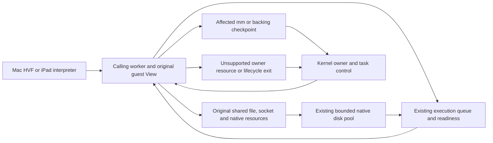

# Coordination and fallback boundaries

This is the consolidated implementation audit after the namespace subsystem
batch, 2026-11-03. Mac HVF and the iPad interpreter use the same userspace Linux
kernel. The remaining boundaries below are still present; completing the latest
batch does not make the whole runtime coordinator-free. The Docker I/O additions
below, 2026-11-04, use calling workers and shared resources from their first implementation.

## Execution model

The Kernel owner admits and collects execution cohorts, manages processes and
publishes structural changes. An admitted short operation runs on its calling
worker. A blocked resource operation can return its execution slot and resume
from original readiness without a syscall RPC to that owner. Native disk jobs own
copied inputs and original resources, and publish results directly to the source.

The relevant scopes are:

- **Resource wait:** only the caller parks; other CPUs continue.
- **In-cohort owner service:** the caller's View is loaned to the existing owner;
  other CPUs can continue. Refusal before effects can end the cohort.
- **Affected-domain checkpoint:** only the required mm/backing users quiesce;
  the owner publishes their structural change.
- **Joined owner path:** the current cohort ends, its Views return, then the owner
  runs task/control or compatibility work. This is broader than one-resource wait.
- **Local execution fallback:** a different implementation runs on the same worker;
  the word `fallback` alone does not identify a coordinator transition.

## Remaining owner dependencies

### Docker I/O additions

| Interface | Normal execution | Current limits |
| --- | --- | --- |
| FIOASYNC / O_ASYNC, F_SETOWN/EX and F_SETSIG | OFD-owned subscriptions on pipe, Unix-socket and PTY readiness enqueue into shared task/process signal mailboxes. The target worker enters the existing ARM64 signal frame and restores it with local sigreturn. PID namespaces, group/TID ownership, credentials, standard coalescing and realtime queues use original identities. Only status/list changes synchronize per OFD; byte I/O and GETFL keep atomic flag reads. | Native TCP and other unsupported FASYNC descriptor kinds return EOPNOTSUPP. Signalfd and masked owner waits retain their existing owner paths. Other signal sources have not been migrated by this addition. |
| io_setup/destroy/submit/cancel/getevents | One demand-zero, read-only context-header page is reserved during ELF load. Setup changes only the shared per-mm context registry. Buffered scalar/vector reads/writes and fsync/fdatasync use the existing disk pool, park the source task, copy results on its worker and publish CQ then eventfd. Accepted waits retain their original context across destruction, handle reuse and cohort handoff. | Buffered io_submit can wait for its batch, as Linux permits; this is not an O_DIRECT DMA/pinned-buffer implementation. Context metadata is bounded to 128 contexts and 65,536 requested credits per context. Zero ring magic selects the library syscall fallback; userspace ring reaping is not advertised. Unsupported opcodes, I/O priority/RWF flags, temporary pgetevents masks and live mapped-file layout work return explicit errors instead of requesting a new owner service. In-flight buffered cancellation returns EAGAIN; already-completed requests return EINVAL. |
| EPOLLEXCLUSIVE | Shared readiness wakes ordinary subscribers and selects an eligible exclusive waiter per original OFD. Native one-shot registrations are driven by an existing idle executor and rearmed as interests retire. No polling bus or reactor thread is added. | ADD-only, no ONESHOT or nested-epoll target; MOD of an exclusive registration returns EINVAL. Existing owner-only descriptors and masked/traced epoll waits retain their prior boundaries. |

The signal-frame implementation is shared by owner delivery, source-worker I/O
delivery and sigreturn. The normal caught-SIGIO worker test asserts zero service
requests and a worker-retired sigreturn. The C fixture `tests/fixtures/async-io.c`
in trames-ipad compares the same AIO, SIGIO and epoll cases against native Linux
on one and four CPUs. Mac acceptance additionally runs the unmodified Debian
Docker/containerd/runc packages and the default four-worker nginx container.

### Other boundaries

| Area | Actual trigger / examples | Current scope and status | Authoritative implementation |
| --- | --- | --- | --- |
| Task lifecycle and process graph | clone/fork/vfork, exec/execveat, exit/group exit, wait/waitid, reparenting and cancellation | Joined owner path. Child/task/VM ownership and pending contexts are changed on the owner. The current whole-cohort scope is an implementation boundary, not a claim that every unrelated address space fundamentally needs pausing. | [process lifecycle](../../crates/trames-session/src/process.rs) (`fork_state`, `exec_at`, `exit_one`, `wait`, `syscall`) |
| Signals and mutable security/task policy | Other signal delivery, mutating signal masks/actions, STOP/CONT/KILL, credentials/capabilities, affinity/limits, seccomp installation/TSYNC and non-ALLOW actions | Owner task effects remain. FASYNC notifications enqueue directly into task/process mailboxes; caught handlers and admitted sigreturn execute on the source worker. Default termination/stop still uses the lifecycle boundary. Allowed admitted filtered calls retain one decision; tracing disables snapshots. | [entry and delivery](../../crates/trames-session/src/process.rs), [shared I/O signals](../../crates/trames-kernel/src/signal/io.rs), [worker decisions](../../crates/trames-session/src/workers.rs), [seccomp](../../crates/trames-session/src/process_seccomp.rs) |
| Structural namespaces and administrative controls | mount/umount/pivot_root, unshare/setns, BPF syscall/control installation, owner cgroup/proc/sysfs projections | Joined owner path. Mount and task namespace topology, credentials and owner Rc control graphs have not been migrated. Ordinary mkdir/unlink/rename/metadata and shared cwd/root are now separate shared resources. Do not classify every network socket or netlink message as owner-only. | [owner syscall dispatch](../../crates/trames-session/src/process.rs), [mount topology](../../crates/trames-vfs/src/mounts.rs), [namespace topology](../../crates/trames-vfs/src/linux_namespace.rs) |
| Dynamic/special pathname and FD resources | Dynamic proc/sys refresh, non-admitted cgroup/nsfs/mqueue mounts, volatile owner descriptors, controlling-terminal acquisition and excluded open types | Before-effects defer. Namespace calls preserve copied operands and accepted shared FDs in `FileOutcome::Owner`; the joined resolver handles owner controls. Other path queries return `None` for their owner entry. A typed defer is not a new guest errno. | [path authority](../../crates/trames-vfs/src/path_queries.rs), [node/open admission](../../crates/trames-vfs/src/lib.rs), [proc synthesis](../../crates/trames-vfs/src/pseudo.rs), [namespace handoff](../../crates/trames-vfs/src/namespace_work.rs) |
| Residual generic FD/network compatibility service | A direct descriptor/control admission does not handle the actual resource; generic network controls, old epoll creation, lseek/fstat or eligible stream byte paths reach `service_candidate` | In-cohort owner service where admitted. Dynamic proc, tracing/filter restrictions, unsupported kind, blocking EAGAIN, EPIPE and internal unsupported results can reject it and request a joined owner path. Ordinary shared file/socket hot paths precede this service; its existence does not show their normal calls use it. | [candidate numbers](../../crates/trames-session/src/worker_syscalls.rs), [actual admission and effects](../../crates/trames-session/src/process_service.rs) |
| Cross-resource transfer | File-to-pipe/socket sendfile/splice and related mixed transport operations outside the regular file-to-file contract | Existing joined Linux/VFS entry. File-to-file copy/sendfile already uses accepted FileWork; remaining mixed algorithms have not been converted into one worker-owned multi-resource operation. | [Linux file calls](../../crates/trames-linux/src/file_calls.rs), [VFS transfer algorithms](../../crates/trames-vfs/src/lib.rs) |
| Owner/mixed waits and masks | pselect; temporary-signal-mask or owner-FD poll/epoll; traced waits; retained waits excluded from `worker_io_candidate` | Original owner wait, with actual readiness/signal/deadline deciding progress. A blocked masked epoll does not by itself repeatedly stop other CPUs. Normal shared unmasked poll, socket/pipe/file waits and adopted io_uring waits use workers/readiness. | [poll ownership](../../crates/trames-linux/src/poll.rs), [wait admission](../../crates/trames-session/src/process.rs), [cohort control](../../crates/trames-session/src/process_vm.rs) |
| Unix ancillary owner controls | SCM_RIGHTS that contains an actual excluded owner control; owner-ledger reaping and a legacy destination/control projection | Retained original endpoint/rights handoff and owner graph work. Portable Unix sockets/rights and ordinary native Wayland transport already share the real resource graph. A mixed owner set is still excluded. | [message handoff](../../crates/trames-linux/src/direct/local_message.rs), [rights ledger](../../crates/trames-vfs/src/ipc.rs), [portable graph](../../crates/trames-vfs/src/ipc/shared_rights.rs) |
| VM and pin topology | brk growth, munmap/mremap, non-additive mmap, mprotect, mincore/madvise and io_uring buffer pin/register variants requiring mm edits | Affected mm/backing checkpoint on the existing run queue. The owner commits and rebuilds the required Views; unsupported/external generations, tracing or non-ALLOW policy can escalate to a joined path. Additive private-anonymous mmap has a separate in-cohort owner publication path. | [VM ABI classification](../../crates/trames-session/src/worker_syscalls.rs), [domain queue](../../crates/trames-session/src/run_queue.rs), [VM commit](../../crates/trames-session/src/process_vm.rs), [View admission](../../crates/trames-memory/src/parallel.rs) |
| Mapped-file layout | Truncate/growth/allocate that changes a live mapped backing layout | Only affected original mm instruction views are quiesced, then the same disk pool runs the accepted file operation. Completion releases overlapping pause counts. Byte transfer and sync alone do not imply this checkpoint. | [file checkpoint](../../crates/trames-session/src/process_file_io.rs), [original file job](../../crates/trames-vfs/src/file_work.rs), [resize](../../crates/trames-vfs/src/memfd.rs) |
| io_uring owner escalation | Actual owner resource/SQE, unavailable event subscription or source pump, mapped layout and file-size signal effects; buffer pins requiring structural authority | Canonical ring state stays shared. `owner_required` hands real owner work back to the Kernel; accepted SQEs keep their original source context. Source background progress on sleep/futex is ordinarily event-driven. No separate ring service thread exists. New namespace SQE opcodes are not added by the namespace batch. | [actor](../../crates/trames-linux/src/direct/uring/actor.rs), [source maintenance](../../crates/trames-linux/src/direct/uring/background.rs), [subscriptions](../../crates/trames-linux/src/direct/uring/wait.rs), [file results](../../crates/trames-linux/src/direct/uring/actor_file.rs) |
| Native guest mapping and exceptional native memory entry | Vulkan shared host-allocation mapping import where `can_import_mapping` is false; unstable native entry code; live-private backing or a native access mode requiring a checkpoint | GPU/native typed checkpoint before body effects; current worker returns the pending HLT to the owner. Ordinary CPU/native bytes keep the common permission/backing model. The GPU context mutex and compiler/fence waits are normally resource waits. | [Vulkan import](../../crates/trames-vulkan/src/backend.rs) (`Invocation::Checkpoint`), [native memory](../../crates/trames-memory/src/parallel/native.rs), [entry registry](../../crates/trames-accel/src/native.rs), [GPU wait](../../crates/trames-session/src/gpu.rs) |
| Scheduler/cohort membership | Legacy futex wake target cannot schedule into its current epoch; a newly eligible nonmember, affinity/control change, instruction allowance or actual owner timer/signal requires scheduling | Current cohort scheduling boundary. Existing epoch members and ordinary readiness continue locally. Idle or periodic host-control checks do not automatically imply teardown: `cohort_control` decides whether to join. | [legacy wake](../../crates/trames-session/src/futex.rs), [worker stop](../../crates/trames-session/src/workers.rs), [cohort selection/collection](../../crates/trames-session/src/process.rs), [control checks](../../crates/trames-session/src/process_vm.rs) |
| Embedding and terminal/session lifecycle | Transfer/timezone command, pause/cancel, terminal create/close/resize, foreground group signal/hangup, actual systemd supervision event; Mac admin/shutdown/deadline/memory-pressure request | Host control requests a join. Routine FFI status snapshots and live PTY byte pumping can run without a join. FileProvider writeback deliberately pauses the session when applying staged edits, as chosen by the owner. | [FFI adapter](https://github.com/kb5000/trames-ipad/blob/80304113124ba34a829c4f61f2cb65bc7dad0e39/crates/trames-ffi/src/session.rs), [iPad lifecycle](https://github.com/kb5000/trames-ipad/blob/80304113124ba34a829c4f61f2cb65bc7dad0e39/apps/ios/Trames/TerminalSession.swift), [Mac control](https://github.com/kb5000/trames-mac/blob/aed5daab61092b468bb89a1af5159cc935dd5ea5/crates/trames-mac/src/session.rs) |
| Final teardown and faults | Unfinished compiler/native context cancellation, task/context destruction, guest synchronous fault delivery or backend failure | Owner lifecycle remains. CPU View collection does not wait for unrelated accepted native disk work. Guest faults use the original signal path; a host backend error is an error, not an automatic full-VM or software CPU fallback. | [task exit/fault](../../crates/trames-session/src/process.rs), [native lifecycle contract](execution-backends.md#live-native-device-authority--2026-11-03), [HVF error mapping](https://github.com/kb5000/trames-mac/blob/aed5daab61092b468bb89a1af5159cc935dd5ea5/crates/trames-hvf/src/kernel.rs) |

## Fallbacks that do not identify an owner transition

- The native libc registry can return `fallback=true` for a size/operation it does
  not accelerate. The guest implementation continues on the same executor. Its
  `checkpoint_retries` counter represents a different event: an owner boundary.
- A DirectFile fast-path miss (contention, seals, finite limit, mapped or disk
  representation) can enter the common full FileWork path. An ordinary full
  result or native disk wait does not require a coordinator syscall service.
- HVF's mapping diagnostic `Fallback` means delta-range history was unavailable;
  it compares persistent coarse mapping stamps and changed chunks. It does not
  switch to an interpreter or a Linux-kernel VM.
- Single-CPU/solo execution or failed parallel View admission can choose the
  existing coordinated caller path. Mac still executes instructions through HVF;
  iPad still uses its interpreter. A recorded backend failure is surfaced.
- Unsupported syscall/driver functionality can return its existing errno or API
  result. This is not evidence of a successful compatibility fallback.
- AppKit/UIKit presentation has its own UI-thread affinity. Ordinary window input,
  Wayland bytes and frame presentation are not the Kernel's owner syscall RPC.
  HiDPI events use the existing Wayland queue. iPad PiP retains the selected
  session's normal background lifecycle control; GPU suspension waits on actual
  context locks/readiness rather than creating a coordinator or service thread.
  See [display lifecycle](display-lifecycle.md) for the background GPU limitation.

## Remaining cost and interpretation of evidence

The per-filesystem namespace transaction, original inode metadata/byte/position
locks, GPU context/device locks, native disk-pool capacity, manifest durability,
View generations/dirty commit and HVF mapping synchronization still cost time.
They must be measured as actual resource work or publication, rather than counted
as coordinator messages. In particular, private namespace mutations retain their
original durable manifest checkpoint; native filesystem lifecycle references do
not make the same per-operation persistence promise.

`service_requests=0` is insufficient to prove owner independence. A direct
checkpoint, unsupported SVC/HLT, signal/control action or legacy scheduling wake
can end a cohort without sending a Service event. Conversely an in-cohort service
can complete while peer CPUs continue. Inspect together:

1. source worker/direct/file/socket/uring completions and retained identities;
2. Service requests and caller wait;
3. cohort rounds and stop/dispatch time;
4. affected-mm VM checkpoint groups, wait/commit/resume timing;
5. native entry retries, mapping delta/coarse comparisons, resource and disk time;
6. the actual before-effects defer, terminal errno, or source-copyout boundary.

The source audit lists reachable current implementation boundaries. The namespace
acceptance verifies its admitted workflows, not the frequency of every remaining
boundary in Firefox or a complete server workload. No whole-application trace or
claim that all these owner paths were exercised is made here. This audit records
the remaining work; it does not start another migration.
