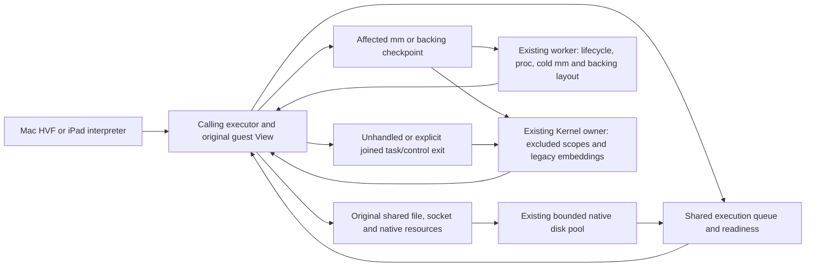

# Coordination and fallback boundaries

This is the consolidated implementation audit through stage 64, retirement of the production
FD/network compatibility RPC, reviewed on 2026-11-07.
The prior runtime baseline is `0c2adca6acb919750007eb97aa686e8a06f555a8`.
Mac HVF and the iPad interpreter share this userspace Linux kernel. Source
resource work, scoped mapping admission and joined administration remain distinct.

## Current status at a glance — 2026-11-07

The Kernel owner still exists. Stage 64 deletes the FD/network compatibility
RPC as an execution category: there is no Service event, caller-View loan,
request/reply transport, service admission classifier, owner service handler or
in-flight service state. Original console resources, complete epoll controls and
FD observations execute from the source; native host bytes use the existing
bounded I/O pool. EPIPE/SIGPIPE for source byte operations completes locally.
The former service's blocking/error cases are not redirected to whole-cohort
fallback. Separate excluded terminal, mixed wait, tracing and native/mapping
boundaries remain in the inventory below.

Stage 63 moves getrandom into one shared source/solo
ABI over the executor's original memory interface and host CSPRNG. Random-device
control requests return their existing unsupported errors on the original OFD;
FIONBIO/FIOASYNC retain their shared flag/subscription implementation. Existing
random-device scalar/vector/positioned reads/writes, poll and random UUID paths
are validated together. No guest entropy pool, worker service or fence is added.

Stage 62 moves the supported membarrier subsystem
to original execution leases: query/registration and errors complete locally;
private barriers visit the original mm, global barriers visit this Linux instance's
current execution domains. Requested actors acknowledge hardware fences before the
caller completes. Busy requests return the CPU slot; no View export, mm pause or
page-table publication is introduced. Native bodies and scoped mapping execution
participate in the same lease protocol. Fork/CLONE_VM/exec retain their original
registration semantics.

Stage 61 generates entry recognition from the actual
Linux and session dispatch arms. Truly unimplemented syscall numbers now complete
with the original ENOSYS diagnostic on the calling worker, after one seccomp
decision. Known handlers, explicit tracing and legacy diagnostic-less embeddings
retain their actual routes. Ordinary already-handled calls do not execute this
cold classifier; AIO's pre-dispatch entry uses the same original AIO predicate.

Stage 60 moves supported BPF program load, identity,
ID reopening, device attach/replace/detach/query and their target-path dependencies
to the calling worker. The same original registry, Files table, immutable programs
and cgroup device graph feed source and solo execution. Verifier work runs outside
the short registry transaction; no resource thread or cohort pause is introduced.

Stage 59 moves the complete supported seccomp
policy subsystem to original task/group resources: strict/filter installation,
TSYNC, prctl queries, all supported entry decisions, SIGSYS and termination effects,
proc visibility, birth/exec inheritance and accepted-call cancellation. Policy
publication never pauses the cohort. Only actual policy installation and birth/
exec credential publication synchronize on the original group; ordinary entry
reads one immutable version without a lock or allocation.

Stage 58's scoped memory and stage 57's task/image lifecycle remain source-owned.
Actual unhandled/control work can still end the current execution cohort. The
table records supported source execution and explicit remaining boundaries; this
is not a claim that all coordinator work is removed.

| Area | Normal scope now | Remaining owner dependency / actual escalation |
| --- | --- | --- |
| Admitted file/path/FD, Unix/TCP I/O, transfers, AIO and io_uring operations | Calling worker and original shared resources; resource waits return the execution slot | Excluded descriptor/path/SQE kinds, owner controls, missing pumps/subscriptions retain explicit boundaries; production mapped-layout effects now use original backing admission |
| Futexes, clocks/timers, admitted poll/epoll/signalfd/child waits and caught signals | Calling workers and original readiness/mailboxes | Legacy nonmember waiter adoption, excluded wait resources, tracing and capability-less lifecycle embeddings can still require the owner |
| Scheduling attributes and CPU affinity | Calling worker and original task atomics/authority; migration waits for only the original target's running lease and releases the caller's execution slot | Tracing and capability-less embeddings keep their boundary. Existing unsupported scheduling features return their original errno locally; no compatibility owner service is needed |
| Individual/group/default-fatal exit, STOP/CONT, parent notification and vfork release | Original source task/group resources | Returned CPU/statistics and cold task cleanup use existing source workers; only the original live mm pauses when necessary. Outside-cohort/solo and tracing/capability-less embeddings retain their boundary |
| fork/clone/vfork and execve/execveat | Existing workers handle pure and mixed mapping scopes, nonleader replacement and original old-mm retirement; existing disk pool prepares native images without a CPU slot | Affected actors still quiesce. Tracing/capability-less embeddings, solo and host invocation remain separate |
| Structural VM edits, pins and mapped-file layout changes | Supported mapping/buffer-registration checkpoints publish on existing workers with original task/mm custody; additive anonymous mmap runs directly while peers continue | Proc/cold-mm checkpoints and supported mapped-file transactions now run on existing workers. Unsupported backing/lifetime/policy and capability-less embeddings retain explicit boundaries |
| Residual generic FD/network compatibility | In-cohort owner service when the actual resource is admitted; only the caller waits | Refusal before effects uses the joined owner path. Candidate syscall numbers do not mean ordinary admitted calls take this route |
| Native libc/GPU/video/audio normal bodies and waits | Source/shared-resource execution or resource waits; existing disk/device workers retain their role | Mapping import, unstable entry, live-private backing and actual native lifecycle/teardown checkpoints can still reach the owner. Local libc/DirectFile/HVF fallback alone is not an owner transition |
| Dynamic proc/sys views and proc pathname/FD consumers | Original PID/mm/Files/fs/namespace resources on the calling worker; owner/solo queries use the same provider | First cross-mm byte export and invalidation now activate on an existing worker using only original task/mm custody. Legacy embeddings without a provider and actual policy remain separate |
| Mount topology administration | Calling worker and original namespace/fs_struct resources, with existing disk workers only for host-backed path work | Busy transactions park the caller on original readiness. Tracing and genuinely excluded path controls keep separate boundaries |
| Task namespace membership and Files/fs detachment | Calling worker; supported unshare/setns and close_range update original per-task bindings and all future-call consumers; busy namespace transactions return the execution slot | Tracing and capability-less embeddings remain. Clone namespace creation retains creator-mm custody; unsupported user/time namespace semantics remain separate |
| Credentials and capabilities | Supported UID/GID/fs-ID/groups, capget/capset and credential prctl run on the caller; original task credentials feed target permissions and observations | Tracing and capability-less embeddings retain their boundary; unsupported user namespaces and file capabilities are unchanged |
| Memory barriers | Supported membarrier query/register/private/global/get-registrations run on source workers; original active execution leases acknowledge requested fences | Tracing and capability-less/solo embeddings keep their joined path. Unsupported sync-core/rseq/global-expedited commands remain unsupported. Ordinary memory accesses acquire no new synchronization |
| Entropy and random devices | getrandom, original random/urandom OFDs and UUID resources run on the caller; unsupported random-device controls return locally on the accepted OFD | Explicit tracing and absent descriptor capabilities retain their own route. Supported getrandom flags remain 0..3 and the existing transfer bound/fault behavior is retained; guest entropy credit/reseed controls remain unsupported |
| BPF and cgroup device policy | Supported program load/identity/reopen and attachment controls use original registry/Files/hierarchy resources on the caller; cgroup target directories and control files resolve/open on workers | Existing unsupported BPF commands/types remain explicit errors; tracing and capability-less embeddings keep their boundaries. Device opens/mknod/PTY peer and proc reopening consume the same live rules |
| Seccomp and tracing | Supported seccomp/prctl installation, TSYNC and entry results use original source task/group resources; busy installation releases the slot; proc and future entries observe live policy | Explicit tracing remains joined. Capability-less embeddings retain signal/exit handling; unsupported listener/logging/notification features remain unsupported. An allowed syscall may still encounter its own excluded resource or generic fallback |
| Actual host/embedding lifecycle | Joined owner handling of the accepted event | Host-authorized exec creation/group control, terminal create/close/resize/hangup, legacy unpumpable console I/O, pause/cancel, timezone/transfer, supervision/admin/deadline/pressure and actual shutdown. Routine live PTY bytes/status/presentation do not imply a join; FileProvider staged writeback deliberately pauses as previously chosen |
| Last-resort SVC/HLT/fault dispatch | Truly unimplemented numbers complete locally using generated conservative recognition and the original diagnostic log | Known handlers whose actual resource/subcommand is excluded, legacy embeddings, tracing and unhandled HLT/fault exits still retain joined fallback. An implemented number returning an errno is not classified as globally unimplemented |
| Single-CPU/solo execution | Existing coordinated caller path | The owner may itself be the guest executor; this is not evidence of an extra cross-thread syscall RPC |

Initial guest admission and exceptional legacy/control rescheduling still involve
owner orchestration. Existing epoch members migrate, park and wake through the
shared execution queue. That queue can now activate an original CPU-pool slot
directly when live affinity requires it; this does not request an owner service
or prestart every configured CPU. Scheduler, resource processing,
communication and full-stop costs must be measured separately. UI-thread affinity
and the native disk/device pools are not additional Linux coordinators.

Stage 55 removes supported task namespace membership changes from joined
dispatch, including Files/fs detachment and every captured resource consumer.
The multi-CPU namespace compatibility fixture requests no owner service and has
no unshare/setns/close_range cohort returns; its final console ioctl still returns.
These are fixture-specific results, not prevalence in Firefox or all containers.

Actual excluded control bodies, tracing/security, exceptional native imports,
host administration and generic unhandled dispatch remain separate boundaries. Source-owned control lifetime does not imply that
every control operation itself has moved to a worker.

## Execution model

The `Join` edge requires the current cohort to return its Views. `Scope`
quiesces its actual mm/backing dependencies. There is no compatibility RPC edge.

The Kernel owner admits and collects execution cohorts and handles the remaining
joined scopes. Original task membership and supported structural publication are
shared with existing executors. An admitted short operation runs on its calling
worker. A blocked resource operation can return its execution slot and resume
from original readiness without a syscall RPC to that owner. Native disk jobs own
copied inputs and original resources, and publish results directly to the source.

The relevant scopes are:

- **Resource wait:** only the caller parks; other CPUs continue.
- **Affected-domain checkpoint:** only the required mm/backing users quiesce;
  the owner publishes their structural change.
- **Joined owner path:** the current cohort ends, its Views return, then the owner
  runs task/control or compatibility work. This is broader than one-resource wait.
- **Local execution fallback:** a different implementation runs on the same worker;
  the word `fallback` alone does not identify a coordinator transition.

## Remaining owner dependencies

### Docker I/O additions

| Interface | Normal execution | Current limits |
| --- | --- | --- |
| FIOASYNC / O_ASYNC, F_SETOWN/EX and F_SETSIG | OFD-owned subscriptions on pipe, Unix-socket and PTY readiness enqueue into shared task/process signal mailboxes. The target worker enters the existing ARM64 signal frame and restores it with local sigreturn. PID namespaces, group/TID ownership, credentials, standard coalescing and realtime queues use original identities. Only status/list changes synchronize per OFD; byte I/O and GETFL keep atomic flag reads. | Native TCP and other unsupported FASYNC descriptor kinds return EOPNOTSUPP. Reader-scoped signalfd reads and admitted waits execute on the source worker. STOP/CONT uses shared group control; default termination and actual lifecycle/owner resources retain their boundary. |
| io_setup/destroy/submit/cancel/getevents | One demand-zero, read-only context-header page is reserved during ELF load. Setup changes only the shared per-mm context registry. Buffered scalar/vector reads/writes and fsync/fdatasync use the existing disk pool, park the source task, copy results on its worker and publish CQ then eventfd. Accepted waits retain their original context across destruction, handle reuse and cohort handoff. | Buffered io_submit can return a submitted prefix and wait for its batch, as Linux permits; accepted payload staging uses the existing MAX_WRITE byte bound, with at most one additional preparation buffer and 64 request records; this is not an O_DIRECT DMA/pinned-buffer implementation. Context metadata is bounded to 128 contexts and 65,536 requested credits per context. Zero ring magic selects the library syscall fallback; userspace ring reaping is not advertised. Unsupported opcodes, I/O priority/RWF flags, temporary pgetevents masks and live mapped-file layout work return explicit errors instead of requesting a new owner service. In-flight buffered cancellation returns EAGAIN; already-completed requests return EINVAL. |
| EPOLLEXCLUSIVE | Shared readiness wakes ordinary subscribers and selects an eligible exclusive waiter per original OFD. Native one-shot registrations are driven by an existing idle executor and rearmed as interests retire. No polling bus or reactor thread is added. | ADD-only, no ONESHOT or nested-epoll target; MOD of an exclusive registration returns EINVAL. Existing owner-only descriptors and traced epoll waits retain their prior boundaries. Admitted masked epoll waits use the source worker. |

The signal-frame implementation is shared by owner delivery, source-worker I/O
delivery and sigreturn. The normal caught-SIGIO worker test asserts zero service
requests and a worker-retired sigreturn. The C fixture `tests/fixtures/async-io.c`
in trames-ipad compares the same AIO, SIGIO and epoll cases against native Linux
on one and four CPUs. Mac acceptance additionally runs the unmodified Debian
Docker/containerd/runc packages and the default four-worker nginx container.

### Shared signals and remaining lifecycle dependency

Signal delivery no longer selects between owner-private and resource queues.
The original task owns one private inbox and one process-shared inbox. Reader
capabilities belong to the syscall caller, so inherited/passed signalfds and
shared epoll interests never retain their creator's task as reader authority.
Accepted blocking reads and signal waits keep their imported operands, original
OFD, mask and deadline across parking, close/reuse and cohort handoff. They
subscribe to original queue/mask readiness and return their execution slot.
io_uring READ/READV/READ_FIXED/POLL use the same submitter-scoped capability,
including fixed files and buffers retained across unmap/unregistration.

Sighand changes serialize with guest enqueue/discard only on the actual table
and queues. Enqueue notification runs after those locks are released; removing
pending records changes the poll epoch without creating a readiness wake.
Owner/source context copies occur only at custody handoff. The short owner mask
ABI uses the same decoder without an unnecessary context mutex roundtrip.

STOP/CONT now uses the original shared thread-group control and parent wait
objects described below. It no longer requires the entire cohort to return.
Ordinary exit, group/default-fatal termination, clear_tid, accepted-operation
cancellation, namespace-init victim termination and original family completion
now use source resources. Returned CPUs, metrics and cold task cleanup are
completed on existing workers while other CPUs continue. Original task/mm permits
protect private projections. A cold group member sharing an executing mm
uses a byte checkpoint of that mm alone. It does not stop unrelated mm/backing
users or rebuild its mappings. External guarded mm borrows retain physical custody
independently of guest parent notification, keyed by the original mm identity.
Task creation now uses the creator mm checkpoint and dynamically admits children
into the same execution queue. Exec now replaces its image at the creator-mm
checkpoint, collecting original group peers and retaining borrowed old memory.
Tracing and security decisions with lifecycle effects retain joined boundaries. Robust-futex owner-death support is not added by this work.

### Other boundaries

| Area | Actual trigger / examples | Current scope and status | Authoritative implementation |
| --- | --- | --- | --- |
| Task lifecycle and process graph | clone/fork/vfork, exec/execveat, exit/group exit, wait/waitid, reparenting and cancellation | Shared wait4/waitid, STOP/CONT, set_tid_address and admitted vfork waits run on source workers. Individual exit(93), exit_group(94) and default-fatal termination retire original resources on their source workers, including the final member and Files with opaque owner controls. Namespace-init victims use original groups. Full returned CPUs and cold task projections now complete on source workers; cold same-mm peers need only that mm byte checkpoint. Fork/clone/vfork construction uses a creator-mm checkpoint; children join the live queue without stopping unrelated mms. The complete task and original-resource child builder are movable; pure lifecycle scopes claim nonblocking original task/mm/group custody on existing workers without VmReady/Service requests. Exec preparation/commit, nonleader identity replacement, failed-image recovery and detached old-mm retirement use original resources. Supported mixed mapping/lifecycle scopes now use the same source authority. Native image loading retains accepted resources on the original task and uses the existing disk pool; waiting releases task/mm permits and the CPU slot. Resident private-store namespace lookup/errors remain local. Untraced continuous-worker custody entries complete pure policy errors before quiescence. Tracing, policy effects requiring full task handling and legacy unadmitted waiter adoption retain joined boundaries. | [process lifecycle](../../crates/trames-session/src/process.rs) (`fork_state`, `exit_one`, `wait`, `syscall`), [image replacement](../../crates/trames-session/src/process_exec.rs) (`prepare_exec_request`, `install_exec`, `commit_exec_task`) |
| Signals and mutable security/task policy | Supported signals, credentials/capabilities, affinity and seccomp installation/TSYNC/result effects are source-owned; explicit tracing and capability-less embeddings remain | One private/process mailbox serves ordinary guest sends, timers, FASYNC, faults and owner producers. Ordinary kill/tkill/tgkill routing, altstack/actions/masks/pending, sigtimedwait/sigsuspend and signalfd read/readv run on the source worker. Caught handlers and sigreturn share the same frames. STOP/CONT uses the original group state and parent wait/SIGCHLD; default termination uses source group cleanup. ERRNO/unsupported TRACE/USER_NOTIF, TRAP and KILL use original source resources. Tracing retains its explicit boundary; accepted ALLOW calls can still encounter an excluded underlying resource. | [entry and delivery](../../crates/trames-session/src/process.rs), [shared I/O signals](../../crates/trames-kernel/src/signal/io.rs), [worker decisions](../../crates/trames-session/src/workers.rs), [seccomp](../../crates/trames-session/src/process_seccomp.rs) |
| Structural namespaces and administrative controls | mount/umount/pivot_root, unshare/setns, BPF and credential/capability changes | Admitted mount/umount/pivot_root run on the caller and original mount/fs resources; a busy namespace parks only its caller. Supported unshare/setns and credentials/capabilities run on the caller with their complete captured consumers. Supported BPF administration now uses original source registry/Files/hierarchy transactions; unsupported APIs keep their original errors. Metadata projections remain observation rather than mutable authority. | [owner dispatch](../../crates/trames-session/src/process.rs), [mount topology](../../crates/trames-vfs/src/mounts.rs), [namespace authority](../../crates/trames-vfs/src/linux_namespace.rs) |
| Dynamic/special pathname and FD resources | Proc PID/task directories, magic links, dynamic bodies, nsfs descriptors, controlling terminals and excluded types | Proc views and original mount namespace FDs are admitted through the common resolver and shared OFDs. Cwd/root/exe/FD reopening retains original resources, not descriptor numbers. Actual excluded owner graphs, mqueue and terminal acquisition retain explicit before-effects boundaries. | [proc provider](../../crates/trames-vfs/src/proc_source.rs), [proc files](../../crates/trames-vfs/src/proc_file.rs), [path authority](../../crates/trames-vfs/src/path_queries.rs) |
| Cross-resource transfer | sendfile/splice between admitted regular files, pipes, Unix streams and TCP | Original OFD pairs execute on the calling worker. Backpressure parks only that task on original readiness; native disk jobs reuse the existing pool. Joined short operations borrow the original VFS without building a retained island. Actual mapped-file layout changes keep affected-domain checkpoints; excluded owner/dynamic resources defer before effects. tee/vmsplice remain unsupported. | [accepted transfer](../../crates/trames-vfs/src/stream_transfer.rs), [source execution and waits](../../crates/trames-linux/src/direct/file.rs) |
| POSIX and real interval timers | timer_create/gettime/getoverrun/settime/delete and getitimer/setitimer | Shared timer objects execute on the caller. A short deadline-index transaction updates the original execution queue; existing workers process a bounded batch of due timers outside that queue's mutex. SIGEV_NONE keeps lazy periodic phase without an armed host deadline. Process/thread signal targets retain their original incarnation. Timer STOP/CONT uses shared group control. Default termination uses original source group cleanup; unsupported CPU-clock/virtual/profiling timers are not added. | [shared timer ABI and index](../../crates/trames-kernel/src/timers.rs), [original signal targets](../../crates/trames-kernel/src/signal/io.rs), [execution queue](../../crates/trames-session/src/run_queue.rs) |
| Event waits and remaining owner/mixed cases | Admitted pselect6, ppoll, epoll_pwait and epoll_pwait2, including temporary masks, use workers; excluded owner/dynamic FDs, tracing, unavailable source pumps and actual lifecycle/task-policy effects retain their boundary | One imported wait retains original OFDs/sets, mask and deadline through parking and cohort handoff. Source I/O signals interrupt locally and sigreturn restores the pre-wait mask. All pending sources now use the same queues. Caught signals interrupt locally; STOP/CONT retains the original wait and uses shared group control. Default termination uses original source group cleanup. | [poll ownership](../../crates/trames-linux/src/poll.rs), [wait admission](../../crates/trames-session/src/process.rs), [cohort control](../../crates/trames-session/src/process_vm.rs) |
| Unix ancillary owner controls | SCM_RIGHTS that contains an actual excluded owner control; owner-ledger reaping and a legacy destination/control projection | Retained original endpoint/rights handoff and owner graph work. Portable Unix sockets/rights and ordinary native Wayland transport already share the real resource graph. A mixed owner set is still excluded. | [message handoff](../../crates/trames-linux/src/direct/local_message.rs), [rights ledger](../../crates/trames-vfs/src/ipc.rs), [portable graph](../../crates/trames-vfs/src/ipc/shared_rights.rs) |
| VM and pin topology | brk growth, munmap/mremap, non-additive mmap, mprotect, mincore/madvise and io_uring buffer pin/register variants requiring mm edits | Affected mm/backing checkpoint on the existing run queue. Existing workers commit and rebuild supported Views, including proc byte activation and cold-mm cleanup; unsupported backing and tracing/security effects retain explicit boundaries. Retained external byte borrowers park only the actual dependency. Pure policy errors complete before quiescence; accepted decisions travel with the original entry. Additive private-anonymous mmap publishes directly. | [VM ABI classification](../../crates/trames-session/src/worker_syscalls.rs), [domain queue](../../crates/trames-session/src/run_queue.rs), [VM commit](../../crates/trames-session/src/process_vm.rs), [View admission](../../crates/trames-memory/src/parallel.rs) |
| Mapped-file layout | Truncate/growth/allocate that changes a live mapped backing layout | Original backing publication leases identify affected mms. Existing workers return their bytes, then the same disk pool runs the accepted mutation while holding its original exclusive ticket. New aliases wait on that backing; original mmap/OFD authority survives cancellation. No process-wide pause counters or actor scan remain. Byte transfer and sync alone do not imply this checkpoint. | [file checkpoint](../../crates/trames-session/src/process_file_io.rs), [original file job](../../crates/trames-vfs/src/file_work.rs), [resize](../../crates/trames-vfs/src/memfd.rs) |
| io_uring owner escalation | Actual owner resource/SQE or unavailable event subscription/source pump; unsupported structural authority | Canonical ring state stays shared. Production mapped-layout SQEs use the original FileLayouts resource; `owner_required` still hands excluded owner work back to the Kernel. Accepted SQEs keep their original source context. Source background progress on sleep/futex is ordinarily event-driven. No separate ring service thread exists. New namespace SQE opcodes are not added by the namespace batch. | [actor](../../crates/trames-linux/src/direct/uring/actor.rs), [source maintenance](../../crates/trames-linux/src/direct/uring/background.rs), [subscriptions](../../crates/trames-linux/src/direct/uring/wait.rs), [file results](../../crates/trames-linux/src/direct/uring/actor_file.rs) |
| Native guest mapping and exceptional native memory entry | Vulkan shared host-allocation mapping import where `can_import_mapping` is false; unstable native entry code; live-private backing or a native access mode requiring a checkpoint | GPU/native typed checkpoint before body effects; current worker returns the pending HLT to the owner. Ordinary CPU/native bytes keep the common permission/backing model. The GPU context mutex and compiler/fence waits are normally resource waits. | [Vulkan import](../../crates/trames-vulkan/src/backend.rs) (`Invocation::Checkpoint`), [native memory](../../crates/trames-memory/src/parallel/native.rs), [entry registry](../../crates/trames-accel/src/native.rs), [GPU wait](../../crates/trames-session/src/gpu.rs) |
| Scheduler/cohort membership | Initial guest admission and legacy nonmember wake; ordinary scheduling metadata and live affinity no longer require the owner | Initial/legacy orchestration retains its boundary. Existing members migrate/park/wake locally; children and exec replacements enter the live queue. Original CPU slots can start directly and lazily from that queue. Periodic checks alone do not tear down the cohort: `cohort_control` tests actual events and original dependencies. | [legacy wake](../../crates/trames-session/src/futex.rs), [queue](../../crates/trames-session/src/run_queue.rs), [owner metadata](../../crates/trames-session/src/process_scheduling.rs), [control checks](../../crates/trames-session/src/process_vm.rs) |
| Embedding and terminal/session lifecycle | Transfer/timezone command, pause/cancel, terminal create/close/resize, foreground group signal/hangup, actual systemd supervision event; Mac admin/shutdown/deadline/memory-pressure request; host-authorized exec process creation and process-group signal | Host control requests a join for actual lifecycle work. Routine FFI status snapshots, retained exec pipe I/O and live PTY byte pumping can run without a join. Host exec reuses the same process kernel, ELF/script loader, shared resources and memory budgets; it creates no additional runtime owner or service thread. FileProvider writeback deliberately pauses the session when applying staged edits, as chosen by the owner. | [FFI adapter](https://github.com/kb5000/trames-ipad/blob/80304113124ba34a829c4f61f2cb65bc7dad0e39/crates/trames-ffi/src/session.rs), [iPad lifecycle](https://github.com/kb5000/trames-ipad/blob/80304113124ba34a829c4f61f2cb65bc7dad0e39/apps/ios/Trames/TerminalSession.swift), [Mac control](https://github.com/kb5000/trames-mac/blob/aed5daab61092b468bb89a1af5159cc935dd5ea5/crates/trames-mac/src/session.rs) |
| Final teardown and faults | Actual session/backend teardown, non-notifying native stop and unhandled fault exits | Ordinary last/group/default-fatal exit is source work; CPUs and cold Rc projections return asynchronously, with actual same-mm byte custody where needed. These are not ordinary whole-cohort exit boundaries. Accepted guest faults use the original signal path; actual unhandled/backend failures and final host teardown retain their explicit boundary. A host backend error is not an automatic full-VM or software fallback. | [source completion](../../crates/trames-session/src/process_exit.rs), [fault/dispatch](../../crates/trames-session/src/workers.rs), [native lifecycle](execution-backends.md#live-native-device-authority--2026-11-03) |

The final worker-dispatch catch-all remains authoritative: an exit without a
source completion/park, in-cohort service or scoped VM request stops the current
cohort before joined handling. Consequently a complete removal audit must include
that catch-all, not just enumerate mount/proc or other named controls. The exact
entry and admission checks are in [workers](../../crates/trames-session/src/workers.rs)
and [candidate classification](../../crates/trames-session/src/worker_syscalls.rs).

## Fallbacks that do not identify an owner transition

- The native libc registry can return `fallback=true` for a size/operation it does
  not accelerate. The guest implementation continues on the same executor. Its
  `checkpoint_retries` counter represents a different event: an owner boundary.
- A DirectFile fast-path miss (contention, seals, finite limit, mapped or disk
  representation) can enter the common full FileWork path. An ordinary full
  result or native disk wait does not require a coordinator syscall service.
- HVF's mapping diagnostic `Fallback` means delta-range history was unavailable;
  it compares persistent coarse mapping stamps and changed chunks. It does not
  switch to an interpreter or a Linux-kernel VM.
- Single-CPU/solo execution or failed parallel View admission can choose the
  existing coordinated caller path. Mac still executes instructions through HVF;
  iPad still uses its interpreter. A recorded backend failure is surfaced.
- Unsupported syscall/driver functionality can return its existing errno or API
  result. This is not evidence of a successful compatibility fallback.
- AppKit/UIKit presentation has its own UI-thread affinity. Ordinary window input,
  Wayland bytes and frame presentation are not the Kernel's owner syscall RPC.
  HiDPI events use the existing Wayland queue. iPad PiP retains the selected
  session's normal background lifecycle control; GPU suspension waits on actual
  context locks/readiness rather than creating a coordinator or service thread.
  See [display lifecycle](display-lifecycle.md) for the background GPU limitation.

## Remaining cost and interpretation of evidence

The per-filesystem namespace transaction, original inode metadata/byte/position
locks, GPU context/device locks, native disk-pool capacity, manifest durability,
View generations/dirty commit and HVF mapping synchronization still cost time.
They must be measured as actual resource work or publication, rather than counted
as coordinator messages. In particular, private namespace mutations retain their
original durable manifest checkpoint; native filesystem lifecycle references do
not make the same per-operation persistence promise.

`service_requests=0` is insufficient to prove owner independence. A direct
checkpoint, unsupported SVC/HLT, signal/control action or legacy scheduling wake
can end a cohort without sending a Service event. Conversely an in-cohort service
can complete while peer CPUs continue. Inspect together:

1. source worker/direct/file/socket/uring completions and retained identities;
2. Service requests and caller wait;
3. cohort rounds and stop/dispatch time;
4. affected-mm VM checkpoint groups, wait/commit/resume timing;
5. native entry retries, mapping delta/coarse comparisons, resource and disk time;
6. the actual before-effects defer, terminal errno, or source-copyout boundary.

The source audit lists reachable current implementation boundaries. The namespace
acceptance verifies its admitted workflows, not the frequency of every remaining
boundary in Firefox or a complete server workload. No whole-application trace or
claim that all these owner paths were exercised is made here. The 2026-11-04 transfer, event-wait, timer and signal migrations update this inventory; the remaining owner
boundaries are still reachable.

### Shared child waits and lifecycle publication (2026-11-05)

The parent process now owns an original shared `Children` object. CLONE_THREAD
shares it; a fork starts a new family. Each child group owns one original
wait-event object, also shared by its threads. Birth, credentials, process-group
changes, reparenting and completed group exit publish structural metadata at
actual custody boundaries. Ordinary owner waits do not rebuild the process
directory after every query, and worker waits never access that directory.

Supported wait4/waitid selection, WNOHANG, WNOWAIT, stopped/continued events,
namespace PID translation and result formatting use this same object from the
owner and source workers. A blocked accepted wait subscribes to both its parent
family and original task/process signal queues before checking readiness. It
returns the execution slot, resumes on existing executors and preserves caught
signal EINTR/SA_RESTART behavior without a service request. Sibling waiters
consume an event once under the parent's object lock. Guest copyout and wake
callbacks run after releasing resource locks.

A consumed exit retires shared PID presence immediately, so kill(0), prlimit and
proc observations cannot expose a reaped child while its owner projection is
awaiting collection. Task visibility handles and original child objects prevent retained
completion handles from keeping a PID visible or retargeting its replacement.
Native ARM Linux oracle checks also corrected pre-existing ABI differences:
WNOHANG without a result does not preflight output pointers; a copyout EFAULT
after consumption does not restore the event; waitid copies rusage before
siginfo while wait4 copies status first. WNOWAIT still preserves the event.

**The remaining lifecycle migration is still open.** Default termination,
live task exit/group-exit cleanup, clear_tid,
parent-death/reparenting policy, namespace-init teardown and CPU/Memory/VFS
projection collection still run at their existing lifecycle boundaries.
`Epoch::finish` still stops its cohort. Exit events become waitable only after
the current cleanup has finished and all group members have exited. None of
these remaining dependencies is relabelled as a worker fast path or hidden RPC.

Cross-cohort adoption keeps child waits disjoint from generic I/O retry
transport. A previously blocked wait4/waitid owns its accepted `ChildWait`
request; importing a second `IoCall` for the same syscall would replay it as
unsupported I/O after the child event completed. The real Kernel adoption test
covers both APIs. Existing owner-event resource envelopes remain an explicit
compatibility boundary; they are not erased by this lifecycle change.

Completed owner projections are collected after worker Views return and before
processing the next returned owner syscall. This makes an immediate getpgid (and
other owner PID queries) observe the same reaping as signal/limit directories;
collection is not deferred to the next cohort's admission. The adoption test
follows each successful source wait with an owner getpgid and requires ESRCH.

### Original thread-group stop/continue control (2026-11-05)

Each original `IoTask` belongs to one shared `task_control::Group`; CLONE_THREAD
adopts the same object and a fork starts a new one. This is an overlay over the
original ready/futex/sleep/signal/child/I/O/GPU state, replacing the owner-private
`State::Stopped` and saved-state wrapper. It does not copy waits or repeat an
accepted syscall. Guest kill/tkill/tgkill, timer targets, FASYNC, resource signals
and parent-death producers use the same generation path. Opposing STOP/CONT
queues are cleared under this group's control lock; notifications run afterward.
SIGCONT resumes the group even when its disposition is ignored or masked.
The same-session permission exception applies to all three guest send APIs.

A running assignment holds a group execution lease. Actual CPU backends can
bind their neutral `ExecutionInterrupt`; STOP requests exits only for this
group's active members. The control lock does not cover guest execution or
native work. The relaxed stop flag is scheduling state, not a guest-memory
barrier. WUNTRACED/SIGCHLD is published only after every live member returns its
CPU and finishes accepted uninterruptible kernel work. Pending KILL suppresses
a late stop acknowledgement. An existing owner VM batch also holds this lease
and skips further guest execution after a stop request.

STOP preserves original subscriptions, operands, OFDs, deadlines and results.
Interruptible user waits stay parked; accepted disk/GPU work, hardware readiness
and ring background work can finish on their existing executors. Expired user
poll/socket/signal deadlines do not spin while stopped. The run queue rearms the
original task wake under its mutex before checking level state and parking.
This closes the real STOP -> CONT notification-coalescing race without a new
transport, polling loop or service thread. A one-slot/four-slot regression runs
four consecutive group stop/wait/continue/wait cycles without an owner request.

Birth, process-group/session changes, namespace changes and reparenting still
publish structural relationships at their existing boundaries. Orphaned groups
ignore default TSTP/TTIN/TTOU; SIGSTOP keeps its unconditional disposition.
Tracing and an actual excluded owner resource retain their existing boundary.
In particular, vfork and accepted mapped-file/legacy-owner work cannot be
acknowledged away: those original dependencies still finish before the group
reports stopped. No all-resource or all-lifecycle owner-independence claim is made.
`Epoch::finish`, exit/group-exit, clear_tid and final resource teardown remain.

The Linux signal-generation and group-stop behavior was checked against
[Linux v6.18 signal.c](https://github.com/torvalds/linux/blob/v6.18/kernel/signal.c).
The paired product evidence includes native ARM Linux, the Mac HVF backend,
the production interpreter and an iPad device-target compile. It does not claim
physical-iPad execution or a whole-browser speedup.

### Shared cgroup hierarchy, freezer and control events (2026-11-05)

The original cgroup v2 hierarchy, TID incarnations, pids counters and device
attachments are now shared resource state. Actual cgroup mounts participate in
the ordinary source pathname/namespace algorithms. Their control OFDs retain
the original inode and hierarchy, rather than an owner VFS or a copied file
body. Read/write, vector and positioned I/O, seek, directory operations and
poll/epoll use these resources from the owner and source workers. The caller's
PID namespace and credentials bind each operation; passing an OFD does not
pass its creator's administrative authority.

Each IoTask retains its original membership capability. Moves update that
member, so a previously retained device factory observes the current cgroup's
policy. Member retirement validates original identity; a late handle cannot
remove a replacement that reused its numeric TID. Hierarchical population and
frozen counts update at birth, move, acknowledgement and retirement, instead
of scanning every task for each pids.current/cgroup.events read. Hierarchy
transactions use the actual resource lock. Ordinary executor freeze tests
read the member's relaxed atomic flag without acquiring that hierarchy lock.

Freeze interrupts only affected active CPUs using the existing group execution
lease and backend interrupt. The normal owner CPU quantum also holds this
lease, as does the existing VM batch. A request is distinct from completion:
`cgroup.events:frozen=1` waits for execution and accepted uninterruptible work
to relinquish each member. Ancestor freeze, nested local freeze, live migration,
SIGKILL and thaw preserve original waits and their execution-slot ownership.
No message bus, service thread, guest-memory barrier or shadow task registry
is introduced. A non-leader exec can rekey a running lease; completion finds
that same original member after the key changes.

The actual control inode owns its event generation and readiness. Population,
completed freeze and pids limit events notify existing epoll/inotify channels
after resource locks are released. Poll does not acknowledge a change; reading
the original OFD does. Initial and removed control files expose Linux kernfs
ERR/PRI behavior. Deletion/recreation and controller removal keep old FD
identity, wake its waiters and return ENODEV rather than redirecting a retained
operation to a replacement control file. The implementation was compared with
[Linux kernfs](https://github.com/torvalds/linux/blob/v6.18/fs/kernfs/file.c),
[the freezer](https://github.com/torvalds/linux/blob/v6.18/kernel/cgroup/freezer.c)
and the [cgroup v2 interface](https://www.kernel.org/doc/html/latest/admin-guide/cgroup-v2.html).

Task birth now checks current limits and publishes membership in one original
cgroup graph transaction. Notifications run after the family publication lock
is released. An accepted cgroup.kill marks actual member identities before
signal delivery, closing the newborn-binding window without retargeting reused
PIDs. Production tasks bind their original IoTask; standalone VFS users retain
the legacy unbound kill-ID collection API. Source exit retires the same original
membership. BPF installation and cgroup namespace/mount topology retain their
joined boundaries; owner-local cold projection cleanup remains asynchronous.

### Original task addresses and resource retirement (2026-11-05)

Each original task now owns one `ThreadAddresses` object. Worker snapshots,
the Linux ABI and successful exec retain that same object; fork creates a new
one and exec clears the original registration. `set_tid_address` runs on the
calling worker, including existing ALLOW/ERRNO filter decisions, without joining
peer CPUs. Registration stores an address; it does not touch or preflight user
memory. Actual exit later attempts the write and ignores its fault, matching
[Linux fork.c](https://github.com/torvalds/linux/blob/v6.18/kernel/fork.c).
The real multithread acceptance registers a read-only address, makes it writable
later and observes clear_tid/futex completion. A denied registration leaves the
original CLONE_CHILD_CLEARTID address intact.

`FileTableOwner` represents one real task reference to the original Files
membership. Cloning a capability retains that reference; CLONE_FILES creates a
new task reference. Final retirement atomically wins once, removes real numeric
membership under its existing object mutex, then releases POSIX locks and drops
complete original OFDs outside that mutex. Accepted operations keep their own
OFD leases. Old factories, late reserved publications and late owner projections
cannot resurrect a closed table. No Rc strong count decides shared resource
lifetime. The existing owner exit path now uses this algorithm too.

Complete descriptions share lifetime even when their bytes require another
entry: stdio, terminal, volatile proc nodes, bridge/log and native image resources
are not excluded merely by kind. Actual owner epoll watch graphs, non-shared
namespace projections, OOM/network proc controls and mount-watch objects remain
explicit owner destructors. Retirement reports their count. Dynamic content,
path authority and task policy keep their actual admission; shared lifetime does
not manufacture worker byte authority. A fixed io_uring proc file retains its
original identity after close/reuse, while its body still defers before effects.

`ProcessRecordLocks` exposes the original process registry/owner pair for
resource-local retirement. `UringActor::cancel_task` cancels only the original
mm/submitter's requests, even after ring close and numeric FD reuse. Owner exit
and source cancellation use the same algorithm. CQ publication and retired lease
callbacks follow the original ring lock; accepted native jobs retain staging.
Legacy owner-ledger reaping remains explicit. These capabilities add no resource
thread, bus, polling loop, global algorithm lock or guest memory barrier.

Sharing complete descriptions also required removing a temporary-position
assumption: volatile file bytes and cgroup read/write/seek now use their original
OFD position, including owner/source and dup interleaving. Positioned writes
keep their no-f_pos-update behavior. The regression checks EOF, seek and mixed
owner/source writes on the same control OFD.

**Actual exit is still a joined lifecycle entry.** The new retirement APIs remove
resource dependencies; they do not by themselves migrate `exit_one`, group exit,
parent-death/reparenting, namespace-init teardown, robust-futex handling, final
mm/native maps or CPU/VFS projection collection. `Epoch::finish` still stops its
cohort. The next dependency migration must address those actual graphs, not
label an owner cleanup request as a source exit. Tracing, vfork and accepted
mapped-file/owner work keep their existing custody boundaries.

### Source individual thread exit and original parent-thread links (2026-11-05)

The original group arbitrates individual exit under its existing control lock.
It keeps one actual last member for final process cleanup; sixteen simultaneous
exitters leave exactly one live member. An allowed exit(93), with another live
member, cancels the submitter's ring requests, retires
cgroup membership, clears its original clear_tid address, wakes one original
futex waiter and retires Files on the calling worker. Non-leader PID visibility
is retired immediately. A leader's waitable process identity remains, and
ordinary process signals still reach its live group after that leader exits.

`Parents` owns the actual parent-thread graph; each task has one original
`Parentage` with relaxed scalar registration. Source and owner paths share this
graph. PR_SET/GET_PDEATHSIG run on the calling worker under existing filter
semantics. Death updates only that parent's original children, selects a live
survivor within the relationship transaction and notifies after unlocking.
A retained task cannot target a new task that reused its TID. Non-leader exec
retains the actual surviving thread through future-TID publication. Normal
cohort capture does not lock/rebuild this graph. Childless retirement does not
search a process table, select a survivor or acquire another group lock.

Already accepted source exit returns its CPU/View to the existing queue without
stopping unrelated jobs or sending an owner service. Remaining owner projections
are collected from an event on their existing owner after the exiting View
returns, without joining the other CPUs. CPU metrics remain with the returned
CPU until cohort drain; final group exit still joins before completing. Their collection is not presented as
already performed on the source. Clear_tid joins can proceed before that cold
collection, as ordinary exit already permits before all teardown completes.
Actual legacy futex-wait adoption keeps its existing scheduling boundary.

Removing the unconditional stop exposed a missing mm completion notification.
If another task had requested a mapping checkpoint, an exiting peer could return
the final active View without publishing VmReady. The owner then waited while
the requester remained held, although its futex ticket was already woken.
`Epoch::finish` now notifies original domain quiescence. A deterministic test
fails without this notification and passes with it; it asserts that the cohort
continues. No all-CPU stop, timer retry, polling loop or service thread substitutes
for the missing notification. Temporary diagnostic code was removed.

Owner group exit and exec also mark every removed original task dead; group exit
uses the same original parent-death and ring-cancellation resources instead of
silently dropping those threads. The Linux reference is
[exit.c](https://github.com/torvalds/linux/blob/v6.18/kernel/exit.c).

**The full lifecycle migration remains open.** The last member, exit_group,
default fatal termination, full process reparenting/subreaper and namespace-init
teardown, robust-futex support/cleanup and final mm/native ownership still need
their actual dependency migration. Operations on owner epoll/namespace/proc/mount
controls keep their explicit before-effects boundary; their presence no longer
refuses an otherwise admitted non-last exit. Tracing, legacy ancillary reaping
and accepted owner/mapped-file operations retain their documented custody.
Vfork creation and successful exec still use their structural owner entry; its
original release event and admitted parent wait now have source paths.
The ordinary syscall/native hot paths gain no new policy or guest-memory fence.

### Original process families and completion notifications (2026-11-05)

`Family` is the process group's actual shared parent/subreaper state. Threads
share it; a fork gets a fresh subreaper flag. Source getppid and
PR_SET/GET_CHILD_SUBREAPER read/write those original scalars, including the
existing ALLOW/ERRNO filter decision and checked guest copyout. They do not copy
parentage into a worker-only policy table or broadcast a change across Process
projections. Scalar accesses remain relaxed atomics.

`Families` owns the original parent/children graph. Structural registration,
adoption, final-status publication and PID-namespace victim selection transact
there; callbacks follow its lock. Parent wait membership and the parent signal
group are one Child relationship, so later STOP/CONT notifications reach the
same original parent as waits. Adoption updates the shared process parent and
all original live parent-thread links. Subreaper search stays within the active
PID namespace. A zombie adopted by an ignoring/NOCLDWAIT parent retires its
original wait/PID presence directly. Disposition comes from an actual live
parent member even if its leader thread has already exited.

Nonleader exec keeps the original Family, Child and descendants while replacing
the original task-presence binding. Registration must refresh that identity even
when numeric PID, process group and UID do not change. Pruning retains a live
family through this handover. The deterministic regression loses the original
children/wait result without these changes, and passes with them. This fixes the
full namespace program's blocked parent without a timeout, retry or polling fix.

This is dependency migration, **not final source process exit**. The existing
lifecycle owner still determines the last-member boundary and holds CPU/VFS/mm
and native-context teardown. It calls the same Family retirement/completion API;
namespace victims are original identities, then their remaining CPU projections
are collected by their existing custodian. Last-member exit, exit_group/default
fatal exit, robust-futex support and final mm/native ownership remain open, as do
actual owner epoll/namespace/proc/mount destructors, tracing/vfork and accepted
owner/mapped-file work. No resource thread, message bus, ordinary guest-memory
barrier or extra native permission model is added.

Namespace shutdown passes each original victim group to the existing full-group
cleanup, retaining its waitable leader until its peers retire. Removing the
leader projection first used to skip original group completion, including when
that leader was already a zombie. The regression covers both live and previously
exited leaders and fails against the old per-thread collection loop. This fixes
resource retirement; the final cleanup itself is still owned, not a source exit.

### Original native address-space lifetime and completion retirement (2026-11-05)

Native GPU, video and audio contexts belong to one actual mm resource, not the
Kernel's maps keyed by a projected vm_id. A real CLONE_VM task acquires one mm
reference. Capturing or cloning a worker capability retains that same task
reference; it cannot postpone logical retirement. Fork gets a separate native
space. Successful exec retires the old task's reference and creates a fresh
space; other real CLONE_VM users retain their original devices. Failed exec does
not change ownership. Source individual exit and owner lifecycle cleanup retire
the same original reference, idempotently.

The final reference takes original resources under their membership mutex and
releases them after unlocking. Device/context leases accepted earlier keep their
actual native dependencies. Weak caches do not own contexts: initialized ordinary
lookups bypass mm membership locking, and source native calls keep their existing
captured context/stream leases. No device is created for an ordinary headless mm.
The private Rc Vulkan graph remains behind its existing exclusive context lease;
this batch adds no unsafe Send/Sync declaration or guest-memory access policy.

Canceled native compilation and final GPU retirement use original completion
and availability subscriptions. A temporary keepalive retains the original graph
until its native work finishes, then breaks outside both object locks. Driver
callbacks try the context once and return when busy; an actual unlock retries the
pending event. A notification state machine closes completion/unlock races and
coalesces reentrant notifications. Its loop drains actual events, never polls a
busy mutex. Signals are rearmed for later completions, and reaper unlock also
notifies displaced normal native callers. An unlock also collects a completion
already observed by another native caller. The reaper excludes its own listener
when publishing its unlock, so it cannot create self-triggered polling. Only
actual retirement work registers these callbacks. Normal context leases gain no new retirement check.

Kernel-owned GPU/video/audio lifetime maps, ProcessMap native-liveness scans and
the owner drive-loop abandoned-GPU poll are removed. Group exit/exec also abandon
the removed original threads' accepted GPU jobs. Tests prove that unrelated
headless execution continues while another native context is occupied, and that
last-mm release returns before two gated native compilation jobs complete.
Reintroducing the old owner poll or removing completion-owned retirement makes
those guarded regressions fail. They release their gates before failing; a test
failure cannot strand a compiler or Kernel test thread.

The existing native final idle/destruction algorithms are retained. MoltenVK
observed fences provide asynchronous pending-submission retirement on Mac/iPad.
A backend without native fence notifications retains its actual native idle call;
this is not advertised as a new asynchronous fence implementation for that
backend. Native audio/decoder stop APIs retain their existing behavior. Last/group
and default-fatal task entry, final CPU/Memory projection custody, robust futex and
actual owner controls still need their connected migration. This batch removes
the native ownership/polling dependency, not the remaining full process boundary.

## Original thread-group exit completion — 2026-11-05

The original Group now separates execution retirement from cleanup completion.
Begin-exit marks the original IoTask dead under the group lock, decrements its
live membership, and retains its member until cleanup finishes. Source non-last
exits finish membership after Job::finish drops their retained guest View and
the existing owner collects the returned Memory/private-control projections.
Owner exits finish after original resources and local projections have returned.
The last begin-exit fixes an ordinary final status; an earlier explicit group
termination fixes it once. Cleanup finish order cannot change this status.

The same original group supplies last-member and final completion decisions to
process locks, family publication and host completion. These decisions no longer
scan ProcessMap or infer death from a temporarily absent owner-held caller. Live
membership is maintained under the existing group mutex; no ordinary guest
access gains a fence or a new global/resource lock. Member identity still uses
the original IoTask, including nonleader exec rekeying. A late stop/hold
projection cannot register a retired task as a new member.

Returning source-exit CPUs collect only owner-local Memory/VFS and scheduling
projections. They do not repeat io_uring cancellation, parent-death delivery,
clear_tid, descriptor/native retirement or native-job abandonment. A guarded
regression holds the original native context occupied while this collection
finishes; injecting legacy native cleanup makes it fail without hanging.
Original owner-local ancillary-rights and detached-mount projection collection
still runs after source descriptor retirement; original OFDs are not retired
again. Ordinary owner exits use that same collector once.

The completion phases are a prerequisite for, not completion of, source last-
member/group/default-fatal exit. Their entry still joins the cohort. Final
CPU/Memory custody, source namespace-init termination of actual victims, robust
futex support and operations on actual owner controls remain connected work.
Original vfork release and namespace completion dependencies are implemented below. No new service thread, polling bus, owner RPC or admission gate
is introduced in this batch.

## Original vfork release and cold projection completion — 2026-11-05

A vfork parent and its actual child share one release object. Creation still
uses the structural clone owner entry. The admitted parent parks on original
readiness in the existing execution queue and returns its slot. A source exit
publishes release after dropping the dying CPU's View; it does not wait for the
old owner to destroy private controls or drain unrelated CPUs. Owner exit and
successful exec finish the same object once. No numeric-PID ProcessMap scan,
new service thread, periodic retry or message bus is used. Linux's
[mm_release](https://github.com/torvalds/linux/blob/v6.18/kernel/fork.c) completes
vfork before full process/FD destruction, even when other child threads remain.
Release/acquire is confined to this actual parent/child completion event.
Pending vfork preserves uninterruptible stop custody; a finished release permits
STOP acknowledgement without running guest instructions. Background io_uring
CQ progress cannot retire that lifecycle wait or replace its clone return value.

Non-last source exit no longer rejects a Files table containing opaque owner
controls. Original logical descriptor retirement happens on its caller; the
private Rc controls remain on their actual owner. A coalesced event on the
existing completion channel collects those controls and the exited Memory
wrapper while other CPU Views continue. Group cleanup membership finishes after
that cold collection. CPU/metrics adoption still occurs once at cohort drain.
The event is asynchronous cleanup, not a source syscall RPC or a new owner poll.

Weak, owner-local references, captured only when a source exit actually returns
its wrapper, preserve final backing publication if the dispatched wrapper retired but an undispatched
CLONE_VM task retains the actual graph. They add no real mm owner, keep no RAM
alive and do not change private-view admission. A guarded mapped-file test drops
the wrapper before commit and verifies both the retained peer and real backing.
A full queue regression also leaves the only other mm owner undispatched and
checks the real backing, not merely a still-cached guest view. Disabling the
retired-root commit makes it fail. Ordinary capture allocates no weak-root
registry; unchanged live wrappers use the prior commit deduplication.

A sole runnable original vfork child can now admit its actual waiting parent by
release-object identity. It no longer needs an unrelated runnable task to enter
the source queue. Removing this admission fails the same full-queue regression
before dispatch. Structural clone/exec authority remains on its existing owner.

Original Families now store final status, optional host completion and pending
namespace dependencies in their existing relationship graph. Retiring nested
init records original victim families even if an ancestor already marked that
namespace dead. Each actual completion releases its dependents; init status and
parent/host notification are published once after its victims complete. This
removes cleanup-order assumptions, not the current joined execution of namespace
shutdown. Victim control references are original Groups for the next connected
source-termination migration.

Validation covers an occupied owner while a vfork parent resumes and another
CPU spins, an actual unique legacy epoll control, release while STOP is pending,
background ring CQ progress, cold private-control destruction while source
captures remain live, backing publication and nested namespace completion. Two
negative controls disable direct source release and ancestor-dead namespace
tracking separately; both fail their corresponding behavioral guard. The same
static C vfork fixture runs under native ARM Linux, Mac HVF and the iPad-shared
interpreter. Product evidence lives in trames-ipad's
`docs/validation/source-completion-20261105.json`.

Last-member exit(93), exit_group(94), default-fatal cleanup, final mm/CPU custody,
source namespace victim termination and excluded control operations remain open.
The current source path keeps one live group member for that joined completion;
this batch does not add another admission gate or claim full owner independence.

## Source process exit and CPU/mm return — 2026-11-05

This supersedes the historical last/group-exit and final-CPU restrictions above.
An original Group records one terminal request and kicks its existing execution
interrupts. Running, parked, stopped/frozen and traced peers observe that request
before executing more guest code. Normal traced syscalls and seccomp actions with lifecycle or signal effects
keep their explicit policy boundary. The caller retires original parents,
cgroup membership, clear_tid/futex wake, Files, process locks, timers, ring work
and native-space references once. Namespace-init retirement returns original
victim groups, including nested dependencies whose ancestor is already dead.

The existing completion queue hands the full Done CPU, metrics and actual exit
resources to its owner immediately, rather than saving a PID-only projection
until cohort drain. The owner destroys its local Rc controls, publishes necessary
backing writes and finishes original group/family cleanup. Parent waits may then
resume in the same execution cohort while unrelated CPUs are still busy. No new
service thread, syscall RPC, polling bus, ordinary guest barrier or unsafe block
is introduced.

Cold members outside the cohort retire through the same original resources.
If another live process shares their mm, a byte-only mm checkpoint returns its
private execution actors and clears their exclusive reservations. Cleanup borrows
the unchanged snapshot and restores those CPUs without a mapping rebuild or
backing-domain closure. A concurrent structural request upgrades that checkpoint
before it resumes. Original task identity guards cold work; original mm identity
guards detached physical memory, so PID reuse cannot redirect either completion.

Guarded external borrowers may outlive a task. Retired publication keeps the mm's
dirty-word journal until those generations return, including a borrower marking a
second frame while the provider publishes the first. Lazy original readiness
notifies the existing owner when the last View returns. Logical group/parent
completion does not wait for that external reference. Private execution is never
concurrent with coordinator byte publication; actual object locks and existing
private-view admission retain the same memory contract on Mac and iPad.

Validation includes parent resumption before unrelated CPUs finish for individual,
group, default signal and synchronous fatal exits; running, sleeping, traced and
cold group members; clear_tid visible to a surviving CLONE_VM process; an external
mm borrow held across wait/reap/PID reuse; and a deterministic late dirty-bit
publication race. Linux semantics are checked against original
[exit_mm and exit task work](https://github.com/torvalds/linux/blob/v6.18/kernel/exit.c).
Remaining boundaries include actual mapping/backing publication, tracing,
policy actions with lifecycle effects, excluded owner resources and original
legacy waiter adoption. Clone and exec construction now use scoped original-owner
custody instead of returning every address space.

## Task creation: creator-mm custody and live admission — 2026-11-05

All currently accepted fork/clone/vfork flag combinations use the existing
creator-mm custody mechanism. Only actual actors of that mm return their Views;
other mms continue on existing executors. Construction still runs on the
original owner of the Rc task/VFS graph. This is scoped owner work, not a claim
that task construction itself is source-thread independent. Initial and newborn
jobs use the same resource-capture helper, policy and original authorities.

The queue registers actual returned child IDs and mm identities before making
newborns runnable, grows participation only on existing CPU workers, and removes
retired membership/domain rows. Parent waits and vfork release retain original
notification objects. Woken continuations prefer an idle original executor,
never wait for a busy one, and leave capacity for new tasks. Initially parked
tasks have no stale CPU reservation. No polling bus or new service thread exists.

Birth and PID-namespace shutdown serialize at the original family relationship
lock; cgroup admission checks and commits at its original hierarchy lock. No
backing I/O or guest byte access runs under the family lock. Accepted fatal-group
state closes publication. Linux TID copyout faults do not cancel an already born
task. Record-lock PID translation reads the original live namespace, including
newborn/reaped mappings, without recapturing unrelated task contexts. Compare
[Linux task publication and TID stores](https://github.com/torvalds/linux/blob/v6.18/kernel/fork.c)
and [cgroup fork/kill ordering](https://github.com/torvalds/linux/blob/v6.18/kernel/cgroup/cgroup.c).

A creation-only checkpoint can retain external guarded borrows. Fork isolates
the child instead of invalidating unchanged parent storage, and preserves its
mapping snapshot and dirty journal until the last borrower returns. Writable
COW preparation freezes new children first, placing the new physical copy in
the child and preserving existing parent hardware mappings. No extra byte
barrier or unsafe admission is added.

Tracing and seccomp effects requiring full task handling still return to their
joined boundary before effects, without replaying the policy decision. Pure
custody-entry policy errors now complete on the worker before mm quiescence. Genuine mapping
changes mixed with creation retain their affected backing closure and external
borrow boundary. Exec now uses the scoped replacement described below;
namespace administration, excluded backings and native lifecycle boundaries
remain explicit. One-CPU/solo caller execution is unchanged.

## Exec image replacement without a whole-cohort return — 2026-11-05

The same creator-mm custody path now handles execve and execveat. Normal accepted
entries replace images without stopping unrelated address spaces. The original
Rc owner still reads argv/environment, resolves the original executable and
interpreter, constructs the new Runtime, and commits replacement. No Rc graph is
transferred to another thread. This removes the whole-cohort dependency, not the
remaining scoped construction/communication cost.

Preparation precedes destructive effects. A failed image preserves the old CPU,
Files, background-ring custody and task group. Successful replacement collects
actual peer CPUs/statistics before the shared de-thread cleanup; unrelated
CLONE_VM processes keep their original jobs. Live queue membership removes old
PIDs/mm entries and admits the replacement before any new image can run. An
owned empty mm entry survives only until its checkpoint is restored. Source
returns already queued before exec are adopted before peers can be removed.

Nonleader exec rekeys the surviving original task to the process ID. Old process
visibility remains alive until replacement publication; the child wait object,
resource directory, cgroup identity and parent links follow the survivor. Process
age and returned peer CPU accounting are preserved without counting global CPU
time twice. Old pending-open/AIO/retry state, deadlines and temporary wait-mask
restoration are cleared; the current signal mask remains. CLOEXEC still unshares
the caller's table first. Compare the ordering and identity requirements in
[Linux de_thread and exec_mmap](https://github.com/torvalds/linux/blob/v6.18/fs/exec.c).

Detached old memory uses its actual mm identity and the existing last-borrow
notification. Known writes publish before retirement; the dirty journal and
physical custody remain until late guarded borrowers return. It does not retain
a guest PID or delay the new image. Shared old mms continue under their surviving
owners. Post-commit backing failures remain host execution errors, rather than a
guest errno implying the old image survived.

Untraced continuous-worker custody entries evaluate seccomp once before effects.
Pure ERRNO/unsupported TRACE/USER_NOTIF results finish there without pausing an mm.
Allowed/deferred entry tokens reach the owner unchanged. Tracing and actual
signal/termination policy effects retain their explicit task-policy boundary.

An accepted cgroup.kill targets the original process inbox/group, even if its
captured leader has retired during exec. It cannot escape through de-threading or
follow a reused TID into another process. Ordinary resource-directed signals keep
their existing retired-target behavior. This uses original group/mailbox locks,
readiness and workers, with no new service thread, polling bus, unsafe block or
ordinary guest-memory barrier.

Remaining costs include scoped original-owner image construction, dynamic proc
path refresh (including openat of /proc/self/exe), namespace administration and
actual excluded mapping/backing/native controls. Single-CPU/solo execution stays
on its coordinated caller path. This change is shared by Mac and iPad; native
Mach-O and ARM Linux reference programs are controls, not claims of identical OS
semantics or a general CPU/Firefox speedup.

## Original task scheduling and on-demand execution slots — 2026-11-06

Stage 52 migrates the implemented scheduling subsystem as one ownership change:
`sched_setparam`, `sched_setscheduler`, `sched_getscheduler`, `sched_getparam`,
`sched_setaffinity`, `sched_getaffinity`, priority ranges, and process/group/user
`setpriority` / `getpriority`. Ordinary `sched_yield` already stays on the source.
The currently unimplemented RR-interval and sched-attribute interfaces preserve
their existing ENOSYS results on that source; realtime/deadline support is not
newly advertised. SCHED_OTHER/BATCH/IDLE and existing errors remain unchanged.

The original IoTask owns relaxed atomic affinity/nice/policy fields and one
coherent credential authority tuple. Normal Process/CPU execution no longer consults copied scheduling snapshots. A self query uses the original task directly; cross-task,
group and UID operations retain the actual original tasks from the existing
PID directory, respecting caller PID namespaces, credentials/capabilities, exit
and nonleader-exec identity changes. Partial priority-set effects preserve the
existing ABI. Fork copies attributes into a new task; exec retains its original
task attributes. No host thread priority or host affinity is changed. Initial task birth, actual
process-group/session changes, credential writes and exec publish their original
authority at that boundary; an ordinary owner query does not rebuild all task
projections before calling the same ABI.

A mask update shares the original group-control lock with execution entry.
If the accepted original task has a running lease, the caller retains its
completion event until that lease leaves. Backend interruption is task-scoped;
the caller parks on existing readiness and returns its CPU slot. Normal lease
return, retirement and rekey complete original waiters after releasing resource
locks. Accepted calls are not replayed after a cohort handoff or redirected by
numeric PID reuse. The existing vfork completion resource and retained wait
machinery are generalized for this event; no second wait/service mechanism is
introduced.

Real twelve-CPU acceptance exposed a dependency beyond syscall dispatch: a
thread pinned to a cold high-numbered CPU could otherwise remain ready forever,
because only the owner's VM-admission branch started additional slots. The
original CPU pool now exposes a shared starter with a per-slot startup/control
lock. The queue starts the required original executor directly; normal jobs and
guest execution do not hold those locks. Only the required slot starts, with
the same persistent CPU/native caches and command channel. No polling bus,
resource thread, full-cohort stop or eager all-CPU allocation is added. Actual
startup failures stop the session explicitly; dynamically started slots also
participate in original cancellation, completion collection and pool teardown.

Compared alternatives are: the old owner task graph (joining peers for control),
a new scheduling request queue (retaining per-call communication), and the
implemented original shared attributes plus task-scoped completion and direct
queue dispatch. Only cold CPU startup uses the existing executor command channel;
normal scheduling calls perform their actual resource work on the caller.

Untraced continuous workers retire ALLOW and pure error seccomp decisions once.
Tracing and real policy signal/termination effects preserve their original
boundary. Dynamic proc rendering still has its broader owner dependency even
though it reads the same live scheduling attributes. Initial guest admission,
legacy nonmember scheduling, namespace/credential administration, structural
memory publication and generic unhandled dispatch are not declared removed.

Concentrated validation covers 324 process/queue/worker cases (three existing
manual cases ignored), 65 kernel cases on Apple and native ARM Linux, strict
checks, both iPad compile targets, and 56 actual HVF/interpreter fixture cases.
The fixture includes cross-thread controls, self/cross-CPU migration, cold slots,
fork/exec, raw Linux ABI and ALLOW-filtered runs. Physical iPad testing remains
skipped. Signed Mac acceptance covers 47 HVF cases plus one pressure case; prior
unchanged memory/VFS/graphics checks are reused. Full filtered evidence and
remaining limits are recorded by the product's
[stage 52 validation](https://github.com/kb5000/trames-ipad/blob/main/docs/validation/worker-scheduling-20261106.json).

## Original proc/sys resources and complete namespace descriptors — 2026-11-06

A live ProcSource uses the original IoDirectory, weak PID incarnation binding,
ProcessView counters, Files membership, fs_struct paths and memory report. Point
queries do not scan unrelated tasks. Lookup demand excludes expensive payloads;
file bodies render through the existing algorithms on a private control island.
The common resolver accepts original inodes/OFDs for cwd/root/exe/fd links and
retained directory-relative traversal. Nonleader exec transfers the original PID
binding; descriptor reuse cannot redirect an accepted operation. Proc metadata
has weak resource ownership rather than a Files-to-task-to-Files cycle. The inode
cache sweeps dead entries under insertion pressure without an arbitrary live
entry quota. Real mount uses distinguish opens/cwd/mappings from metadata leases.

Maps retain their open mm, auxv retains saved bytes, cmdline follows the original
PID's current mm, and environ retains its open mm. Command/environment bytes are
read from original guest memory, including setproctitle; the loaded argument list
is not used as mutable byte authority. Same-mm reads use the caller's CpuMemory.
Remote reads collect page dependencies, activate bounded original physical read
leases at the existing target-mm quiescent boundary, and finish on the calling
worker. Mapping changes revoke only overlapping virtual readers; backing changes
revalidate through the original provider, and logical last-mm retirement releases
pins even if a physical execution View remains borrowed. No ordinary CPU load or
store barrier/check is added. No observer retains an execution View indefinitely.

First remote admission still uses the existing scoped memory owner: this removes
proc byte work and whole-cohort stopping, not the structural mapping publication
boundary. An external retained View parks that scope on original idle readiness;
unrelated mms continue. Clone/exec at that boundary requeues the original read
scope after lifecycle completion. FileWork and io_uring retain each operation's
actual dependencies, including fixed descriptors/buffers, vectors and new pages
discovered by setproctitle. Subscriptions advance when the dependencies change;
there is no new service thread, polling loop or resource bus.

MountNamespace now owns the actual synchronized Table and Arc Mount graph.
Read-only projections keep weak original namespace authority and do not retain
overlay layers. An nsfs descriptor, SCM_RIGHTS transfer, bind alias or setns target
retains the complete original Table, including later mounts. Namespace-FD export
normalizes to that original Table, never a read-only snapshot. Linux's ordered
mount-namespace bind rule rejects self/older bindings; unshare omits namespace
bind subtrees. This prevents namespace reference cycles without a collector.
Actual mount/unshare/setns administration retains its existing owner boundary.

The serial/traced owner queries use the same provider. They no longer perform a
second discovery walk and full process snapshot before an admitted lookup. Mac
host-managed memory queries use a Send callback to the actual host statistics;
bounded iPad sessions keep their budget reporting. Synthetic/legacy embeddings
without these capabilities keep their explicit old admission path.

Control-file opens preserve ordinary semantics: O_TRUNC on supported sysctls,
OOM controls and cgroup files does not become a regular-file truncate request.
Actual truncate syscalls still apply their original checks. Real Docker/runc
acceptance exposed this dependency after the control OFDs became worker-owned.

This batch does not add a Linux dentry history model: deleted cwd/root names and
anonymous endpoint O_PATH/pipe reopen details retain existing compatibility
limits. It does not claim all namespace administration, owner-only epoll graphs,
tracing/security or generic dispatch fallbacks are removed. Product fixture and
counterbalanced timing evidence is recorded in
[stage 53 validation](https://github.com/kb5000/trames-ipad/blob/main/docs/validation/worker-proc-20261106.json).

## Original mount transactions and root replacement — 2026-11-06

The supported mount topology subsystem (mount, remount, bind/recursive bind,
move, private/slave flags, umount/lazy detach and pivot_root) uses the original
namespace Table, Mount graph and lookup/retirement registries from source workers.
A pathname executor no longer freezes a topology snapshot or retains every mount
through an auxiliary strong registry. Each private resolver caches an immutable
weak lookup index; only actual registry edits publish a new revision. Cache hits
do not take the shared index lock, and cached entries cannot retain a detached
mount or its overlay layers. A serial writer reuses its index allocation when
there are no other readers. Ordinary path/FD consumers observe changes
without returning their CPUs or rebuilding a coordinator snapshot. Metadata-only
proc snapshots remain read-only projections and do not become mutation authority.

One transaction mutex per original namespace protects structural invariants.
An uncontended in-memory call executes on its source worker. Native filesystem
work retains owned operands in the existing disk pool. A contending FileWork
subscribes to that namespace's original readiness and releases its execution
slot; retries and cancellation retain the accepted operation. The real unlock
uses the existing atomic readiness protocol because a failed try_lock does not
acquire the mutex. No ordinary guest-memory barrier, polling bus, coordinator
request or new service thread is added. Mutation error ordering and permissions
remain in the common VFS algorithms, shared by owner and source entries.

Pivot_root replaces exact old mount/inode root and cwd references directly in
original fs_structs, including independent contexts. Open directory FDs and cwd
below the old root retain their original paths. A weak context registry serializes
only context creation and this reference replacement, preventing a concurrent
fork from publishing a missed old-root copy. Weak-entry pruning is amortized;
ordinary chdir/open/read operations do not acquire that registry lock. This follows
Linux [chroot_fs_refs](https://github.com/torvalds/linux/blob/master/fs/fs_struct.c).
A detached or foreign mount can remain readable through its directory FD, but
cannot become the caller's namespace root; this preserves the namespace membership
check in Linux [path_pivot_root](https://github.com/torvalds/linux/blob/master/fs/namespace.c).

This batch does not claim worker-side task namespace membership changes.
Unshare/setns and CLONE_NEW* still update captured task resources at their existing
lifecycle/owner boundary; unshare copies the original table under its transaction.
Credentials, unsupported newer mount APIs/propagation modes, tracing/security,
excluded pathname controls and generic unhandled dispatch remain explicit limits.
The native Linux, interpreter/HVF, timing and local regression evidence is in
[stage 54 validation](https://github.com/kb5000/trames-ipad/blob/main/docs/validation/worker-mount-20261106.json).

## Original task namespace membership and complete Files/fs lifetime — 2026-11-06

Stage 55 moves supported unshare/setns and close_range as one subsystem. Calling
workers retain a private resolver over original Files, fs_struct, UTS, mount,
network, IPC, cgroup and pid-for-children resources. A real membership change
prepares a candidate, commits once, then publishes only the original per-task
bindings. Failed preparation discards the candidate without detaching the old
Files/fs membership. The task's owner imports committed bindings before service,
scoped clone/exec/VM custody, CPU collection or retirement; it never replays the
namespace operation. Serial execution consumes one candidate directly. Non-mount
setns replaces a validated task-local handle, and private/no-unshare close_range
uses the actual Files table without a candidate or publication.

The source refreshes future DirectSyscalls, paths, descriptor factories, UTS/umask,
network, native image/event/audio resources, exit ownership and dynamic proc
observers together. Existing native wake targets and service roots are retained.
Accepted AIO/io_uring operations keep their original descriptors, paths and
execution context; only future SQE acceptance gets the new context. Ring actor
roots and task cancellation authority survive the switch. There is no ordinary
syscall version check, extra guest-memory barrier, new service thread or polling
message bus.

Files membership now retains each complete OFD, including excluded cold control
objects. Their former Rc control wrapper becomes Arc with object-local RwLock;
the full contained graph is Send+Sync, asserted at compile time. Ordinary Shared
OFD I/O is unchanged and acquires no new control lock. Private descriptor caches
are observations rather than owners. A copied table duplicates CLOEXEC and current
open slots, shares existing OFDs and the current limit, and omits unpublished
numeric reservations. Last-close and native callbacks run outside membership's
mutex. The unsafe Send resolver proof remains a private Rc island: exported
capabilities contain only owned original resources, never references to its VFS.

FsOwner counts actual task membership independently of path observers. Exit,
exec and detachment retire it idempotently, even before cold owner projections
are collected. Retained path contexts still keep their accepted roots. Mount
setns checks actual task sharing plus SYS_ADMIN/SYS_CHROOT, following Linux
[mntns_install](https://github.com/torvalds/linux/blob/master/fs/namespace.c).
Detachment avoids copying an already-private Files/fs domain, consistent with
[ksys_unshare](https://github.com/torvalds/linux/blob/master/kernel/fork.c).

A busy original mount transaction retains the accepted target namespace even if
its FD closes or is reused. Original readiness parks the caller; another existing
worker can resume it. Caught signals/STOP do not discard accepted uninterruptible
work; fatal retirement uses current task owners. Seccomp entry decisions travel
once, including ERRNO refusals and close_range variants. No global task scan is
needed to test fs sharing.

Concentrated validation covers source/serial commit and rollback, target retention,
waiting/cancellation, repeated publication/collection, actual fs ownership, native
notification reuse, accepted async SQE resources, filtered denials, and the common
Linux ABI. Native ARM Linux, HVF and interpreter fixtures cover 1/2/4/12 CPUs with
and without an ALLOW filter. An isolated Docker/runc lifecycle checks real container
namespace setup. Both iPad targets compile; no physical iPad performance claim is
made. The [stage 55 record](https://github.com/kb5000/trames-ipad/blob/main/docs/validation/worker-task-namespace-20261106.json)
contains hashes, all timing pairs and product validation.

Five alternating unprofiled pairs (64 checked namespace rounds per worker) show
2.70x/3.41x/6.94x at 2/4/12 CPUs. One CPU remains about 6% slower (5.955 to 6.314 ms
per 64 rounds), after eliminating unnecessary view copies and refreshes. The
unchanged proc control spans 0.99x–1.01x and does not establish a general speedup.
These figures are namespace-microbenchmark results, not Firefox or Geekbench.

Unsupported user/time namespaces, credentials/capabilities, clone's task graph
construction, tracing/security effects, excluded control bodies and generic
unhandled dispatch remain explicit. This completes the supported task namespace
membership batch, not global coordinator removal.

## Original credentials and complete permission consumers — 2026-11-06

Stage 56 moves the supported credential subsystem together: UID/GID/res-ID/fs-ID
and supplementary groups, capget/capset, keepcaps, bounding/ambient capabilities,
securebits, no_new_privs and dumpability. The source worker and serial executor
use one Linux ABI implementation. A prepared mutation commits only after all
input and permission checks succeed. Queries do not clone the groups vector;
ordinary worker getuid/geteuid/getgid/getegid retain their direct identity reads.

Each original IoTask owns one coherent CredentialState, shared by scheduling,
signal-target permission checks, remote prlimit/capget, proc observations and
family/SIGCHLD/waitid identity. A credential change does not republish the PID or
family graph. One task-local publication updates its cold VFS at collection or
before owner service/clone/exec custody. The source refreshes future path, file,
network, descriptor factory, UTS, kernel-log, Unix sender, limit and native/async
contexts together. Accepted io_uring/AIO work keeps the credentials and resources
accepted with the operation; later SQEs use the new authority. No extra ordinary
file-access lock, syscall version check, service thread or polling bus is added.

Dumpability is an original mm atomic shared by CLONE_VM and live proc resources;
fork and exec create the corresponding independent state. Sensitive credential
commits clear it and parent-death signaling before publishing objective credentials.
Proc reads the credential record before mm dumpability through the existing
credential lock publication. This follows the ordering purpose of Linux
[commit_creds](https://github.com/torvalds/linux/blob/master/kernel/cred.c), without
adding a guest-memory fence. Raw Linux set-ID remains per-task; libc is responsible
for its own thread-wide setxid protocol.

The shared ABI also fixes invalid setfsuid/setfsgid queries, setre-ID permissions
and saved-ID rules, setres-ID no-op behavior, transactional sorted group imports,
getgroups/setgroups count and privilege ordering, and remote capget error ordering.
Native ARM Linux fixtures cover those cases, per-thread authority, live remote
permissions, parent-death clearing and waitid identity. Source conformance tests
check original observers before owner collection, future permission refresh,
accepted SQE authority, and exactly one filter decision. The detailed
[stage 56 evidence](https://github.com/kb5000/trames-ipad/blob/main/docs/validation/worker-credentials-20261106.json)
records the final product checks and all observed failures or retries.

This completes supported credentials and their consumers, not coordinator removal.
Original-owner task/image construction, structural mapping publication, tracing
and security lifecycle, excluded control bodies and generic unhandled dispatch
remain. Unsupported user/time namespaces and executable file capabilities are not
introduced by this change.

Five counterbalanced unprofiled pairs use 256 checked credential rounds per
worker (fs-ID changes, capability drops/restores/queries, denied setgid and identity
queries). Timing is the longest worker loop, excluding creation and final joins.

| CPUs | Previous median | Current median | Speedup |
| --- | ---: | ---: | ---: |
| 1 | 4.443 ms | 3.552 ms | 1.25x |
| 2 | 137.874 ms | 19.107 ms | 7.22x |
| 4 | 323.613 ms | 37.179 ms | 8.70x |
| 12 | 1977.995 ms | 92.936 ms | 21.28x |

These are credential-administration measurements, not Firefox, Geekbench or
whole-container performance. The first Docker acceptance had an isolated round-6
cleanup timeout; subsequent baseline/candidate runs passed. Its root cause is
unattributed and remains tracked separately from the source-credential guarantees.

## 57. Original task/image lifecycle and mapping dependencies — 2026-11-06

The supported fork/clone/vfork/exec subsystem now constructs, admits and replaces
original tasks on existing workers, including mixed mapping scopes and disk-backed
image preparation. Its memory, VFS, PID/family, membership, queue and retirement
dependencies move with it. No global Kernel lock or new coordinator thread is used.

The following paragraphs retain intermediate implementation and validation history.
Statements about pending work or unchanged pins inside those milestones describe
that milestone, not the current status. The final acceptance below supersedes them;
remaining proc/cold-mm, mapped-file layout and actual policy/host boundaries stay
explicit in the current inventory.

The ownership prerequisite now covers the complete original Memory graph. Its
outer fork-byte Arc is separate from the inner physical SharedPage retained by
execution Views, so migration cannot inflate COW counts. Memory is automatically
Send through its fields; no whole-Kernel/Memory unsafe Send assertion is used.
CLONE_VM structural roots use one object-local reentrant mutex plus the existing
RefCell borrow rules. Interpreter slices borrow once; worker View accesses keep
their original byte path. The movable root is not yet admitted to lifecycle
workers: actual mm quiescence and executor-slot release remain admission work.

PageBacking is Send + Sync and uses Arc handles. File mappings retain the original
shared OFD, inode, mount identity, writable lease and cold page source, including
private COW mappings after descriptor close. Their local RefCell byte cache and
unpublished-borrow state are removed. Concurrent first mappings converge on one
physical cache page. A per-page writeback lock orders persistence snapshots;
dirty state is cleared before copying, preserved for later writes, and restored
on I/O error. Ordinary guest bytes retain their existing access protocol.

Guest fork uses fallible child accounting. Another mm's allocation can defeat an
earlier quota query, so a failed fork rolls back tentative charges and leaves the
parent's translation/epoch state unchanged. Fresh child charges skip the shared
first-touch state machine. Reached but unwritten sparse zeros remain uncharged,
including through retained Views. These changes resolve concrete dependencies;
they do not remove original-owner task/image construction.

Original task-number allocation now uses a session-owned atomic resource, shared
by guest clone and host-spawn entry points. It preserves monotonic IDs and the
existing overflow/error accounting; it is not a new task-capacity policy. Nested
PID translations use retained identity objects owned by actual tasks, TGID/PGID/
SID references and pending signal senders. Final release removes only that
identity's own ancestor entries. The clone-time global Process/signal-sender scan
and namespace-wide retain_ids sweep are removed. Root namespace translation and
reference acquisition still avoid map/registry locks.

Signal dequeue retains the sender through ABI translation, including signalfd,
sigtimedwait and source-thread handler frames. Standard-signal coalescing keeps
only the first sender; discards and rejected queue admission release their own
references. A process inbox remains lazy so binding policy cannot prevent a new
thread from adopting the original shared queue. Source handler delivery also now
converts si_pid through the receiver's namespace, as the owner delivery path did.
Nonleader exec retains the original leader identity while a pending signal can
independently retain its retired TID. These objects retain translations, not the
sender's task, Files, memory or execution slot.

Task capacity now belongs to one original atomic admission resource. Both guest
clone and host launch reserve before construction; a dropped reservation refunds
failure automatically. Published slots move into the task's original Presence.
Unreaped zombies retain their slot, while source wait/automatic reaping releases
it exactly once even if an owner projection or directory still retains visibility.
Task-table length and owner collection no longer decide capacity. Reaping uses a
relaxed atomic exchange and counter decrement; ordinary visibility reads remain
relaxed loads, with no new CPU-byte or native-function synchronization.

Both creation paths use the same family/PID/cgroup publication transaction.
Cgroup custody precedes ancestor PID maps, matching cgroup PID queries; all
validation precedes committing membership and namespace init. A rejected first
child leaves PID 1 available. Notifications and cgroup binding follow the family
guard. Host launch prepares its executable before committing namespace identity,
and updates the shared terminal session/foreground group only after admission.
Failed image loading therefore changes neither that terminal nor task capacity.
Host launch no longer republishes every unrelated task after insertion.
The common builder now accepts only the original task and retained session resources:
capacity, task/resource IDs, Families, limits and proc publication. It no longer
requires a Kernel reference or task-table access. Production clone calls this same
entry, then installs the child in the existing owner table; host admission uses
the same original birth transaction. Resource IDs and the transitional family
refresh marker are relaxed atomics. Per-task proc metadata construction no longer
requires Kernel, while live mapping/payload observations keep their actual memory
custody. This removes construction's dependency on the complete Kernel type; it
does not yet remove owner admission or dispatch.

Complete Vfs, Linux and Process now derive Send through their actual fields. No
unsafe Send is asserted for these types, and PathQueries no longer needs its old
manual Send assertion. Files membership and OFDs remain original shared resources.
Descriptor memoization is private to each task; only immutable identity markers
and immutable capability arrays use Arc. CLONE_FILES retains the same membership,
not a copied table or a cache mutex. Fork captures the membership revision under
its existing lock and retains cached results only if they match that exact copied
revision, avoiding a cache-versus-fork race with a concurrent shared-Files writer.
Original pseudo-filesystem metadata and the legacy ancillary ledger have their
own object guards; namespace projections are immutable Arc values. Heap cursors,
embedding-terminal state and shared membarrier registration use relaxed atomics.
Heap topology edits still require mm custody; scalar atomics do not replace it.

Legacy ancillary reaping never holds the ledger while checking channel liveness,
because send/receive acquire the channel first. Weak channel identities survive
until removal to prevent address reuse, and recursive OFD destruction follows the
ledger guard. An original pending-control count lets empty ordinary socket views
skip both ledger locks. Only actual legacy-control insert/remove operations edit
that scalar; byte I/O acquires no new lock or fence.

New regressions move the complete VFS after the parent drops, retain queued epoll
rights and namespace FDs, race CLONE_FILES edits against forked caches, and move
a complete Process with private COW memory and original pipe ownership. Two
independent builders create and publish 32 children after the Kernel is dropped,
with immediate original proc/family observations. A remote vfork case checks the
actual shared bytes, TLS/stack, parent release and failed birth after group
termination. These are construction/custody tests, not proof that a production
SVC already stays on a worker.

The new birth fixture exposed a native-oracle version difference: the local
Linux 7.0.0-38-generic returns EAGAIN on the first cgroup-rejected init attempt and
ENOMEM thereafter. The upstream [sub-init retry change, merged in April 2026](https://kernel.googlesource.com/pub/scm/linux/kernel/git/hid/hid/+/440d6635b20037bc9ad46b20817d7b61cef0fc1b)
removes that historical limitation. Trames deliberately keeps the retryable
behavior; the new guest fixture requires it and also verifies that an init which
actually ran and exited still makes later creation fail with ENOMEM. Its explicit
old-kernel oracle mode reports `legacy-init-disabled` and exits 77, never a pass.
The current upstream behavior was source-checked, not executed on a newer native
kernel. Failed native diagnostic runs and their empty temporary cgroups were
recorded and cleaned up.

The previous admission milestone included 189 unchanged memory checks on macOS and ARM64 Linux
(one ignored each). This admission change passes 522 macOS VFS checks plus 73
kernel checks; 13 VFS local-network/clock tests initially hit sandbox permissions
and pass on the permitted retry. The 30 hostfs-only cases from the prior milestone
are unchanged and reused. ARM64 Linux passes 551 all-feature VFS checks (one
ignored) and 73 kernel checks. Final process validation passes 225 cases (two
ignored); the unchanged worker/queue/session remainder contributes 122 passes
(one ignored). Both iPad compile targets and strict affected-crate checks pass.
Sixty-six checked guest runs across HVF/interpreter at 1/4/12 CPUs cover exec
variants, vfork, PID identities/namespaces, birth rejection/retry, cgroup lifecycle,
quota competition, freezer and subtree termination. The earlier PID-identity
fixture passed native ARM64 Linux; the new first-init fixture's old-kernel result
is the explicit difference above, not an oracle pass. Fixtures are wired into
namespace/cgroup CI. Installed Dev/stable and product pins are unchanged; the
whole lifecycle batch is still unintegrated.

After the complete-task and builder change, macOS passes 554 all-feature VFS
checks (one ignored), ARM64 Linux passes 553 (one ignored), and both hosts pass
350 process checks (three ignored). The 243 Linux ABI checks pass on ARM64 Linux;
unchanged memory/kernel checks above are reused. Both iPad compile targets, strict
VFS/Linux/session checks, isolated Mac/interpreter release builds and another 66
lifecycle guest cases at 1/4/12 CPUs pass. No installed Dev/stable application or
published product pin changed.

Nine alternating before/after pairs compare VFS ownership against the previous
birth milestone, using reconstructed source verified against its saved hashes.
Medians in ns/op: warm descriptor masks/flags 18.17 -> 14.75, private VFS fork/drop
683.29 -> 638.80, shared-Files clone/drop 131.51 -> 130.67, Unix byte round trip
177.67 -> 149.84, pipe round trip 80.60 -> 76.40, and legacy epoll-right transfer
409.73 -> 401.89. The initial movable-ledger implementation regressed Unix byte
I/O by about 8%; skipping empty control ledgers removed that cost. These local
measurements include VFS entry/projection overhead and do not establish Firefox
or whole-application speedup.

Nine counterbalanced ownership microbenchmark pairs compare the candidate with
the published baseline. Hot CPU, worker bytes, shared CPU slices, software stores,
native fills and fork operations remain within approximately 3% of baseline.
Unbatched scalar read/write through a shared wrapper costs 6.30 -> 11.05 ns per
pair; the structural lock is not free. CPU-slice borrowing amortizes it, and
source syscall integration should likewise retain scoped custody instead of
reacquiring it for each scalar. This is an ownership measurement, not an
application speedup. Raw logs, binaries and source hashes are in the product's
ignored `target/task-lifecycle` checkpoint until whole-batch integration. No
application-level performance improvement is claimed for the PID change yet.

The original complete task now has one retained handle through Work, Job,
ready/parked queues, VM checkpoints, and Done. The owner table stores that same
handle; removing/reinserting a table entry neither copies Process nor adds a
Memory or Files owner. CPU/View execution takes no task-body guard. CPU return,
including fatal diagnostics and group-exit detection, uses the retained original
task rather than resolving an old PID projection. Checkpoint accounting retains
the same handle while a failed exec can continue its original job.

Task-body custody uses an object-local reentrant mutex and RefCell. Owned guards
retain the stable Arc allocation; the private Ref/RefMut drops before the lock,
and extraction releases the borrow before returning the Arc. The lifetime
extension is limited to that owned allocation, guards remain non-Send, and no
unsafe Send assertion is needed. Reentrant conflicting access still fails at the
borrow boundary. Observer scans now release task custody before family
publication or reacquiring a leader, instead of relying on a reference's implicit
last use. This first custody milestone retained blocking access; the later
nonblocking admission below supersedes that limitation for checkpoint entry.

Dispatch preparation also accepts retained original session resources and one
original task, without Kernel or a task-table reference. Initial production
dispatch calls this same builder. Native contexts are owned by the task's original
address space; there is no duplicate device/resource registry. New tests remove
the owner projection before CPU completion, hold task custody while a real worker
executes, and retain original Memory/FD identities through cancellation and a VM
checkpoint. Another test drops Kernel and its whole table, builds a child on a
separate executor, prepares its job, and runs it on the original CPU pool. These
verify the construction-to-queue components; production clone/exec SVC admission
still uses owner custody.

After original-task custody and dispatch extraction, macOS and ARM64 Linux each
pass 353 process/worker/queue checks (three ignored). Both iPad compile targets,
strict session/conformance checks, isolated Mac/interpreter release builds and
66 lifecycle guest cases at 1/4/12 CPUs pass. Unchanged VFS, Linux ABI and memory
checks above are reused. Installed Dev/stable binaries still match the previous
hashes; nothing in this in-progress batch has been deployed or integrated.

Five alternating before/after pairs compare against the preceding builder
milestone, with both retained runner hashes recorded. The exec measurements below
cover 64 checked replacements or failures; vfork measures each release over 24
rounds. Times are medians in milliseconds.

| CPUs | Case | Before | After |
| --- | --- | ---: | ---: |
| 4 | exec | 11.502 | 11.255 |
| 4 | nonleader-thread exec | 19.856 | 20.150 |
| 4 | failed exec | 1.324 | 1.315 |
| 4 | vfork, plain / legacy-owner resources | 0.0963 / 0.1038 | 0.0967 / 0.1060 |
| 12 | exec | 11.362 | 11.155 |
| 12 | nonleader-thread exec | 19.767 | 19.724 |
| 12 | failed exec | 1.367 | 1.294 |
| 12 | vfork, plain / legacy-owner resources | 0.0953 / 0.1056 | 0.0951 / 0.1069 |

The single-CPU cases remain within 0.02% of their preceding medians. These paths
show no material regression from retained task custody; they do not establish a
Firefox/Geekbench speedup or measure future source-lifecycle admission. Complete
samples and fixture/binary hashes are in `target/task-lifecycle/custody-bench.json`
in the product workspace until whole-batch integration.

Original task membership now lives in one shared Directory of IDs to retained
task handles. Its mutex covers membership edits and cached immutable iteration
snapshots, never task-body acquisition, guest execution, callbacks or final
resource destruction. Snapshots retain original handles, not extra Memory/Files
owners. Joined handlers keep a local set of temporarily excluded IDs; checking
out a task no longer removes it from global membership. Source lookup and child
publication can proceed while another thread holds that task's body.

Checkout completion preserves the original handle. Rekey updates old/new ID
membership atomically before releasing task custody. Removal and reinsertion
compare original handle identity, so an older handler cannot overwrite a newer
replacement or resurrect a retired task. Snapshot invalidation and retired
handles drop after the directory mutex. A completed Child now publishes itself
straight into this original Directory; production clone no longer asks Kernel's
local table to insert its completed body. Lifecycle SVC admission still runs on
the original owner, pending the next dependencies below.

New regressions check cross-thread lookup/publication during checkout, identity
preservation across rekey, replacement and retirement races, concurrent publishers,
and Memory owner counts under retained snapshots. The existing no-Kernel birth/
dispatch test now publishes the child into the shared directory before queueing it.

The final shared-directory change passes 357 process/worker/queue checks on each
of macOS and ARM64 Linux (three ignored), both iPad compile targets, strict
session/conformance checks, isolated release builds and 66 HVF/interpreter
lifecycle guest cases at 1/4/12 CPUs. Previous unchanged memory/VFS/Linux ABI
checks are reused. Five alternating timing pairs against the preceding custody
milestone keep the tested exec/vfork medians within 1.8%; single-CPU medians are
within 0.2%. The 120 measured runs, source baseline and binary/fixture hashes are
recorded in `target/task-lifecycle/directory-bench.json`. This is compatibility
and overhead evidence, not proof of source-thread lifecycle admission or an
application speedup. Installed applications and published pins remain unchanged.

The mapping Registry now provides executor-local preparation cursors over the
same original shared-frame identities, code epoch and physical-window pool.
Metrics remain caller-local. Canonical frame publication checks both before and
after candidate construction; losing candidates and byte refresh/page-in run
outside table custody. Existing cached snapshots remain usable across cursors.
The physical pool locks individual address-space windows for allocation, with a
short directory lookup; pruning cannot wait for another window's allocation or
remove a pending slot request. A live slot is never reused for a replacement.
CPU/native View byte paths do not enter any of these new resource locks.

Production cohort view preparation now accepts the original Directory and Registry
without Kernel. The no-Kernel birth/queue test shares the original registry rather
than moving it out of Kernel, then uses the production view builder. New concurrent
regressions cover resident and deferred backing identity, code invalidation,
cache reuse, allocation races, retained physical generations and independent
window progress. Deferred source preparation reads no guest file bytes.

After the shared-registry change, macOS and ARM64 Linux each pass 194 memory
checks (188 unit cases plus six integration cases; one ignored) and 357 process
checks (three ignored). Strict affected checks, both iPad compile targets,
isolated release builds and 66 HVF/interpreter guest cases pass. Five alternating
pairs against the retained directory milestone cover 120 timed exec/vfork runs;
medians remain within 2.1%, and single-CPU medians within 0.2%. This does not
measure parallel source checkpoint throughput or establish an application
speedup. Evidence and binary hashes are in `target/task-lifecycle/registry-bench.json`.
Installed applications, published commits and product pins remain unchanged.

Task bodies and shared mm roots now use one original-object Custody primitive.
Owned permits retain the stable mutex/cell allocation without retaining a
Ref/RefMut; ordinary methods reenter on the admitted host thread. Conflicting
RefCell borrows are still refused. The original outer mm root count does not
include admission permits, and CPU/native Views never enter the custody lock.
Guard/permit unlock publishes a resource notification after releasing its mutex;
the Readiness subscription/retry handshake prevents lost wakeups on ARM.

The production checkpoint entry now tries actual retained task and mm custody.
If busy, it subscribes and retries before parking the complete original
checkpoint in the existing execution queue. No CPU slot or unrelated domain is
held waiting, and there is no polling retry. Release before queue publication is
latched; release after publication wakes the existing queue. Cancellation restores
owned domains and returns the original jobs once, dropping subscriptions outside
the queue mutex. Successful first admission creates no wait signal/subscription,
and all permits use one cohort allocation. The source executor still needs to
claim and execute these checkpoints: the current production consumer of the new
admission API remains the owner, using its existing VmReady notification.

New regressions cover held task versus held mm custody, dispatch of unrelated
jobs during the wait, source identity and exactly-once clone after wake,
cancellation, both unlock/publication orders, concurrent subscribe/unlock,
RefCell exclusion, retired allocation lifetime, unchanged mm root counts and
View execution while structural custody is held on another thread. macOS and
ARM64 Linux each pass 195 memory, 19 shared-resource and 359 process checks;
strict affected checks, both iPad compile targets, isolated release builds and
66 lifecycle guest cases pass. Unchanged VFS and Linux ABI checks are reused.
Installed applications and published pins remain unchanged.

Fixed-work timing retains the initial admission variant and its focused retry:
four-CPU nonleader exec measured +5.2% initially and +1.4% on nine focused pairs.
After removing successful-admission wait allocations, five final alternating
pairs (120 runs) put measured exec/vfork medians between -3.4% and +2.7% against
the retained registry milestone; four-CPU nonleader exec is +0.1%, twelve-CPU
nonleader exec +2.7%, and single-CPU cases stay within 0.4%. This small workload
variation is not proof of application speedup or zero overhead.

A separate seven-pair memory microbenchmark retains the earlier verified root
custody binary. Warmed View/CPU-slice paths show no comparable increase, while
unbatched shared-wrapper read/write pairs rise from 10.99 to 11.94 ns (+8.6%).
That cost is the structural release notification handshake, not an additional
View byte lock. The original raw label `shared_structural` refers to these
scalar pairs, not mmap topology. Reports and binary hashes are retained as
`admission-bench.json`, `admission-focused-bench.json`,
`admission-final-bench.json` and `admission-memory-bench.json` under the local
whole-batch evidence directory. Source checkpoint throughput remains unmeasured
until those checkpoints execute on existing workers.

The existing executor's queue take path now claims fork/clone/vfork-only
checkpoints and executes the production Birth/Directory/Registry/Dispatch path.
Ready and resource-deferred source checkpoints cannot be taken by the owner.
These scopes suppress VmReady requests, retain their actual Box<Job>, and run
outside the queue mutex. If task/mm custody is busy, the existing slot dispatches
other work and retries only after the original notification. New child bodies
hold custody before Directory publication, and their initial Views join the same
checkpoint before any CPU resumes. Additional CPUs start through the existing
pool. Source ownership is distinguished from owner custody so cold cleanup cannot
mistake a worker's structural transaction for its own access permission.

Family publication now updates the corresponding original leader at bootstrap,
group/credential/image changes and the existing birth transaction. There is no
children_dirty flag or family refresh scan at clone/wait boundaries. Initial
legacy IO publication and cold collection still have their separate table walks;
they are not called by source clone. Family pruning accompanies cold reaping.

Accepted policy tokens are consumed once. Parent signal state, vfork completion,
COW ordering, original PID/cgroup/family admission, CPU return and asynchronous
statistics remain intact. Snapshot metrics use local preparation cursors and one
short accounting merge after execution. Private-View admission counts actual
root owners in the admitted set; an outside/cold root retains guarded byte access
instead of consulting unrelated task bodies. The original CPU/native byte model
and custody-release handshake are unchanged.

Mac and ARM64 Linux each pass 361 process cases (three ignored); two new tests
cover fork/vfork/failed creation at one/four slots without owner events, accepted
policy exactly once, unstealable source retries, busy task/mm admission,
unrelated same-slot work and cancellation. Both iPad compile targets, strict
affected checks and 66 HVF/interpreter guest cases pass. A test-only accepted-policy
assertion was added after the release runners were built; it passes on both hosts
without changing their production source. Unchanged memory/shared/VFS/ABI checks
are reused. No product installation, commit or pin is updated.

Five alternating timing pairs against the nonblocking-admission milestone retain
120 runs: four/twelve-CPU thread/exec chains improve 13.3%/15.6%; single-CPU cases
remain within 0.3%. Four-CPU plain vfork regresses 4.9%, confirmed at 5.2% on nine
focused pairs (about 5 microseconds); the additional-control-object vfork case
improves about 9–11%. Twelve-CPU failed exec changes +7.8% initially and -5.7% in
the focused repeat, so its direction is not established. Both reports remain in
`target/task-lifecycle/source-bench.json` and `source-focused-bench.json`; no
application speedup or whole-subsystem completion is claimed.

Pure execve/execveat checkpoints now use that same existing-executor path. An
original group index in Directory selects complete live/cold peers; task/mm
admission remains nonblocking and all-or-release before effects. Image failure
returns its errno through the original Job, with accepted background state and
policy intact. Success preserves leader age, original proc identity and accumulated
CPU time, releases peers/clear-tid/Files/context/vfork resources, publishes through
original Parents/family/cgroup resources, and atomically rekeys the original task.
The legacy exec parent-thread refresh scan is removed as well.

A completed peer's queued Done can be claimed by exact original handle. If legacy
collection already took it, cleanup holds original object custody through identity
validation; a stale exit cannot clear the new PID's memory/resources. Local source
metrics merge asynchronously once, with no Kernel reference during replacement.

Detached original mms belong to one shared retirement resource. Late borrower
writes commit on existing executors; subscriptions survive epoch replacement and
registration after release. A busy mm subscribes and releases the CPU slot; its
cached identity avoids reacquiring custody merely to republish the wait. Membership
locks cover no commits, callbacks or destruction. The outside-epoch owner remains
an observer/driver of the same resource, not a required in-epoch completion hop.

Mac and ARM64 Linux each pass 366 process cases (three ignored), plus 20 shared
cases. New direct-epoch tests reject VmReady/Service requests and cover exec/execat,
failed image, live/queued/already-dequeued leader exit, stale cleanup, original age,
proc identity, CPU accounting and exactly one policy evaluation. Additional tests
cover group indexing, retained late backed writes without Kernel, subscriber
changes, repeated retirement wakes and busy-mm slot release. Both iPad compile
targets, strict checks and 66 HVF/interpreter lifecycle guest cases pass. The last
policy assertion is test-only and was rerun on both hosts after release builds;
production source is unchanged. No product installation, commit or pin is updated.

Five alternating pairs against the retained source-fork milestone (120 runs)
measure multi-CPU exec chains -0.6% to -2.9%, failed exec -4.5% to -9.9%, and
single-CPU cases within 0.2%. Vfork initially measures +2.7% to +3.8%; nine focused
pairs give plain four/twelve-CPU +1.1%/-0.9% and control-object +0.2%/-1.4%.
Both `exec-source-bench.json` and `exec-source-focused-bench.json` are retained.
This does not establish whole-application speedup or a stable incremental vfork
regression. The earlier source-fork plain-vfork cost remains an open question.

Supported mapping-only and mixed mapping/lifecycle scopes now run on existing
CPU workers. brk/mmap/munmap/mremap/mprotect/msync/madvise and accepted io_uring
buffer registration share the original Linux implementation. Original outside
borrowers use idle subscriptions; task/mm contention releases all permits and the
execution slot. The same worker engine retains the bounded 250us quiesced batching
rule. Additive anonymous mmap needs neither owner RPC nor a VM checkpoint; its
original pending entry and separate readiness survive contention/cancellation.

Native executable, shebang and ELF-interpreter preparation now uses the existing
bounded disk pool. Requests contain accepted guest strings, filesystem context
and original file authority; results contain movable CPU/Memory/Linux state,
never a thread-affine execution engine. No Kernel/Process or old mm is sent to a
disk worker. Completion wakes the original checkpoint, and install/rekey/cleanup
still run on an admitted CPU worker. Failed loading preserves the old image;
epoch cancellation retains the result on the original task. Exit discards that
pending authority, so late completion cannot resurrect it. The affected group/mm
stays paused during this I/O; unrelated jobs remain dispatchable on the same slot.

Private-store namespace metadata is resident: accepted inode lookup and errors
complete before disk submission, and accepted inodes are not resolved twice.
Host/overlay namespaces and foreign native handles defer lookup. This restores
fast failure without placing native file-byte reads back on a CPU executor. The
existing disk pool handles both ordinary file requests and image work; only the
cold image request is boxed, preserving ordinary file-job allocation behavior.
Resident lookup errors stay inline: no disk job, completion allocation or owner
wakeup is manufactured for an operation that already completed on the source.

Mac/Linux process acceptance is 369 passed, three ignored. Source exec's six
identity/policy modes now cover actual private stores as well as memory at one/four
CPUs. Held-image tests cover close/argument overwrite, same-slot unrelated work,
cancel/resume and late completion after kill. Both hosts pass six executable-inode
tests, strict checks and both iPad targets compile. HVF/interpreter coverage is 66
lifecycle, 24 mapping and 24 private-store exec cases at 1/4/12 CPUs; final corrections
rerun only affected exec cases. Unchanged memory/shared/VFS/ABI checks are reused.
A test initially bypassed the required Table checkout before joined exit; its
retained failure logs are followed by corrected passes on both hosts.

Five paired mapping runs improve four/twelve-CPU total time 9.1%/24.8%; longer
fixed compute work improves 18.5%/43.7%. Short peer wall-latency sums increase while
longer ones decrease, so actual shared-mm pauses remain a cost. Native Mac/Linux
references and all samples are retained. Nine focused pairs against the pre-source
lifecycle milestone put plain vfork at -11.0%/-14.3% and the control-object variant
at -22.9%/-24.4%, resolving the earlier approximately five-microsecond cost for that
specific comparison. These are fixture results, not whole-application speedups.

A longer private-disk nonleader-exec loop exposed an epoch-cancellation bug: an
unfinished image returned Ok(None), which joined exec dispatch normally interprets
as an already-installed replacement. The original guest could run past exec before
I/O completed. Pending image preparation now explicitly retains Blocked(number,
accepted_args); completion resumes the same request once, and termination still
discards it. The real failure and a deterministic before-fix failing test are
retained. The deterministic regression passes after the fix on both hosts; 40 hardware
runs complete 512 nonleader execs each (20,480 total) in the previously failing
private store. Final integration checks below pass on the same production source.

### Final local integration acceptance

Both macOS and native ARM64 Linux pass every step of the runtime CI workflow:
formatting, execution boundaries, strict all-target checks, all workspace tests,
release build and memory-reclaim footprint. The interpreter product workspace
also passes its full Rust test suite, including 369 process tests (three ignored).
Mac product/HVF checks, both iPad compile targets, 66 lifecycle cases, 24 mapping
cases and 24 private-store exec cases pass. The dedicated Docker store completes
eight startup/exec/health/stop rounds; the Go GC fixture completes thirty rounds.
Unchanged guest inputs and unrelated graphics acceptance are reused.

The Wayland test entry initially triggered a pinned-nightly monomorphization ICE.
Disabling incremental compilation did not change it. Matching the existing product
entry points' recursion limit (512) fixes this test-only configuration; no unsafe
Send assertion, production notification change or toolchain upgrade is involved.
The four real Wayland fixture tests remain explicitly ignored by the default suite;
this compile fix does not claim a new graphical acceptance run. Linux's initial
offline metadata cache miss was resolved by fetching locked dependencies, after
which the complete workflow ran offline.

Private-disk image preparation has residual costs: failed exec is +10.5%/+6.3%
(about 2.8/1.8 microseconds per call at 4/12 CPUs) against the retained mapping
milestone. Short four-CPU control-vfork mean includes a large tail; nine alternating
256-round pairs give plain +0.5% and control +6.3%. These are retained alongside
mapping and end-to-end vfork improvements, not hidden behind a throughput claim.
The prior stage-56 intermittent Docker cleanup timeout remains unattributed;
this passing run does not establish its cause or a fix.

Product integration uses paired runtime pins on each main branch. Only Mac Dev is
in deployment scope; stable applications and business environments are unchanged.
Both iPad compile targets pass; physical iPad acceptance remains skipped.
The product's stage-57 validation records exact sources, runners, timings and logs.

Remaining architectural boundaries after this batch:

- Proc/cold-mm-only checkpoints and mapped-file layout transactions.
- Actual tracing/security policy, excluded resource controls and generic fallback.
- Solo execution and host/embedding administration; asynchronous owner projections
  remain separate from source task execution and do not imply a lifecycle RPC.

## 58. Original scoped-memory activation, completion and file layouts — 2026-11-06

This batch completes the remaining supported scoped-memory subsystem together:
first proc-byte activation, returned/cold task memory completion, and mapped-file
layout mutations. Source execution owns the original resources throughout. The
owner remains the outside-cohort/solo driver and handles genuinely excluded
policy, host and dispatch work; it is not an RPC destination for these operations
while the source lifecycle is bound.

### Original authority and publication

- `proc_views::ReadDriver` binds original pending reads to the current executor.
  The task directory caches original MemoryReport identity, avoiding custody of
  unrelated task bodies just to find a provider. Byte export/invalidation requests
  only its actual mm checkpoint. Replacement and cancellation retain accepted
  reads, subscriptions and original identity; a stale driver cannot unbind a new one.
- Group readiness feeds a dirty-membership worklist. Returned CPUs, statistics,
  clear-tid/cancellation, cold tasks, namespace-init victims and original family/
  vfork completion run on existing workers. Dormant shared-mm cleanup retains
  original task/mm custody; detached and externally borrowed memory remains alive
  until its actual borrowers return. PID 1 completion stops the session directly.
- One layout resource belongs to each original mapped inode/backing. Its publication
  leases cover the root memory, retained Views, old generations and pending aliases.
  Accepted truncate/growth/allocate excludes new publication immediately, then
  waits for original readers and dirty-byte commit before native mutation.
  The exclusive ticket stays in the accepted FileWork through disk completion.
- `FileLayouts` owns accepted original work/results across executor changes.
  Readiness selects pending request IDs; no actor scan, resource thread or polling
  bus is added. Direct file calls and io_uring use the same resource. Pending mmap
  retains its original Descriptor/OFD, imported arguments and mapping plan across
  waits, close/reuse and cancellation; it never re-resolves the descriptor number.
- Mapping publication uses existing backing membership and revision caches.
  Anonymous memory avoids publication allocation; unchanged cold/root/snapshot
  generations reuse admission. Ordinary CPU/native byte access has no added lock,
  permission policy, fence or translation. The relaxed pending flag is a hint;
  the original object mutex remains the structural admission authority.

See [layout ownership](../../crates/trames-memory/src/layout.rs),
[accepted file transactions](../../crates/trames-linux/src/file_layouts.rs),
[source layout admission](../../crates/trames-session/src/process_lifecycle_layouts.rs),
[proc activation](../../crates/trames-session/src/process_lifecycle_memory.rs) and
[cold/returned completion](../../crates/trames-session/src/process_lifecycle_retirement.rs).

### Cross-dependency completion and defects caught before integration

A live mapped-file resize initially deadlocked with children repeatedly publishing
new aliases. The writer owned one structural scope, while children needed that
scope to complete their own mapping closure. The writer could not run until those
children returned their Views. An independent layout-byte checkpoint now returns
only the original mm bytes even when its structural closure intersects an owned
scope. It restores the accepted syscall unchanged; structural mutation still
requires its complete original closure. This breaks the wait cycle without an
extra coordinator, replay or broad pause.

Cold exit testing also exposed a lost completion: a byte pause could be accepted
just before the last CPU domain disappeared. No future checkpoint could then wake
the cold task. Domain removal now feeds existing source maintenance, which retries
only retained original-memory requests. Retirement publication precedes its final
readiness recheck, closing the separate publish/wake race. One hundred repeated
exit tests (nine scenarios each) and deterministic regressions pass.

External borrowers and backing writers have distinct readiness. Cold completion
subscribes to the actual blocked resource, so already-idle bytes cannot produce an
immediate-retry loop while a layout writer still owns publication.

### Validation, measurements and remaining limits

Both full runtime CI host workflows pass. Final session changes were then checked
with 381 process cases (three ignored) on macOS and ARM64 Linux, plus strict checks.
The unchanged passing runtime crates are reused. Both iPad targets compile; physical
iPad acceptance remains skipped. Mac product and signed hardware tests pass.
Real HVF/interpreter stress covers 1/4/12 CPUs with busy retained aliases, concurrent
new mappings and file resize. No stable/business environment is restarted.

Nine alternating unprofiled samples, each with 100 resizes, give these medians:

| Execution | One CPU / reader | Four CPUs / readers |
| --- | ---: | ---: |
| Stage 57 | 158.022 ms | 226.243 ms |
| Stage 58 | 5.885 ms | 34.260 ms |
| Native macOS | 0.465 ms | 0.653 ms |
| Native ARM64 Linux CI guest | 0.074 ms | 0.112 ms |

Linux reference uses three samples and six provisioned CPUs; Darwin has 16KiB
pages while Linux has 4KiB pages. Guest CPU counts do not pin the native references.
These are fixture comparisons, not an application speedup or equivalent storage
benchmarks. Separate diagnostic four-CPU runs show 101 cohort rounds becoming one
(the final console boundary), with no compatibility service requests. One earlier
instrumented sample took 813 ms; the nine unprofiled repeats took 25–41 ms. The tail
is recorded without attributing it to instrumentation or claiming it eliminated.
Original-mm quiescence, hardware exits, scheduling and disk dispatch still cost
considerably more than the native references.

Ordinary append/grow control tests use three unprofiled pairs plus independent
counter runs. Timed changes range from roughly -15% to +7%, with short in-memory
cases changing by tens of nanoseconds per iteration. They do not establish a
universal file-I/O improvement. Exact samples, source/binary hashes and coverage
are in the product's [stage 58 validation](https://github.com/kb5000/trames-ipad/blob/main/docs/validation/worker-scoped-memory-20261106.json).

Capability-less generic Linux embeddings retain their explicit FileCheckpoint/
owner fallback. Unsupported backing/import or policy cases are not made admissible
by this batch. Actual tracing/security controls, excluded resource graphs, native
mapping imports, host administration and last-resort joined dispatch still need
separate subsystem work. The earlier stage-56 Docker cleanup timeout remains
unattributed; no fix is claimed here.

## 59. Original seccomp policy, TSYNC and lifecycle consumers — 2026-11-07

The entire supported policy subsystem uses the calling executor and original
resources. Classic BPF is evaluated once per architectural entry; pure denial,
TRAP with the original ARM64 frame, KILL_THREAD and KILL_PROCESS use existing
signal/exit authority. Strict-mode violations terminate with SIGKILL; filter
termination uses SIGSYS. Debug tracing retains its explicit joined path.

Each task owns a stable policy allocation. Release publication selects an
immutable boxed version; syscall entry acquires its pointer and only refreshes
its cached chain when the version changes. Boxes remain allocated until all
original-task consumers retire. Persistent chain tails keep storage linear in
the Linux filter-path bound, and iterative release prevents a long inherited
chain overflowing a host stack. This controlled raw-pointer access requires
stable boxes, immutable payloads and a retained original Arc; it does not permit
an old pointer to outlive its owner. It adds no ordinary guest-byte lock, check
or memory barrier.

TSYNC validates every live original group policy before publishing any change.
Conflicts report the original thread's PID translated in the caller's namespace;
exited/reused identities cannot redirect the update. The original group mutex
serializes installation and final birth/exec publication, without borrowing peer
Process bodies or stopping their CPUs. Source contention subscribes, retries
admission and returns its execution slot. Accepted filter bytes and credentials
survive cancellation and resume without guest-pointer rereads. No coordinator,
resource thread or polling bus is added.

`no_new_privs` is a monotonic original-task atomic shared by retained credential
views; fork creates a distinct flag. Thread birth recopies policy and NNP under
the same group transaction. Proc observes the original immutable policy directly,
so an older image publication cannot overwrite a newer filter count. Accepted
syscalls retain their old decision across policy publication, mapping admission
and cancellation.

Exec preparation retains original credentials and accepted executable metadata.
If TSYNC enables NNP while image I/O is pending, final publication recomputes the
image's credentials and UID/GID/secure auxiliary values under policy-group custody.
It does not reopen the executable or reread guest arguments. The existing disk
pool still loads images while no CPU slot or policy lock is held. Tests cover a
prepared set-ID image, late TSYNC, changed file permissions and both retained and
initial-stack auxv. New PID namespaces bind signal translations only after birth
activates the namespace; otherwise queued old-TID references would be lost.

Local validation includes 394 process cases (three ignored) on each host, the
runtime CI checks with affected-only retries, Mac product and signed hardware
tests, both iPad compile targets, and native Linux/HVF/interpreter fixtures at
1/4/12 CPUs. A receiver-lifetime race in an existing custody test was fixed without
weakening its wake assertion; passing unrelated suites were reused. Physical
iPad, Firefox and Docker performance are not claimed for this batch.

Five alternating unprofiled before/after pairs initially measured the following
steady-entry medians (5,000 calls per thread):

| CPUs / threads | Work | Stage 58 | Stage 59 candidate |
| --- | --- | ---: | ---: |
| 1 | Unfiltered / ALLOW / ERRNO | 6.609 / 6.674 / 5.988 ms | 6.666 / 6.739 / 6.023 ms |
| 4 | Unfiltered / ALLOW / ERRNO | 6.127 / 6.464 / 932.887 ms | 6.301 / 6.246 / 6.124 ms |
| 12 | Unfiltered / ALLOW / ERRNO | 12.675 / 14.782 / 5775.095 ms | 12.667 / 13.997 / 12.548 ms |

The large ERRNO improvement removes repeated whole-cohort returns, not BPF work.
Ordinary and ALLOW controls range approximately -5.3% to +2.8%, with single-CPU
controls within 1%; these small differences are not a universal throughput claim.
One-CPU/solo dispatch remains the existing direct caller strategy. Native macOS
unfiltered and ARM64 Linux policy references, exact source/binary hashes, final
checks and samples are retained in [stage 59 validation](https://github.com/kb5000/trames-ipad/blob/main/docs/validation/worker-seccomp-20261107.json).

Remaining owner work includes explicit tracing, excluded descriptor/ancillary/
ring resources, exceptional native imports, host/embedding administration and
last-resort SVC/HLT/fault dispatch. Supported policy no longer supplies a reason
for those dependencies; an ALLOW result does not make an excluded resource safe
to run locally. The stage-56 Docker cleanup timeout remains unattributed.

## 60. Original BPF programs and cgroup device-policy administration — 2026-11-07

Supported BPF commands 5/8/9/13/15/16 share one byte ABI for source and solo calls.
Original descriptor factories retain the actual Files, cgroup registry and caller
credentials; credential/namespace changes refresh future factories through the
existing task publication. Accepted resources do not follow a later FD reuse.
Programs are immutable, interpreted guest device filters; nothing reaches the
host kernel. Existing SKB probe limitations, verifier language, capabilities and
unsupported-command errors remain unchanged.

Loading reserves an actual FD before verification, then publishes the verified
program and descriptor. Pure bounded verification runs outside the cgroup lock.
Registry IDs and quotas still account for original FD, attachment and active
resource leases; ID reopening upgrades the same weak registry entry. Source close,
dup, fork/exec and SCM_RIGHTS use the existing complete shared OFDs. No owner
projection has to collect a newly published program before another worker uses it.

Attach/replace/detach/query take the original hierarchy transaction and per-group
rules. The transaction checks group existence before indexing it: an open target
can be removed concurrently, and must return ENODEV rather than panic or bind to a
replacement at the same pathname. Ancestor/descendant attachment constraints and
atomic replacement preserve the existing shared device-access graph. Ordinary
device checks acquire no new synchronization, permissions or mapping work.

Real-fixture diagnostics also exposed cgroup target opens returning the cohort.
Cgroup directory and control-file opens now use their existing shared filesystem
identities; relative dirfd lookup, enumeration and original control OFDs need no
process snapshot. Deleted/recreated paths cannot redirect accepted targets. The
legacy proc-source-less embedding boundary is preserved rather than fabricating a
process provider.

Validation includes both local runtime CI workflows, final affected VFS/Linux ABI
and process checks, both iPad compile targets, and 18 real HVF/interpreter runs at
1/4/12 CPUs with raw and ALLOW-filtered parallel BPF administration. Native ARM64
Linux executes the same identity and threaded control fixture. Tests cover twelve
simultaneous program/attachment publishers, lifetime/ID reopening, Files separation,
credential refresh, concurrent cgroup removal and query copyout faults. A pre-existing
TSYNC regression test now waits for all three guest observations with a deadline,
instead of assuming four global instruction budgets schedule every host thread.
The zero-service/cohort-return assertions are retained.

See [public validation and measurements](https://github.com/kb5000/trames-ipad/blob/main/docs/validation/worker-bpf-20261107.json).
Unchanged CPU/backend/device acceptance is reused. Physical iPad, Firefox, Docker
and stable deployment are not claimed for this batch. Generic dispatch, actual
shared-mm quiescence, exceptional native import, tracing/legacy resources and host
lifecycle still remain in the inventory above.

## 61. Generated syscall entry recognition and unimplemented completion — 2026-11-07

The canonical Linux and session dispatch methods now use one shared macro that
emits both their original match expressions and conservative entry recognition.
Numeric arms own their entire number even when a subcommand/resource guard refuses;
explicit dynamic arms reuse their pure ABI predicate. There is no separately
maintained list of unsupported numbers that can silently shadow a future handler.
The AIO wrapper before those tables is excluded with its existing `aio_call`
predicate; new pre-dispatch families must expose and reuse their entry predicate.

At the cold end of source dispatch, an entry owned by neither table nor the AIO
wrapper returns ENOSYS without a cohort return or owner service. The lookup is not
added to ordinary file/socket/futex/native/memory fast paths. Filtered unknown calls
use their already captured architectural entry decision. ERRNO/TRACE/USER_NOTIF,
TRAP and termination keep the existing seccomp handling; an allowed unknown call
logs exactly once before completing. Explicit syscall tracing still joins.

A retained diagnostic capability owns only the original session log, numeric task
identity and bounded command name. It retains no Process/VFS/Files projection or
mutable guest pointer. Source and solo diagnostic formatting share one function,
including the SVC address, argument words, original PID and command truncation.
Writing a kernel-produced diagnostic does not require the guest's permission to
read that log; the existing log bound/rate limit and reader wakeups are unchanged.
Changing a task name or executable still crosses its existing lifecycle boundary
before new source work is captured. Legacy embeddings without diagnostic authority
retain their explicit joined behavior.

Macro tests cover numeric ranges, binding patterns, repeated numeric guards and
pure dynamic predicates. Process tests cover multiple unknown numbers, invalid
guest pointers, raw/ALLOW/ERRNO policy, exactly one decision, original unprivileged
diagnostics, zero service/cohort returns, and the retained tracing/known-handler
boundary. Recognition tests include pre-dispatch AIO, credentials, scheduling,
namespace, memory, device, lifecycle and lower-32-bit syscall numbering.

See [public validation](https://github.com/kb5000/trames-ipad/blob/main/docs/validation/worker-dispatch-20261107.json).
Known excluded resource/subcommand bodies and the actual host/native/memory/tracing
boundaries remain; this is not removal of all generic dispatch or the Kernel owner.

Stage-61 timing interpretation: 1,000 raw/ALLOW unknown calls per thread avoid the
repeated cohort returns, while filter-denied controls already completed locally in
the baseline. Their short 4/12-CPU runs regress by about 0.9/3.3 ms. With 100,000
denied calls, median wall time is about 2% higher at 4/12 CPUs and 5% at one CPU;
all samples, including a one-CPU outlier, are retained. This does not establish
zero overhead or identify the fixed-latency cause. No extra policy check was added
to the early denial path, but scheduling/initial memory publication and generated
code layout remain possible contributors requiring separate evidence. Do not
translate the unknown-call gains into Firefox/Geekbench scores.

## 62. Original execution-lease memory barriers — 2026-11-07

The existing membarrier commands 0/1/8/16/512 share one ABI implementation. Query,
registration, missing-registration and invalid-command/flag results execute on the
calling worker. Cmd/flags consume their Linux 32-bit arguments, including register
high bits; native Linux validates that correction. The advertised command mask is
unchanged. Registration is the original per-mm atomic: CLONE_VM shares it, fork
copies it, and exec resets the replacement mm. No owner collection is needed for
queries or publication.

An actual barrier performs a full host fence before visiting execution domains.
A private request visits only its original mm; global visits the current domains
of this userspace Linux instance. Under each original domain's existing mutex,
the request retains acknowledgement tokens for active execution leases and asks
their existing CPU interrupt handles to return. Leases are published before any
CPU or synchronous native work, including the pre-entry window. One host fence on
retirement acknowledges all requests accepted by that lease. The caller's own
lease is excluded because it is already executing the pre-barrier fence. A seeded
counter prevents early completion while other domains are being visited. Acquire
completion followed by the caller's full fence orders the return. The request is
not a substitute for the actual CPU fences.

Quiescent lease withdrawal and new admission use the same original domain mutex;
publication/withdrawal and the request's observation cannot pass each other without
that synchronization. New entrants after a domain visit observe its publication.
The proof assumes the supported coherent AArch64 host and backends that do not mark
guest/native execution as pure or readonly to the compiler. Existing shared-byte
access, permissions, atomic operations and guest weak ordering stay unchanged.
Only actual barriers add full fences; ordinary lease retirement does not. The
worker reuses its existing exit-state check for pause or requested acknowledgement,
with a reusable per-worker flag rather than another per-SVC polling mechanism.

A scoped mapping batch can execute guest instructions with root-mm custody, so its
actual execution also publishes a scoped lease, even though its queue domain is
structurally paused. Existing workers and interrupts serve it; there is no new
thread. Synchronous native bodies remain registered until they really return.
A blocked/native executor cannot be counted as acknowledged just because another
worker observed a metadata flag. No syscall/native body holds the domain mutex.

One retained barrier wait owns readiness and acknowledgement resources only. The
caller releases its CPU slot and keeps the same View, accepted operation and policy
decision. Caught signals/STOP defer completion without replaying the SVC; fatal
exit/cancel can discard the waiter while original leases finish their tokens.
Cohort handoff retains and rebinds the original wait; no numeric PID/mm relookup
redirects an accepted request. Legacy/solo/traced callers use the same ABI with
their existing joined execution boundary.

The ordering design follows the entry/remote/return roles described in
[Linux's implementation](https://github.com/torvalds/linux/blob/master/kernel/sched/membarrier.c)
and the [membarrier ABI manual](https://man7.org/linux/man-pages/man2/membarrier.2.html).
Tests inspect original lease participation, native pre-entry, cancellation,
concurrent requests, scoped execution, single-slot progress and retained Views.
Both local runtime workflows, 400 process tests per host, iPad compile targets and
30 real HVF/interpreter cases pass. The real cases cover private/global, ALLOW,
1/4/12 CPUs, native Linux argument checks and the full fork/exec compatibility
fixture. The fixture is not a probabilistic weak-memory proof.

See [raw validation and timing controls](https://github.com/kb5000/trames-ipad/blob/main/docs/validation/worker-membarrier-20261107.json).
The coordinator, actual host lifecycle, explicit tracing, unsupported operations,
excluded resource bodies and exceptional native/memory publication remain in the
current inventory. Global here does not synchronize other host applications or
GPU DMA; native device API synchronization retains its own contract.

## 63. Source entropy and original random-device controls — 2026-11-07

getrandom(278) now uses one ABI implementation for the original execution View
and solo/owner memory. The calling executor invokes the existing host CSPRNG;
it neither sends a syscall service nor returns the cohort. The same permission,
whole-output preflight, 1 MiB transfer bound and guest-memory write path remain.
There is no new entropy pool, guest PRNG, global lock, disk job, fence or thread.
Loader/ASLR entropy continues to use the same CSPRNG helper. Device and UUID
entropy already use that host provider on their calling resource path.

Flags use Linux's unsigned 32-bit argument, correcting rejection of register high
bits. Flags 0..3 remain supported; GRND_INSECURE is not added. Zero-length requests
retain the original address-range check: NULL is accepted, while an address above
the guest user range returns EFAULT. Native ARM64 Linux verifies both cases and
the flag truncation. This follows the unsigned flags and import-before-output
roles in [Linux's random driver](https://github.com/torvalds/linux/blob/master/drivers/char/random.c).
The existing whole-range EFAULT behavior remains more conservative than Linux's
possible partial output across a later fault; this batch does not change it.

Random-device admission checks the original inode/OFD kind, not its pathname.
Unsupported entropy ioctls keep ENOTTY (EBADF for O_PATH) without reading their
unused guest pointer or entering the coordinator. FIONBIO and FIOASYNC are
excluded from this error-only path: their original flag and notification code
still applies. Accepted controls retain the original OFD across close/replacement;
the numeric descriptor slot is not re-resolved after effects. Other descriptor
kinds retain their actual admission and do not inherit random-device behavior.

Policy admission stays on the existing entry: raw, ALLOW and ERRNO tests assert
one decision, original memory permissions and no services, cohort returns or VM
checkpoints. O_PATH/read-only/write-only access and close/reuse are covered. Real
HVF/interpreter programs validate 1/4/12 CPUs, scalar/vector/positioned random
device reads/writes, nonblocking status, poll, UUID and boot_id. The native Linux
fixture uses the same calls; the macOS reference measures the host getentropy
provider, without pretending that macOS exposes Linux getrandom/seccomp/proc.

See [validation and timings](https://github.com/kb5000/trames-ipad/blob/main/docs/validation/worker-entropy-20261107.json).
Explicit tracing, legacy resources and actual host/backend events remain in the
current consolidated inventory; this is not removal of the entire Kernel owner.

## 64. Retirement of the FD/network compatibility RPC — 2026-11-07

This batch closes an execution entry, including its dependencies and refusal
paths. It does not count individual migrated syscall arms as subsystem closure.
The deleted production pieces are `Event::Service`, `Request`/`ReturnTo`, the
reply channel and source wait, `service_candidate`, `process_service.rs`,
`Linux::network_service`, and run-queue/domain service bookkeeping. The private
legacy additive-mmap RPC is also gone; local VM jobs require original task
custody. Old public service counters remain zero-valued diagnostic fields for
product compatibility. Historical transport-only tests and the transport cost
experiment are retired with their implementation; original-resource behavior,
retirement, parking, seccomp and close/reuse tests remain.

`GuestOutput::source_console` supplies the actual Send+Sync byte resource, with
owned buffers and existing readiness. It contains no guest pointers or mutable
Kernel/VFS control callback. CLI native descriptors are retained at capture;
Mac boot output and iPad queues keep their original buffers. Dup, fork and queued
operations retain the same OFD/provider after numeric FD replacement. Captured
and UI queues execute on the calling worker. Potentially blocking native host
bytes reuse the existing bounded file pool and return the CPU slot. Queue epoch
changes are monotonic; callbacks run after buffer locks are released. No new
reader/coordinator/service thread or polling bus is created. The old standalone
CLI stdin reader is removed. Native OS I/O accepted by the existing file pool
still has that pool's drain semantics; this does not add cancellation of an
already executing host syscall.

`epoll_create1` publishes a complete original control through Files. The original
legacy/nested watch graph is shared alongside the existing live index, including
fork, SCM_RIGHTS, source close and retirement. Polling retains the existing
admission policy: sharing lifetime alone does not admit every legacy/nested wait
or terminal control. Complete FD metadata/lseek retain the original description,
rather than relying on an incomplete observation projection. Native/raw TCP and
ordinary byte EPIPE return their final errno and signal the original source task;
MSG_NOSIGNAL retains its existing behavior. None of these effects is replayed
through a compatibility handler.

Validation covers both local runtime workflows, process regressions, both iPad
SDK targets, 36 real HVF/interpreter cases at 1/4/12 CPUs, and 54 native ARM64
Linux references. Real matrix cases cover raw/ALLOW policy, FD metadata/epoll,
scalar/vector console bytes and socket controls. Every HVF case has zero service
requests and no cohort-return syscall. These are path measurements, not a claim
that all remaining host or resource boundaries have disappeared.

Paired medians, 200 iterations per guest thread, raw policy:

| Workload | 4 CPUs before → after | 12 CPUs before → after | Native ARM64 Linux, 12 threads |
| --- | ---: | ---: | ---: |
| FD observations and epoll create/close | 62.146 → 3.690 ms | 350.819 → 12.147 ms | 1.467 ms |
| Same plus scalar/vector console writes | 73.318 → 19.643 ms | 410.691 → 69.180 ms | 3.212 ms |
| Same plus UDP socket controls | 70.300 → 9.713 ms | 380.888 → 27.267 ms | 2.325 ms |

Three alternating-order pairs per case use exact signed runners; headless tests
set `TRAMES_MAC_BUNDLED=1` to prevent normal launch redirection to an adjacent
older app bundle. Native references use the same binary in the local ARM64 Linux
CI environment (six virtual CPUs on this Mac), with stdout on local storage;
evidence is copied to the shared directory after timing. This is a Linux syscall
reference, not native macOS execution of Linux epoll. Short one-core metadata
samples varied; 20,000-iteration paired controls across all six policy/workload
combinations changed by -2.27% to +0.61%. There is still substantial absolute
syscall and native-console pool overhead. This is not a browser or application
speedup claim. The stage-61 short denied-control issue remains unattributed.

See [stage 64 evidence](https://github.com/kb5000/trames-ipad/blob/main/docs/validation/fd-compatibility-closure-20261107.json)
for hashes, initial failures, corrected test assumptions and unchanged boundaries.
